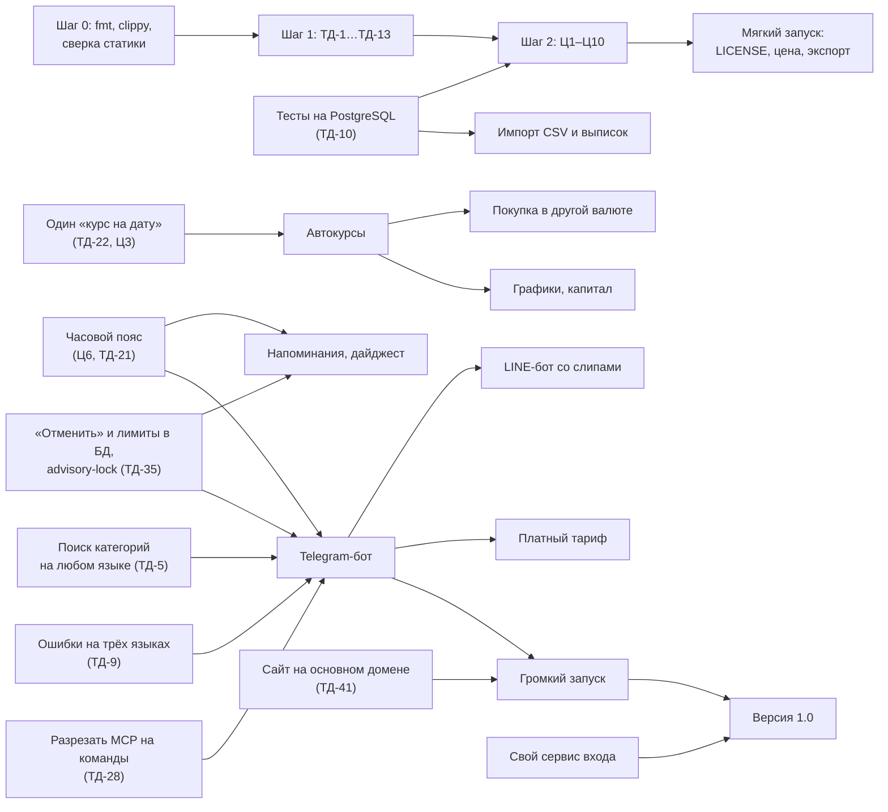

# План развития: что делать дальше и в каком порядке

Статья сводит в один план три документа, написанных по итогам аудита 17.10.2026:

- [competitor-analysis.md](competitor-analysis.md) — **что строить и для кого**: рынок, ниша, позиционирование,
  пробелы P0–P2, каналы роста, цена;
- [roadmap.md](roadmap.md) — **в каком порядке строить продукт**: находки аудита (Ц — неверные цифры,
  Б — безопасность), этапы 0–5 до версии 1.0;
- [tech-debt.md](tech-debt.md) — **что в коде мешает строить**: 54 пункта с серьёзностью и трудоёмкостью
  (в статье — «ТД-4», «ТД-22» и т. д.).

Остальные документы папки — справочные: [tz-v3.md](tz-v3.md) (что сделано по ТЗ и что осталось),
[mcp.md](mcp.md) и [mcp-plan.md](mcp-plan.md) (ассистенты), [id-service-prompt.md](id-service-prompt.md) (свой сервис
входа), [deploy-vds.md](deploy-vds.md) (продакшен). Документы не заменяются этой статьёй: она говорит, **что и когда**
брать из них, а подробности каждого пункта — по ссылке на номер.

## Коротко

1. **Продукт уже впереди рынка в своей нише.** Семья с ролями + несколько валют с честным курсом + двойная запись +
   пишущий MCP + три языка вплоть до данных — такого сочетания нет ни у Monarch, ни у Дзен-мани, ни у open-source.
   Догонять банковскую синхронизацию не нужно.
2. **Рост тормозят базовые вещи, а не большие функции:** продукт публично не запущен (нет лицензии, цены, сайт
   закрыт от индексации), данные нельзя ни выгрузить, ни загрузить, без подписки на Claude остаётся только ручной
   ввод, курсы — вручную, нет напоминаний и графиков.
3. **Сначала — доверие к цифрам и коду.** В отчётах есть тихо неверные числа (Ц1–Ц11), в коде — десяток опасных, но
   дешёвых дефектов (ТД-1…ТД-13). Это 2–3 недели, и это правило проекта: «цифры важнее функций».
4. **Главный рычаг роста — Telegram-бот.** Роадмап ставит его в последний этап одной строкой, анализ конкурентов —
   в обязательный «бесплатный вход» на третий месяц. В этом плане бот переезжает в версию 0.4 и становится
   центром второго-третьего месяца.
5. **Три языка — не налог, а продукт.** Тайский контент о семейном и мультивалютном учёте почти пуст, смешанные
   семьи нигде больше не получают общий бюджет на своих языках. Правило «три языка всегда» стоит продавать.

Порядок одной строкой: **закрыть опасное → цифрам можно верить → мягкий запуск и фундамент → удобно каждый
день → Telegram-бот и импорт → семья и деньги → версия 1.0**.

## Где мы сейчас (17.10.2026, версия 0.1.0)

| Что | Состояние |
| --- | --- |
| Код | ~31 тыс. строк Rust, 13 крейтов, 219 тестов — все зелёные; денег в `f64` нет, `unwrap` в рабочем коде нет |
| Качество кода | `cargo fmt --check` — 1575 расхождений, clippy — 16 предупреждений, ни того ни другого нет в CI |
| Тесты на PostgreSQL | ни одного выполняемого: триггер двойной записи, миграции и ~1900 строк SQL не проверяются |
| Числа в отчётах | 11 известных ошибок (Ц1–Ц11), часть — «тихие»: отчёт показывает неверное число без предупреждения |
| Безопасность | критических уязвимостей нет; есть опасная конфигурация dev-входа (ТД-1) и обход «Требовать 2FA» токенами (ТД-2) |
| Языки | интерфейс на ru/en/th, но все сообщения об ошибках — по-русски (ТД-9); у Rauthy нет тайского |
| Запуск | файла `LICENSE` нет; цены нет; новый сайт на GitHub Pages закрыт от индексации (`extra.preview = true`); обратная связь — только GitHub Issues (`contact_email` пуст) |
| Данные | нет экспорта и импорта; курсы — только вручную; нет поиска по операциям, напоминаний, графиков |
| Ввод | быстрый расход за ~5 секунд в вебе; AI-ввод (фраза, фото чека) — только через Claude с коннектором |

Сильная сторона, которую нельзя растерять: точная двойная запись, обмен валют одной операцией с фактическим курсом и
комиссией, лимиты с прогнозом, семья с ролями и 2FA-политикой, MCP с правами по разделам и без удаления.

## Куда идём

**Позиционирование** (из анализа конкурентов): «Семейный бюджет для жизни в нескольких валютах: скажите трату
ассистенту или боту, а бухгалтерия честно посчитает курс, комиссию и остаток лимита — на вашем языке».

**Аудитория по волнам:**

1. Русскоязычные семьи в Таиланде: рубли меняются через СБП-обменник или USDT, параллельно — тайский счёт и наличные
   баты. Это и есть демо-проект приложения — первые пользователи понимают продукт без объяснений.
2. Экспаты и цифровые кочевники вообще: деньги в 2–3 валютах, курс гуляет на 5–10 % за несколько месяцев.
3. Смешанные семьи: один партнёр читает по-русски, другой по-тайски, няня или бухгалтер — по-английски.

**Ассистент и бот — основной способ ввода, а не дополнение.** Ручной ввод — причина ухода №1, отсутствие отдачи —
№2, удержание финансовых приложений на 30-й день — около 4,5 %. Значит, всё решает первая неделя: человек должен
записывать траты без усилий и сразу видеть, что это ему даёт.

**Чего не делать** (подробнее — в конце статьи): прямую синхронизацию с банками России и Таиланда, нативные
приложения раньше офлайн-PWA, инвестиции, ограничения по числу операций, «вечные» лицензии.

## Где документы расходятся и как это решено

Три документа писались с разных сторон, и по нескольким пунктам они ставят разные сроки. Решения ниже — основа
плана.

| Вопрос | Анализ конкурентов | Роадмап | Решение в этом плане |
| --- | --- | --- | --- |
| Лицензия, цена, индексация сайта | P0, первый месяц | этап 5 (v1.0) | Разделить. **Мягкий запуск** (LICENSE, ценовая политика, контактный email, страницы идей) — сразу после «закрыть опасное», это почти не стоит разработки. **Переезд сайта на основной домен** — как только определён домен, не дожидаясь 1.0: SEO разгоняется месяцами, а переподключать Claude и OIDC дешевле, пока пользователей мало. **Громкий запуск** (Хабр, Show HN, Product Hunt) — после бота |
| Telegram-бот | P1, третий месяц, «обязательный бесплатный вход» | этап 5, одна строка | Версия 0.4, второй-третий месяц, центральная задача. Без бота AI-ввод доступен только меньшинству с платным Claude |
| Экспорт и импорт | P0, первый месяц | этап 3 (v0.4) | **Экспорт CSV — рано** (недели 3–6): дёшево и снимает страх «запереть данные». **Импорт — в 0.4**: пакетная запись в двойную бухгалтерию требует тестов на PostgreSQL и поиска дублей |
| Автоматические курсы | P0, первый месяц | этап 2 (v0.3) | Второй месяц, но **после** объединения трёх реализаций «курса на дату» (ТД-22) и честного «нет курса» (Ц3) — иначе автокурсы лягут на кривой фундамент |
| Ошибки на трёх языках | P0 | этап 2 | Начать на неделе 3 и вести по фиче (это ТД-9, трудоёмкость L), закончить к 0.3 — до бота: ответы бота — это те же сообщения об ошибках |
| Покупка в валюте, отличной от валюты счёта | P1, третий месяц | этап 4 (v0.5) | Версия 0.4 вместе с ботом: «оплатил тайский QR со Сбера» — типовой сценарий ниши и типовая фраза для бота |
| Графики, поиск, теги | P1, третий месяц | этапы 2 и 4 | Поиск и фильтры — 0.3; графики и теги — 0.5 |
| Технический долг | не рассматривается | этапы 0–1 | Первым, маленькими PR с тестом, параллельно с «запуском» на стороне сайта |

## План по шагам

Сроки ориентировочные: за первые 9 дней проекта сделано ~75 коммитов, но каждая заметная функция тянет за собой
три языка, запись в «Что нового», гайд со скриншотами на каждом языке. Шаги 3–4 и 5–6 частично идут параллельно.

### Шаг 0. День 1: сетка безопасности в CI

Сделать, пока нет открытых веток, — иначе разовое форматирование 131 файла столкнётся со всеми PR.

- `rustfmt.toml` и разовый `cargo fmt` отдельным PR (ТД-15), исправить 16 предупреждений clippy.
- В CI: `cargo fmt --check`, `cargo clippy -- -D warnings`, сверка статики
  `npm run build && git diff --exit-code crates/app/static` (ТД-16). Именно её отсутствие пропустило ТД-8.
- `rust-toolchain.toml` и пиннинг actions по digest (ТД-39) — заодно, это S.

В описании PR — `Changelog: none`.

### Шаг 1. Неделя 1: закрыть опасное (v0.1.1)

Десять дефектов высокой серьёзности, каждый — до дня работы, вместе — 1–2 дня. Каждый — отдельный PR с
регрессионным тестом.

| Пункт | Что не так для человека | Что сделать |
| --- | --- | --- |
| ТД-1 | Забыли `APP_ENV=prod` — на проде включается «Вход для разработки» под любым email без пароля. Самая опасная строчка проекта | Не стартовать без явного `APP_ENV`; dev-вход — только без OIDC и только для `demo:*` |
| ТД-2 (= Б1) | Токен, выпущенный до «Требовать 2FA», продолжает работать в REST и MCP | Хранить `mfa` в `fb_api_tokens`, при включении 2FA отзывать токены без MFA |
| ТД-3 | Через старую версию транзакции доход превращается в расход — итоги бюджета разъезжаются | Тип категории проверять всегда |
| ТД-4 | Claude пропускает или дублирует операции при постраничном чтении | Настоящие `limit/offset` в SQL, тест на адаптер |
| ТД-5 | Точное имя категории на другом языке («Food», «รถ») даёт «неоднозначно». **Это фундамент будущего бота** | Один механизм поиска, разделитель `\u{1f}` |
| ТД-6 | `PUT` с `archived` обходит правила архива, без поля — молча снимает архив | Архив только через `archive`/`restore` |
| ТД-7 | Запись с кодом `FOOD/CAFE` нельзя открыть, изменить и архивировать | Коды `[A-Z0-9_]`, `urlencode` в шаблонах |
| ТД-8 | Дерево категорий и лимитов без отступов: Tailwind вырезал классы `indent-*` | `safelist`, `make css` |
| ТД-12 | Renovate может поднять major PostgreSQL, автообновление применит его — прод не стартует | Запрет или approval на major postgres и Rauthy |
| ТД-13 | Внешние копии не удаляются (нарушается обещание «30 дней»), об ошибке бэкапа никто не узнаёт | `rclone sync` с ротацией, уведомление, проверка свежести |

Заметные пользователю исправления (ТД-3, ТД-5, ТД-7, ТД-8) — записью `change = "fixed"` в
`site/content/releases/next/`. Остальное — `Changelog: none`.

**Готово, когда:** все десять пунктов закрыты, CI зелёный с линтерами.

### Шаг 2. Недели 2–3: цифрам можно верить (v0.1.x — этап 0 роадмапа)

Сначала — тесты на PostgreSQL, потом исправления: половина ошибок живёт в SQL и триггерах.

1. **CI-джоб с `postgres:16`** и общий контрактный набор тестов для memory- и PG-адаптеров (ТД-10, M). Роадмап
   ставит это в этап 1, но без него не проверить частичный индекс (Ц10), триггер двойной записи и миграции.
2. **Ошибки в отчётах:**
   - Ц1 + Ц5 — лимит за период как сумма лимитов по каждому месяцу/неделе внутри, разбиение по `valid_from`,
     сумма 0 = «лимита нет» (сейчас годовой отчёт считает месячный лимит как `× 365/31`, а закончить лимит нельзя);
   - Ц2 — запрет смены типа категории при операциях, планах или лимитах;
   - Ц3 + ТД-22 — **одна** функция «курс на дату» вместо трёх; без курса — «нет курса», сумма не входит в итоги
     (сейчас RUB + THB складываются 1:1);
   - Ц4 — правка правила плана закрывает старый план и создаёт новый (сейчас теряются оплаты и появляются ложные
     «просроченные»);
   - Ц7, Ц8 + ТД-40 — проверка `plan_id`/`plan_date`; `minor_units` 0–4 без уменьшения при проводках; базовую
     валюту нельзя архивировать;
   - Ц10 + ТД-19 — частичный уникальный индекс на OPENING и защита «Сверить остаток» от двойного клика;
   - ТД-20 — `checked_*` для сумм, `MAX_AMOUNT`, `CatchPanicLayer` (сейчас переполнение = паника).
3. **Безопасность:** Б2 (`set_role` добавляет в проект любого `user_id`), Б3 (добавление по email без согласия →
   только приглашение), Б4 (`/demo` без `Origin`, лимит по IP, потолок карты лимитера), Б5 (токены только на `/api`),
   Б6 (общий текст ошибок входа), ТД-34 (доступ Claude «оживает» при повторном добавлении участника — FK
   с `CASCADE`), ТД-43 (`/projects/switch` и `/lang` меняют состояние через GET без CSRF).
4. ТД-14 — `restore-check` на bash с `pipefail` и `trap`, проверка обеих баз.

**Готово, когда:** раздел «Этап 0» в [roadmap.md](roadmap.md) весь отмечен `[x]`, у каждой ошибки есть
регрессионный тест, известных неверных чисел нет. Это и есть критерий «можно звать людей».

### Шаг 3. Недели 3–6: мягкий запуск и фундамент (v0.2)

Три дорожки идут параллельно: первая — в основном решения владельца и сайт, вторая и третья — код.

**Дорожка «Доверие и запуск»**

- **LICENSE.** Рекомендация анализа — AGPL-3.0 (как у Sure): код открыт для self-host, закрытый SaaS-клон
  обязан публиковать изменения. Без лицензии «открытый код» юридически не открыт.
- **Ценовая политика** на сайте, в FAQ, на трёх языках: бета бесплатна; партнёр бесплатен всегда; self-host бесплатен;
  «вечных» лицензий не будет; платить будут за удобство (бот с AI, распознавание чеков, импорт, хостинг), а не за
  число операций.
- **Контакт:** `contact_email` в `site/config.toml` — писать можно не только через GitHub.
- **Публичный список идей** в `site/content/ideas/` (три файла на идею): Telegram-бот, импорт и экспорт,
  автоматические курсы, графики, «моё / общее», USDT и валюты вне ISO 4217, нативные приложения, инвестиции,
  карманные деньги детям, удаление через MCP по отдельному праву. Список сам работает как канал обратной связи и
  показывает, что продукт живой.
- **Экспорт CSV** — операции, счета, справочники. Первая выдача данных наружу; заметна пользователю — запись в
  «Что нового» и абзац в гайде.
- **Переезд сайта на основной домен** — по [site/README.md](../site/README.md): `extra.preview = false`, новые
  `base_url` и `app_url`, приложение — на `budget.`, вход — на `auth.`, лендинг и правовые страницы приложения
  (`crates/features/site`) — редиректами на сайт. До этого — тест сверки юридических текстов (ТД-41), иначе две копии
  разойдутся. Важно: адрес приложения входит в коннектор Claude и redirect OIDC, а позже — в `rpId` passkey; чем
  раньше переезд, тем меньше людей будут переподключаться.

**Дорожка «Фундамент» (этап 1 роадмапа)**

- Наблюдаемость: `tracing-subscriber` (JSON, request-id), `/ready` с `SELECT 1`, graceful shutdown по SIGTERM
  (ТД-32, ТД-36). Сейчас при обновлении обрываются запросы на запись, а логи `TraceLayer` уходят в никуда.
- «Отменить» — мягкое удаление в БД (`deleted_at` + срок) вместо памяти процесса; лимит запросов — по IP до
  аутентификации; `pg_try_advisory_lock` для фоновых задач и сида (ТД-35, ТД-53). Без этого не сделать кнопку
  «Отменить» в боте и напоминания.
- Атомарность: удаление и создание проекта в одной транзакции (ТД-17), счёт с начальным остатком —
  `create_with_opening` (ТД-18).
- **Часовой пояс** у пользователя или проекта, `today(&Session)` вместо `chrono::Local` (Ц6, ТД-21). Обязательное
  условие для напоминаний и бота: «сегодня» должно быть сегодня у семьи, а не у сервера.
- Округление после суммирования по `minor_units` (Ц9), без тихой обрезки выборок (Ц11, ТД-25), индексы (ТД-52).
- Продакшен: dev-порт на 127.0.0.1, `cap_drop`/`read_only`/healthcheck (Б7), `${VAR:?}` для секретов Rauthy
  (ТД-37), копии ещё и на другой сервер (Б8).
- **Разрезать `mcp/src/service.rs`** (1494 строки) на `tools/*` и `projects/adapters/web.rs` на вход / профиль /
  участников (ТД-28). Это подготовка к боту: новое поле сейчас требует правок в 4–5 местах, бот стал бы шестым.
  Цель — общий слой «команд ассистента», которым пользуются и MCP, и бот.

**Дорожка «Языки»**

- Начать ТД-9: `AppError::Validation { field, key, args }`, перевод через `t()`, тест на кириллицу в литералах
  ошибок; переводить по фиче, по PR на фичу.
- Добавить тесты `templates_are_translated` в `projects` и `mcp` (их там нет); ненайденный ключ i18n — ошибка
  в тестах, а не молчаливый показ ключа.

**Готово, когда:** у проекта есть лицензия и объявленная цена, данные можно выгрузить, этап 1 роадмапа закрыт,
продакшен обновляется без потерь. Версия 0.2 — статья о релизе `site/content/releases/0-2-0.md` из записей `next/`.

### Шаг 4. Месяц 2: удобно каждый день (v0.3 — этап 2 роадмапа)

Цель — семья ведёт бюджет без трения на любом из трёх языков, первая неделя нового пользователя проходит гладко.

- **Ошибки на трёх языках** — закончить ТД-9. После этого обещание «три языка» выполняется с первой минуты.
- **Автоматические справочные курсы** на дату: ЦБ РФ, Банк Таиланда или открытый API (ECB); ежедневная фоновая
  задача под advisory-lock; ручной курс приоритетнее; фактический курс операции обмена остаётся своим. Метрика —
  «ни одного дня без курса для активных валют».
- **Операции:** поиск по тексту и сумме, фильтры по категории и периоду, пагинация (сейчас поиск есть только
  в MCP `list_transactions`).
- **Коды справочников из названия** — пользователь больше не придумывает `CARD_KBANK`, а ТД-7 закрывается в корне.
- **Мастер первого запуска:** валюты семьи с курсами, счета, первые регулярные платежи. Для ниши — сразу
  предложить пару RUB/THB и счета «Наличные ฿», «Карта ₽».
- Буддийский год для th; скриншоты лендинга на en и th.
- Гайды: обновить затронутые, переснять скриншоты (`scripts/guide-screenshots.mjs`).

### Шаг 5. Месяцы 2–3: приложение работает за вас (v0.4) — Telegram-бот, напоминания, импорт

Самый важный шаг для роста. Анализ конкурентов: русскоязычная аудитория живёт в Telegram, Claude с коннекторами есть
у меньшинства, а десятки ботов «трата одной фразой в таблицу» доказывают спрос. Бот в семейном чате — ещё и
вирусная петля: партнёра приглашают туда, где он уже есть.

**Что должно быть готово до бота:** ТД-5 (поиск категорий на любом языке), ТД-9 (ответы на языке человека),
часовой пояс (Ц6), «Отменить» в БД, общий слой команд после разрезания MCP (ТД-28), лимит запросов по IP.

**Как устроить бота** (предложение, детали — в отдельном ТЗ):

- Новый крейт-фича `telegram` (webhook), который вызывает **те же команды и те же права**, что MCP: бот — ещё
  один ассистент с грантом, без права удаления, каждое действие — в журнал с пометкой «через бота».
- Привязка: в профиле «Подключить Telegram» → ссылка `t.me/<бот>?start=<одноразовый код>` (как приглашение по
  HMAC-ссылке). После своего сервиса входа с Telegram-логином привязка станет одним тапом.
- Семейный чат: владелец проекта привязывает групповой чат к проекту; трата записывается от имени того участника,
  кто её написал; наблюдатель писать не может; незнакомые аккаунты игнорируются.
- **Фраза без AI** (бесплатно): «кофе 120 карта SCB», «такси 80+45 вчера» → сумма с арифметикой, как в быстром
  расходе; категория по названию на любом из трёх языков; счёт по названию или последний; дата. Ответ:
  «Расход 120 ฿ · Кафе · SCB — осталось на неделю 1 380 ฿» и кнопки «Отменить», «Другая категория».
  Неоднозначно — три кнопки с вариантами.
- **Фото чека или слипа и свободные фразы — через LLM** (Claude API): это стоит денег и становится первой платной
  возможностью — ровно «монетизировать удобство» из анализа конкурентов.
- **Напоминания и дайджест** — в бот и на email: плановый платёж завтра/сегодня, лимит ≥ 80 % и > 100 %,
  еженедельный семейный дайджест «потрачено X из Y, осталось Z, на неделе платежи». Это ответ на причину ухода №2
  («не увидел ценности»): приложение само приходит с пользой.

**Импорт и переезд:**

- Импорт CSV с сопоставлением колонок, предпросмотром, поиском дублей, всё в одной транзакции; готовые профили —
  Дзен-мани, CoinKeeper, Splitwise, выписки KBank, SCB, Т-Банк, Сбер.
- MCP: импорт выписки и промпт «итоги месяца» (этап 5 [mcp-plan.md](mcp-plan.md)).
- Страницы «Переезд с Дзен-мани / CoinKeeper / Splitwise» на трёх языках: жалобы на их синхронизацию, подписки и
  лимиты — повторяющиеся окна для привлечения (так Monarch вырос на закрытии Mint).

**Покупка в другой валюте:** расход с двумя суммами — в валюте покупки и в валюте списания (тайский QR со Сбера,
карта в батах платит в долларах). Естественное расширение двойной записи.

**Громкий запуск** — после выхода бота: статья на Хабре или в Т—Ж о двойной записи и MCP на Rust, Show HN
(«MCP-first family budget, self-hostable»), Product Hunt, каталоги MCP, показ бота в живых русскоязычных
Telegram-чатах Пхукета и Паттайи.

**Готово, когда:** новая семья подключает бота за минуту и записывает трату фразой в семейном чате; напоминания
приходят по местному времени; данные из Дзен-мани переезжают одним файлом.

### Шаг 6. Месяцы 4–6: семья и деньги (v0.5 — этап 4 роадмапа)

- **Графики:** расходы по месяцам, структура по категориям, тренды, капитал в базовой валюте с переоценкой
  (опирается на автокурсы).
- **«Моё / общее»:** метка владельца у операций и счетов, видимость счёта по участникам; 62 % пар держат хотя бы
  часть денег раздельно, Monarch уже добавил такую маркировку.
- **Взаиморасчёты «кто кому должен»** поверх двойной записи.
- **Цели накоплений** (счёт с суммой и сроком), **долги и кредитные карты** как пассивы.
- Теги («отпуск 2026»), месяц с дня зарплаты, перенос остатка лимита — если пользователи попросят.
- **Вложения к операциям** (фото чека для гарантии и возврата): отдельный маршрут загрузки — общее ограничение тела
  запроса 64 КБ; файлы должны попасть в резервные копии.
- **Офлайн-PWA:** service worker с очередью быстрых расходов и share target — раньше любых нативных приложений.
- **LINE-бот с разбором слипов PromptPay** для тайской аудитории — на ядре Telegram-бота.
- **Платный тариф за домохозяйство** с бесплатным партнёром. Ориентиры: Россия 199–499 ₽/мес или 1000–1500 ₽/год,
  Таиланд 79–149 ฿/мес, Запад $30–60/год.

### Шаг 7. Около полугода: версия 1.0 — запуск для людей (этап 5 роадмапа)

- **Свой сервис входа** по [id-service-prompt.md](id-service-prompt.md): passkey, Telegram, тайский, нормальный
  выход. Это отдельный репозиторий и большая работа — начинать параллельно после шага 3, чтобы к 1.0 он был готов.
  Он же даёт OAuth для ChatGPT и Gemini (идея `more-assistants`) — подключать, если подтвердится спрос.
- Форма отзывов и комментарии на сайте (идея `feedback-on-site`).
- Lighthouse ≥ 90, Mozilla Observatory, формальный проход OWASP ASVS L2, ZAP в prod-режиме под демо-гостем (ТД-38).
- Сводный отчёт по нескольким проектам.
- Статья о релизе 1.0 и второй круг запуска (Product Hunt, обзоры, подборки «лучшие приложения для бюджета»).

## Карта зависимостей

Что нельзя начинать раньше чего. Стрелка «A → B»: B опирается на A.

## Как понять, что всё идёт правильно

Метрики собраны из обоих документов. Важный пробел: **сейчас их нечем измерить.** Трекеров нет и не будет
(это часть обещания приватности), а у операций не хранится источник. Поэтому в шаг 3 стоит добавить:

- поле `source` у операций: `web`, `quick`, `api`, `mcp`, `bot`, `import`;
- агрегированный отчёт без персональных данных для администратора (команда или `make stats`): активные проекты,
  проекты со вторым участником, когорты удержания, доля операций по источникам.

| Метрика | Цель | Когда смотреть |
| --- | --- | --- |
| Известные ошибки в цифрах | 0 | постоянно; новое не выходит, пока есть известные |
| Активные семьи (операция за 7 дней) | 50–100 | после мягкого запуска |
| Доля проектов со вторым участником | растёт | после мягкого запуска; это вирусная петля |
| Удержание на 30-й день | > 15 % (в категории ~4,5 %) | после бота |
| Доля операций из бота, ассистента и импорта | растёт, > 50 % | после бота |
| Время записи расхода | < 5 секунд | при каждом изменении ввода |
| Дни без курса для активных валют | 0 | после автокурсов |
| Платящие домохозяйства | первые десятки | после платного тарифа |
| Приток из тайских и англоязычных источников | растёт | после переезда сайта и LINE-бота |

## Решения, которые принимает владелец

Код за них не решит, а от них зависят сроки. Рекомендации — из анализа конкурентов и документов.

| Решение | Рекомендация | Нужно к |
| --- | --- | --- |
| Лицензия | AGPL-3.0 | шагу 3 |
| Цена | бета бесплатна, партнёр бесплатен всегда, позже — тариф за домохозяйство; без «вечных» лицензий и лимитов на число операций | шагу 3 (объявить), шагу 6 (ввести) |
| Домены | сайт — основной домен, приложение — `budget.`, вход — `auth.` (как в site/README.md); переезжать раньше, а не к 1.0 | шагу 3 |
| Контактный email | завести и указать в `site/config.toml` | шагу 3 |
| LLM для бота | провайдер, бюджет на API, что бесплатно (фраза), что платно (фото, свободный текст) | шагу 5 |
| Приём платежей | провайдер для России и Таиланда — открытый вопрос и главный риск монетизации | шагу 6 |
| Свой сервис входа | открытые решения из раздела 8 [id-service-prompt.md](id-service-prompt.md): `rpId`, вход только по passkey, email, лицензия | началу работы над ним |

## Как работать каждый день

**Один пункт — один PR.** Маленький, с тестом, со ссылкой на номер пункта («ТД-4», «Ц3»). Так проще ревьюить,
откатывать и видеть прогресс.

**Чек-лист PR** (из [CLAUDE.md](../CLAUDE.md)):

- [ ] `make test` (`cargo test --workspace`); шаблоны менялись — `make css`;
- [ ] всё, что видит пользователь, — сразу на ru, en и th; тест `templates_are_translated` в фиче;
- [ ] заметно пользователю — три файла в `site/content/releases/next/` (`new`, `improved` или `fixed`);
      не заметно — `Changelog: none` в описании PR;
- [ ] новая возможность, которой нужно научиться, — гайд в `site/content/guides/<slug>/` со скриншотами на каждом
      языке; изменился интерфейс гайда — переснять;
- [ ] задумали, но откладываем, — идея в `site/content/ideas/`; идея вышла — `status = "done"` и ссылка на релиз;
- [ ] сайт менялся — `make site-check` и `make site`;
- [ ] меняется версия в `Cargo.toml` — статья о релизе из накопленных записей, `next/` очистить.

**Держать документы живыми.** После слияния — отметить `[x]` в [roadmap.md](roadmap.md), в
[tech-debt.md](tech-debt.md) зачеркнуть номер пункта и дописать ссылку на PR. Цифры (число тестов, строк) в
документах руками не обновлять — они устаревают (ТД-44).

**Как ставить задачи Claude.** Ссылаться на документ и номер — в них уже есть «где» и «что сделать»:

- «Исправь пункт 4 из docs/tech-debt.md с регрессионным тестом на адаптер»;
- «Сделай Ц1 и Ц5 из docs/roadmap.md: лимит за период как сумма лимитов по месяцам, с тестами»;
- «Подготовь ТЗ Telegram-бота по шагу 5 из docs/development-plan.md, код — после моего одобрения»;
- «Добавь идею „USDT и валюты вне ISO“ в site/content/ideas на трёх языках».

## Чего не делать

- **Прямую синхронизацию с банками России и Таиланда.** В России банки блокируют сторонние подключения, тайские
  не подключаются к западным агрегаторам. Каждый месяц, вложенный в синхронизацию, покупает главную жалобу всей
  категории (21 % негативных отзывов). Полуавтоматика — фраза, фото, слип, файл — даёт ту же скорость без хрупкости.
- **Нативные приложения раньше офлайн-PWA.** PWA с очередью ввода и share target закрывает почти всё.
- **Инвестиции, net worth, zero-based-режим** — узким сегментам; записать идеями и ждать сигналов.
- **Лимит на число операций в бесплатном тарифе** — за это Splitwise получил волну отказов.
- **«Вечные» лицензии** — вокруг обесценившихся «вечных» покупок у Дзен-мани и CoinKeeper больше всего гнева.
- **Новые функции поверх известных ошибок в цифрах.** Для финансового продукта один инцидент с данными дороже
  месяца разработки.
- **Сравнительные страницы с непроверенными цифрами.** Многие факты о конкурентах взяты из поисковых сниппетов;
  перед публикацией «сравнение с X» каждую цифру проверить на сайте вендора, а отличия от ezBookkeeping (двойная
  запись, семейные роли) — подтвердить.

## Риски

| Риск | Что с ним делать |
| --- | --- |
| Ниша узкая: русскоязычных семей в Таиланде — десятки тысяч | Сразу закладывать экспатов и смешанные семьи; трёхъязычие и мультивалюта переносятся без переделки |
| Ассистенты становятся товаром: ChatGPT уже читает банки, у Claude появились финансовые коннекторы | Защищает то, чего нет у чата над банком: семья, двойная запись, мультивалюта, ручные каналы |
| Зависимость от Claude: AI-ввод — только у подписчиков с коннекторами | Telegram-бот как бесплатный вход в ту же механику |
| ezBookkeeping — прямой конкурент с ru/th, MCP и импортом | Проверить, есть ли у него двойная запись и роли, прежде чем строить на этом маркетинг |
| Монетизация: Maybe потратил ~$1 млн и закрылся; платежи из России затруднены | Платить за удобство, а не за хостинг; рано решить вопрос провайдера платежей |
| Темп выше качества | Шаги 0–2 до любых новых функций; CI с линтерами и PostgreSQL |
| Инструкции, спрятанные в данных (описания операций читает модель) | Базовые принципы MCP и бота: нет права удаления, права меняются только в браузере, данные — не команды |

## Приложение: соответствие пунктов документов

Одна проблема часто описана в обоих документах аудита под разными номерами. Таблица помогает не сделать одно и то же
дважды.

| Роадмап | Технический долг | Шаг плана |
| --- | --- | --- |
| Б1 — токены и 2FA | ТД-2 | 1 |
| Ц1, Ц5 — лимиты по периодам | — | 2 |
| Ц2 — смена типа категории | близко к ТД-3 | 1 (ТД-3), 2 (Ц2) |
| Ц3 — сумма без курса 1:1 | ТД-22 | 2 |
| Ц4 — правка плана задним числом | — | 2 |
| Ц6 — часовой пояс | ТД-21 | 3 |
| Ц7 — проверка `plan_id`/`plan_date` | — | 2 |
| Ц8 — `minor_units`, архив валюты | ТД-40 | 2 |
| Ц9 — округление | ТД-22 | 3 |
| Ц10 — гонки OPENING | ТД-19 | 2 |
| Ц11 — тихие лимиты выборки | ТД-24, ТД-25 | 3 |
| Б2, Б3, Б5, Б6 — участники, токены, ошибки входа | — | 2 |
| Б4 — `/demo`, лимит по IP | ТД-35 | 2 и 3 |
| Б7 — dev-порт, healthcheck | ТД-1, ТД-36, ТД-37 | 1 и 3 |
| Б8 — копии на том же VDS | ТД-13 | 1 и 3 |
| Этап 1: Postgres в CI | ТД-10 | 2 |
| Этап 1: clippy, fmt, CSS в CI | ТД-15, ТД-16 | 0 |
| Этап 1: логи, `/ready`, shutdown | ТД-32, ТД-36 | 3 |
| Этап 1: «Отменить» и лимит в БД, advisory-lock | ТД-35, ТД-53 | 3 |
| Этап 1: атомарность проекта | ТД-17 | 3 |
| Этап 1: разрезать модули | ТД-28 | 3 |
| Этап 2: ошибки на трёх языках | ТД-9 | 3–4 |
| Этап 5: свой сервис входа | ТД-54 (тайский и выход в Rauthy) | 7 |
| Этап 5: сайт на основной домен | ТД-41 | 3 |
| — | ТД-3…ТД-8, ТД-12, ТД-14, ТД-20, ТД-34, ТД-43 | 1–2 |
| — | ТД-23, ТД-26, ТД-27, ТД-29…ТД-31, ТД-33, ТД-42, ТД-44…ТД-51 | по ходу, когда трогаем соответствующий код |
