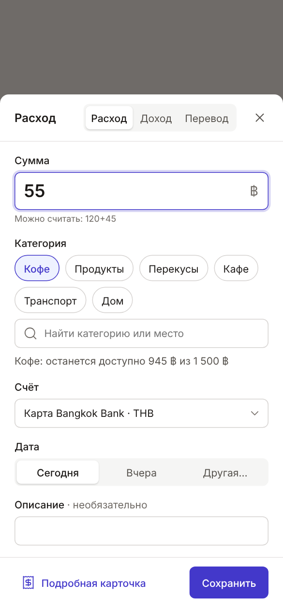
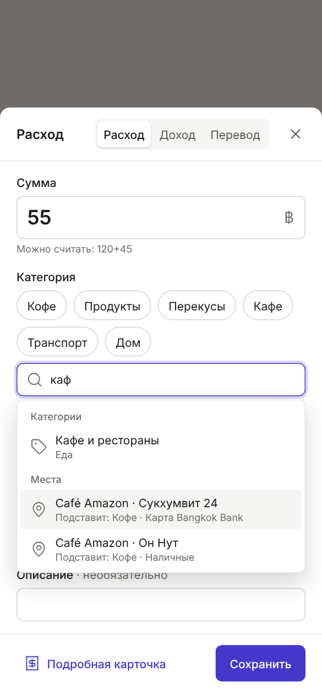
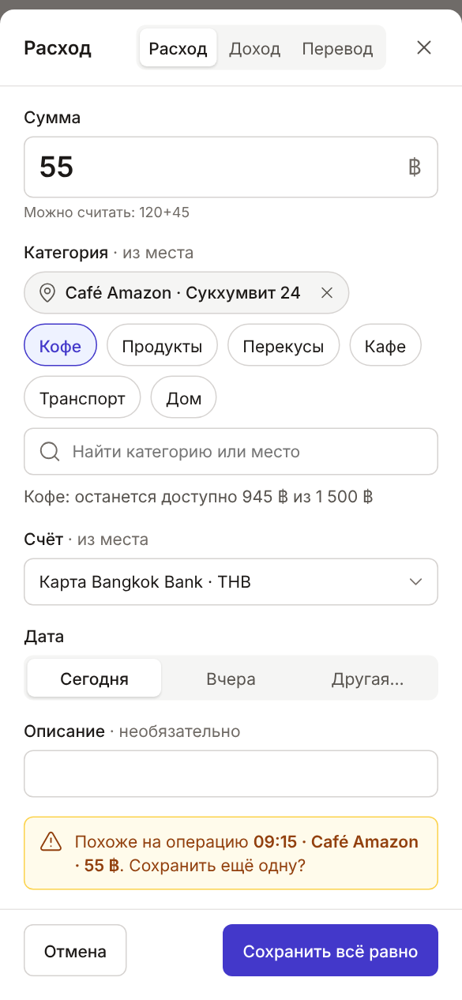
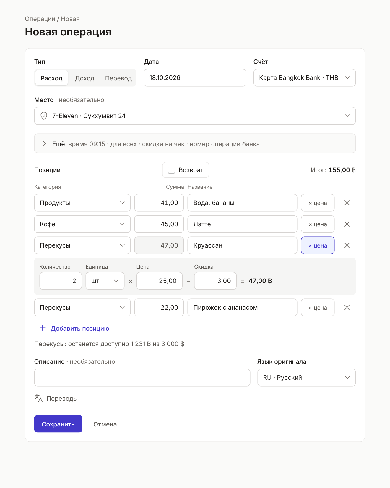
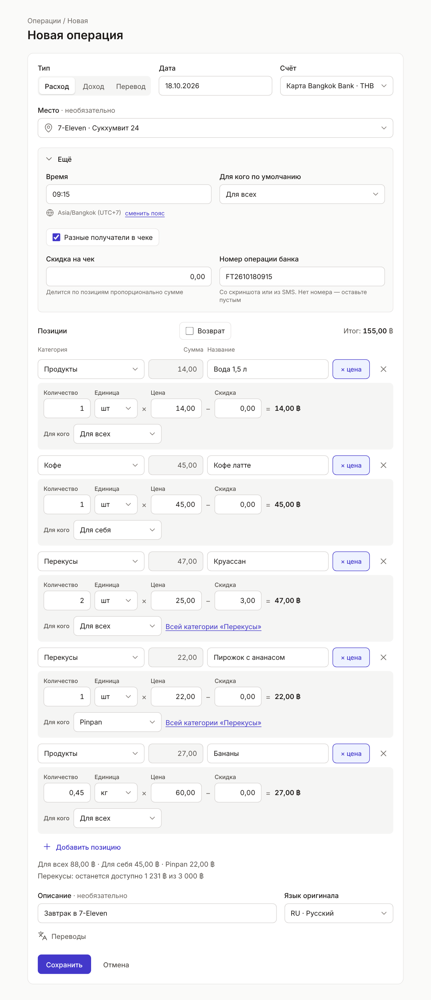

# Группа 1: карточка операции — ТЗ на реализацию

19.10.2026. Основа — «Семейная бухгалтерия — спек новых фич» (18.10.2026, группа 1 утверждена 19.10.2026).
Здесь собрано всё из группы 1, что меняет карточку расхода, дохода и перевода, с согласованными формами и
решениями по вопросам, которые спек оставил открытыми. Где документ расходится со спеком, действует он; такие
места помечены **Решение**.

Макеты: холст https://claude.ai/artifact/ERnH42mPNJ6er92rUmFJNs (виден владельцу), снимки — `docs/group-1/`.

## 1. Принцип: два уровня ввода

Новые поля — дополнительные пути. Ручной ввод в 90% случаев не должен стать сложнее.

- **Быстрый ввод** — как сейчас: сумма → категория → Enter. Новых полей на экране нет.
- **Подробная карточка** — все поля, но незаполненные свёрнуты, пока не нужны.
- **Ассистент через MCP** передаёт всё сразу и не зависит от раскладки форм.
- **Сервер:** все новые поля необязательны, у каждого есть значение по умолчанию. Запрос, валидный сейчас
  (счёт, категория, сумма), остаётся валидным в форме, форме без JS, REST и MCP.

## 2. Порядок работ

### 2.1. Предварительные работы

По утверждённому порядку перед группой 1 идут долги, эталон `rust-hex-api` v3 и предоплата плановых платежей.
Этап 0 сделан (`docs/stage-0.md`). Что из оставшегося нужно какому шагу (номера — `docs/tech-debt.md`):

| Долг | Состояние на 19.10 | Нужен до шага |
| --- | --- | --- |
| #10 тесты на PostgreSQL в CI | **частично**: джоб с `postgres:16`, `kernel::testing`, тесты use cases transactions на PG, миграция позиций, сборка приложения с демо; остальные адаптеры — позже | 1 — у каждого шага миграции |
| #9 коды ошибок с переводами (эталон v3) | **частично**: `error::Problem` (код, поле, текст на языке запроса), ошибки kernel и transactions на трёх языках; остальные фичи и шаблоны эталона — позже | 1 — новые ошибки сразу на трёх языках; 4 — коды ответа пакета |
| #20 переполнение `Decimal` | **сделано**: разбор сумм и домен операций без паники, предел `NUMERIC(18,4)`, `CatchPanicLayer` | 2 — `quantity × price` |
| #3 тип категории при правке | **сделано** | 2 — правка позиций |
| #25, #26 обрезка ленты, итоги в хендлере | **лента операций — сделано**: итоги и выписка в сервисе по всем операциям, обрезка видна; MCP и справочники — нет | 2 — лента |
| #22 курс на момент — одна функция | частично: `kernel::rates::rate_on` по дате в budget и planning | 3 |
| #4 пагинация MCP | нет | 4 |
| #7 нормализация кодов с транслитерацией (эталон v3) | нет, `kernel/src/code.rs:5` пропускает кириллицу | 5, 6 |
| #5 поиск в MCP | нет | 5 — поиск мест тем же механизмом |
| Предоплата плановых платежей | нет | отдельный PR до шага 1 по спеку |

### 2.2. Шаги группы 1

Спек делит группу на три PR. PR 1 спека слишком большой для одного ревью, поэтому делим его на четыре шага.
Релиз один — после шага 6; записи «Что нового» копятся в `site/content/releases/next/`.

| Шаг | Что входит | PR спека |
| --- | --- | --- |
| 1 | Время и часовые пояса (Ц6 / #21): `occurred_at`, `occurred_tz`, пояс пользователя, лента по времени | 1 |
| 2 | Позиции чека: таблица, правила суммы, «× цена», скидка на чек, правка по `id`, лента по категориям | 1 |
| 3 | Курсы со временем и источником, курсы из переводов, округление по `minor_units` | 1 |
| 4 | Дубли, `client_id`, `external_ref`, пакетное создание, лимит тела 2 МБ | 1 |
| 5 | Справочник мест: поле в карточке, поиск мест в быстром вводе | 2 |
| 6 | Справочник людей и «Для кого» | 3 |

Каждый шаг добавляет в формы только свои поля: блок «Ещё» появляется в шаге 1 (время), растёт в шагах 2, 4 и 6.

**Решение 19.10.2026:** первым делаем шаг 2 (позиции чека), перед ним — #10 и #9; шаг 1 — следом. Блок «Ещё»
появляется в шаге 2 (скидка на чек). Все шаги — коммитами в одной ветке, один PR и один релиз; сервер и деплой
в этой работе не меняются.

**Ход работ** (ветка `claude/trusting-johnson-3fvwqz`; обновлять после каждого шага):

| Шаг | Состояние |
| --- | --- |
| #10, #9 (подстраховка) | сделано частично — см. 2.1: PostgreSQL в CI, `kernel::testing::TestDb`, `on_each_repo!` в тестах transactions; `error::Problem` + `i18n::tr` в kernel и transactions |
| 2. Позиции чека | **сделано** (+ #3, #20, #25/#26 для ленты); «Что нового» и гайд «Операции» обновлены |
| 5. Места | следующий: сначала #7 (коды из названий с транслитерацией) и #5 (поиск в MCP) |
| 6. Люди | после мест |
| 1. Время и пояса | не начат |
| 3. Курсы | не начат |
| 4. Дубли | не начат |

Как продолжать: тот же порядок проверок, что в шаге 2 — тесты use cases на памяти и PostgreSQL
(`TEST_DATABASE_URL`), тест миграции на старых данных, ошибки через `Problem` на трёх языках, тест
`no_russian_literals_in_code`, просмотр форм в браузере (с JS, без JS, телефон), гайд и скриншоты
(`scripts/guide-screenshots.mjs`), запись в `site/content/releases/next/`, независимое ревью ветки.

## 3. Согласованные формы

### 3.1. Быстрый ввод

| 1. Как сейчас | 2. Поиск находит и места | 3. Место выбрано, возможный дубль |
| --- | --- | --- |
|  |  |  |

- **Поля как сейчас:** сумма, 6 частых категорий, поиск, счёт, «Сегодня / Вчера / Другая…», описание. Порядок,
  фокус и клавиши (Enter, Ctrl/Cmd+Enter, Esc) не меняются.
- **Подставляется само, на экране не показывается:**
  - время: «Сегодня» — сейчас; «Вчера» и другая дата — без времени;
  - пояс — текущий пояс пользователя;
  - получатель — «Для всех»;
  - одна позиция без названия и цены.
- **Место (шаг 5)** — не отдельное поле. Поиск ищет категории и места (название и варианты написания, без
  регистра и диакритики): сначала группа «Категории», затем «Места». Под местом — что оно подставит: «Подставит:
  Кофе · Карта Bangkok Bank».
- **Выбранное место** — метка с крестиком над частыми категориями.
  - Категория и счёт места подставляются с пометкой «· из места». Если пользователь их меняет, пометка исчезает.
  - Пока в справочнике нет мест, диалог выглядит как сейчас.
  - «Сохранить и ещё» оставляет место, как счёт и дату.
- **Возможный дубль (шаг 4)** — строка над кнопками, а не окно: «Похоже на операцию 09:15 · Café Amazon · 55 ฿.
  Сохранить ещё одну?». Кнопки — «Отмена» и «Сохранить всё равно»; Enter сохраняет.
- **Кнопка «Разбить на позиции»** становится «Подробная карточка» и, как сейчас, переносит введённое. У перевода
  остаётся «С комиссией».
- **Перевод** — без изменений; время — по тем же правилам, что у расхода.

### 3.2. Подробная карточка

| 4. По умолчанию | 5. Всё раскрыто |
| --- | --- |
|  |  |

Открывается из быстрого ввода («Подробная карточка»), без JS — по кнопкам «Расход / Доход / Перевод», при оплате
плана и при правке из ленты.

- **На виду:** тип, дата, счёт, место (шаг 5), позиции, «Возврат», итог, описание с переводами.
- **«Ещё»** — одна свёрнутая строка; в свёрнутом виде показывает, что внутри: «время 09:15 · для всех · скидка на
  чек · номер операции банка». Состав:

  | Поле | Шаг | Примечание |
  | --- | --- | --- |
  | Время | 1 | Под полем строка «Asia/Bangkok (UTC+7) · сменить пояс» |
  | Скидка на чек | 2 | Подсказка «Делится по позициям пропорционально сумме» |
  | Номер операции банка | 4 | Подсказка «Со скриншота или из SMS. Нет номера — оставьте пустым» |
  | Для кого по умолчанию, «Разные получатели в чеке» | 6 | |

  При правке «Ещё» раскрыто, если есть номер операции банка, пояс операции отличается от текущего пояса
  пользователя или получатели не «Для всех».
- **Позиция**, колонки как сейчас: категория, сумма, название (бывшая «заметка»), «× цена», удалить.
  - «× цена» раскрывает строку: количество, единица (шт, кг, л, г), цена, скидка, «= сумма».
  - Строка раскрыта сама, если у позиции есть цена, количество не 1, единица не «шт» или скидка больше 0.
  - Когда цена задана, сумма считается сама и поле суммы только для чтения. Чтобы ввести сумму вручную, цену
    стирают.
- **Получатели (шаг 6).**
  - При включённом «Разные получатели в чеке» у каждой позиции строка «Для кого».
  - Если в чеке больше одной позиции этой категории — ссылка «Всей категории «Перекусы»».
  - Под позициями сводка «Для всех 88,00 ฿ · Для себя 45,00 ฿ · Pinpan 22,00 ฿».
  - Выключение при разных получателях — «Сбросить всё на <значение>?» — «Сбросить» / «Оставить разными».
- **Пересчёт:** итог и предупреждение лимита пересчитываются при каждом изменении, как сейчас.
- **Перевод:** в «Ещё» — время и номер операции банка. Позиций, места, получателя и скидки нет, комиссия — как
  сейчас.
- **Без JS:**
  - «Ещё» и «× цена» — элементы `
`, как комиссия и переводы описания сейчас;
  - строки «Для кого» показываются через CSS `:has()` от переключателя;
  - суммы считает сервер при сохранении;
  - поля позиций — `items[0][name]` и т. п. через `serde_qs` (новая зависимость, запись в `deny.toml`), три пустые
    позиции в запасе;
    - **Решение при реализации:** поля позиций — параллельные списки (`item_category`, `item_amount`, `item_price`…),
      как было у формы: каждая строка отправляет все поля, и `serde_qs` не нужен — без новой зависимости;
    - **Решение при реализации:** «× цена» — флажок со стилем кнопки, панель видна через `:has()` (у `
`
      нельзя поставить кнопку в строку, а панель — под строкой); работает и без JS;
  - возможный дубль — форма возвращается с предупреждением и кнопкой «Сохранить всё равно»
    (`allow_duplicate=1`).

### 3.3. Лента

- **Группы и порядок:** группы по `occurred_on`, внутри дня `COALESCE(occurred_at, created_at) DESC`. Сейчас
  `occurred_on DESC, created_at DESC` (`transactions/adapters/postgres.rs:246`): после миграции порядок не меняется.
- **Время:** показывается в поясе операции. Если пояс отличается от текущего — «09:15 (UTC+7)». Без времени —
  время не показывается.
- **Простая операция** (одна позиция без названия и цены) выглядит как сейчас.
- **Несколько позиций:** для отображения они группируются по категориям — категория с суммой, под ней товары в
  порядке чека: «Круассан · 2 шт × 25 − 3 → 47». Позиция без цены — «Латте · 45».
- **Метки получателей (шаг 6):**
  - **Решение:** метка «Для всех» не показывается (это обычный случай);
  - один конкретный получатель на все позиции — одна метка у операции («Для себя», «Pinpan»);
  - разные — метки у позиций и сводка под операцией.

## 4. Модель данных

Миграции только добавляют колонки и таблицы и заполняют их; старое удаляется отдельным следующим релизом.
Проводки не меняются, кроме простановки `item_id`.

### 4.1. Шапка `fb_transactions`

| Колонка | Тип | Шаг | Смысл |
| --- | --- | --- | --- |
| `occurred_on` | `DATE`, есть | 1 | **Решение:** это `local_date` спека — дата по поясу операции. Новую колонку не заводим |
| `occurred_at` | `TIMESTAMPTZ NULL` | 1 | Момент операции (UTC); пусто — время неизвестно |
| `occurred_tz` | `TEXT NOT NULL` | 1 | Имя IANA: `Asia/Bangkok`, `Asia/Ho_Chi_Minh` |
| `created_at` | `TIMESTAMPTZ`, есть | — | Когда запись внесена; не меняется |
| `account_code` | `TEXT NULL` | 2 | Расход и доход — счёт; перевод — счёт списания; начальный остаток — счёт. Удалена миграцией `double_entry`, возвращается как служебная |
| `total` | `NUMERIC(18,4) NULL` | 2 | Сумма позиций; у перевода — списано всего |
| `refund` | `BOOLEAN NOT NULL DEFAULT false` | 2 | **Решение:** хранится, чтобы возврат не считался дублем покупки. Сейчас выводится из знака проводки |
| `external_ref` | `TEXT NULL` | 4 | Номер операции банка, id SMS, строки выписки |
| `place_code` | `TEXT NULL` | 5 | Место; у перевода всегда пусто |

Индексы: `(project_id, account_code, total, occurred_on)` (шаг 4) и уникальный
`(project_id, account_code, external_ref) WHERE external_ref IS NOT NULL` (шаг 4).

«Для кого» и `discount_total` в шапке **не хранятся** (раздел 5.6).

### 4.2. Позиции `fb_transaction_items` (шаг 2)

| Колонка | Тип | Умолчание | Смысл |
| --- | --- | --- | --- |
| `id` | `UUID PRIMARY KEY` | | Не меняется при правке |
| `transaction_id` | `UUID NOT NULL`, FK → шапка `ON DELETE CASCADE` | | |
| `position` | `INTEGER NOT NULL`, уникален в операции | | Порядок в чеке |
| `item_name` | `TEXT NULL` | | На языке ввода, без переводов |
| `quantity` | `NUMERIC(18,6) NOT NULL`, `> 0` | 1 | |
| `unit` | `TEXT NOT NULL`, `pcs`/`kg`/`l`/`g` | `pcs` | Подписи через i18n |
| `price_per_unit` | `NUMERIC(18,6) NULL`, `≥ 0` | | Цена с ценника |
| `discount` | `NUMERIC(18,4) NOT NULL`, `≥ 0` | 0 | |
| `amount` | `NUMERIC(18,4) NOT NULL`, `> 0` | | Сумма позиции |
| `category_code` | `TEXT NOT NULL` | | |
| `for_person_code` | `TEXT NULL` | | Шаг 6; пусто — «Для всех» |
| `note` | `TEXT NULL` | | |

**Решение:** количество и цена — до 6 знаков после запятой; «полная точность» спека этого хватает (0,001 кг, цена
за грамм).

У проводки на категорию — `item_id UUID NULL` (FK на позицию). Инвариант: у расхода и дохода каждая проводка
`CATEGORY` ссылается на свою позицию, одна проводка на позицию, её сумма — `±amount`. Комиссия перевода и
служебные проводки — без `item_id`.

### 4.3. Прочие таблицы

| Таблица | Изменение | Шаг |
| --- | --- | --- |
| `fb_users` | `timezone TEXT NOT NULL DEFAULT 'UTC'`, `timezone_auto BOOLEAN NOT NULL DEFAULT true` | 1 |
| `fb_rates` | `effective_at TIMESTAMPTZ`, `source TEXT` (`transfer`/`reference`), `source_name TEXT NULL`, `transaction_id UUID NULL`; уникальность `(project_id, currency_code, effective_at, source)` и `(transaction_id)`. `rate_date` остаётся до следующего релиза | 3 |
| `fb_client_ids` | новая: `project_id`, `client_id`, `body_hash`, `transaction_id NULL` (`ON DELETE SET NULL`), `created_at`; ключ `(project_id, client_id)` | 4 |
| `fb_projects` | `duplicate_window_minutes INTEGER NOT NULL DEFAULT 10`, от 0 до 1440 | 4 |
| `fb_places` | новая, раздел 5.8 | 5 |
| `fb_people` | новая, раздел 5.9 | 6 |

## 5. Правила

### 5.1. Позиции и суммы (шаг 2)

- Операция — от 1 до 100 позиций (`MAX_LINES`); в пакете — не больше 1 000 позиций на вызов.
- Все позиции одного типа: в расходе — расходные категории, в доходе — доходные. Зарплата с удержанным налогом —
  две операции.
- `amount = round(quantity × price_per_unit, minor_units, half-up) − discount`, умножение `checked_mul`;
  переполнение → `validation`.
- Переданы цена и `amount`:
  - расхождение больше единицы младшего разряда → `amount_mismatch`;
  - в пределах допуска хранится присланный `amount`.
- Передан только `amount` → цена пустая.
- `quantity > 0`, `price_per_unit ≥ 0`, `amount > 0`. Скидка, съедающая позицию целиком, → `validation`.
- Скидка на чек `discount_total` (поле ввода, не хранится): делится по `discount` позиций пропорционально сумме,
  остаток округления — самой крупной позиции.
  - **Решение:** `discount_total ≥ total` → `validation`; при правке поле пустое, введённое значение
    добавляется к уже записанным скидкам.
- `total = Σ amount`.

### 5.2. Значения по умолчанию

| Что | Порядок выбора |
| --- | --- |
| Категория позиции | указанная → категория места (шаг 5) → `not_found` |
| Счёт | указанный → счёт места (шаг 5) → последний использованный, как сейчас |
| Получатель позиции (шаг 6) | указанный → из шапки; `all` — «Для всех» явно, отсутствие поля — взять из шапки |
| Время | сегодня — сейчас; другая дата — пусто; в MCP — правила 5.3 |
| Пояс | текущий пояс пользователя |

### 5.3. Время и часовые пояса (шаг 1)

- Операция — прошедшее событие: хранит момент в UTC и свой пояс. Время и дата всегда показываются в поясе
  операции, одинаково для всех участников. Пояс сервера ни на что не влияет: убрать `chrono::Local`
  (23 вызова в 18 файлах) и `TZ` из `Dockerfile:42`.
- Отчёты по дням, неделям и месяцам — по `occurred_on`.
- Смена даты без времени сохраняет время и пересчитывает `occurred_at` в поясе операции; если времени не было,
  оно остаётся пустым.
- Пояс операции меняется только явно (ссылка «сменить пояс»). В совместном проекте операция — в поясе автора.
- Для подбора курса операция без времени — конец её `occurred_on`.
- Плановые платежи остаются местными датами. Оплата плана, «Сверить остаток» и быстрый ввод получают текущий
  пояс пользователя.
- **Пояс пользователя:**
  - браузер передаёт его в cookie `tz` (`Intl.DateTimeFormat().resolvedOptions().timeZone`);
  - если `timezone_auto` включён и пояс другой, сервер обновляет настройку; проверка по списку IANA
    (`chrono-tz`);
  - в профиле можно выключить автообновление и выбрать пояс вручную;
  - по умолчанию: у существующих пользователей `Asia/Bangkok`, у новых — из браузера при первом входе, иначе UTC;
  - без браузера (MCP, бот, форма без JS) действует сохранённый пояс;
  - пояс пользователя задаёт «сегодня», границы текущего периода и пояс новых операций.
- **MCP и REST:**
  - `occurred_at` — ISO 8601 со смещением; необязательный `occurred_tz`;
  - есть `occurred_tz` → дата по нему, смещение в ISO задаёт только момент; нет — пояс пользователя;
  - передана только дата (`date`: `YYYY-MM-DD`, `today`, `yesterday`): сегодня — `occurred_at` = сейчас, иначе
    пусто;
  - `get_context` возвращает пояс пользователя.

### 5.4. Курсы и точность валюты (шаг 3)

- **Курс из перевода.** Перевод с обменом, где одна из валют базовая, создаёт курс `source = transfer`:
  - `effective_at` = момент перевода;
  - `rate = (amount − fee) / to_amount`, приведённый к «базовая за 1 единицу»;
  - курс пишется после коммита перевода, идемпотентно по `transaction_id`;
  - правка перевода пересчитывает курс, удаление обнуляет `transaction_id`;
  - перевод между двумя небазовыми валютами курс не создаёт.
- **Ручной курс** (`reference`) без времени действует с 00:00 даты по поясу пользователя; `source_name` — «ЦБ РФ»,
  «Google», «банк». Источник только показывается.
- **Пересчёт операции** — последний курс с `effective_at ≤ момента операции`, одна функция для всех отчётов
  (#22). Операция раньше первого курса — «нет курса».
- **Форма перевода** показывает отклонение от предыдущего курса.
  - **Решение:** собственный курс этого перевода при сравнении не учитывается, иначе при правке отклонение
    всегда 0.
- **Округление.** Любая денежная сумма (позиция, проводка, перевод, комиссия, начальный остаток) при записи
  округляется до `minor_units` валюты (half-up).
  - Курсы, цена и количество хранятся с полной точностью.
  - Допуск сверки — единица младшего разряда.
- **`minor_units`.** Поле «Знаков после запятой» в форме валюты уже есть (этап 0, Ц8).
  - Добавить подстановку по ISO 4217: THB, RUB, USD — 2; VND, JPY — 0; KWD — 3; нестандартный код — 2.
  - Уменьшить нельзя, если есть суммы с большей точностью.

### 5.5. Дубли (шаг 4)

Одна проверка для формы, быстрого ввода, REST, MCP и пакета — по базе и внутри пакета, только при создании.
**Решение:** при правке не проверяем.

- **Точный дубль** — операция не создаётся, возвращается существующая (`status: existing`):
  - `client_id` (уникален в проекте): тот же хеш тела → существующая операция; другой хеш или операция удалена →
    `409 client_id_conflict`;
  - `external_ref` по `(project_id, account_code, external_ref)`; у перевода — счёт списания.
- **Возможный дубль** — совпало всё:
  - тот же тип и признак возврата (**Решение**, в спеке не было);
  - тот же счёт (у перевода — оба);
  - тот же `total`;
  - разница `occurred_at` не больше окна дублей, а если у одной из операций времени нет — та же дата;
  - место одинаковое или у одной не указано.
  Совпадение позиций указывается в причине.
- **Решение:** поиск берёт `occurred_on` ± 1 день, иначе операции 23:55 и 00:03 не находят друг друга.
- **Окно** — настройка проекта `duplicate_window_minutes` (10 минут) на странице проекта.
- **`on_duplicate`** — только для возможных дублей, по умолчанию `warn`:
  - `warn` — дубль не сохраняется (`status: duplicate`); при `atomic: true` откатывается весь пакет;
  - `skip` — пропускаются только дубли, остальное сохраняется;
  - `allow` — сохраняется всё;
  - `allow_duplicate: true` у операции — сохранить её при любом режиме.
- **`external_ref` через MCP:** Claude заполняет его со скриншота банка или из SMS, если номер виден; иначе поле
  пустое.

### 5.6. Правка

- Позиции правятся по `id`: с `id` — изменить, без `id` — добавить, `remove_item_ids` — удалить. `id` позиций при
  перезаписи проводок сохраняются. Блокировки нет: при одновременной правке выигрывает последний.
- **Решение — получатель в шапке не хранится, а выводится:**
  - если у всех позиций он одинаковый — это значение, переключатель «Разные получатели» выключен;
  - иначе — «Для всех», переключатель включён;
  - смена получателя в шапке меняет только позиции со старым (выведенным) значением.
- Пояс операции при правке не меняется, пока его не сменили явно.

### 5.7. Перевод

- Время, пояс и `external_ref` — как у расхода; `account_code` — счёт списания, `total` — списано всего.
- **Решение:** у перевода нет позиций, места, получателя и скидки на чек.
- Комиссия — проводка без `item_id`. Комиссия, которую банк списал отдельной операцией, — отдельный расход.

### 5.8. Справочник мест (шаг 5)

Отдельный крейт `places` по образцу categories.

| Поле | Тип | Смысл |
| --- | --- | --- |
| `code` | code | Уникален в проекте: `SEVEN_ELEVEN`, `CAFE_AMAZON` |
| `name` | text | «7-Eleven»; не переводится — имя собственное |
| `aliases` | text[] | Варианты написания для поиска, включая тайский |
| `default_category_code` | code? | Категория позиции по умолчанию |
| `default_account_code` | code? | Счёт по умолчанию, например рынок — наличные |
| `kind` | `shop` `cafe` `market` `online` `service` `other` | |
| `location` | text? | Филиал или адрес |
| `archived` | bool | Скрыть из выбора, история сохраняется |

- Операция ссылается только на существующее место; новое место — только явно (`add_place`). Сервер не создаёт
  места из свободного текста.
- Место, на которое ссылаются операции, не удаляется — только архивируется.
- Поиск по названию и вариантам написания, без учёта регистра и диакритики.
- Код из названия — нормализация эталона v3 (#7) с транслитерацией, при совпадении — суффикс `_2`, `_3`.

### 5.9. Справочник людей и «Для кого» (шаг 6)

| Поле | Тип | Смысл |
| --- | --- | --- |
| `code` | code | Уникален в проекте: `ALEKSEY`, `PINPAN` |
| `name` | text | Отображаемое имя |
| `aliases` | text[] | Другие имена для поиска |
| `user_id` | uuid? | Участник проекта; пусто — человек без аккаунта. Уникален в проекте, если задан |
| `archived` | bool | Скрыть из выбора, история сохраняется |

- **Автоматические записи участников:**
  - создаются при `create_project` (владелец), `accept_invite`, `add_member`; демо-гостю — нет;
  - `name` — имя из профиля, `code` — транслитерация по эталону v3; если результат пустой — `MEMBER`; при
    совпадении — `_2`, `_3`;
  - повторное вступление разархивирует прежнюю запись;
  - `remove_member` — запись архивируется;
  - `delete_account` — запись архивируется, имя заменяется на «Удалённый участник», `user_id` обнуляется.
- **В выборе:** первая строка «Для всех» (пусто); запись текущего зрителя — «Для себя»; остальные — по имени.
- По умолчанию всегда «Для всех», последний выбор не запоминается.
- Плательщик определяется счётом и автором операции, не этим справочником.
- Новый человек — только явно (`add_person`).

## 6. API и MCP

| Что | Шаг | Изменение |
| --- | --- | --- |
| `POST /api/transactions`, `add_expense`, `add_income` | 1, 2, 4–6 | `occurred_at`, `occurred_tz`, `items` (поля позиции), `discount_total`, `external_ref`, `client_id`, `allow_duplicate`, `place`, `for`. Внутри — тот же путь, что пакет из одной операции |
| `add_transfer` | 1, 4 | время, `external_ref` |
| `PUT /api/transactions/{id}`, `update_transaction` | 1, 2 | позиции по `id`, `remove_item_ids`, время |
| `GET /api/transactions`, `list_transactions` | 2, 4–6 | позиции в ответе; фильтры `place`, `for` (`all` — только «Для всех»); пагинация `offset/size` (#4) |
| `POST /api/transactions/batch`, `add_transactions` | 4 | до 100 операций любых типов и 1 000 позиций; `atomic`, `on_duplicate` |
| `GET/POST /api/rates`, `list_rates`, `set_rate` | 3 | время, `source`, `source_name`, `transaction_id`, фильтр `source` |
| `add_currency`, `update_currency`, `list_currencies` | 3 | `minor_units` |
| `get_context` | 1, 5, 6 | пояс пользователя, частые места, все люди и код записи пользователя |
| `GET/POST /api/places`, `PUT /api/places/{code}`, `list_places`, `add_place`, `update_place` | 5 | новые |
| `GET/POST /api/people`, `PUT /api/people/{code}`, `list_people`, `add_person`, `update_person` | 6 | новые |

- **Ответ на создание (одиночное и пакет):** на каждую входную операцию в том же порядке — `index`,
  `status` (`created | existing | duplicate | error`), `id`, `possible_duplicate_of` (`id`, уровень
  `exact | probable`, причина — «та же сумма и место, разница 3 мин»), `error`; затем блок `limits` один раз.
- **Ошибки** — код и сообщение на языке пользователя (#9):
  - `not_found` — со списком похожих записей;
  - `amount_mismatch`, `client_id_conflict`, `kind_mismatch`, `validation`, `permission_denied`.
- **Лимит тела** — 64 КБ на всё приложение (`kernel/src/auth.rs:42`, `app/src/main.rs:203`); для
  `/api/transactions/batch` и `/mcp` — 2 МБ.
- **Права MCP** — новые пункты в группе «Справочники»: «Места: добавлять и изменять», «Люди: добавлять и
  изменять».
  - «Все справочники» включает их.
  - Без права `add_place` и `add_person` возвращают `permission_denied`.
  - Выбор существующих мест и людей в операциях работает под правом «Операции».
- **REST** — как сейчас: `/api/...` без версии, правка через `PUT`.

## 7. Миграции и приёмка

| Что | Шаг | Как |
| --- | --- | --- |
| Время | 1 | `occurred_tz = 'Asia/Bangkok'`; `occurred_at = created_at`, если дата `created_at` по Бангкоку совпадает с `occurred_on`, иначе пусто |
| Пояс пользователей | 1 | `timezone = 'Asia/Bangkok'`, `timezone_auto = true` |
| Позиции | 2 | Каждая проводка `CATEGORY` у расхода или дохода → позиция: `item_name` = `note`, 1 шт, цена пусто, `amount` = модуль проводки; проводке ставится `item_id` |
| Шапка | 2 | `account_code`, `total`, `refund` — из проводок |
| Курсы | 3 | `effective_at` = `rate_date` 00:00 по Бангкоку, `source = reference`; `entered`, `inverted` сохраняются |
| Курсы из старых переводов | 3 | По курсу `transfer` на каждый перевод с обменом, где одна валюта базовая |
| `minor_units` | 3 | По ISO 4217 для существующих валют. Суммы с большей точностью не округляются, а перечисляются в отчёте сверки |
| `fb_client_ids` | 4 | Пустая |
| Люди | 6 | Запись каждому текущему участнику каждого проекта |

**Приёмка релиза:**

1. `pg_dump` боевой базы, восстановление в копию, миграции на копии.
2. Сверка до и после:
   - остатки всех счетов — без изменений;
   - порядок операций в ленте — без изменений;
   - итоги бюджета — изменения только из-за курсов из старых переводов, каждое перечислено с причиной;
   - число позиций = числу проводок на категории.
3. Отчёт сверки утверждает пользователь, затем выкатка. При проблеме — восстановление из дампа.

## 8. Тексты на трёх языках

Каждый шаг добавляет свои строки в `i18n.rs` на ru/en/th; проверка — `templates_are_translated`. Основные
(окончательные формулировки — в PR):

| ru | en | th |
| --- | --- | --- |
| Подробная карточка | Full details | รายละเอียดทั้งหมด |
| Найти категорию или место | Find a category or place | ค้นหาหมวดหมู่หรือสถานที่ |
| Категории · Места | Categories · Places | หมวดหมู่ · สถานที่ |
| Подставит: {category} · {account} | Fills in: {category} · {account} | จะใส่ให้: {category} · {account} |
| из места | from the place | จากสถานที่ |
| Убрать место | Remove place | เอาสถานที่ออก |
| Похоже на операцию {time} · {place} · {amount}. Сохранить ещё одну? | Looks like {time} · {place} · {amount}. Save another one? | คล้ายรายการ {time} · {place} · {amount} บันทึกอีกรายการไหม? |
| Сохранить всё равно | Save anyway | บันทึกต่อไป |
| Ещё | More | เพิ่มเติม |
| Время | Time | เวลา |
| сменить пояс | change time zone | เปลี่ยนเขตเวลา |
| Скидка на чек | Receipt discount | ส่วนลดทั้งใบเสร็จ |
| Делится по позициям пропорционально сумме | Split across items in proportion to their amounts | แบ่งให้แต่ละรายการตามสัดส่วนยอดเงิน |
| Номер операции банка | Bank reference | เลขอ้างอิงธนาคาร |
| Со скриншота или из SMS. Нет номера — оставьте пустым | From a screenshot or SMS. No number — leave it empty | จากภาพหน้าจอหรือ SMS ถ้าไม่มีให้เว้นว่าง |
| Название | Name | ชื่อรายการ |
| × цена | × price | × ราคา |
| Количество · Единица · Цена · Скидка | Quantity · Unit · Price · Discount | จำนวน · หน่วย · ราคา · ส่วนลด |
| шт · кг · л · г | pcs · kg · l · g | ชิ้น · กก. · ล. · ก. |
| Место | Place | สถานที่ |
| Для кого · Для кого по умолчанию | For whom · For whom by default | สำหรับใคร · สำหรับใคร (ค่าเริ่มต้น) |
| Для всех · Для себя | For everyone · For myself | สำหรับทุกคน · สำหรับตัวเอง |
| Разные получатели в чеке | Different recipients in one receipt | หลายผู้รับในใบเสร็จเดียว |
| Всей категории «{category}» | Whole category “{category}” | ทั้งหมวด “{category}” |
| Сбросить всё на {value}? · Сбросить · Оставить разными | Reset all to {value}? · Reset · Keep different | ตั้งทั้งหมดเป็น {value}? · รีเซ็ต · คงไว้ต่างกัน |
| Часовой пояс · Определять автоматически | Time zone · Detect automatically | เขตเวลา · ตรวจหาอัตโนมัติ |
| Окно дублей, минут | Duplicate window, minutes | ช่วงตรวจรายการซ้ำ (นาที) |
| Из перевода · Справочный | From a transfer · Reference | จากการโอน · อ้างอิง |

Данные пользователя (название позиции, места, имя человека) не переводятся.

## 9. Сайт и «Что нового»

- Каждый шаг, который заметит пользователь, — запись в `site/content/releases/next/` (три файла). Статья о
  релизе — при смене версии.
- **Гайды, скриншоты на трёх языках** (`scripts/guide-screenshots.mjs`):
  - `transactions` — быстрый расход, чек, перевод, лента;
  - `first-budget`, `accounts` (выписка);
  - `currencies-and-rates` — источник курса, время;
  - `profile` — часовой пояс;
  - `connect-claude` — новые права;
  - новые гайды о местах и людях.
- **Идеи вне группы 1** — в `site/content/ideas/` (по спеку):
  - доход и налог в одной операции;
  - видимость строк по счетам;
  - связывание записи человека с новым участником;
  - алиасы мест из SMS, слияние мест, подсказка сменить категорию места;
  - нечёткий поиск дублей;
  - сравнение курсов и потери на конвертации;
  - рыночные курсы и фоновые задачи;
  - выгрузка и загрузка проекта;
  - отчёты по местам и получателям.

## 10. Готово, когда

- **Быстрый ввод** делается теми же действиями, что сейчас: сумма → частая категория → Enter. Ни одного нового
  обязательного поля и ни одного нового поля на пути фокуса.
- **Тест:** запрос из счёта, категории и суммы принимается формой, формой без JS, REST и MCP; результат — одна
  позиция 1 шт, время по правилам 5.2.
- **Формы** совпадают с макетами раздела 3; «Ещё» и «× цена» работают без JS.
- **Модель:**
  - инвариант «позиция ↔ проводка» проверяется в домене и тестом;
  - миграции и transactions покрыты тестами на PostgreSQL в CI (#10).
- **Сверка** на копии боевой базы утверждена (раздел 7).
- **Проверки:** `make test`, `make css` (шаблоны), `make site-check` и `make site` зелёные.
- **Сайт:** гайды, скриншоты и статья о релизе готовы.
