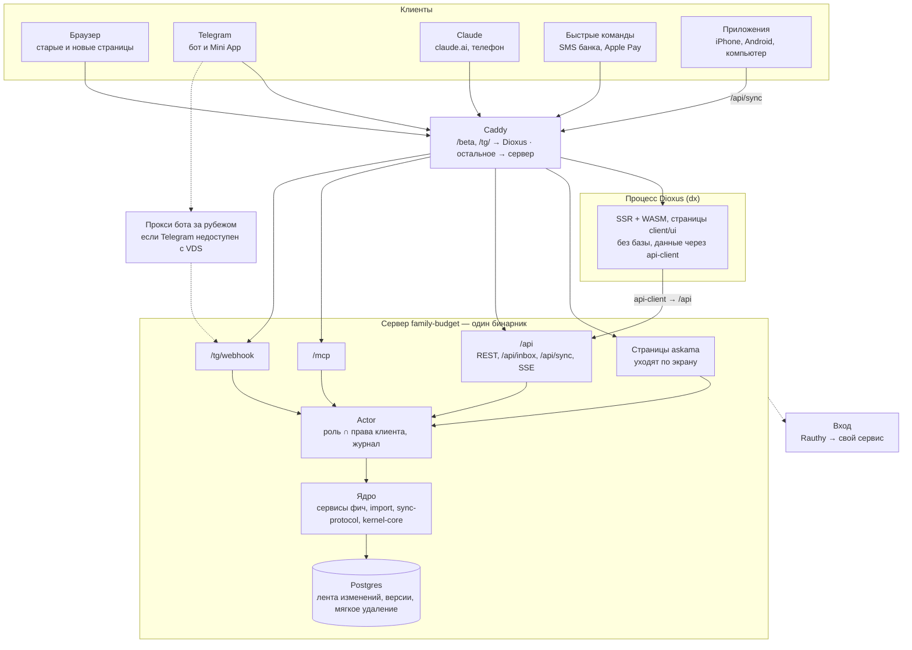
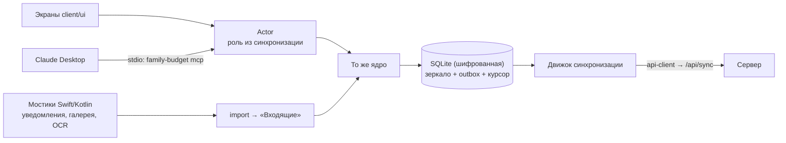
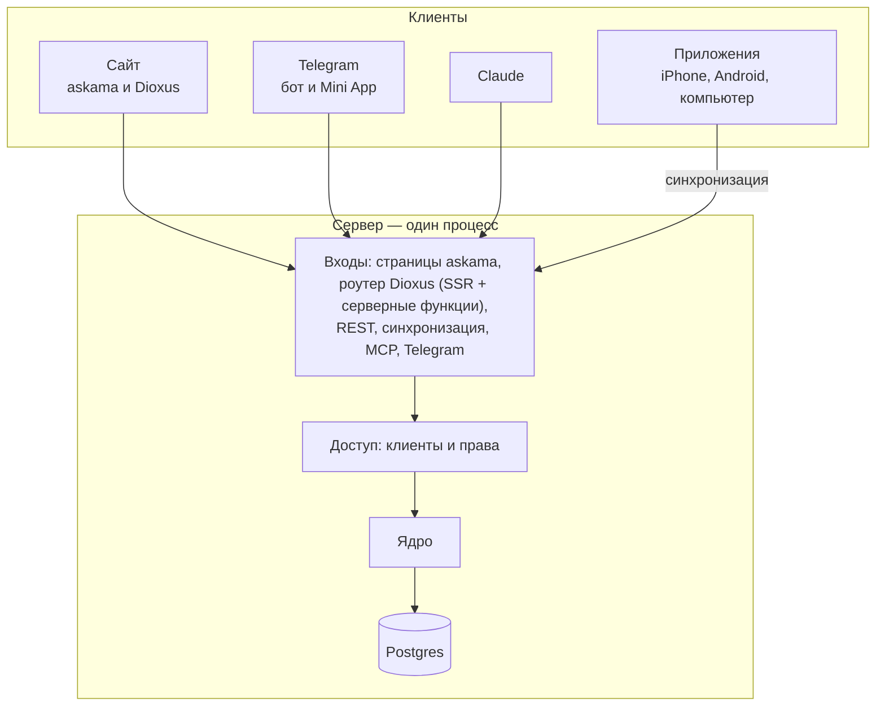

# Платформы: Telegram, мобильное и десктоп-приложение, офлайн — ТЗ на доработку

21.10.2026, редакция 2 — по итогам обсуждения архитектуры. Основа — идея `site/content/ideas/mobile-app*`,
дорожная карта (`docs/roadmap.md`) и шаг 4 группы 1 (`docs/group-1.md`). Где этот документ расходится с
дорожной картой, действует он; принятые решения помечены **Решение**. Всё, что зависит от внешних сервисов и
версий (Dioxus, Telegram Bot API, «Быстрые команды», Google Play, Apple), сверять с актуальной документацией в
начале каждого этапа. Схемы архитектуры — раздел 3 и приложение А.

## 1. Цель

Вывести бюджет за пределы браузера: операции записываются там, где они появляются, и без интернета.

- **Сайт** — постепенно переходит на Dioxus, старые страницы работают, пока их экран не переписан.
- **iPhone без приложения** — «Быстрые команды» отправляют SMS банка и покупки Apple Pay во «Входящие».
- **Telegram** — бот принимает пересланные SMS и скриншоты, присылает напоминания; Mini App — бюджет внутри
  Telegram.
- **Приложения** — сначала iPhone (на нём живёт владелец), затем Android, затем компьютер: офлайн, своя база,
  импорт из уведомлений (Android) и галереи.
- **Claude Desktop** — локальный MCP в приложении для компьютера, без сервера.

### 1.1. Не цели

- Отказ от сервера: сервер остаётся главным — права, конфликты, итоговые цифры.
- Микросервисы: сервер — один бинарник (раздел 3.3).
- gRPC: один HTTP API на JSON (раздел 4.3).
- «Нативный» вид интерфейса: компоненты Dioxus рисуются в webview и выглядят одинаково на всех платформах.
- Чтение уведомлений на iPhone: Apple не даёт это делать ни одному приложению.
- MCP с телефона без сервера: Claude на телефоне подключается только к удалённым MCP-серверам.

## 2. Принципы

1. **Одно ядро, разные сборки.** Правила учёта, сервисы и порты фич — общие для сервера и приложений.
   Сборки отличаются только адаптерами: хранилищем и входами.
2. **Входы тонкие.** Страницы askama, REST, MCP, Telegram, синхронизация, экраны приложений — адаптеры:
   определяют, кто пришёл, и вызывают сервис фичи. Логики учёта во входах нет.
3. **Права = кто ∩ через что.** Роль пользователя в проекте, суженная правами клиента. Проверка — в сервисах,
   не в HTTP-слое (раздел 6). Удаления через ассистентов, бота и токены нет, как сейчас в MCP.
4. **Сервер чистый.** Он не знает про Dioxus: новый веб — отдельный процесс и такой же клиент API, как
   приложения (раздел 3.2).
5. **Сервер главный.** Приложение хранит копию и очередь; спорные случаи решает сервер.
6. **Запись на устройстве — всегда через очередь,** отправка — сразу (раздел 12).
7. **Ничего не теряется и не дублируется:** UUID с устройства, `client_id`, `external_ref` (раздел 7).
8. **Сначала фундамент, потом интерфейсы.** Подготовка ядра проверяется на работающем приложении и тестах до
   того, как появится первый новый экран (раздел 15).
9. **Три языка — сразу.** Экраны, ответы бота, уведомления, ошибки, гайды, «Что нового» — ru/en/th в том же PR.
10. **Пользователь сам решает, что разрешить:** уведомления, галерея, Telegram, «Быстрые команды» включаются
    вручную и отключаются в любой момент.

## 3. Архитектура

### 3.1. Схема (выбранная, v2)



Внутри приложения (iPhone, Android, компьютер):



Отклонённый вариант (v1, Dioxus внутри сервера) и сравнение — приложение А.

### 3.2. Почему Dioxus — отдельный процесс

**Решение:** веб на Dioxus — отдельный процесс без доступа к базе, клиент `/api` через общий крейт
`api-client`, как Telegram Mini App и приложения.

- Сервер не зависит от молодого фреймворка: обновления Dioxus не трогают API, MCP и деньги.
- Сборка стандартная: сервер — `cargo`, Dioxus — `dx`; совпадение версий axum не важно.
- Один путь к данным для всех новых клиентов: чего нет в API, видно сразу на вебе, а не на iPhone.
- Сбои и выкатка изолированы; пилот выключается одной строкой в Caddy.
- Цена — эндпоинт и функция `api-client` на каждый экран. Это работа, нужная приложениям в любом случае.

Решение обратимо: экраны `client/ui` получают данные через контекст оболочки, переход на v1 меняет только
источник данных в оболочке web. Пилот (этап E) подтверждает или отменяет это решение.

### 3.3. Бинарники и процессы

| Что | Сколько | Как |
| --- | --- | --- |
| Сервер `family-budget` | 1 бинарник | страницы askama, REST, синхронизация, MCP, webhook бота, фоновые задачи; подкоманды `serve`, `migrate` |
| Процесс Dioxus | 1 процесс | SSR и WASM-бандлы для `/beta` (сайт) и `/tg/` (Mini App) |
| Сервис входа | 1, отдельно | Rauthy, позже свой (`docs/id-service-prompt.md`) |
| Приложения | 3 | iPhone, Android, компьютер; в компьютерном — подкоманда `family-budget mcp` (stdio) |
| Рядом | | Postgres, Caddy |

**Решение:** сервер на сервисы не делим. Двойная запись держится на одной транзакции БД (операция, проводки,
лента изменений, журнал), права — один слой `Actor`; масштаб семейный. Модульность уже есть: фичи — крейты,
адаптеры — за cargo-features.

Когда отдельный процесс оправдан:

- **Прокси Telegram-бота** на зарубежном VPS — если с VDS в России плохая связь с `api.telegram.org`. Только
  транспорт: принимает webhook и пересылает в сервер по защищённому каналу. Проверить связь до этапа G.
- **Второй экземпляр с `--role worker`** — если фоновые задачи начнут мешать сайту (нужны блокировки
  `pg_try_advisory_lock`, дорожная карта, этап 1).

### 3.4. Устройство репозитория (целевое)

```
crates/
  kernel-core/        без axum и sqlx: error, i18n, code, search, pagination, rates, crypto, Choice,
                      parse_money/parse_number, Role, Theme, scope_allows
  kernel/             серверное: web, auth, throttle, undo, config, testing (зависит от kernel-core)
  access/             Actor, клиенты, права, журнал (этап B)
  features/<фича>/    domain, service, ports, dto — всегда; adapters за cargo-features
  features/telegram/  бот, привязка, проверка initData
  import/             разбор SMS, уведомлений, текста чеков, выписок
  sync-protocol/      типы и версии протокола синхронизации
  api-client/         типизированный клиент /api на общих DTO (web, telegram, приложения)
  app/                сервер: проводка (wiring), main
client/
  ui/                 общие страницы и компоненты Dioxus
  web/                оболочка сайта (процесс Dioxus)
  telegram/           оболочка Mini App
  mobile/             оболочка iPhone/Android + ios/, android/ (Swift/Kotlin-мостики)
  desktop/            оболочка компьютера + локальный MCP
```

Структура фич задана эталоном `rust-hex-api` (`arch.toml`, версия 2). **Решение:** разделение kernel, крейт
`access` и адаптеры за cargo-features вносим в сам эталон (новая версия), чтобы `arch.py upgrade` не откатил их.

### 3.5. Cargo-features адаптеров

| Feature | Что включает | Где нужна |
| --- | --- | --- |
| *(без features)* | domain, service, ports, dto | везде, в том числе wasm32 и iOS/Android |
| `openapi` | `utoipa::ToSchema` у DTO (`cfg_attr`) | сервер |
| `postgres` | `adapters/postgres.rs`, sqlx postgres | сервер |
| `web` | `adapters/web.rs`, `adapters/http.rs`, askama, axum | сервер |
| `sqlite` | `adapters/sqlite.rs` | приложения |
| `memory` | `adapters/memory.rs` | тесты, демо |

## 4. Технологии

### 4.1. Dioxus

**Решение:** новые интерфейсы пишем на Dioxus (0.7+): один код экранов на Rust для сайта, Mini App, телефона и
компьютера; общие типы с сервером.

- **Компоненты** (dioxuslabs.com/components) — HTML-компоненты в webview, не нативные виджеты.
- **Серверные функции** в процессе Dioxus — тонкие: проброс в `/api` через `api-client`. Офлайн-клиенты
  вызывают локальные сервисы напрямую (раздел 13).
- **Мобильная часть Dioxus моложе десктопной;** нативный код (Swift/Kotlin) подключаем вручную. Проверяется на
  этапе I.
- **Запасной вариант для приложений** — Tauri 2 (готовые плагины Swift/Kotlin). Ядро не меняется.
- **LiveView** не используем: компоненты не переедут в офлайн-клиенты.

### 4.2. Судьба askama и htmx

Дорожная карта (этап 1) спрашивала «решить судьбу htmx». **Решение:** askama-страницы живут, пока их экран не
переписан на Dioxus; переход по экрану, после пилота (этап E). Лендинг и правовые страницы в
`crates/features/site` не трогаем (CLAUDE.md).

Что переход меняет и что решить до массового переноса:

- **Скриншоты гайдов** — переснимать каждый переписанный экран на трёх языках.
- **Формы без JS** — сейчас основные формы работают без JavaScript; с гидратацией Dioxus — нет. Решить:
  отказаться от правила или держать запасные формы.
- **CSP** — для WASM нужен `'wasm-unsafe-eval'` в `script-src` (сейчас `'self'`); для `/tg/` в Telegram Web —
  своё правило `frame-ancestors` (сейчас `'none'`).

### 4.3. Протокол между клиентами и сервером

**Решение:** один HTTP API на JSON и общий крейт `api-client` с теми же DTO. gRPC не делаем:

- REST всё равно нужен внешним клиентам: API-токены с OpenAPI, «Быстрые команды» (только HTTP + JSON),
  интеграции;
- браузер не говорит на gRPC — понадобился бы gRPC-Web с прослойкой;
- строгий контракт уже есть: все клиенты на Rust, DTO общие — расхождение ломает сборку;
- `Decimal`, UUID, даты и `Problem` с переводами плохо ложатся в protobuf;
- скорость на семейных объёмах не важна.

Поток «есть новое» — SSE или WebSocket. Если пачки синхронизации станут большими — бинарный формат (postcard
или CBOR) для `/api/sync` по заголовку `Accept`, без смены протокола. gRPC вернётся в обсуждение, только если
появятся клиенты не на Rust.

### 4.4. Хранилище на устройстве

SQLite, база зашифрована (SQLCipher или аналог — выбрать на этапе H), ключ — в iOS Keychain / Android Keystore /
системном хранилище ключей компьютера. Полная копия проекта: у семьи это мегабайты.

## 5. Этап A. Ядро без сервера

Цель — фичи собираются без axum и sqlx под `wasm32-unknown-unknown` и `aarch64-apple-ios`.

Что сейчас связывает ядро с сервером (21.10.2026):

| Где | Что | Мест |
| --- | --- | --- |
| сервисы и порты | `kernel::web::Choice` | 14 |
| домен и сервисы | `kernel::web::parse_money` / `parse_number` | 4 |
| сервисы | `kernel::undo::UndoBuffer` | 4 |
| сервисы | `Config`, `RateLimiter`, `SessionInfo` | по 1 |
| домен projects, mcp | `kernel::auth::{Role, Theme, scope_allows}` | 2 фичи |
| dto | `utoipa::ToSchema` | почти все фичи |
| `kernel` | зависит от axum, sqlx, askama, tokio | весь крейт |

Шаги — отдельными PR, каждый проверяется на текущем приложении:

1. **`kernel-core`:** перенести `error`, `i18n`, `code`, `search`, `pagination`, `rates`, `crypto`, `Choice`,
   `parse_money`/`parse_number`, `Role`, `Theme`, `scope_allows`. `kernel` реэкспортирует — фичи не меняются.
2. **Фичи на `kernel-core`:** домен, сервисы, порты и DTO импортируют из него; `UndoBuffer`, `RateLimiter`,
   `Config` — за порты или в адаптеры.
3. **OpenAPI за feature `openapi`.**
4. **Адаптеры за cargo-features** (раздел 3.5); `app` включает всё.
5. **CI:** `cargo check` ядра без features под `wasm32-unknown-unknown` и `aarch64-apple-ios`.
6. **Эталон `rust-hex-api`:** новая версия с этим устройством, `arch.py upgrade` проекта.

**Готово, когда:** `cargo test --workspace` и clippy зелёные, приложение и MCP ведут себя как раньше, проверка
сборки ядра в CI проходит. `Changelog: none`.

## 6. Этап B. Actor: клиенты и права

### 6.1. Что сейчас

Права проверяются тремя способами:

| Кто | Где | Как |
| --- | --- | --- |
| Веб (askama) | промежуточный слой `kernel/src/auth.rs` | по HTTP-методу: всё, кроме GET, — запись; VIEWER не пускаем |
| API-токены | там же | права токена `read`/`write`, проект токена |
| MCP | сервис фичи `mcp` | `Grant` с правами по справочникам |

Проверка по HTTP-методу не подходит новым клиентам: у серверных функций Dioxus и у `/api/sync` всё — POST.

### 6.2. Модель

Права = **кто** (пользователь, роль в проекте) ∩ **через что** (клиент). Клиент может только сузить роль.

| Клиент | Права клиента | Итог | Запись в таблице клиентов |
| --- | --- | --- | --- |
| `web` (askama) | все | = роль | нет, встроенный |
| `web-dioxus` | все | = роль | нет, встроенный (флаг включения) |
| `api_token` | read / write / «только Входящие» | роль ∩ токен | да |
| `mcp` | Grant по справочникам | роль ∩ Grant | да |
| `telegram` | как у MCP | роль ∩ права | да |
| `device` | как у MCP | роль ∩ права | да |

Таблица клиентов (кроме встроенных):

| Поле | Тип | Что |
| --- | --- | --- |
| `id` | UUID | |
| `user_id`, `project_id` | UUID | владелец и проект доступа |
| `kind` | `api_token` \| `mcp` \| `telegram` \| `device` | вид клиента |
| `external_id` | TEXT | `client_id` MCP / Telegram user id / id устройства / хеш токена |
| `name` | TEXT | «Claude», «Telegram @nick», «iPhone Алексея», «Быстрые команды» |
| `permissions` | как у MCP сейчас | права по справочникам и операциям, отдельное право «Входящие» |
| `mfa` | BOOL | открыт со вторым фактором |
| `created_at`, `last_used_at`, `revoked_at` | | |

### 6.3. Как работает

- Крейт `access`: `Actor { user_id, project_id, role, client, permissions }` и проверки «можно ли».
- Промежуточный слой только определяет, кто пришёл (сессия, токен, Grant), и собирает `Actor`.
- Каждый метод сервиса принимает `Actor` и проверяет право сам. Проверка по HTTP-методу удаляется.
- Журнал пишет источник: «с сайта», «Dioxus beta», «Claude», «Telegram», «iPhone», «Быстрые команды».
- Доступы MCP и API-токены переносятся миграцией без изменения прав; `fb_api_tokens.mfa` сохраняется.
- Порядок переноса: веб на askama → API-токены → MCP. После каждого шага поведение для пользователя прежнее.
- Удаление и архив через клиентов, кроме встроенных, — нельзя. Исключение — правка своих операций с устройства
  (раздел 12.3).

### 6.4. Интерфейс

Страница «Подключённые приложения» (рядом с «Подключить Claude» или вместо неё): клиенты, права, последний
вход, «Отключить» — сразу, токены перестают работать.

**Готово, когда:** все три механизма заменены одним, тесты прав общие для всех входов (PostgreSQL и память),
страница на трёх языках, гайд «Подключить Claude» обновлён, скриншоты пересняты.

## 7. Этап C. Приём операций без дублей

Шаг 4 группы 1 (`docs/group-1.md`), ещё не сделан. Без него нельзя ни синхронизацию, ни импорт, ни бота.
Делаем по `group-1.md`:

- `client_id` — уникален в проекте; тот же хеш тела → существующая операция, другой → `409 client_id_conflict`;
- `external_ref` — номер операции банка, id SMS или уведомления; уникален по `(project_id, account_code,
  external_ref)`;
- пакетное создание (REST и MCP), лимит тела 2 МБ;
- `allow_duplicate` — явное согласие на похожую операцию.

**Решение:** UUID операции, созданной на устройстве, генерирует устройство и передаёт как `client_id`;
повторная отправка безопасна. Для SMS без номера операции `external_ref` — хеш (отправитель, время, текст).

Сразу полезно: Claude не создаёт дубль при повторе запроса.

## 8. Этап D. Состояние в базе

- **Мягкое удаление** (`deleted_at` + срок) вместо удаления из памяти «Отменить»: «Отменить» переживает
  перезапуск, синхронизация получает «надгробия».
- **Лимит запросов** — в БД или на прокси (сейчас в памяти процесса).
- **`version`** у изменяемых записей — для конфликтов синхронизации и защиты от гонок правки (Ц10).
- **Лента изменений `fb_changes`** (`project_id`, `seq`, сущность, id, версия, время) — пишется в той же
  транзакции, что и изменение. Можно начать писать раньше, чем появятся читатели.

Пункты из этапа 1 дорожной карты. **Готово, когда:** тесты на PostgreSQL, «Отменить» работает после
перезапуска, поведение для пользователя прежнее. `Changelog: none` (или запись, если «Отменить» стало
надёжнее заметно).

## 9. Этап E. Пилот: веб на Dioxus

Цель — сравнить Dioxus с askama на знакомом функционале и подтвердить схему v2.

- Экраны «Операции» и диалог быстрого расхода на Dioxus с серверным рендерингом, по адресу `/beta/...`;
  старые страницы работают как раньше.
- Процесс Dioxus отдельно (раздел 3.2), данные — через `api-client` из существующего REST.
- Клиент `web-dioxus` в `access`, флаг включения.
- Вход: Caddy отдаёт cookie сессии обоим процессам (домен один), Dioxus пробрасывает её в `/api`.

Что сравниваем (~2 недели):

| Вопрос | Как проверяем |
| --- | --- |
| Сессия и CSRF | cookie проходит в `/api`, проверка `Origin` не мешает |
| Скорость | первый экран с SSR и двумя запросами к API — не медленнее askama на телефоне |
| Вес | WASM ≤ 1 МБ по сети (brotli) |
| Стоимость экрана | время на «эндпоинт + функция `api-client` + экран» |
| Удобство | сколько кода, три языка, тёмная тема, слоты кнопок |

Итог — **Решение** в этом документе: переводим сайт по экрану, остаёмся на askama, или переходим на v1.

## 10. Этап F. Импорт, «Входящие» и «Быстрые команды»

### 10.1. Крейт `import`

- Вход: текст SMS или уведомления (с отправителем и временем), текст со скриншота (уже распознанный OCR),
  строки выписки CSV, данные Apple Pay (сумма, продавец, карта).
- Выход: кандидат операции — вид, сумма, валюта, счёт (по последним цифрам карты), место (поиск мест), время,
  `external_ref`, уверенность, что не распознано.
- Шаблоны банков — данные, а не код: файл на банк. Первые: Сбер, Т-Банк (SMS), KBank, SCB, Bangkok Bank.
  Добавить банк — файл и тесты на обезличенных примерах.
- Не распознано — кандидат с пустыми полями и исходным текстом; дальше — пользователь или Claude.
- Сопоставления «карта ••1234 → счёт», «продавец → место» запоминаются после подтверждения.

### 10.2. «Входящие»

- Кандидат не становится операцией сам: ждёт подтверждения.
- Вход для всех источников — `POST /api/inbox` (тело: текст или данные, источник, время); MCP — инструмент
  `add_draft`.
- Карточка: исходный текст или скриншот, поля, «Сохранить», «Изменить», «Это не операция».
- «Сохранять сразу» — настройка по источнику и уверенности, по умолчанию выключена.
- Дубль по `external_ref` или похожая операция (сумма, счёт, время ± N минут) — предупреждение.
- Скриншоты и исходные тексты хранятся ограниченное время, удаляются вместе с проектом.

### 10.3. iPhone без приложения: «Быстрые команды»

```
SMS от банка → автоматизация «Сообщение» (отправитель, текст содержит…; «Выполнять сразу»)
            → «Получить содержимое URL»: POST /api/inbox, Authorization: Bearer <токен>
            → тело { text, sender, received_at } → import → «Входящие»
Apple Pay   → автоматизация «Транзакция» (Кошелёк) → { amount, merchant, card } → /api/inbox
```

- Пользователь: «Подключить iPhone» → токен `api_token` с единственным правом «Входящие» → ссылка на готовую
  команду (спрашивает токен при установке) → автоматизация на отправителя банка.
- Только SMS: push-уведомления банковских приложений командам недоступны. Сбер и другие российские банки шлют
  SMS; тайские — в основном push (для них — бот, скриншоты, Apple Pay).
- Нет сети — у команд нет очереди: ветка «Если ошибка» сохраняет текст в файл или «Заметки».
- Фильтр по отправителю — на сервер уходят только SMS банков; написать в «Конфиденциальности».
- Apple Pay работает в Таиланде, в России — нет.
- Названия и поведение автоматизаций зависят от версии iOS — проверить на iPhone владельца перед гайдом.

**Готово, когда:** крейт с тестами на примерах каждого банка; «Входящие» на сайте, в REST и MCP; готовая
команда и гайд «Операции из SMS на iPhone» на трёх языках; «Что нового».

## 11. Этап G. Telegram: бот и Mini App

### 11.1. Бот (фича `telegram`)

- Webhook на сервере (или через прокси, раздел 3.3), секрет вебхука проверяется; токен бота — в секретах.
- Привязка: «Подключить Telegram» → `t.me/<бот>?start=<одноразовый код>` (10 минут, одно использование) →
  клиент `telegram` с выбранными правами. OAuth внутри Telegram не используем.
- Пересланное SMS, уведомление, скриншот → `/api/inbox` → карточка с «Сохранить», «Открыть», «Не операция».
- Короткий ввод «250 кофе»; `/balance`, `/budget`; напоминания: плановый платёж завтра, лимит ≥ 80 % и > 100 %.
- Язык — `language_code` (ru/en/th, остальные — en); сообщения боту хранятся у Telegram — в
  «Конфиденциальности».
- Когда свой сервис входа научится входу через Telegram (`docs/id-service-prompt.md`), привязка может
  опираться на тот же Telegram id.

### 11.2. Mini App

Страница `/tg/` процесса Dioxus — оболочка `client/telegram` поверх тех же `client/ui`.

1. Telegram открывает `/tg/`, процесс Dioxus отдаёт HTML (SSR), подгружается WASM.
2. Клиент берёт `window.Telegram.WebApp.initData` и отправляет в `POST /api/telegram/login`.
3. Сервер проверяет подпись по алгоритму Telegram (HMAC-SHA256: ключ — HMAC от токена бота с `WebAppData`,
   сообщение — поля, кроме `hash`, по алфавиту через `\n`), `auth_date` не старше 1 часа, находит клиента.
4. Ответ — токен на 15 минут, хранится в памяти, идёт в `Authorization`. **Не cookie:** в Telegram Web Mini App
   во фрейме, Safari блокирует там cookie.
5. Истёк — снова шаг 2. Не привязан — экран «Подключите Telegram в настройках бюджета».

Токен бота — только на сервере. Экраны: остатки, быстрая операция, «Входящие», бюджет за месяц. Возможности:
`themeParams`, `MainButton`, `BackButton`, вибрация, сканер QR для PromptPay, BiometricManager, ярлык на главный
экран. Офлайна нет.

### 11.3. Оболочки клиентов

Страницы `client/ui` не знают, где запущены: оболочка кладёт в контекст Dioxus свои реализации.

| Контекст | web | telegram | mobile | desktop |
| --- | --- | --- | --- | --- |
| Вход | сессия (cookie) | `initData` → токен в заголовке | токен устройства | токен устройства |
| Данные | `api-client` | `api-client` | локальные сервисы + SQLite | локальные сервисы + SQLite |
| Главная кнопка | на странице | `MainButton` | на странице | на странице |
| «Назад» | ссылка | `BackButton` | системный жест | ссылка |
| Тема | своя | `themeParams` | системная | системная |
| Язык | настройки | `language_code` | системный / настройки | системный / настройки |
| Сканер QR | — | `showScanQrPopup` | камера | — |

В страницах — слоты под главную кнопку и «Назад», а не сами кнопки. Сайт и Telegram — два WASM-бандла одного
процесса Dioxus, или одна сборка, которая видит `initData` и включает Telegram-оболочку; выбор — по итогам E.

**Готово, когда:** бот привязывается и принимает пересылки, Mini App входит без пароля, экраны на трёх языках в
светлой и тёмной теме Telegram, тесты `initData`, гайд «Бюджет в Telegram», «Что нового».

## 12. Этап H. Синхронизация

### 12.1. Запись на устройстве

1. В одной транзакции SQLite: изменение + запись в `outbox`. Интерфейс показывает изменение сразу.
2. Сразу после записи — «толчок» фоновой задаче.
3. Отправка пачкой по порядку (сначала новый счёт, потом операция по нему).
4. Ответ по каждой записи: принято / уже было (тот же `client_id`) / конфликт / ошибка проверки / нет прав.
5. Нет сети или ошибка — повтор 1 → 5 → 30 с → 1 → 5 мин, и сразу при появлении сети или открытии приложения.

Отдельного пути «есть сеть — сразу на сервер» нет: один путь не теряет данные при обрыве.

### 12.2. Получение изменений

- Курсор по `fb_changes.seq` (этап D) в `sync_state`; после отправки — сразу получение.
- Пока приложение открыто — SSE/WebSocket «есть новое».
- Первый запуск — снимок проекта, дальше — лента; удаления — «надгробия».

### 12.3. Версии и конфликты

- Новые операции не конфликтуют (двойная запись только добавляет проводки).
- Правка: «правил версию 3», на сервере 4 → «конфликт» с серверной версией, ничего не перезаписывается молча;
  приложение показывает обе и предлагает выбрать.
- Справочники — так же. Права проверяются при каждом приёме.

### 12.4. Протокол (`sync-protocol`)

| Запрос | Что |
| --- | --- |
| `POST /api/sync/push` | пачка из `outbox`, ответ по каждой записи |
| `GET /api/sync/pull?after=<seq>&limit=` | изменения и новый курсор |
| `GET /api/sync/snapshot` | полный снимок |
| `GET /api/sync/stream` | SSE/WebSocket «есть новое» |

Версия протокола в заголовке: сервер поддерживает текущую и предыдущую, старше — «обновите приложение». Вход —
токен клиента `device`.

### 12.5. Таблицы на устройстве

| Таблица | Что |
| --- | --- |
| зеркала `transactions`, `entries`, `items`, `accounts`, `categories`, `places`, `people`, `currencies`, `rates`, `limits`, `plans` | копии серверных с `version` |
| `outbox` | `id`, сущность, действие, тело, `client_id`, `created_at`, попытки, последняя ошибка |
| `sync_state` | курсор, время последней синхронизации, версия протокола |
| `conflicts` | своя и серверная версии |
| `inbox` | кандидаты из уведомлений и галереи до подтверждения |

Значок для пользователя: «✓ синхронизировано» / «⏳ ждёт отправки: N» / «⚠ нужно выбрать версию».

**Готово, когда:** тесты протокола (обрыв посреди отправки, повтор, конфликт, удаление, снимок) на PostgreSQL и
SQLite; две копии приложения и сайт сходятся к одним цифрам.

## 13. Приложение на устройстве

Общее для этапов I–K: на телефоне и компьютере работает «маленький сервер» без сети внутри.

- **Экраны** вызывают сервисы фич напрямую, без HTTP; сервисы — тот же код и те же проверки, что на сервере.
- **Адаптеры `sqlite`** за теми же портами; тесты `on_each_repo!` гоняют проверки и на SQLite.
- **Actor** — роль из последней синхронизации, клиент — это устройство; офлайн роль не повысить, сервер
  проверит каждую запись.
- **Двойная запись** проверяется доменом; триггер Postgres страхует на сервере.
- **Чтение** — всегда из SQLite; отчёты считает тот же код.
- **Миграции SQLite** — вместе с приложением.

| Офлайн | Только с сетью («Нужна сеть») |
| --- | --- |
| операции, чеки, переводы | участники, приглашения, роли |
| счета, категории, места, люди | доступы Claude, Telegram, токены |
| бюджет, лимиты, планы | 2FA, удаление проекта |
| импорт из уведомлений и галереи во «Входящие» | новые курсы (получает сервер), разбор через Claude |

**Первый запуск:** вход через системный браузер (ASWebAuthenticationSession / Custom Tabs) → клиент `device`,
токен в Keychain/Keystore → снимок проекта.

## 14. Этапы I–K. iPhone, Android, компьютер

### 14.1. Этап I. iPhone

- Оболочка `client/mobile` + мостики на Swift.
- «Поделиться» → приложение (скриншоты), фото из галереи (PhotoKit, пока приложение открыто), OCR — Apple Vision.
- «Быстрые команды» (раздел 10.3) могут передавать данные в приложение, а не только на сервер — работает офлайн.
- Фон — BGTaskScheduler, редкие окна; основное — синхронизация при открытии.
- Распространение: Apple Developer, TestFlight, App Store.

### 14.2. Этап J. Android

- Уведомления банков: `NotificationListenerService` на Kotlin, только выбранные приложения банков; текст →
  `import` → «Входящие» на устройстве. `external_ref` — номер операции или хеш (приложение, время, текст).
- Галерея: новые скриншоты (`ContentObserver` + WorkManager), OCR — ML Kit (проверить тайский); «Поделиться».
- Синхронизация — WorkManager с условием «есть сеть»; база в Keystore; биометрия.
- Распространение: Google Play (строгая проверка доступа к уведомлениям и `READ_MEDIA_IMAGES` — описание, видео,
  страница о данных; если не пропустят галерею — «Поделиться»), RuStore, APK.

**Готово, когда:** уведомление банка из списка за ≤ 5 секунд становится кандидатом, без сети; гайд на трёх
языках.

### 14.3. Этап K. Компьютер и локальный MCP

- Оболочка `client/desktop`: та же SQLite и синхронизация.
- `family-budget mcp` — MCP по stdio с инструментами серверного MCP и локальным хранилищем; Claude Desktop
  запускает её сам.
- Права — `access`, локальный клиент `mcp`; удаления нет; записи Claude идут через `outbox`; журнал — тоже.
- Данные из базы — данные, не инструкции.
- Права проверяются на устройстве; подделать их может только владелец компьютера — и это его данные. Сервер
  проверит при синхронизации.

## 15. Порядок работ

**Решение:** сначала вся подготовка ядра — она проверяется на работающем приложении, — потом интерфейсы.
iPhone раньше Android: владелец живёт на iPhone и проверяет приложение каждый день.

| Этап | Что | Зависит от | Пользователь заметит |
| --- | --- | --- | --- |
| **Подготовка** | | | |
| A | Ядро без сервера | — | нет |
| B | Actor: клиенты и права (web, токены, MCP) | A | «Подключённые приложения» |
| C | Приём без дублей (шаг 4 группы 1) | — | дубли не создаются |
| D | Состояние в базе: мягкое удаление, версии, лента изменений | — | «Отменить» после перезапуска |
| **Интерфейсы** | | | |
| E | Пилот: веб на Dioxus в `/beta` | A, B | бета-экраны |
| F | Импорт, «Входящие», «Быстрые команды» | B, C | операции из SMS на iPhone |
| G | Telegram: бот и Mini App | B, E, F | бюджет в Telegram |
| **Приложения** | | | |
| H | Синхронизация | A, C, D | — (готовит I–K) |
| I | iPhone | E, H | приложение |
| J | Android | I | приложение, уведомления |
| K | Компьютер и локальный MCP | H | приложение, Claude без сервера |

A–D можно вести параллельно, если не трогают одни файлы (C и D — transactions; A — все фичи).
Каждый этап — PR или серия; «Что нового» у заметных пользователю, у остальных `Changelog: none`.

## 16. Безопасность и приватность

- Токен бота, ключи — только на сервере, в секретах.
- `initData` — проверка на сервере, свежесть 1 час; токен Mini App — 15 минут, в заголовке.
- Привязка Telegram — одноразовый код, 10 минут.
- Токены клиентов — минимальные права («только Входящие» для «Быстрых команд»), отзыв сразу.
- База на устройстве зашифрована; биометрия по желанию.
- Уведомления и SMS — только выбранных банков; исходные тексты и скриншоты — минимальный срок хранения.
- Проект требует 2FA — клиенты, открытые без второго фактора, не работают.
- CSP: `'wasm-unsafe-eval'` только для страниц Dioxus; `frame-ancestors` для `/tg/` — только Telegram.
- «Конфиденциальность» и «Удаление данных» на трёх языках: что читаем, что храним, где, как удалить.

## 17. Три языка, сайт и «Что нового»

- Экраны Dioxus — словари как в `i18n.rs` фич; тест «все ключи переведены» для `client/ui`.
- Ответы бота, уведомления, готовые «Быстрые команды» — ru/en/th.
- Гайды: «Подключённые приложения», «Операции из SMS на iPhone», «Входящие», «Бюджет в Telegram», затем
  приложения. Скриншоты на каждом языке; переписанные экраны — переснять.
- Идея `mobile-app` → `in_progress` с этапа F, `done` и ссылка на релиз — после I.

## 18. Риски

| Риск | Насколько | Что делаем |
| --- | --- | --- |
| Перевод ядра на `kernel-core` и `Actor` затронет все фичи | 🟠 | Маленькие PR без изменения поведения, тесты |
| Сессия и CSRF между процессом Dioxus и `/api` | 🟠 | Проверить в первые дни пилота E |
| Эндпоинт на каждый экран замедлит перенос сайта | 🟡 | Мерить в E; обратимо (v1) |
| Формы без JS и CSP при переходе на Dioxus | 🟡 | Решить до массового переноса (4.2) |
| Мобильный Dioxus сыроват, нет плагинов для нативного кода | 🟠 | Мостики минимальные; запасной Tauri 2 |
| Telegram замедляют в России, VDS в России | 🟠 | Проверить связь, прокси бота; Telegram — не единственный вход |
| «Быстрые команды» меняются между версиями iOS | 🟡 | Проверка на iPhone, гайд с версией iOS |
| Google Play не пропустит доступ к уведомлениям или галерее | 🟠 | Описание и видео; «Поделиться»; RuStore и APK |
| Конфликты синхронизации сложнее, чем кажется | 🟡 | Новые операции не конфликтуют; правки — версия и выбор |
| Тексты SMS и уведомлений банков меняются | 🟡 | Шаблоны — данные, тесты, запасной путь — Claude |
| Качество тайского OCR | 🟡 | Проверить Vision и ML Kit на реальных чеках |
| Утечка токена бота | 🟠 | Секреты, ротация, проверка `auth_date` |

## 19. Открытые вопросы

1. Срок хранения скриншотов и исходных текстов во «Входящих».
2. Push-напоминания: APNs/FCM или только бот Telegram (FCM в России с перебоями).
3. Шифрование SQLite: SQLCipher или другой вариант; sqlx sqlite или rusqlite.
4. Формы без JS после перехода на Dioxus — сохраняем правило или нет.
5. «Сохранять сразу» для уверенных кандидатов — по умолчанию для каких источников.
6. Сколько проектов держит приложение офлайн: текущий или все.
7. Mini App без бота (по ссылке) — нужна ли.
8. Сайт и Telegram — два WASM-бандла или одна сборка.

## Приложение А. Отклонённый вариант v1 и сравнение

v1 — Dioxus внутри сервера: роутер Dioxus в нашем axum, серверные функции вызывают сервисы напрямую.



| Критерий | v1: внутри сервера | v2: рядом, через API (выбран) |
| --- | --- | --- |
| Процессы | 1 | 2 (+1 контейнер) |
| Новый экран | быстрее: серверная функция → сервис | эндпоинт API + функция `api-client` |
| Сервер не зависит от Dioxus | нет | да |
| Сборка | нестандартная или через `dx` | сервер — `cargo`, Dioxus — `dx` |
| Совпадение версий axum | надо проверять | не важно |
| Веб и приложения на одном API | нет | да |
| Изоляция сбоев и выкатки | нет | да |
| Вход | сессия уже есть | проброс cookie, проверить CSRF |
| Задержка | вызов функции | ≈ 1 мс по локальной сети |
| Откат пилота | удалить роутер | строка в Caddy |

Также рассматривали «рядом, общая база» (процесс Dioxus с нашими крейтами и прямым доступом к Postgres):
отклонён — по сути второй экземпляр сервера, а «Отменить» и лимит запросов в памяти разъехались бы между
процессами.
