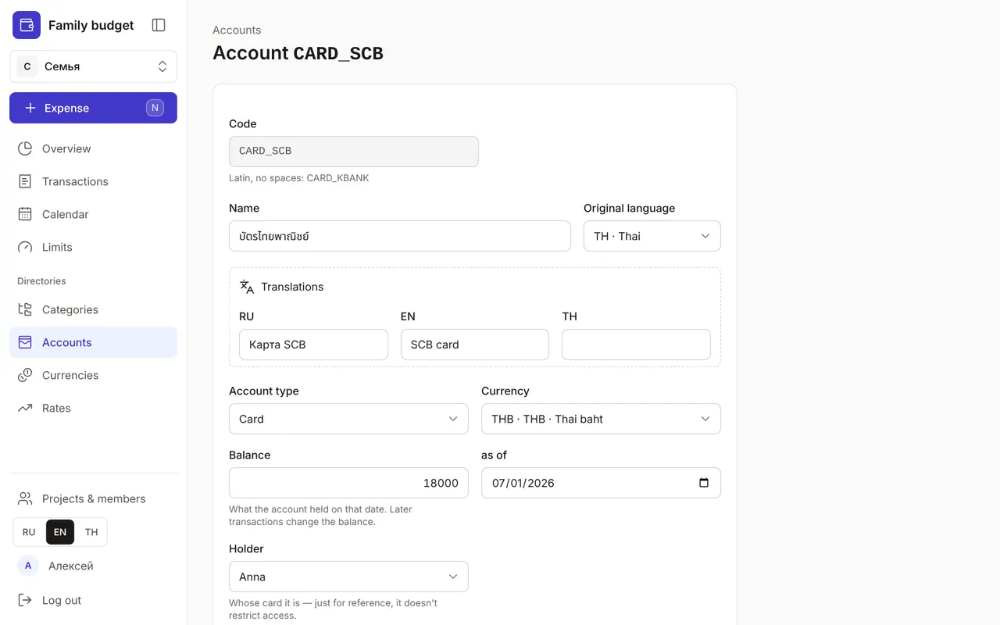
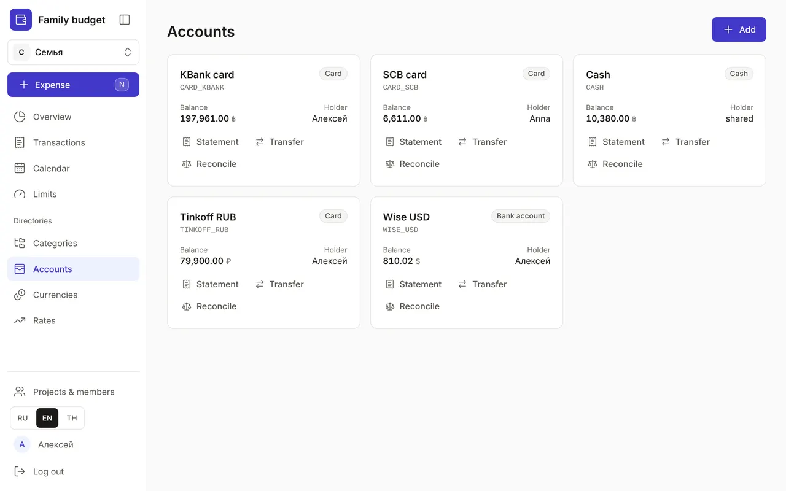
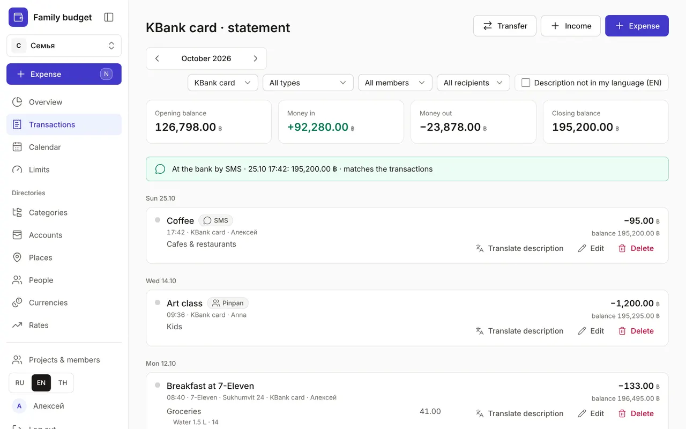
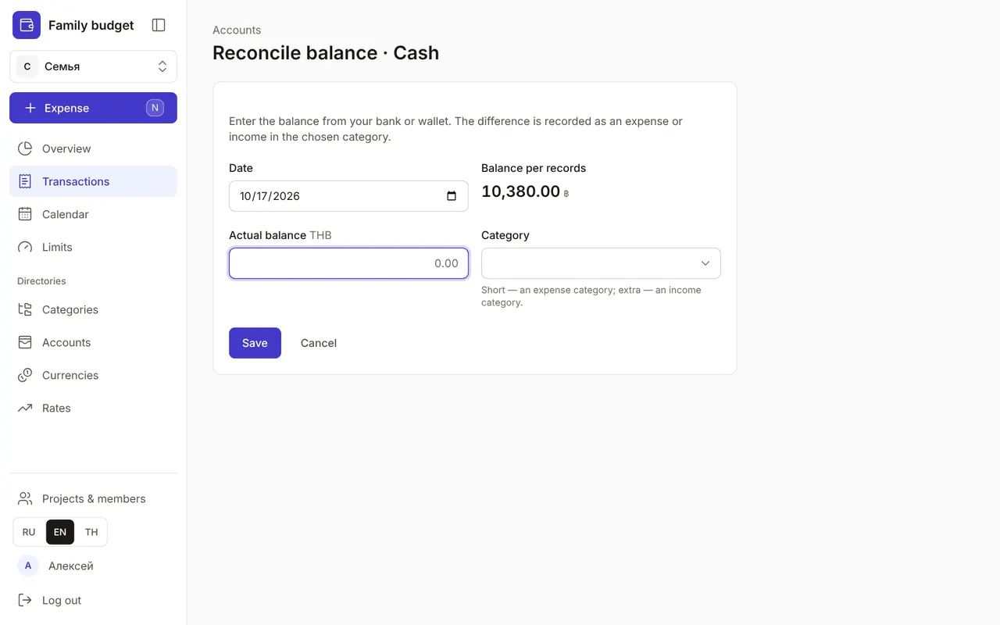

+++
title = "Accounts, statements and reconciling balances"
description = "Cards, cash and savings in any currency: how to add an account, view its statement, transfer money and reconcile the balance with your bank."
date = 2026-10-17T17:00:00

[taxonomies]
topics = ["accounts"]

[extra]
level = "beginner"
+++

An account is where money lives: a wallet with cash, a card, a bank account or savings. Every transaction takes money out of an account or puts money into one, so the balances in the app match the real ones. A new budget already has a "Cash" account in the base currency.

## 1. Add an account

Under "Directories", open "Accounts" and click "Add". Enter a "Code" — Latin letters without spaces, such as CARD_KBANK — a "Name" (translations go in "Translations"), the "Account type" — "Cash", "Card", "Bank account" or "Savings" — and the currency. In "Balance", enter what the account held "as of" a date: transactions after that date will change it.

The "Holder" is whose card it is; it's just for reference and doesn't restrict access to the account in a family budget. You can't change an account's currency once it has transactions — open a separate account for another currency.

## 2. Balances and statements

The "Accounts" page has a card for each account: its type, the balance in its currency and the holder. A negative balance is shown in red — a reason to check whether all incoming money has been recorded.

The "Statement" button opens the month's transactions for that account only: "Opening balance", "Money in", "Money out", "Closing balance" and the balance after each transaction — handy for comparing with your bank statement.

## 3. Transfer between accounts

The "Transfer" button on a card opens a transfer with that account already selected as "From". Withdrawing cash, putting money into savings, changing dollars into baht — these are all transfers and don't count as spending. How to record a currency exchange with a fee is in the guide [Transactions: expenses, income and transfers](@/guides/transactions/index.en.md).

## 4. Reconcile the balance with your bank

Sometimes you can't record everything, and the balance in the app drifts from your bank or wallet. Click "Reconcile" on the account card or "Reconcile balance" in the statement. Enter the "Actual balance" — the app compares it with the "Balance per records" and shows the difference.

Choose a category for the difference: if there's less money, an expense category (for example, "Food" if you forgot to log a couple of lunches); if there's more, an income category. After "Save", the difference is recorded as a single "Balance reconciliation" transaction and the balances match.

## 5. Close an account

No longer need a card? Click the account's name, and in the form that opens click "Archive". Only an account with a zero balance can be archived: transfer the money to another account first. The archived account's transactions stay in your history and reports.
