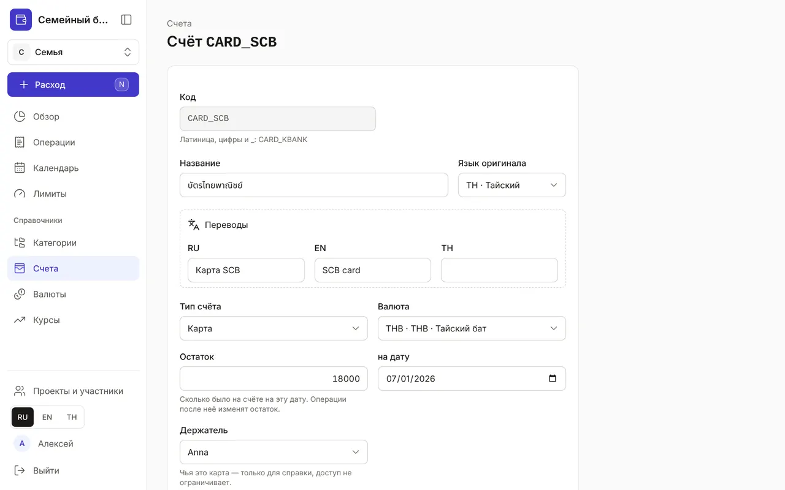
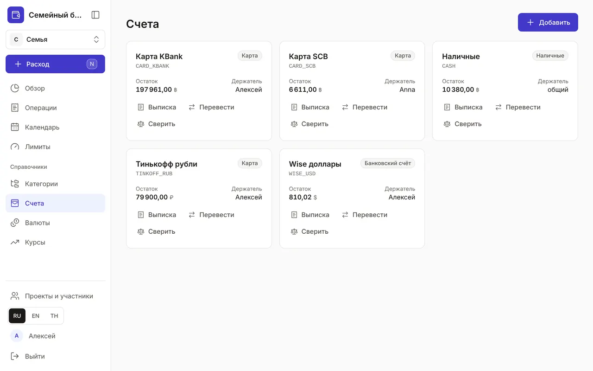
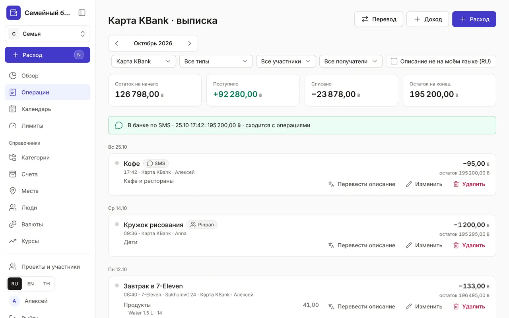
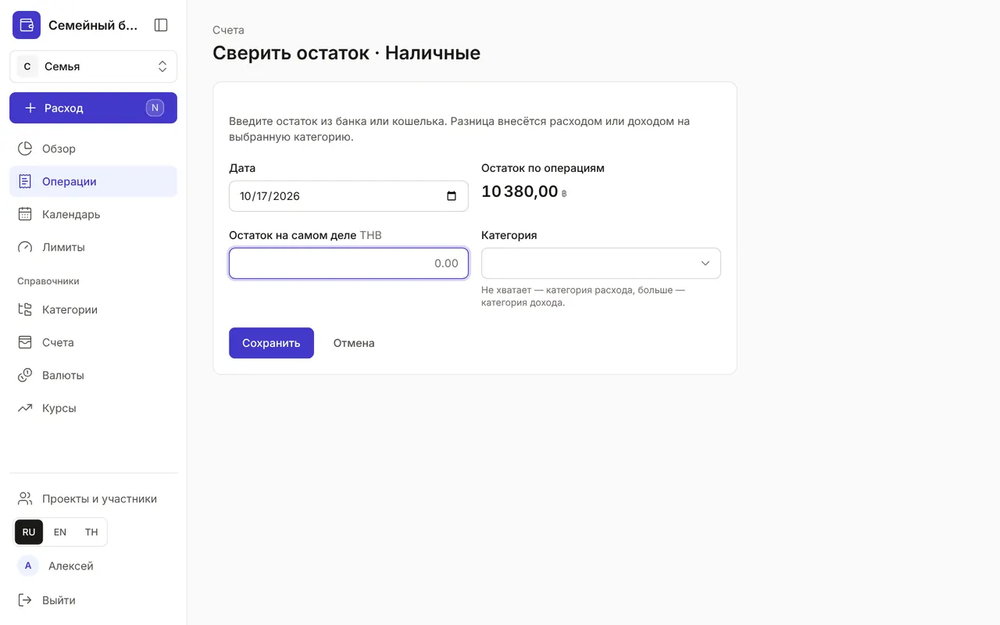

+++
title = "Счета, выписка и сверка остатка"
description = "Карты, наличные и накопления в любой валюте: как завести счёт, посмотреть выписку, перевести деньги и сверить остаток с банком."
date = 2026-10-17T17:00:00

[taxonomies]
topics = ["accounts"]

[extra]
level = "beginner"
+++

Счёт — это место, где лежат деньги: кошелёк с наличными, карта, банковский счёт или копилка. Каждая операция списывает деньги со счёта или зачисляет на него, поэтому остатки в приложении совпадают с реальными. В новом бюджете уже есть счёт «Наличные» в базовой валюте.

## 1. Добавьте счёт

В «Справочниках» откройте «Счета» и нажмите «Добавить». Укажите «Код» — латиницей без пробелов, например CARD_KBANK, «Название» (переводы — в блоке «Переводы»), «Тип счёта» — «Наличные», «Карта», «Банковский счёт» или «Накопления» — и валюту. В поле «Остаток» введите, сколько было на счёте «на дату»: операции после этой даты будут его менять.

«Держатель» — чья это карта; это только для справки, доступ к счёту в семейном бюджете он не ограничивает. Валюту счёта нельзя поменять, когда по нему уже есть операции, — для другой валюты заведите отдельный счёт.

## 2. Остатки и выписка

На странице «Счета» — карточка каждого счёта: тип, остаток в его валюте и держатель. Отрицательный остаток показан красным — повод проверить, все ли поступления записаны.

Кнопка «Выписка» открывает операции только этого счёта за месяц: «Остаток на начало», «Поступило», «Списано», «Остаток на конец» и остаток после каждой операции — удобно сравнивать с выпиской банка.

## 3. Переведите между счетами

Кнопка «Перевести» на карточке открывает перевод, где этот счёт уже выбран как «Откуда». Снять наличные, отложить в копилку, поменять доллары на баты — всё это переводы, они не считаются расходом. Как записать обмен валют с комиссией — в гайде [«Операции: расходы, доходы и переводы»](@/guides/transactions/index.md).

## 4. Сверьте остаток с банком

Иногда записать всё не получается, и остаток в приложении расходится с банком или кошельком. Нажмите «Сверить» на карточке счёта или «Сверить остаток» в выписке. Введите «Остаток на самом деле» — приложение сравнит его с суммой «Остаток по операциям» и покажет разницу.

Выберите категорию для разницы: если денег меньше — категорию расхода (например, «Еда», если забыли записать пару обедов), если больше — категорию дохода. После «Сохранить» разница запишется одной операцией «Сверка остатка», и остатки совпадут.

## 5. Закройте счёт

Карта больше не нужна — нажмите на название счёта, в открывшейся форме нажмите «В архив». В архив уходит только счёт с нулевым остатком: сначала переведите деньги на другой счёт. Операции архивного счёта остаются в истории и отчётах.
