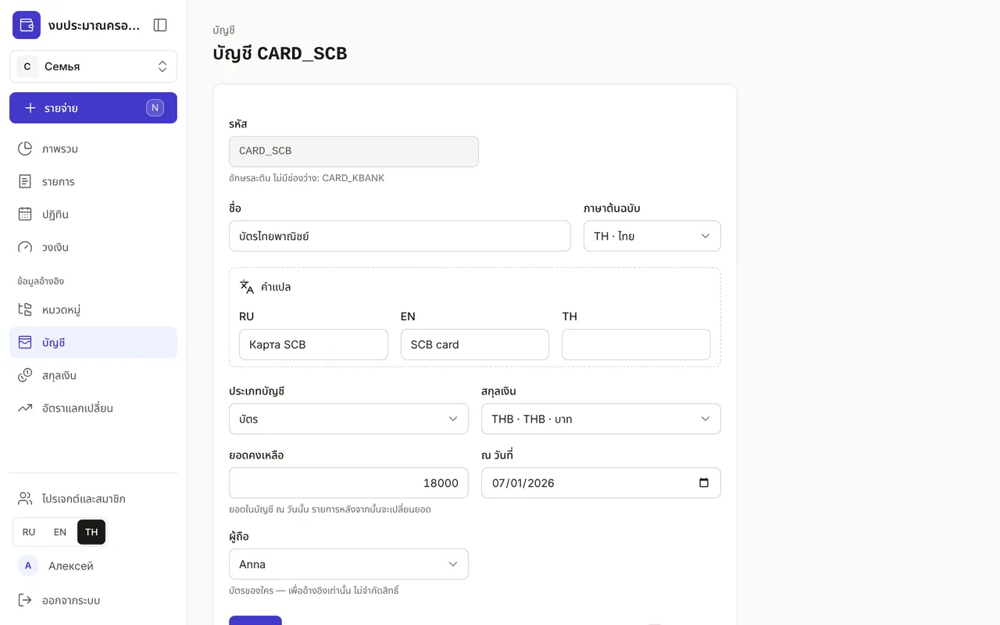
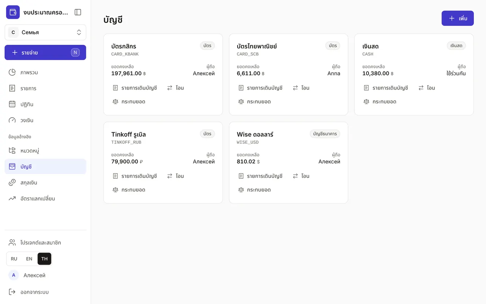
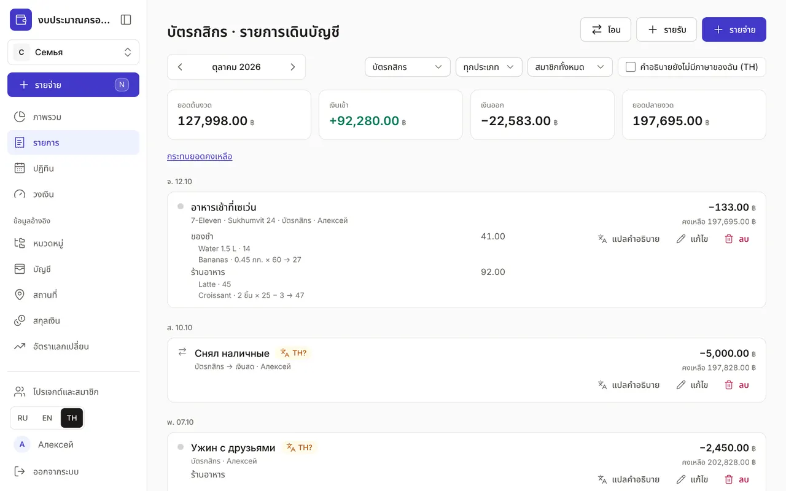
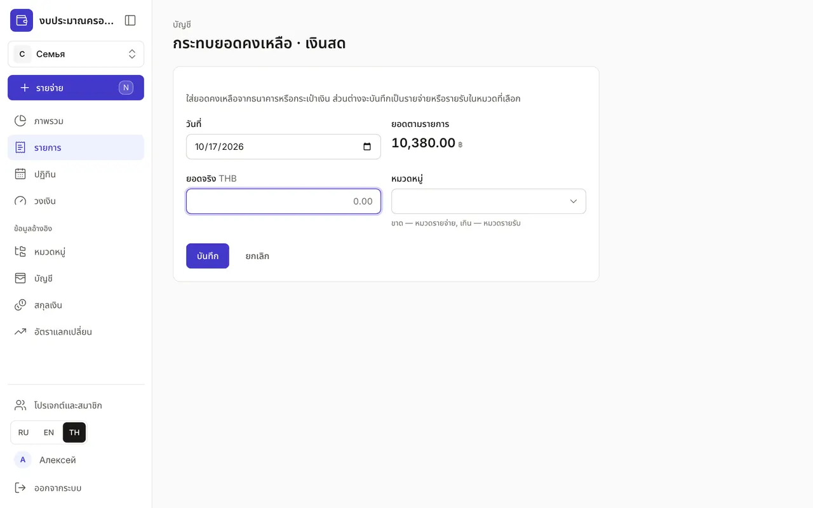

+++
title = "บัญชี รายการเดินบัญชี และการกระทบยอด"
description = "บัตร เงินสด และเงินออมในสกุลเงินใดก็ได้: วิธีเพิ่มบัญชี ดูรายการเดินบัญชี โอนเงิน และกระทบยอดกับธนาคาร"
date = 2026-10-17T17:00:00

[taxonomies]
topics = ["accounts"]

[extra]
level = "beginner"
+++

บัญชีคือที่เก็บเงิน เช่น กระเป๋าเงินสด บัตร บัญชีธนาคาร หรือเงินออม ทุกรายการจะตัดเงินออกจากบัญชีหรือเพิ่มเงินเข้าบัญชี ยอดคงเหลือในแอปจึงตรงกับของจริง งบใหม่มีบัญชี "เงินสด" ในสกุลเงินหลักให้แล้ว

## 1. เพิ่มบัญชี

ใน "ข้อมูลอ้างอิง" เปิด "บัญชี" แล้วกด "เพิ่ม" ใส่ "รหัส" เป็นอักษรละติน ตัวเลข และ _ เช่น CARD_KBANK "ชื่อ" (คำแปลใส่ใน "คำแปล") "ประเภทบัญชี" — "เงินสด" "บัตร" "บัญชีธนาคาร" หรือ "เงินออม" — และสกุลเงิน ในช่อง "ยอดคงเหลือ" ใส่ยอดในบัญชี "ณ วันที่" ที่เลือก รายการหลังวันนั้นจะเปลี่ยนยอดนี้

"ผู้ถือ" คือเจ้าของบัตร ใช้เพื่ออ้างอิงเท่านั้น ไม่จำกัดสิทธิ์ใช้บัญชีในงบครอบครัว เปลี่ยนสกุลเงินของบัญชีไม่ได้เมื่อมีรายการแล้ว หากใช้สกุลเงินอื่นให้เปิดบัญชีแยก

## 2. ยอดคงเหลือและรายการเดินบัญชี

หน้า "บัญชี" มีการ์ดของแต่ละบัญชี: ประเภท ยอดคงเหลือในสกุลเงินของบัญชี และผู้ถือ ยอดติดลบจะเป็นสีแดง — เป็นสัญญาณให้ตรวจว่าบันทึกเงินเข้าครบหรือยัง

ปุ่ม "รายการเดินบัญชี" เปิดรายการของบัญชีนั้นในเดือนนั้นเท่านั้น: "ยอดต้นงวด" "เงินเข้า" "เงินออก" "ยอดปลายงวด" และยอดคงเหลือหลังแต่ละรายการ สะดวกสำหรับเทียบกับรายการเดินบัญชีของธนาคาร

## 3. โอนระหว่างบัญชี

ปุ่ม "โอน" บนการ์ดจะเปิดการโอนโดยเลือกบัญชีนั้นเป็น "จากบัญชี" ไว้แล้ว ถอนเงินสด เก็บเข้าบัญชีออม แลกดอลลาร์เป็นบาท — ทั้งหมดนี้คือการโอน และไม่นับเป็นรายจ่าย วิธีบันทึกการแลกเงินพร้อมค่าธรรมเนียมอยู่ในคู่มือ ["รายการ: รายจ่าย รายรับ และการโอน"](@/guides/transactions/index.th.md)

## 4. กระทบยอดกับธนาคาร

บางครั้งบันทึกไม่ครบ ยอดในแอปจึงไม่ตรงกับธนาคารหรือกระเป๋าเงิน กด "กระทบยอด" บนการ์ดบัญชี หรือ "กระทบยอดคงเหลือ" ในรายการเดินบัญชี ใส่ "ยอดจริง" แล้วแอปจะเทียบกับ "ยอดตามรายการ" และแสดงส่วนต่าง

เลือกหมวดสำหรับส่วนต่าง: ถ้าเงินขาด เลือกหมวดรายจ่าย (เช่น "อาหาร" ถ้าลืมบันทึกมื้อกลางวันสองสามมื้อ) ถ้าเงินเกิน เลือกหมวดรายรับ หลังกด "บันทึก" ส่วนต่างจะถูกบันทึกเป็นรายการเดียวชื่อ "กระทบยอดคงเหลือ" และยอดจะตรงกัน

## 5. ปิดบัญชี

ไม่ใช้บัตรแล้ว? กดชื่อบัญชี แล้วในแบบฟอร์มที่เปิดขึ้นกด "เก็บถาวร" เก็บถาวรได้เฉพาะบัญชีที่ยอดเป็นศูนย์ จึงต้องโอนเงินไปบัญชีอื่นก่อน รายการของบัญชีที่เก็บถาวรแล้วยังอยู่ในประวัติและรายงาน
