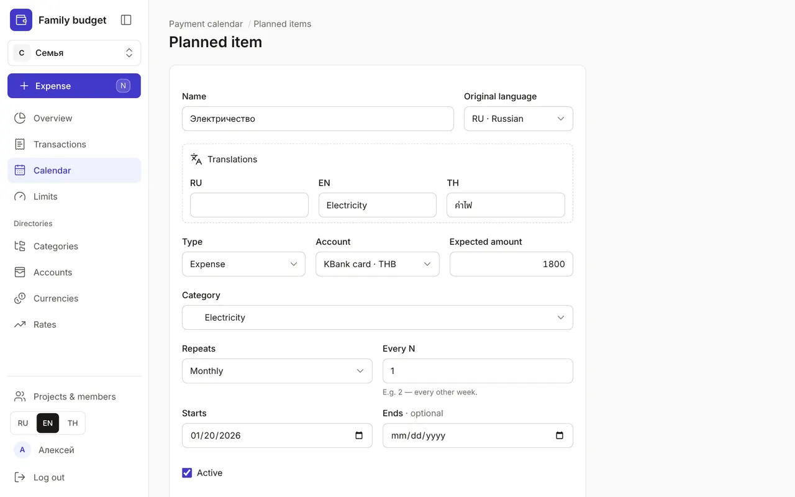
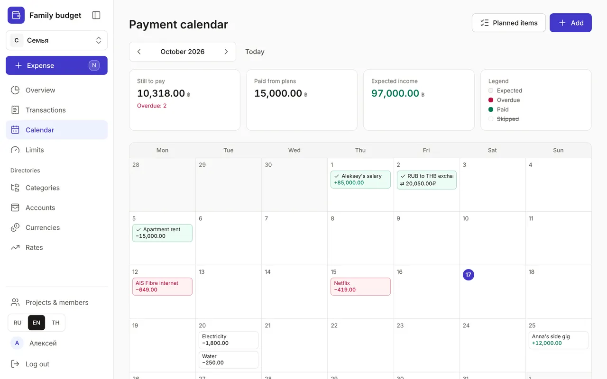
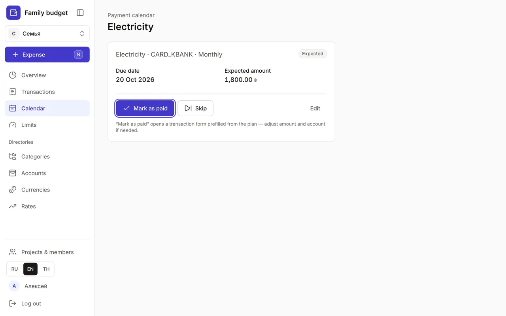
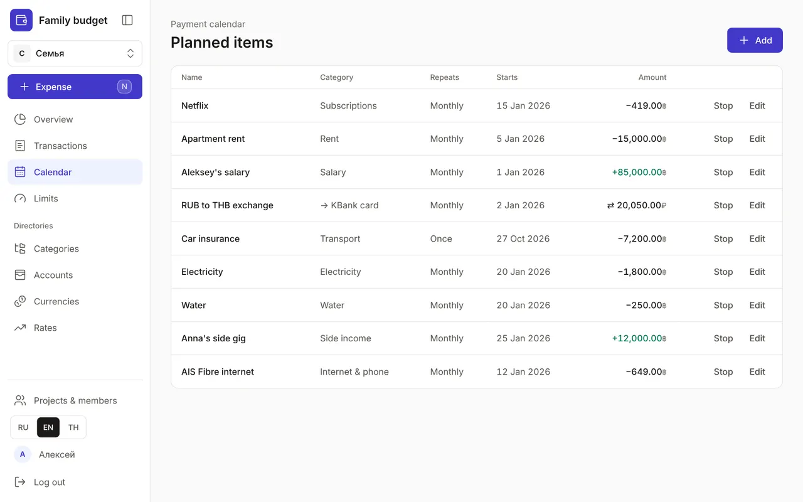

+++
title = "Calendar: regular payments and income"
description = "Rent, subscriptions, salary and transfers to savings: add them once, see the whole month and mark payments in one click."
date = 2026-10-17T17:30:00

[taxonomies]
topics = ["planning"]

[extra]
level = "beginner"
+++

The "Calendar" shows money that is planned to come in and go out: rent, utilities, subscriptions, salary. Add these once and you'll see the whole month before the first payment, and the Overview in "Forecast" mode will include them in its totals and balances.

## 1. Add a planned item

In the "Calendar", click "Add". Write a name in any language (translations go in "Translations"), choose the type — expense, income or transfer — the account, the "Expected amount" and the category. A transfer has a "To account" instead of a category: for example, the savings account you put money into every month.

"Repeats" is "Once", "Daily", "Weekly", "Monthly" or "Yearly". "Every N" sets the step: 2 with "Weekly" means every other week. "Starts" is the date of the first payment; leave "Ends" empty or set the date of the last payment, for example for an instalment plan. Click "Save".

## 2. See the whole month

Each payment sits on its day in the calendar, and its colour shows the status: "Expected", "Overdue", "Paid" or "Skipped" (struck through). At the top are the month's totals: "Still to pay" with the number of overdue items, "Paid from plans" and "Expected income". The arrows switch months and "Today" brings you back to the current one.

A payment in another currency is shown in the account's currency, and the hover tooltip also shows it in the base currency. On a phone the calendar turns into a list by day.

## 3. Mark a payment as paid

Click a payment in the calendar or in the Overview's "Still planned" list. The "Mark as paid" button opens a transaction form prefilled from the plan: you can adjust the amount, account and date — say, when the electricity bill is higher than usual. Once saved, the payment becomes "Paid", and the "Open transaction" button takes you to the recorded transaction.

Not paying this month? Click "Skip" and it stops counting in the forecast. Changed your mind — open it again and click "Restore".

## 4. Manage your plans

The "Planned items" button in the "Calendar" opens a list of all plans with their repeat, start date and amount. "Stop" pauses a plan: no new payments appear for it, while the ones already paid stay in the history. "Resume" turns it back on.

"Edit" opens the plan's form, where you can also delete it. Deleted it by mistake? Click "Undo" in the pop-up message. Claude can mark planned payments as paid too: see [How to connect Claude to your budget](@/guides/connect-claude/index.en.md).
