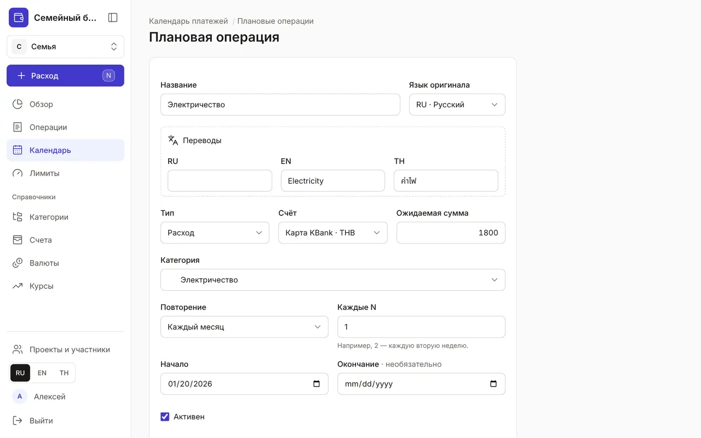
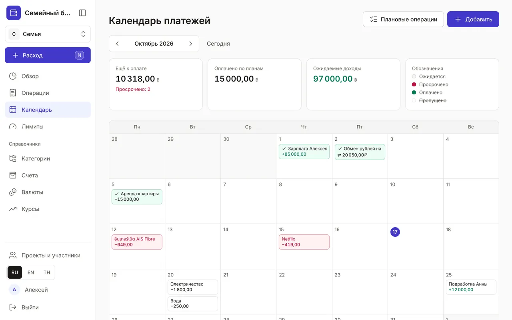
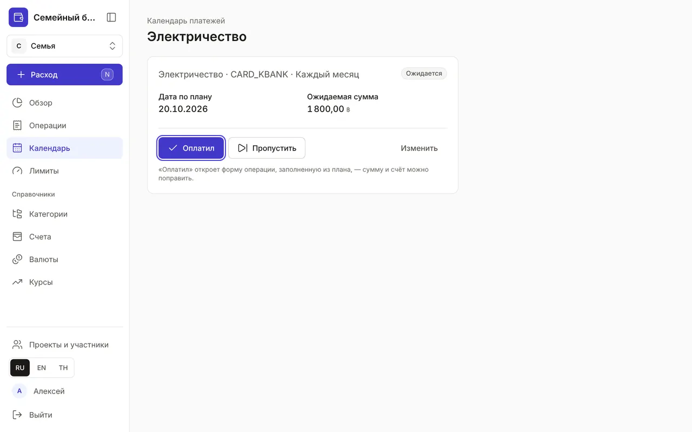
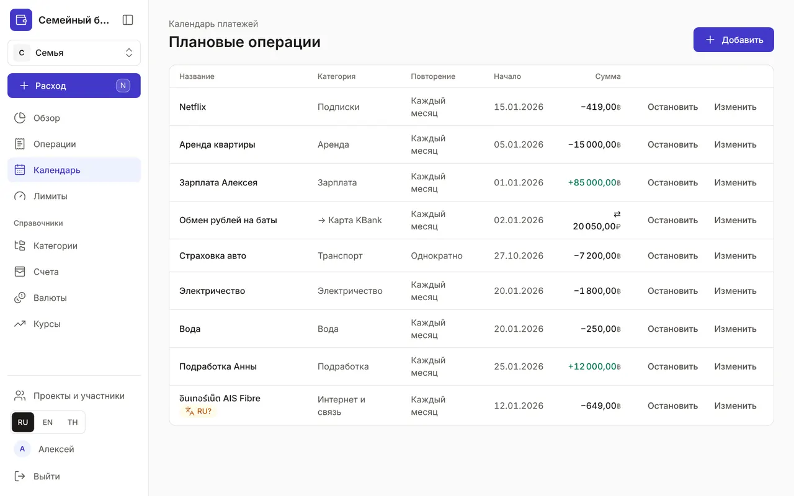

+++
title = "Календарь: регулярные платежи и доходы"
description = "Аренда, подписки, зарплата и переводы в копилку: завести один раз, видеть месяц целиком и отмечать оплату в один клик."
date = 2026-10-17T17:30:00

[taxonomies]
topics = ["planning"]

[extra]
level = "beginner"
+++

«Календарь» показывает деньги, которые придут и уйдут по плану: аренду, коммуналку, подписки, зарплату. Заведите их один раз — и месяц будет виден целиком ещё до первой оплаты, а «Обзор» в режиме «Прогноз» учтёт их в итогах и остатках.

## 1. Заведите плановую операцию

В «Календаре» нажмите «Добавить». Напишите название на любом языке (переводы — в блоке «Переводы»), выберите тип — расход, доход или перевод, счёт и категорию, укажите «Ожидаемая сумма». У перевода вместо категории — «Счёт зачисления»: например, копилка, куда вы откладываете каждый месяц.

«Повторение» — «Однократно», «Каждый день», «Каждую неделю», «Каждый месяц» или «Каждый год». «Каждые N» задаёт шаг: 2 и «Каждую неделю» — раз в две недели. «Начало» — дата первого платежа, «Окончание» можно не заполнять или указать дату последнего платежа, например по рассрочке. Нажмите «Сохранить».

## 2. Смотрите месяц целиком

Каждый платёж стоит в календаре в свой день, цвет показывает состояние: «Ожидается», «Просрочено», «Оплачено» или «Пропущено» (зачёркнуто). Сверху — итоги месяца: «Ещё к оплате» с числом просроченных, «Оплачено по планам» и «Ожидаемые доходы». Стрелки листают месяцы, «Сегодня» возвращает к текущему.

Платёж в другой валюте показан в валюте счёта, а в подсказке при наведении — ещё и в базовой. На телефоне календарь превращается в список по дням.

## 3. Отметьте оплату

Нажмите на платёж в календаре или в списке «Ещё предстоит по планам» в «Обзоре». Кнопка «Оплатил» откроет форму операции, уже заполненную из плана: сумму, счёт и дату можно поправить — например, если счёт за свет пришёл больше обычного. После сохранения платёж станет «Оплачено», а кнопка «Открыть операцию» приведёт к записанной операции.

В этом месяце платежа не будет — нажмите «Пропустить»: он перестанет считаться в прогнозе. Передумали — откройте его снова и нажмите «Вернуть в ожидание».

## 4. Управляйте планами

Кнопка «Плановые операции» в «Календаре» открывает список всех планов с повторением, датой начала и суммой. «Остановить» ставит план на паузу: новые платежи по нему перестают появляться, а уже оплаченные остаются в истории. «Возобновить» включает его снова.

«Изменить» открывает форму плана — там же его можно удалить. Если у плана, по которому уже были платежи, поменять дату начала, повторение или интервал, прошлые оплаты и пропуски останутся в истории: прежний план закроется, а новое правило начнёт действовать с сегодняшнего дня. Сумму, счёт и категорию можно менять как раньше — это касается только платежей, которые ещё не решены. Удалили по ошибке — нажмите «Отменить» во всплывающем сообщении. Записывать оплату плановых платежей умеет и Claude: см. [«Как подключить Claude к бюджету»](@/guides/connect-claude/index.md).
