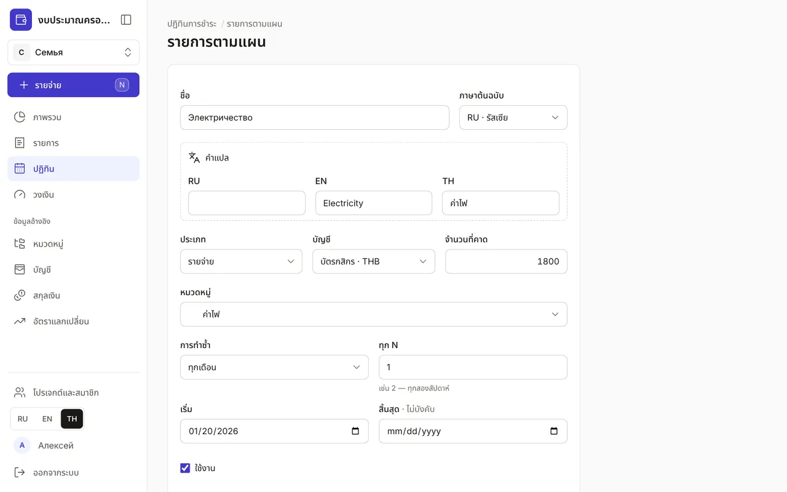
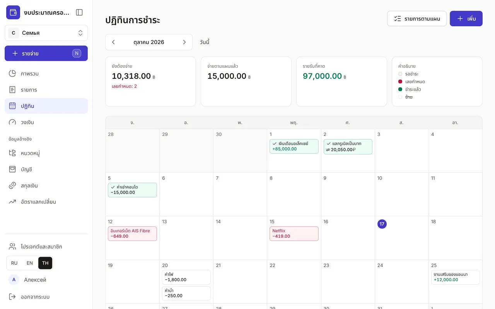
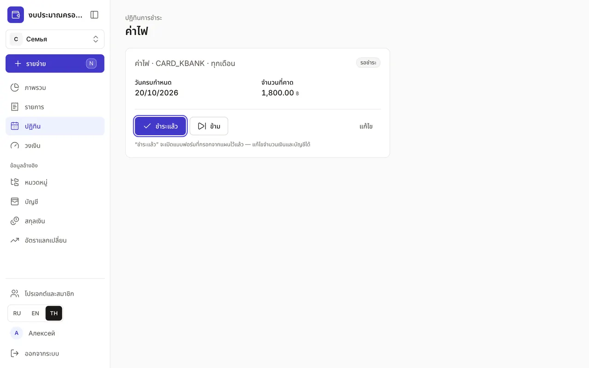
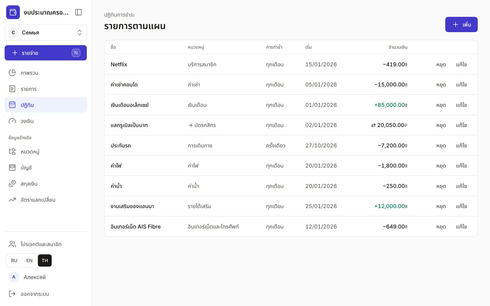

+++
title = "ปฏิทิน: การชำระและรายรับประจำ"
description = "ค่าเช่า ค่าสมาชิก เงินเดือน และการโอนเข้าบัญชีออม: เพิ่มครั้งเดียว เห็นทั้งเดือน และบันทึกการชำระในคลิกเดียว"
date = 2026-10-17T17:30:00

[taxonomies]
topics = ["planning"]

[extra]
level = "beginner"
+++

"ปฏิทิน" แสดงเงินที่จะเข้าและออกตามแผน เช่น ค่าเช่า ค่าน้ำไฟ ค่าสมาชิก เงินเดือน เพิ่มรายการเหล่านี้ครั้งเดียว แล้วจะเห็นทั้งเดือนตั้งแต่ก่อนการชำระครั้งแรก และ "ภาพรวม" ในโหมด "คาดการณ์" จะนับรวมในยอดสรุปและยอดคงเหลือ

## 1. เพิ่มรายการตามแผน

ใน "ปฏิทิน" กด "เพิ่ม" ตั้งชื่อเป็นภาษาใดก็ได้ (คำแปลใส่ในส่วน "คำแปล") เลือกประเภท — รายจ่าย รายรับ หรือโอน — บัญชี "จำนวนที่คาด" และหมวดหมู่ การโอนจะมี "บัญชีปลายทาง" แทนหมวดหมู่ เช่น บัญชีออมที่คุณโอนเก็บทุกเดือน

"การทำซ้ำ" เลือกได้ "ครั้งเดียว" "ทุกวัน" "ทุกสัปดาห์" "ทุกเดือน" หรือ "ทุกปี" ส่วน "ทุก N" กำหนดระยะห่าง: 2 กับ "ทุกสัปดาห์" คือทุกสองสัปดาห์ "เริ่ม" คือวันที่ชำระครั้งแรก "สิ้นสุด" เว้นว่างได้ หรือใส่วันที่ชำระครั้งสุดท้าย เช่น ของการผ่อนชำระ แล้วกด "บันทึก"

## 2. ดูทั้งเดือน

แต่ละรายการอยู่ในปฏิทินตรงวันของมัน สีบอกสถานะ: "รอชำระ" "เลยกำหนด" "ชำระแล้ว" หรือ "ข้าม" (ขีดฆ่า) ด้านบนคือยอดสรุปของเดือน: "ยังต้องจ่าย" พร้อมจำนวนรายการที่เลยกำหนด "จ่ายตามแผนแล้ว" และ "รายรับที่คาด" ลูกศรใช้เปลี่ยนเดือน และ "วันนี้" พากลับมาเดือนปัจจุบัน

รายการในสกุลเงินอื่นแสดงในสกุลเงินของบัญชี และเมื่อชี้เมาส์จะเห็นยอดในสกุลหลักด้วย บนโทรศัพท์ปฏิทินจะเปลี่ยนเป็นรายการเรียงตามวัน

## 3. บันทึกการชำระ

กดรายการในปฏิทิน หรือในรายการ "ยังรอตามแผน" ของ "ภาพรวม" ปุ่ม "ชำระแล้ว" จะเปิดแบบฟอร์มรายการที่กรอกจากแผนไว้แล้ว แก้จำนวนเงิน บัญชี และวันที่ได้ เช่น เมื่อบิลค่าไฟเดือนนี้สูงกว่าปกติ หลังบันทึก รายการจะมีสถานะ "ชำระแล้ว" และปุ่ม "เปิดรายการ" จะพาไปยังรายการที่บันทึกไว้

เดือนนี้ไม่ต้องจ่าย? กด "ข้าม" แล้วรายการนี้จะไม่ถูกนับในยอดคาดการณ์ ถ้าเปลี่ยนใจ เปิดรายการอีกครั้งแล้วกด "คืนสถานะ"

## 4. จัดการแผน

ปุ่ม "รายการตามแผน" ใน "ปฏิทิน" เปิดรายการแผนทั้งหมด พร้อมการทำซ้ำ วันเริ่ม และจำนวนเงิน "หยุด" จะพักแผนไว้: จะไม่มีรายการใหม่ของแผนนี้ ส่วนรายการที่ชำระแล้วยังอยู่ในประวัติ "เริ่มใหม่" จะเปิดแผนอีกครั้ง

"แก้ไข" เปิดแบบฟอร์มของแผน ซึ่งลบแผนได้จากที่นั่น ถ้าลบผิด กด "เลิกทำ" ในข้อความที่ปรากฏขึ้น Claude ก็บันทึกการชำระรายการตามแผนได้ ดู ["วิธีเชื่อม Claude กับงบของคุณ"](@/guides/connect-claude/index.th.md)
