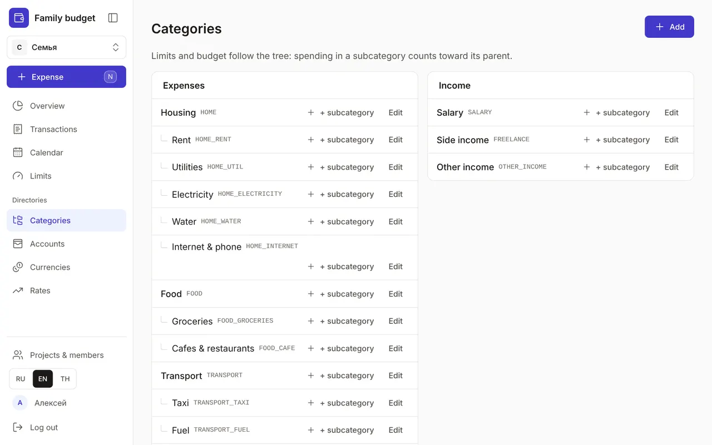
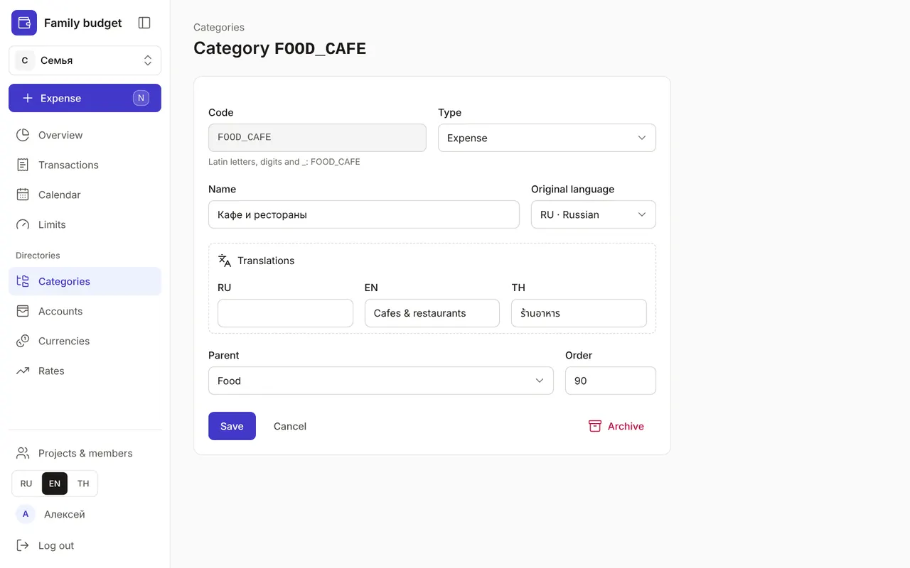

+++
title = "Categories: a tree of spending and income"
description = "How categories work, why subcategories help, how to add your own category and translate its name into other languages."
date = 2026-10-17T17:10:00

[taxonomies]
topics = ["start", "limits"]

[extra]
level = "beginner"
+++

Categories answer the questions "where did the money go?" and "where did it come from?". A new budget already has a ready-made set: housing, food, transport, health, salary and more. You can extend it and reshape it to suit you.

## 1. The category tree

"Categories" is under "Directories". "Expenses" are on the left, "Income" on the right. Categories nest up to five levels deep: "Housing → Utilities → Electricity". Next to each name is the category code in grey. Limits and the Overview follow the tree: spending in a subcategory counts toward its parent.

## 2. Add a category

Click "Add", or "+ subcategory" next to the right branch — then the parent is filled in for you. In the form:
- "Code" — Latin letters, digits and _, such as FOOD_CAFE; Claude and the API find the category by it, and it can't be changed after saving;
- "Type" — expense or income; once a category has transactions, plans or limits, its type can't be changed — otherwise past amounts would move to the other budget tree;
- "Name" and "Original language", with translations in "Translations";
- "Parent" — the place in the tree; "— top level —" is the top;
- "Order" — the smaller the number, the higher the category among its siblings.

## 3. Names in three languages

If your family speaks different languages, everyone sees categories in their own. Write the name the way you're used to and add translations under "Translations". Until there's a translation into the interface language, the name has a badge with the language code and a question mark, such as "EN?". Search in the quick expense window finds a category in any of the three languages, even without a translation.

## 4. Edit or remove

"Edit" opens the same form: you can change the name, translations, parent and order. Send a category you no longer need to "Archive": it disappears from the pickers, while old transactions and reports stay intact. Archive a branch from the bottom up — subcategories first, then the parent. Changed your mind? Click "Undo" in the pop-up message.

Don't split the tree up in advance. Start with the ready-made set and add a subcategory when you want to see where money goes within a branch — for example, splitting "Transport" into taxi and fuel.
