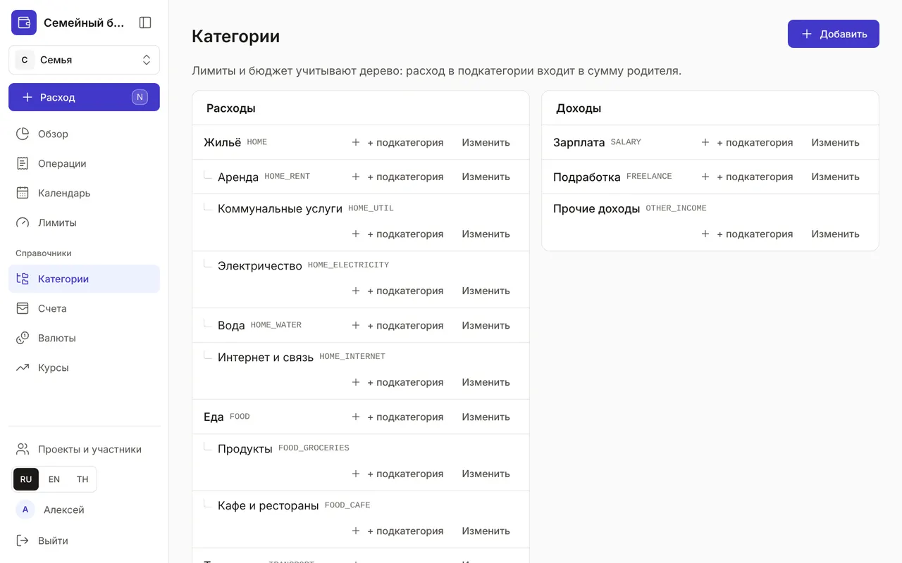
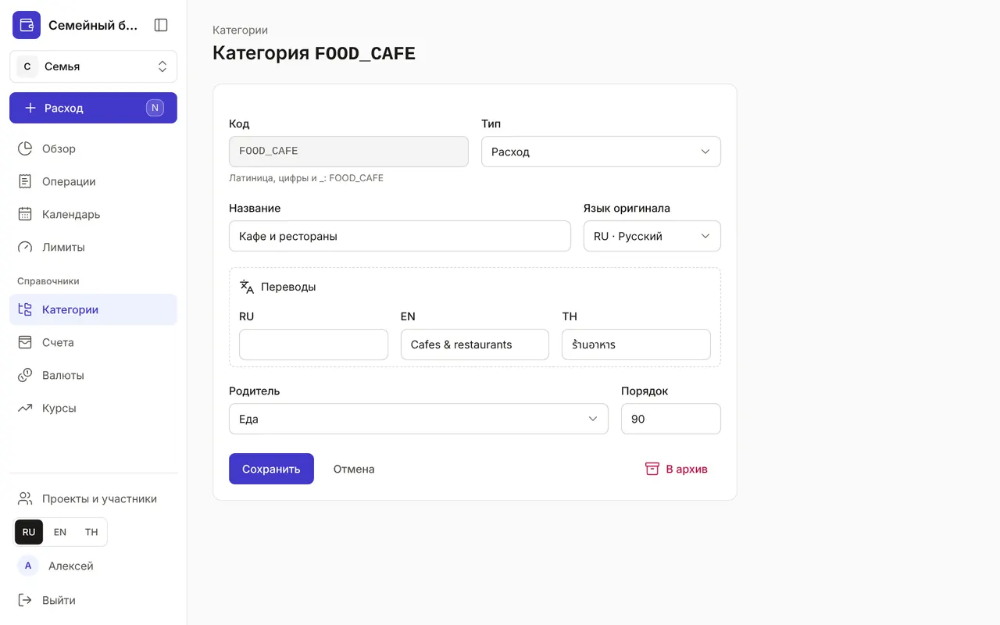

+++
title = "Категории: дерево расходов и доходов"
description = "Как устроены категории, зачем нужны подкатегории, как добавить свою категорию и перевести её название на другие языки."
date = 2026-10-17T17:10:00

[taxonomies]
topics = ["start", "limits"]

[extra]
level = "beginner"
+++

Категории отвечают на вопрос «на что ушли деньги» и «откуда они пришли». В новом бюджете уже есть готовый набор: жильё, еда, транспорт, здоровье, зарплата и другие. Его можно дополнить и перестроить под себя.

## 1. Дерево категорий

Раздел «Категории» — в «Справочниках». Слева — «Расходы», справа — «Доходы». Категории вкладываются друг в друга до пяти уровней: «Жильё → Коммунальные услуги → Электричество». Рядом с названием — код категории серым. Лимиты и «Обзор» считают по дереву: трата в подкатегории входит в сумму родителя.

## 2. Добавьте категорию

Нажмите «Добавить» или «+ подкатегория» у нужной ветки — тогда родитель подставится сам. В форме:
- «Код» — латинские буквы, цифры и _, например FOOD_CAFE; по нему категорию находят Claude и API, после сохранения код не меняется;
- «Тип» — расход или доход; если по категории уже есть операции, планы или лимиты, тип не меняется — иначе прошлые суммы перешли бы в другое дерево бюджета;
- «Название» и «Язык оригинала», переводы — в блоке «Переводы»;
- «Родитель» — место в дереве, «— корень —» — верхний уровень;
- «Порядок» — чем меньше число, тем выше категория среди соседей.

## 3. Названия на трёх языках

Если в семье говорят на разных языках, каждый видит категории на своём. Пишите название как привычно, а переводы добавьте в «Переводах». Пока перевода на язык интерфейса нет, рядом с названием стоит бейдж с кодом языка и знаком вопроса, например «RU?». Поиск в окне быстрого расхода находит категорию на любом из трёх языков, даже без перевода.

## 4. Изменить или убрать

«Изменить» открывает ту же форму: можно поменять название, переводы, родителя и порядок. Категорию, которая больше не нужна, отправьте «В архив»: она пропадёт из выбора, а старые операции и отчёты сохранятся. Ветку архивируют снизу вверх — сначала подкатегории, потом родителя. Передумали — нажмите «Отменить» во всплывающем сообщении.

Не дробите дерево заранее. Начните с готового набора, а новую подкатегорию заводите, когда захочется понять, куда уходят деньги внутри ветки — например, разделить «Транспорт» на такси и топливо.
