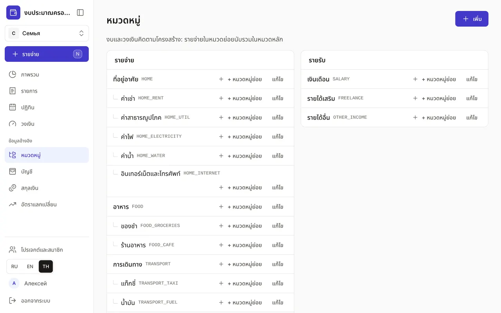
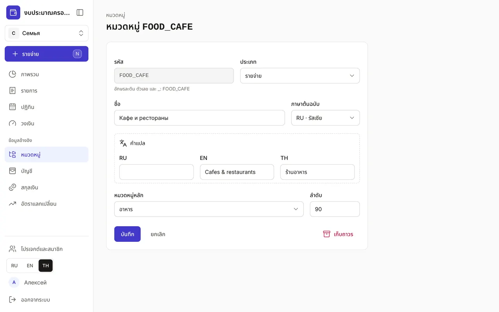

+++
title = "หมวดหมู่: โครงสร้างรายจ่ายและรายรับ"
description = "หมวดหมู่ทำงานอย่างไร หมวดย่อยช่วยอะไร วิธีเพิ่มหมวดของคุณเอง และแปลชื่อเป็นภาษาอื่น"
date = 2026-10-17T17:10:00

[taxonomies]
topics = ["start", "limits"]

[extra]
level = "beginner"
+++

หมวดหมู่ตอบคำถามว่า "เงินหมดไปกับอะไร" และ "เงินมาจากไหน" งบใหม่มีชุดหมวดพร้อมใช้อยู่แล้ว เช่น ที่อยู่อาศัย อาหาร การเดินทาง สุขภาพ เงินเดือน และอื่น ๆ เพิ่มเติมหรือปรับโครงสร้างให้เหมาะกับคุณได้

## 1. โครงสร้างหมวดหมู่

หน้า "หมวดหมู่" อยู่ใน "ข้อมูลอ้างอิง" ทางซ้ายคือ "รายจ่าย" ทางขวาคือ "รายรับ" หมวดซ้อนกันได้ถึงห้าระดับ เช่น "ที่อยู่อาศัย → ค่าสาธารณูปโภค → ค่าไฟ" ข้างชื่อจะมีรหัสหมวดเป็นสีเทา วงเงินและ "ภาพรวม" คิดตามโครงสร้าง: รายจ่ายในหมวดย่อยนับรวมในหมวดหลัก

## 2. เพิ่มหมวดหมู่

กด "เพิ่ม" หรือ "+ หมวดหมู่ย่อย" ข้างกลุ่มที่ต้องการ แล้วหมวดหลักจะถูกเลือกให้อัตโนมัติ ในแบบฟอร์ม:
- "รหัส" — อักษรละตินไม่มีช่องว่าง เช่น FOOD_CAFE Claude และ API ใช้รหัสนี้หาหมวด และเปลี่ยนไม่ได้หลังบันทึก
- "ประเภท" — รายจ่ายหรือรายรับ
- "ชื่อ" และ "ภาษาต้นฉบับ" ส่วนคำแปลใส่ใน "คำแปล"
- "หมวดหมู่หลัก" — ตำแหน่งในโครงสร้าง "— ระดับบนสุด —" คือระดับบนสุด
- "ลำดับ" — ตัวเลขยิ่งน้อย หมวดยิ่งอยู่สูงกว่าหมวดอื่นในระดับเดียวกัน

## 3. ชื่อสามภาษา

ถ้าคนในครอบครัวใช้ภาษาต่างกัน ทุกคนจะเห็นหมวดหมู่เป็นภาษาของตัวเอง เขียนชื่อตามที่ถนัด แล้วเพิ่มคำแปลใน "คำแปล" ตราบใดที่ยังไม่มีคำแปลเป็นภาษาของหน้าจอ ข้างชื่อจะมีป้ายรหัสภาษาและเครื่องหมายคำถาม เช่น "TH?" ช่องค้นหาในหน้าต่างบันทึกรายจ่ายด่วนหาหมวดได้ทั้งสามภาษา แม้ยังไม่มีคำแปล

## 4. แก้ไขหรือเลิกใช้

"แก้ไข" เปิดแบบฟอร์มเดียวกัน เปลี่ยนชื่อ คำแปล หมวดหลัก และลำดับได้ หมวดที่ไม่ใช้แล้วให้กด "เก็บถาวร" หมวดนั้นจะหายไปจากตัวเลือก แต่รายการและรายงานเดิมยังอยู่ครบ เก็บถาวรจากล่างขึ้นบน — หมวดย่อยก่อน แล้วจึงหมวดหลัก ถ้าเปลี่ยนใจ กด "เลิกทำ" ในข้อความที่ปรากฏขึ้น

ไม่ต้องแบ่งหมวดละเอียดตั้งแต่แรก เริ่มจากชุดพร้อมใช้ แล้วค่อยเพิ่มหมวดย่อยเมื่ออยากรู้ว่าเงินในกลุ่มนั้นหมดไปกับอะไร เช่น แยก "การเดินทาง" เป็นแท็กซี่และน้ำมัน
