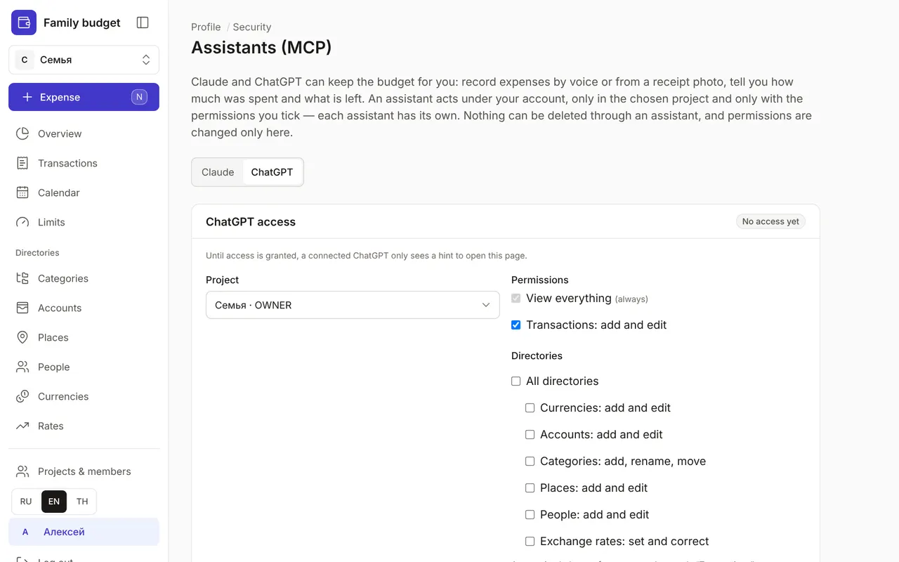
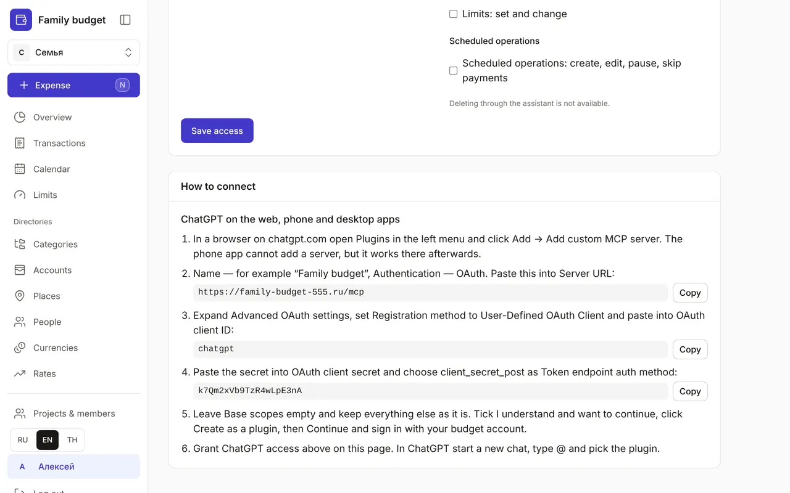
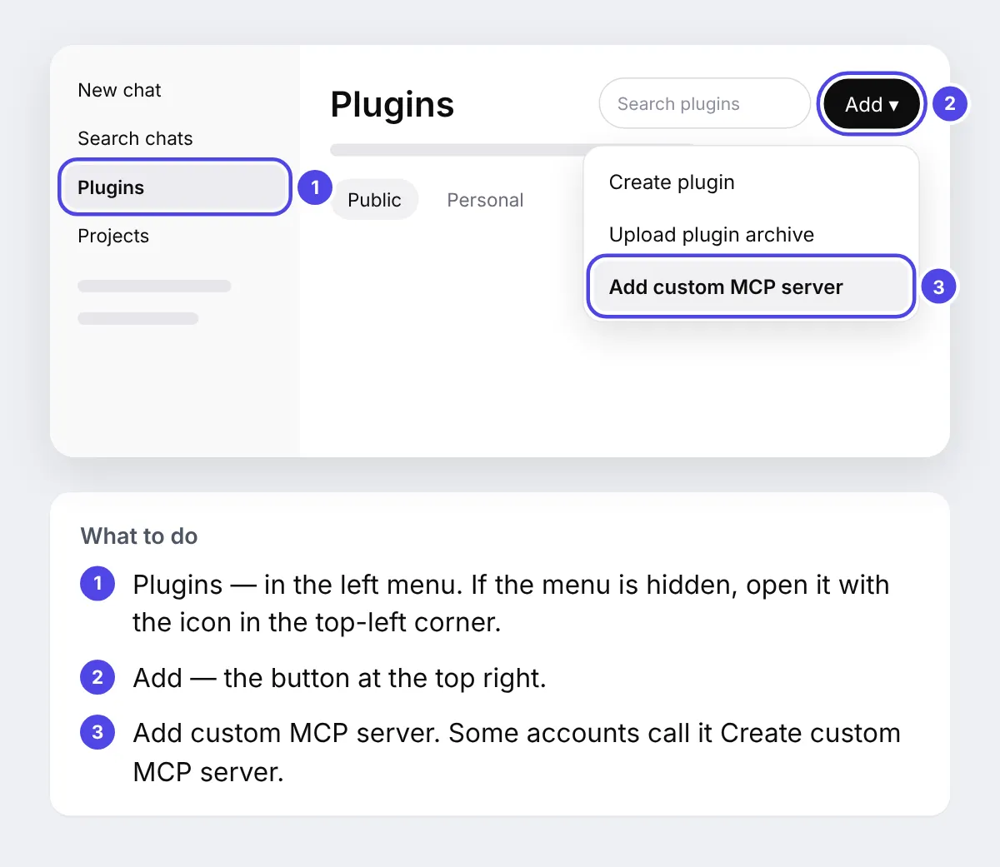
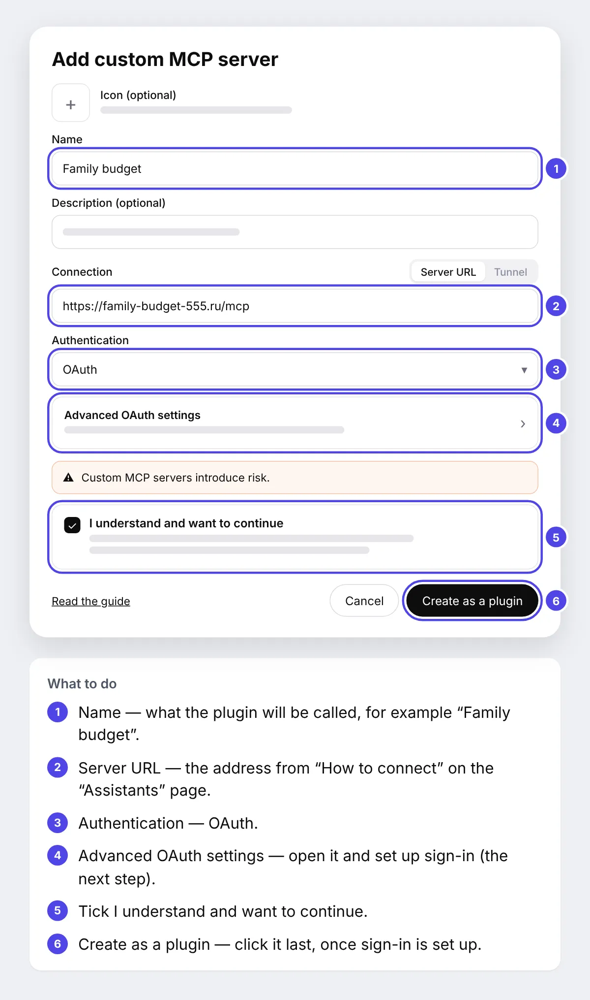
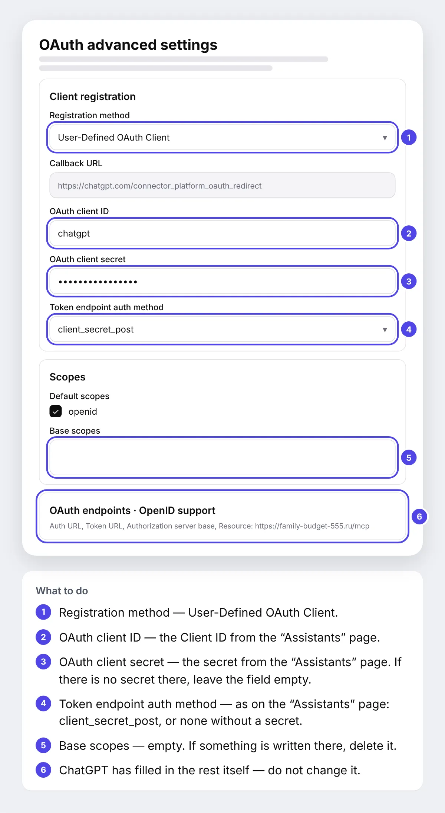
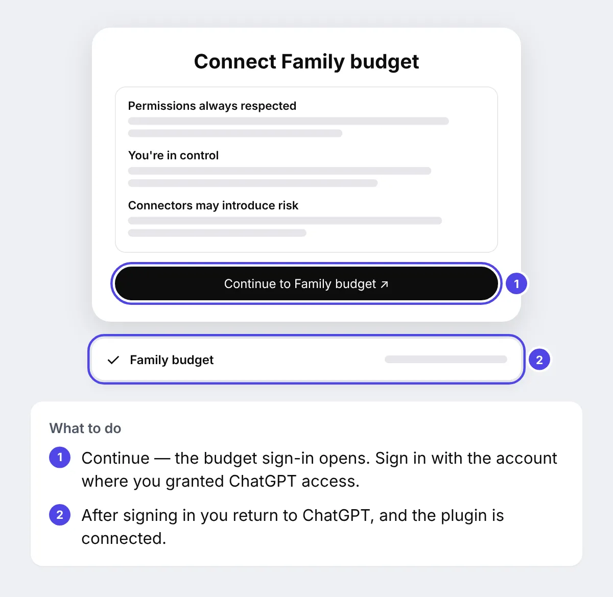
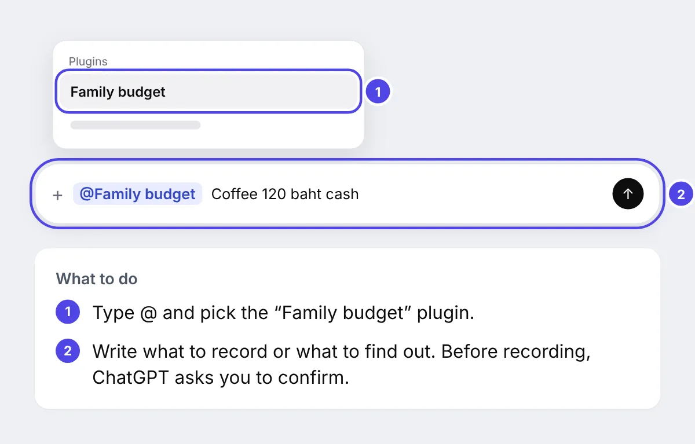

+++
title = "How to connect ChatGPT to your budget"
description = "Step by step, with screenshots: add the budget to ChatGPT as a plugin and log spending right from a chat — on the web and in the phone app."
date = 2026-10-20

[taxonomies]
topics = ["claude", "security"]

[extra]
level = "beginner"
+++

ChatGPT can keep the budget for you: log expenses from a message or a receipt photo, tell you how much you have spent and how much is left, and mark planned payments as paid. It works under your account, only in the project you choose and only with the permissions you tick. Nothing can be deleted through ChatGPT.

Connecting takes about ten minutes. You need a budget account, a ChatGPT account and a computer: the plugin can only be added in a browser on chatgpt.com, but afterwards you can use it in the ChatGPT phone app too. Keep two tabs open — the budget and ChatGPT: it is easiest to copy the values for ChatGPT straight from the budget page.

ChatGPT shows these settings in English, and its buttons and fields are named below exactly as you will see them on screen. The pictures of ChatGPT windows are diagrams: the numbers on them match the notes below each diagram.

## 1. Grant access in the budget

Sign in to the budget and open Profile → Security → Assistants (MCP). At the top of the page there is a "Claude | ChatGPT" switch: click "ChatGPT". Choose a project and permissions: "View everything" is always on, "Transactions: add and edit" is ticked by default, and directories, limits and scheduled operations are up to you. Click "Save access" below the permissions: the card shows "Access granted", and ChatGPT gets a shield icon in the switch.

Claude and ChatGPT have separate permissions: for example, you can let Claude record transactions and let ChatGPT only view.

## 2. Find the connection details

Scroll the same page down to "How to connect". It repeats, step by step, what you will do in ChatGPT and has three values with a "Copy" button: the server URL, the Client ID and the secret. If there is no secret there, it is not needed — the field stays empty in ChatGPT.

## 3. Open plugins in ChatGPT

In a new tab open chatgpt.com and sign in to ChatGPT. In the left menu choose Plugins. At the top right click Add, then Add custom MCP server in the menu. Some accounts call this item Create custom MCP server.

No Plugins section or no Add custom MCP server item? Custom servers are added on paid ChatGPT plans, and in a ChatGPT Business or Enterprise workspace an admin may turn this off — ask them to allow it.

## 4. Fill in the basics

The Add custom MCP server window opens. In Name write what the plugin will be called, for example "Family budget". Description can stay empty. In Connection, Server URL should be selected — paste the server URL from "How to connect" into the field. In Authentication choose OAuth: an Advanced OAuth settings row appears below, which we open in the next step. Do not click Create as a plugin yet.

## 5. Set up sign-in: Advanced OAuth settings

Click Advanced OAuth settings — the OAuth advanced settings panel opens. ChatGPT has found the sign-in addresses itself; you only need to change four fields and check a fifth:

1. Registration method — choose User-Defined OAuth Client.
2. OAuth client ID — paste the Client ID from the "Assistants" page.
3. OAuth client secret — paste the secret from the "Assistants" page. If there is no secret there, leave the field empty.
4. Token endpoint auth method — choose what the "Assistants" page says: client_secret_post, or none without a secret.
5. Base scopes — the field must be empty: if something is written there, delete it. In Default scopes keep openid ticked.

Leave the rest — Callback URL, OAuth endpoints and OpenID support — as it is. Close the panel and go back to the Add custom MCP server window.

## 6. Create the plugin and sign in

Tick I understand and want to continue and click Create as a plugin. ChatGPT offers to connect: in the Connect window click Continue. The budget sign-in page opens — sign in with the same account in which you granted access in the first step. After signing in you return to ChatGPT.

If the Connect window did not appear, open Plugins → Personal, find "Family budget" and click Install or Connect.

## 7. Try it

Start a new chat. Type @, pick "Family budget" in the list and add what you need: "Coffee 120 baht cash", "How much is left for food this month?" — or send a receipt photo with "log this". Before each record ChatGPT shows what it is about to do and asks you to confirm: check the amount and the account.

Every change made through ChatGPT goes into the security log: Profile → Security.

## If something went wrong

- ChatGPT replies that access is not configured and gives a link to the "Assistants" page — open it, click "Save access" on the ChatGPT tab and start a new chat.
- You changed permissions, but ChatGPT does not see them — in Plugins open "Family budget", click Refresh and start a new chat.
- An invalid_client error after signing in — copy the Client ID and the secret again with the "Copy" button and check the Token endpoint auth method.
- An "Invalid redirect uri" error — this is a setting on our side: write to us on the ["Reviews and suggestions"](@/feedback.en.md) page.
- ChatGPT cannot connect to the server — check the URL: it ends with /mcp, without a trailing slash.

## How to disconnect

On the Assistants (MCP) page open the ChatGPT tab and click "Revoke" — access closes immediately, and Claude is not affected. The plugin itself can be removed in ChatGPT, in the Plugins section. How to connect Claude is in the guide ["How to connect Claude to your budget"](@/guides/connect-claude/index.en.md).
