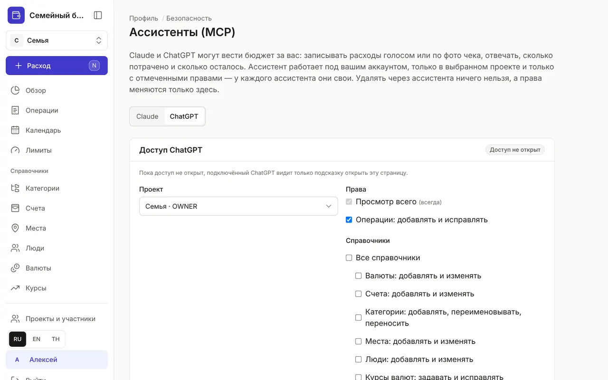
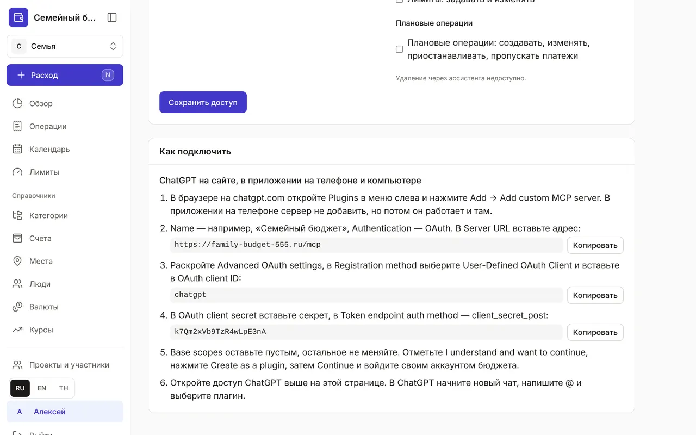
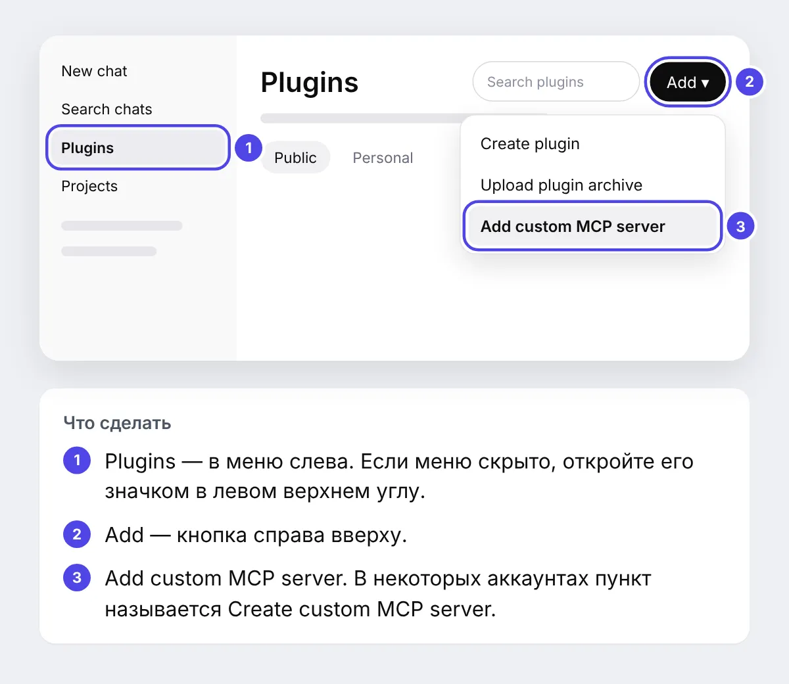
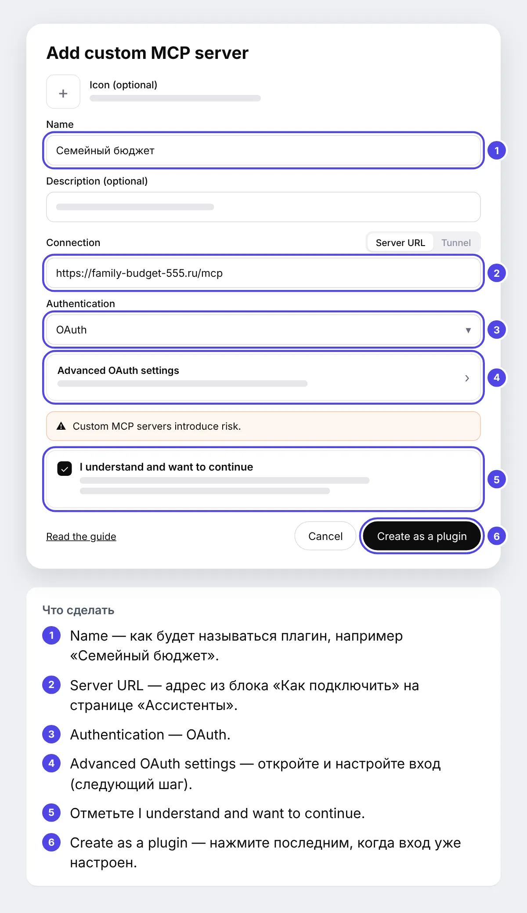
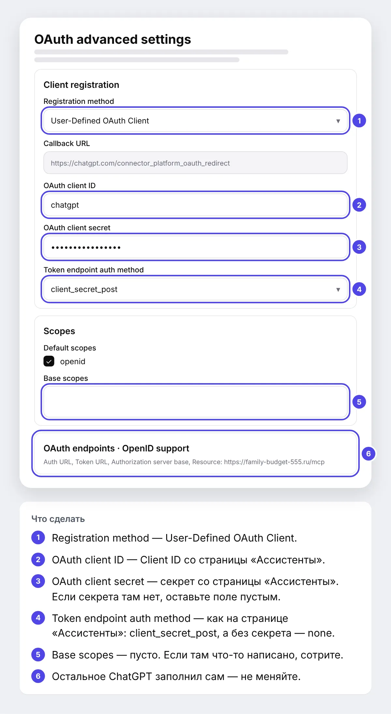
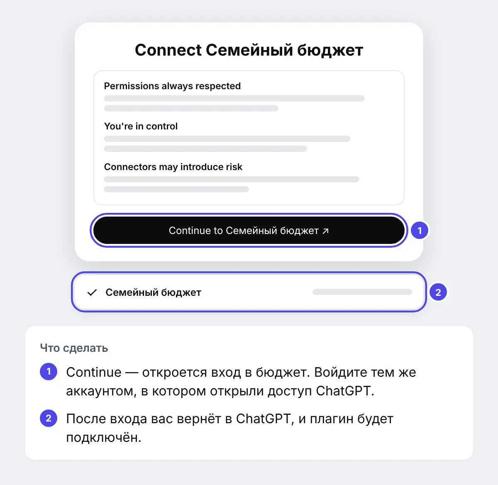
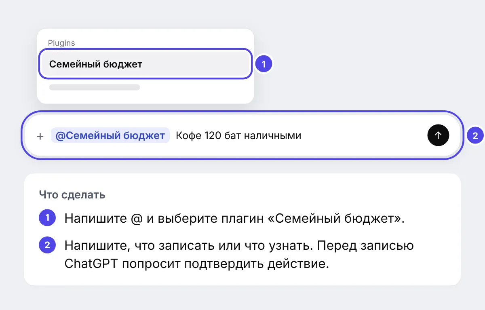

+++
title = "Как подключить ChatGPT к бюджету"
description = "Пошагово, со скриншотами: добавьте бюджет в ChatGPT как плагин и записывайте траты прямо из чата — на сайте и в приложении на телефоне."
date = 2026-10-20

[taxonomies]
topics = ["claude", "security"]

[extra]
level = "beginner"
+++

ChatGPT может вести бюджет за вас: записывать расходы по сообщению или по фото чека, отвечать, сколько потрачено и сколько осталось, отмечать оплату плановых платежей. Он работает под вашим аккаунтом, только в выбранном проекте и только с отмеченными правами. Удалить через ChatGPT ничего нельзя.

На подключение уйдёт минут десять. Понадобятся аккаунт в бюджете, аккаунт ChatGPT и компьютер: добавить плагин можно только в браузере на chatgpt.com, а пользоваться им потом можно и в приложении ChatGPT на телефоне. Держите открытыми две вкладки — бюджет и ChatGPT: значения для ChatGPT удобнее всего копировать прямо со страницы бюджета.

ChatGPT показывает эти настройки на английском, поэтому его кнопки и поля ниже названы по-английски — так, как вы увидите их на экране. Картинки с окнами ChatGPT — схемы: цифры на них совпадают с пояснениями под схемой.

## 1. Откройте доступ в бюджете

Войдите в бюджет и откройте «Профиль» → «Безопасность» → «Ассистенты (MCP)». Вверху страницы — переключатель «Claude | ChatGPT»: нажмите «ChatGPT». Выберите проект и права: «Просмотр всего» есть всегда, «Операции: добавлять и исправлять» отмечено по умолчанию, справочники, лимиты и плановые операции — по желанию. Нажмите «Сохранить доступ» под правами: в карточке появится «Доступ открыт», а у ChatGPT в переключателе — значок щита.

Права у Claude и ChatGPT отдельные: можно, например, разрешить Claude записывать операции, а ChatGPT — только смотреть.

## 2. Найдите данные для подключения

Прокрутите ту же страницу вниз, до блока «Как подключить». Там по шагам повторено то, что вы будете делать в ChatGPT, и есть три значения с кнопкой «Копировать»: адрес сервера, Client ID и секрет. Если секрета в блоке нет, он не нужен — в ChatGPT это поле останется пустым.

## 3. Откройте плагины в ChatGPT

В новой вкладке откройте chatgpt.com и войдите в ChatGPT. В меню слева выберите Plugins. Справа вверху нажмите Add, а в меню — Add custom MCP server. В некоторых аккаунтах этот пункт называется Create custom MCP server.

Нет раздела Plugins или пункта Add custom MCP server? Свои серверы добавляют на платных тарифах ChatGPT, а в рабочем пространстве ChatGPT Business или Enterprise это может выключить администратор — попросите его разрешить.

## 4. Заполните основное

Откроется окно Add custom MCP server. В Name напишите, как будет называться плагин, например «Семейный бюджет». Description можно не заполнять. В Connection должно быть выбрано Server URL — вставьте в поле адрес сервера из блока «Как подключить». В Authentication выберите OAuth: ниже появится строка Advanced OAuth settings, её откроем на следующем шаге. Кнопку Create as a plugin пока не нажимайте.

## 5. Настройте вход: Advanced OAuth settings

Нажмите Advanced OAuth settings — откроется панель OAuth advanced settings. Адреса входа ChatGPT нашёл сам, поменять нужно четыре поля и проверить пятое:

1. Registration method — выберите User-Defined OAuth Client.
2. OAuth client ID — вставьте Client ID со страницы «Ассистенты».
3. OAuth client secret — вставьте секрет со страницы «Ассистенты». Если секрета там нет, оставьте поле пустым.
4. Token endpoint auth method — выберите то, что написано на странице «Ассистенты»: client_secret_post, а без секрета — none.
5. Base scopes — поле должно быть пустым: если там что-то написано, сотрите. В Default scopes оставьте отмеченным openid.

Остальное — Callback URL, OAuth endpoints и OpenID support — не трогайте. Закройте панель и вернитесь в окно Add custom MCP server.

## 6. Создайте плагин и войдите

Отметьте I understand and want to continue и нажмите Create as a plugin. ChatGPT предложит подключиться: в окне Connect нажмите Continue. Откроется страница входа бюджета — войдите тем же аккаунтом, в котором открывали доступ на первом шаге. После входа вас вернёт в ChatGPT.

Если окно Connect не появилось, откройте Plugins → Personal, найдите «Семейный бюджет» и нажмите Install или Connect.

## 7. Попробуйте

Начните новый чат. Напишите @, выберите в списке «Семейный бюджет» и допишите, что нужно: «Кофе 120 бат наличными», «Сколько осталось на еду до конца месяца?» — или пришлите фото чека со словом «запиши». Перед каждой записью ChatGPT покажет, что собирается сделать, и попросит подтвердить: проверьте сумму и счёт.

Каждое изменение через ChatGPT попадает в журнал безопасности: «Профиль» → «Безопасность».

## Если что-то не получилось

- ChatGPT отвечает, что доступ не настроен, и даёт ссылку на страницу «Ассистенты» — откройте её, на вкладке ChatGPT нажмите «Сохранить доступ» и начните новый чат.
- Вы поменяли права, а ChatGPT их не видит — в Plugins откройте «Семейный бюджет», нажмите Refresh и начните новый чат.
- После входа ошибка invalid_client — скопируйте Client ID и секрет заново кнопкой «Копировать» и проверьте Token endpoint auth method.
- Ошибка «Invalid redirect uri» — это настройка на нашей стороне: напишите нам на странице [«Отзывы и предложения»](@/feedback.md).
- ChatGPT не может подключиться к серверу — проверьте адрес: он заканчивается на /mcp, без слеша в конце.

## Как отключить

На странице «Ассистенты (MCP)» откройте вкладку ChatGPT и нажмите «Отключить» — доступ закроется сразу, а Claude это не затронет. Сам плагин можно удалить в ChatGPT, в разделе Plugins. Как подключить Claude — в гайде [«Как подключить Claude к бюджету»](@/guides/connect-claude/index.md).
