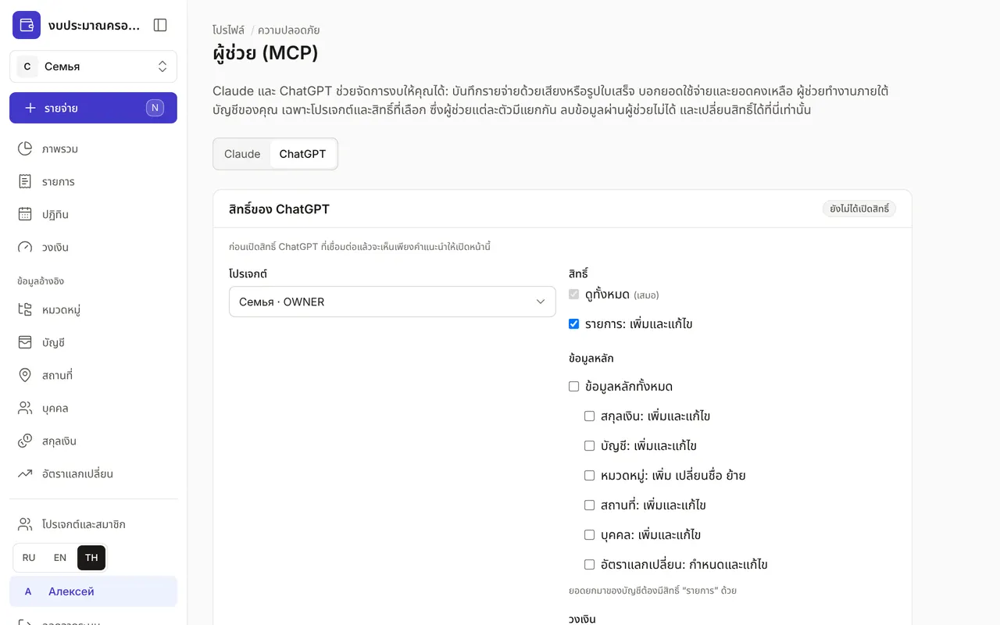
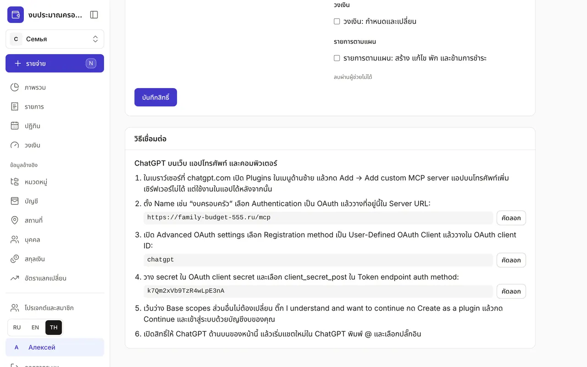
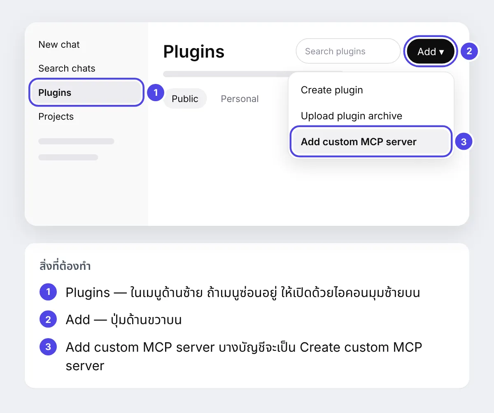
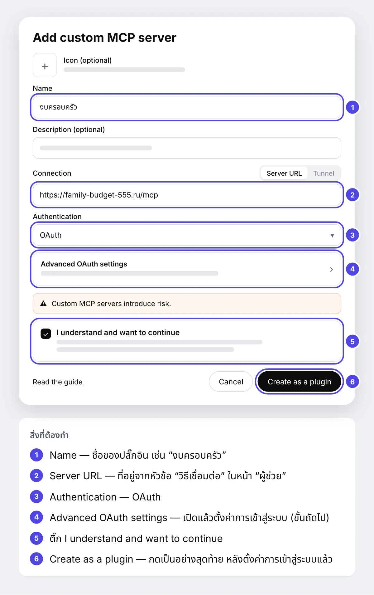
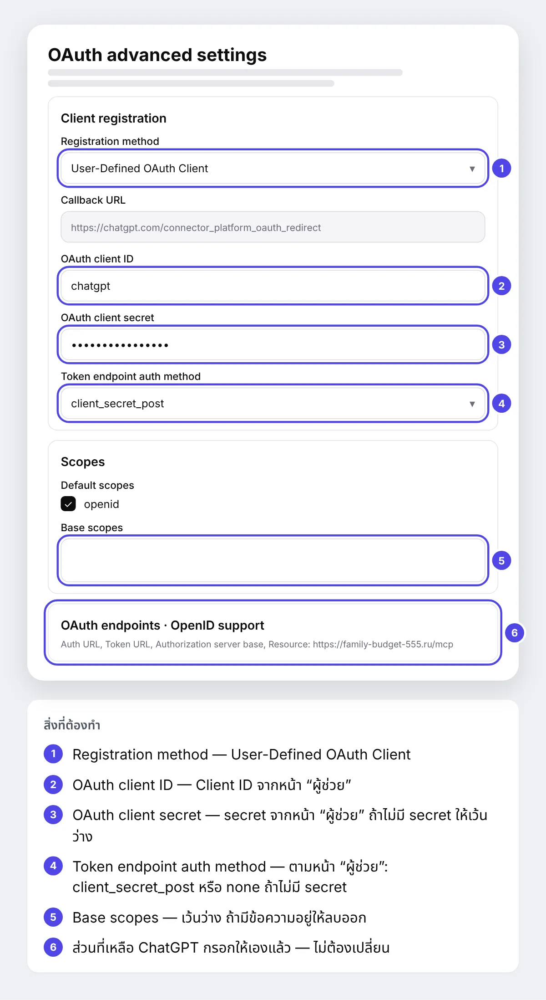
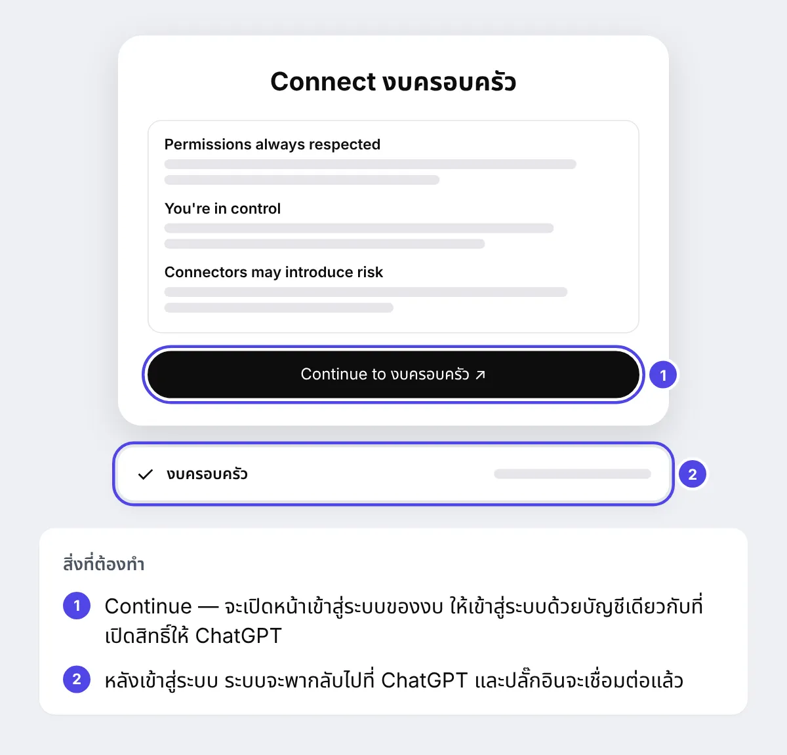
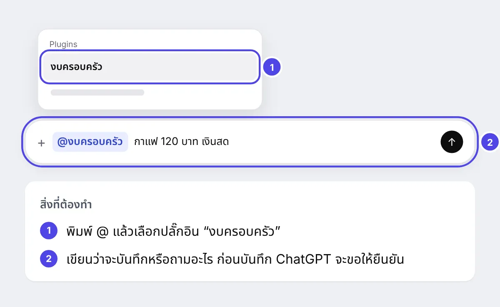

+++
title = "วิธีเชื่อม ChatGPT กับงบของคุณ"
description = "ทีละขั้นพร้อมภาพหน้าจอ: เพิ่มงบเข้า ChatGPT เป็นปลั๊กอิน แล้วบันทึกค่าใช้จ่ายจากแชทได้เลย — ทั้งบนเว็บและในแอปบนโทรศัพท์"
date = 2026-10-20

[taxonomies]
topics = ["claude", "security"]

[extra]
level = "beginner"
+++

ChatGPT ดูแลงบแทนคุณได้: บันทึกรายจ่ายจากข้อความหรือรูปใบเสร็จ บอกว่าใช้ไปเท่าไรและเหลือเท่าไร และทำเครื่องหมายว่าชำระรายการตามแผนแล้ว ChatGPT ทำงานภายใต้บัญชีของคุณ เฉพาะในโปรเจกต์ที่คุณเลือก และเฉพาะสิทธิ์ที่คุณติ๊กไว้ ลบอะไรผ่าน ChatGPT ไม่ได้

การเชื่อมต่อใช้เวลาประมาณสิบนาที คุณต้องมีบัญชีงบ บัญชี ChatGPT และคอมพิวเตอร์ เพราะเพิ่มปลั๊กอินได้เฉพาะในเบราว์เซอร์ที่ chatgpt.com แต่หลังจากนั้นใช้งานในแอป ChatGPT บนโทรศัพท์ได้ด้วย เปิดไว้สองแท็บ — งบและ ChatGPT: คัดลอกค่าสำหรับ ChatGPT จากหน้างบโดยตรงสะดวกที่สุด

ChatGPT แสดงการตั้งค่าเหล่านี้เป็นภาษาอังกฤษ ด้านล่างจึงเรียกปุ่มและช่องของ ChatGPT เป็นภาษาอังกฤษตามที่คุณจะเห็นบนหน้าจอ ภาพหน้าต่าง ChatGPT เป็นแผนภาพ: ตัวเลขบนภาพตรงกับคำอธิบายใต้แผนภาพ

## 1. เปิดสิทธิ์ในงบ

เข้าสู่ระบบงบ แล้วเปิด "โปรไฟล์" → "ความปลอดภัย" → "ผู้ช่วย (MCP)" ด้านบนของหน้ามีตัวสลับ "Claude | ChatGPT": กด "ChatGPT" เลือกโปรเจกต์และสิทธิ์: "ดูทั้งหมด" เปิดอยู่เสมอ "รายการ: เพิ่มและแก้ไข" ถูกติ๊กไว้ตั้งแต่แรก ส่วนข้อมูลหลัก วงเงิน และรายการตามแผนเลือกได้ตามต้องการ กด "บันทึกสิทธิ์" ใต้รายการสิทธิ์: การ์ดจะแสดง "เปิดสิทธิ์แล้ว" และ ChatGPT ในตัวสลับจะมีไอคอนโล่

สิทธิ์ของ Claude และ ChatGPT แยกกัน: เช่น ให้ Claude บันทึกรายการได้ แต่ให้ ChatGPT ดูได้อย่างเดียว

## 2. หาข้อมูลสำหรับเชื่อมต่อ

เลื่อนหน้าเดียวกันลงไปที่ส่วน "วิธีเชื่อมต่อ" ในนั้นมีขั้นตอนที่คุณจะทำใน ChatGPT และมีสามค่าพร้อมปุ่ม "คัดลอก": URL ของเซิร์ฟเวอร์ Client ID และ secret ถ้าในส่วนนี้ไม่มี secret แปลว่าไม่ต้องใช้ — ช่องนี้ใน ChatGPT เว้นว่างไว้

## 3. เปิดปลั๊กอินใน ChatGPT

ในแท็บใหม่ เปิด chatgpt.com แล้วเข้าสู่ระบบ ChatGPT ในเมนูด้านซ้ายเลือก Plugins ที่มุมขวาบนกด Add แล้วเลือก Add custom MCP server ในเมนู บางบัญชีจะเรียกเมนูนี้ว่า Create custom MCP server

ไม่มีส่วน Plugins หรือไม่มีเมนู Add custom MCP server? เซิร์ฟเวอร์ของตัวเองเพิ่มได้ในแพ็กเกจ ChatGPT แบบชำระเงิน และในพื้นที่ทำงาน ChatGPT Business หรือ Enterprise ผู้ดูแลอาจปิดไว้ — ขอให้ผู้ดูแลอนุญาต

## 4. กรอกข้อมูลหลัก

หน้าต่าง Add custom MCP server จะเปิดขึ้น ในช่อง Name ใส่ชื่อปลั๊กอิน เช่น "งบครอบครัว" ช่อง Description เว้นว่างได้ ใน Connection ต้องเลือก Server URL — วาง URL ของเซิร์ฟเวอร์จากส่วน "วิธีเชื่อมต่อ" ลงในช่อง ใน Authentication เลือก OAuth: ด้านล่างจะมีแถว Advanced OAuth settings ซึ่งเราจะเปิดในขั้นถัดไป ยังไม่ต้องกด Create as a plugin

## 5. ตั้งค่าการเข้าสู่ระบบ: Advanced OAuth settings

กด Advanced OAuth settings — แผง OAuth advanced settings จะเปิดขึ้น ChatGPT หาที่อยู่สำหรับเข้าสู่ระบบให้เองแล้ว คุณแค่เปลี่ยนสี่ช่องและตรวจช่องที่ห้า:

1. Registration method — เลือก User-Defined OAuth Client
2. OAuth client ID — วาง Client ID จากหน้า "ผู้ช่วย"
3. OAuth client secret — วาง secret จากหน้า "ผู้ช่วย" ถ้าในหน้านั้นไม่มี secret ให้เว้นว่าง
4. Token endpoint auth method — เลือกตามที่เขียนในหน้า "ผู้ช่วย": client_secret_post หรือ none ถ้าไม่มี secret
5. Base scopes — ช่องนี้ต้องว่าง: ถ้ามีข้อความอยู่ให้ลบออก ใน Default scopes ให้ openid ติ๊กไว้ตามเดิม

ส่วนที่เหลือ — Callback URL, OAuth endpoints และ OpenID support — ไม่ต้องแตะ ปิดแผงแล้วกลับไปที่หน้าต่าง Add custom MCP server

## 6. สร้างปลั๊กอินและเข้าสู่ระบบ

ติ๊ก I understand and want to continue แล้วกด Create as a plugin ChatGPT จะชวนให้เชื่อมต่อ: ในหน้าต่าง Connect กด Continue หน้าเข้าสู่ระบบของงบจะเปิดขึ้น — เข้าสู่ระบบด้วยบัญชีเดียวกับที่เปิดสิทธิ์ในขั้นแรก หลังเข้าสู่ระบบ ระบบจะพากลับไปที่ ChatGPT

ถ้าหน้าต่าง Connect ไม่ขึ้น ให้เปิด Plugins → Personal หา "งบครอบครัว" แล้วกด Install หรือ Connect

## 7. ลองใช้

เริ่มแชทใหม่ พิมพ์ @ เลือก "งบครอบครัว" ในรายการ แล้วเขียนสิ่งที่ต้องการ: "กาแฟ 120 บาท เงินสด" "เดือนนี้ค่าอาหารเหลือเท่าไร?" — หรือส่งรูปใบเสร็จพร้อมคำว่า "บันทึกให้หน่อย" ก่อนบันทึกทุกครั้ง ChatGPT จะแสดงว่าจะทำอะไรและขอให้ยืนยัน: ตรวจจำนวนเงินและบัญชี

ทุกการเปลี่ยนแปลงผ่าน ChatGPT จะถูกบันทึกในบันทึกความปลอดภัย: "โปรไฟล์" → "ความปลอดภัย"

## ถ้ามีอะไรไม่สำเร็จ

- ChatGPT ตอบว่ายังไม่ได้ตั้งค่าสิทธิ์และให้ลิงก์ไปหน้า "ผู้ช่วย" — เปิดลิงก์นั้น กด "บันทึกสิทธิ์" ในแท็บ ChatGPT แล้วเริ่มแชทใหม่
- คุณเปลี่ยนสิทธิ์แล้ว แต่ ChatGPT มองไม่เห็น — ใน Plugins เปิด "งบครอบครัว" กด Refresh แล้วเริ่มแชทใหม่
- หลังเข้าสู่ระบบมีข้อผิดพลาด invalid_client — คัดลอก Client ID และ secret ใหม่ด้วยปุ่ม "คัดลอก" และตรวจ Token endpoint auth method
- ข้อผิดพลาด "Invalid redirect uri" — เป็นการตั้งค่าฝั่งเรา: เขียนถึงเราที่หน้า ["รีวิวและข้อเสนอแนะ"](@/feedback.th.md)
- ChatGPT เชื่อมต่อเซิร์ฟเวอร์ไม่ได้ — ตรวจ URL: ต้องลงท้ายด้วย /mcp ไม่มีเครื่องหมาย / ต่อท้าย

## วิธียกเลิกการเชื่อมต่อ

ในหน้า "ผู้ช่วย (MCP)" เปิดแท็บ ChatGPT แล้วกด "ยกเลิกสิทธิ์" — สิทธิ์จะปิดทันที และไม่กระทบ Claude ส่วนตัวปลั๊กอินลบได้ใน ChatGPT ที่ส่วน Plugins วิธีเชื่อมต่อ Claude อยู่ในคู่มือ ["วิธีเชื่อม Claude กับงบของคุณ"](@/guides/connect-claude/index.th.md)
