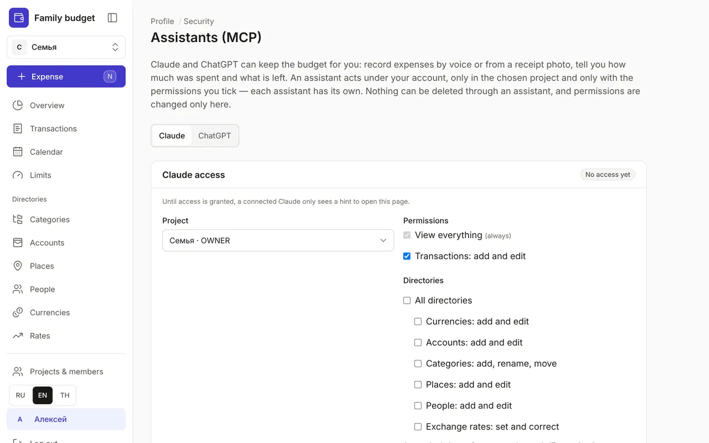

+++
title = "How to connect Claude to your budget"
description = "Log spending by voice or by a receipt photo right from a chat with Claude — on the web, in the phone app and in Claude Code."
date = 2026-10-17

[taxonomies]
topics = ["claude", "security"]

[extra]
level = "beginner"
+++

Claude can keep the budget for you: log expenses by voice or from a receipt photo, tell you how much you have spent and how much is left, and mark planned payments as paid. It works under your account, only in the project you choose and only with the permissions you tick. Nothing can be deleted through Claude.

## 1. Grant access in the budget

Sign in to the budget and open Profile → Security → Assistants (MCP). Choose a project and permissions: "View everything" is always on, and "Transactions: add and edit" is ticked by default. Directories, limits and scheduled operations are up to you. Click "Save access".

## 2. Add the connector in Claude

On claude.ai open Customize → Connectors → "+" → Add custom connector. The server URL and the Client ID are shown on the same Assistants (MCP) page under "How to connect". Click Connect and sign in with your budget account. The connector also appears in the Claude phone app right away.

## 3. Try it

Start a new chat and write, for example: "Coffee 120 baht, cash" or send a receipt photo with "log this". Ask: "How much is left for food this month?" Every change made through Claude goes into the security log, and you can revoke access at any time on the same page.

## Claude Code

For Claude Code, create a personal API token in Profile → Security → API tokens — the token defines the project and permissions. The command to connect is shown on the Assistants (MCP) page.

If you change permissions, start a new chat in Claude: it asks for the list of available actions at the start of a conversation.
