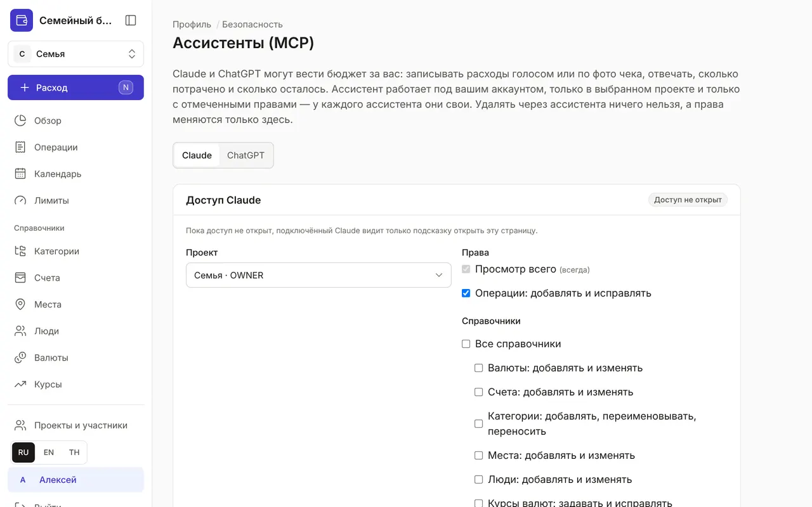

+++
title = "Как подключить Claude к бюджету"
description = "Записывайте траты голосом и по фото чека прямо из чата с Claude — на сайте, в приложении на телефоне и в Claude Code."
date = 2026-10-17

[taxonomies]
topics = ["claude", "security"]

[extra]
level = "beginner"
+++

Claude может вести бюджет за вас: записывать расходы голосом или по фото чека, отвечать, сколько потрачено и сколько осталось, отмечать оплату плановых платежей. Он работает под вашим аккаунтом, только в выбранном проекте и только с отмеченными правами. Удалить через Claude ничего нельзя.

## 1. Откройте доступ в бюджете

Войдите в бюджет и откройте «Профиль» → «Безопасность» → «Ассистенты (MCP)». Выберите проект и права: «Просмотр всего» есть всегда, «Операции: добавлять и исправлять» отмечено по умолчанию. Справочники, лимиты и плановые операции — по желанию. Нажмите «Сохранить доступ».

## 2. Добавьте коннектор в Claude

На claude.ai откройте «Настроить» → «Коннекторы» → «+» → «Добавить свой коннектор». Адрес сервера и Client ID показаны на той же странице «Ассистенты (MCP)» в блоке «Как подключить». Нажмите «Подключить» и войдите своим аккаунтом бюджета. Коннектор сразу появится и в приложении Claude на телефоне.

## 3. Попробуйте

Начните новый чат и напишите, например: «Кофе 120 бат наличными» или пришлите фото чека со словами «запиши». Спросите: «Сколько осталось на еду до конца месяца?» Каждое изменение через Claude попадает в журнал безопасности, а отключить доступ можно в любой момент на той же странице.

## Claude Code

Для Claude Code создайте личный API-токен в «Профиль» → «Безопасность» → «API-токены» — проект и права задаются у токена. Команда для подключения показана на странице «Ассистенты (MCP)».

Если вы поменяли права, начните в Claude новый чат: список доступных действий он запрашивает в начале разговора.
