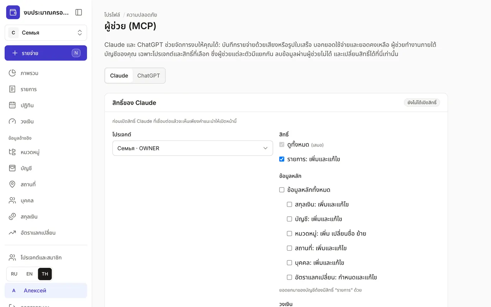

+++
title = "วิธีเชื่อม Claude กับงบของคุณ"
description = "บันทึกรายจ่ายด้วยเสียงหรือรูปใบเสร็จจากแชทกับ Claude ได้เลย — บนเว็บ ในแอปโทรศัพท์ และใน Claude Code"
date = 2026-10-17

[taxonomies]
topics = ["claude", "security"]

[extra]
level = "beginner"
+++

Claude ดูแลงบแทนคุณได้: บันทึกรายจ่ายด้วยเสียงหรือจากรูปใบเสร็จ บอกว่าใช้ไปเท่าไรและเหลือเท่าไร และทำเครื่องหมายว่าชำระรายการตามแผนแล้ว Claude ทำงานภายใต้บัญชีของคุณ เฉพาะในโปรเจกต์ที่คุณเลือก และเฉพาะสิทธิ์ที่คุณติ๊กไว้ ลบอะไรผ่าน Claude ไม่ได้

## 1. เปิดสิทธิ์ในงบ

เข้าสู่ระบบงบ แล้วเปิด "โปรไฟล์" → "ความปลอดภัย" → "ผู้ช่วย (MCP)" เลือกโปรเจกต์และสิทธิ์: "ดูทั้งหมด" เปิดอยู่เสมอ และ "รายการ: เพิ่มและแก้ไข" ถูกติ๊กไว้ตั้งแต่แรก ส่วนข้อมูลหลัก วงเงิน และรายการตามแผนเลือกได้ตามต้องการ แล้วกด "บันทึกสิทธิ์"

## 2. เพิ่มตัวเชื่อมต่อใน Claude

ที่ claude.ai เปิด Customize → Connectors → "+" → Add custom connector URL ของเซิร์ฟเวอร์และ Client ID แสดงอยู่ในหน้า "ผู้ช่วย (MCP)" เดียวกัน ในส่วน "วิธีเชื่อมต่อ" กด Connect แล้วเข้าสู่ระบบด้วยบัญชีงบของคุณ ตัวเชื่อมต่อจะปรากฏในแอป Claude บนโทรศัพท์ทันที

## 3. ลองใช้

เริ่มแชทใหม่แล้วพิมพ์ เช่น "กาแฟ 120 บาท เงินสด" หรือส่งรูปใบเสร็จพร้อมคำว่า "บันทึกให้หน่อย" ถามว่า "เดือนนี้ค่าอาหารเหลือเท่าไร?" ทุกการเปลี่ยนแปลงผ่าน Claude จะถูกบันทึกในบันทึกความปลอดภัย และยกเลิกสิทธิ์ได้ทุกเมื่อในหน้าเดียวกัน

## Claude Code

สำหรับ Claude Code ให้สร้างโทเคน API ส่วนตัวใน "โปรไฟล์" → "ความปลอดภัย" → "โทเคน API" — โปรเจกต์และสิทธิ์กำหนดที่โทเคน คำสั่งสำหรับเชื่อมต่อแสดงอยู่ในหน้า "ผู้ช่วย (MCP)"

ถ้าคุณเปลี่ยนสิทธิ์ ให้เริ่มแชทใหม่ใน Claude เพราะ Claude จะขอรายการสิ่งที่ทำได้ตอนเริ่มบทสนทนา
