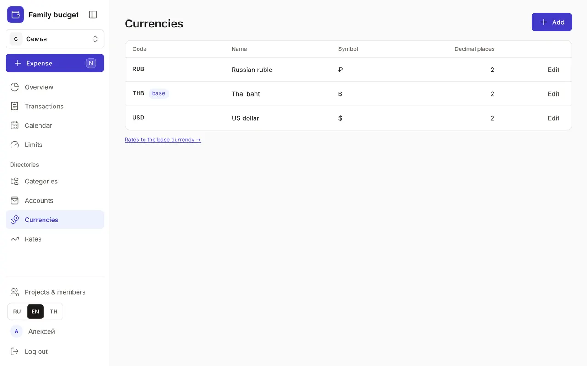
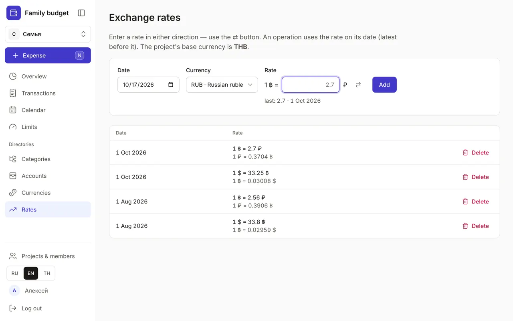

+++
title = "Currencies and exchange rates"
description = "One currency for the budget, any currencies for accounts: how to add a currency, enter a rate in whichever direction suits you and understand the exchange result."
date = 2026-10-17T16:50:00

[taxonomies]
topics = ["currencies"]

[extra]
level = "beginner"
+++

Every project has a base currency, chosen when the budget is created. The Overview, limits and totals are counted in it. Accounts, meanwhile, can be in any currency: amounts are converted to the base one at the rate on the transaction's date.

## 1. Add a currency

Under "Directories", open "Currencies" and click "Add". The "Code" is the three-letter ISO 4217 code: THB, RUB, USD. The "Symbol" is shown next to amounts — ฿, ₽, $. "Decimal places" is 0 to 4, usually 2; it can't be reduced once the currency has amounts. As everywhere, the "Name" can be written in any language and given translations. The base currency is marked with a "base" badge. It, and any currency with active accounts, can't be archived: archive the accounts first.

## 2. Enter a rate

Open "Rates" in the menu or the "Rates to the base currency →" link under the list of currencies. Pick the "Date" and "Currency" and enter the "Rate". You can enter a rate in either direction — the way your bank quotes it: "1 $ = 33.25 ฿" or "1 ฿ = 2.7 ₽". The ⇄ button swaps the direction, and under the field you can see the last rate entered and its date.

If a new rate differs from the previous one many times over, the app asks "Is the direction mixed up?" and offers to fix it with the "Swap direction" button. Delete a wrong rate with "Delete"; changed your mind — "Undo" in the pop-up message.

## 3. Which rate applies

Each transaction is converted at the rate on its date: the latest rate on or before that date is used. So you don't need to enter a rate every day — update it when it changes noticeably, say once a month. If a currency has no rate at all, its amounts are left out of the totals — they can't be converted. The Overview shows an amber warning with a link to "Exchange rates" and a "no rate" tag on the category, and the transaction form and quick entry warn you while you type.

## 4. The exchange result

When you change currency with a transfer between accounts, the bank rarely gives you the rate from your directory. The Overview shows the difference in the period net card as the "Exchange result": "−" means lost on the exchange. It isn't counted in expenses or limits. Record the exchange fee separately, in the transfer's "Fee" field: that one is an expense. How to record an exchange is in the guide [Transactions: expenses, income and transfers](@/guides/transactions/index.en.md).
