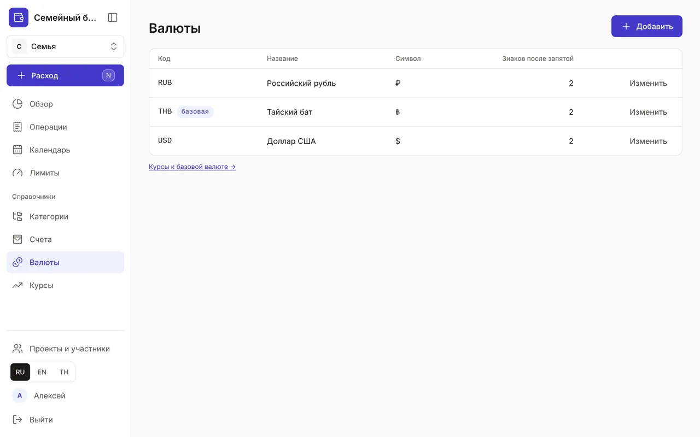
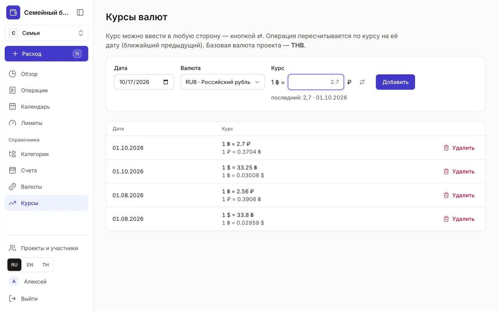

+++
title = "Валюты и курсы"
description = "Бюджет — в одной валюте, счета — в любых: как добавить валюту, ввести курс в удобную сторону и понять курсовую разницу."
date = 2026-10-17T16:50:00

[taxonomies]
topics = ["currencies"]

[extra]
level = "beginner"
+++

У каждого проекта есть базовая валюта — её выбирают при создании бюджета. В ней считаются «Обзор», лимиты и итоги. Счета при этом могут быть в любых валютах: суммы пересчитываются в базовую по курсу на дату операции.

## 1. Добавьте валюту

В «Справочниках» откройте «Валюты» и нажмите «Добавить». «Код» — трёхбуквенный по ISO 4217: THB, RUB, USD. «Символ» показывается рядом с суммами — ฿, ₽, $. «Знаков после запятой» — от 0 до 4, обычно 2; уменьшить нельзя, если в валюте уже есть суммы. «Название», как везде, пишут на любом языке и дополняют переводами. Базовая валюта отмечена бейджем «базовая». Её и валюту, в которой есть активные счета, нельзя архивировать: сначала архивируйте счета.

## 2. Введите курс

Откройте «Курсы» в меню или ссылку «Курсы к базовой валюте →» под списком валют. Заполните «Дата», «Валюта» и «Курс». Курс можно ввести в любую сторону — как пишет ваш банк: «1 $ = 33,25 ฿» или «1 ฿ = 2,7 ₽». Кнопка ⇄ меняет направление, а под полем видно последний введённый курс и его дату.

Если новый курс в разы отличается от прошлого, приложение спросит: «Может, перепутано направление?» — и предложит исправить его кнопкой «Поменять направление». Ошибочный курс удаляется кнопкой «Удалить»; передумали — «Отменить» во всплывающем сообщении.

## 3. Какой курс применяется

Каждая операция пересчитывается по курсу на её дату: берётся последний курс не позже этой даты. Поэтому курс не нужно вводить каждый день — достаточно обновлять его, когда он заметно меняется, например раз в месяц. Если у валюты нет ни одного курса, её суммы не входят в итоги — их нельзя пересчитать. «Обзор» покажет жёлтое предупреждение со ссылкой на «Курсы валют» и пометку «нет курса» у категории, а форма операции и быстрый расход предупредят ещё при вводе.

## 4. Курсовая разница

Когда вы меняете валюту переводом между счетами, банк редко даёт курс из справочника. Разницу «Обзор» показывает в карточке итога периода — строка «Курсовая разница»: «−» значит потеряно на обмене. В расходы и лимиты она не входит. Комиссию за обмен записывайте отдельно, полем «Комиссия» в переводе: это уже расход. Как записать обмен — в гайде [«Операции: расходы, доходы и переводы»](@/guides/transactions/index.md).
