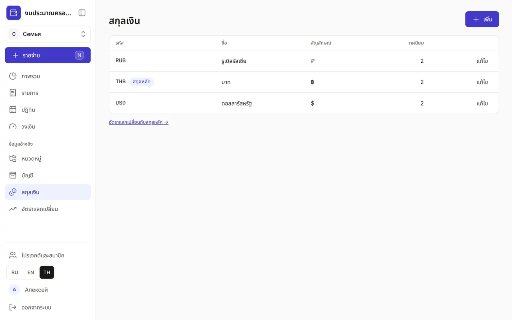
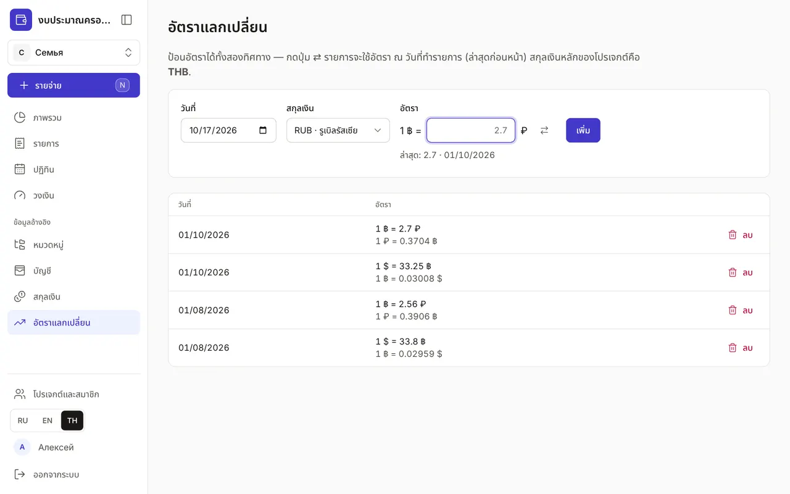

+++
title = "สกุลเงินและอัตราแลกเปลี่ยน"
description = "งบใช้สกุลเงินเดียว บัญชีใช้สกุลใดก็ได้: วิธีเพิ่มสกุลเงิน ใส่อัตราในทิศทางที่สะดวก และเข้าใจผลต่างอัตราแลกเปลี่ยน"
date = 2026-10-17T16:50:00

[taxonomies]
topics = ["currencies"]

[extra]
level = "beginner"
+++

ทุกโปรเจกต์มีสกุลเงินหลัก ซึ่งเลือกตอนสร้างงบ "ภาพรวม" วงเงิน และยอดสรุปคำนวณในสกุลนี้ ส่วนบัญชีใช้สกุลเงินใดก็ได้ จำนวนเงินจะแปลงเป็นสกุลหลักตามอัตรา ณ วันที่ของรายการ

## 1. เพิ่มสกุลเงิน

ใน "ข้อมูลอ้างอิง" เปิด "สกุลเงิน" แล้วกด "เพิ่ม" "รหัส" คือรหัสสามตัวอักษรตาม ISO 4217 เช่น THB, RUB, USD "สัญลักษณ์" จะแสดงข้างจำนวนเงิน เช่น ฿, ₽, $ "ทศนิยม" ปกติคือ 2 "ชื่อ" เขียนได้ทุกภาษาและเพิ่มคำแปลได้เหมือนที่อื่น สกุลเงินหลักมีป้าย "สกุลหลัก"

## 2. ใส่อัตราแลกเปลี่ยน

เปิด "อัตราแลกเปลี่ยน" ในเมนู หรือลิงก์ "อัตราแลกเปลี่ยนกับสกุลหลัก →" ใต้รายการสกุลเงิน เลือก "วันที่" "สกุลเงิน" แล้วใส่ "อัตรา" ใส่อัตราได้ทั้งสองทิศทางตามที่ธนาคารของคุณแสดง: "1 $ = 33.25 ฿" หรือ "1 ฿ = 2.7 ₽" ปุ่ม ⇄ ใช้สลับทิศทาง และใต้ช่องจะเห็นอัตราล่าสุดที่ใส่พร้อมวันที่

ถ้าอัตราใหม่ต่างจากอัตราเดิมหลายเท่า แอปจะถามว่า "อาจสลับทิศทางผิดหรือไม่?" และให้แก้ด้วยปุ่ม "สลับทิศทาง" อัตราที่ใส่ผิดลบได้ด้วยปุ่ม "ลบ" ถ้าเปลี่ยนใจ กด "เลิกทำ" ในข้อความที่ปรากฏขึ้น

## 3. ใช้อัตราไหน

แต่ละรายการแปลงตามอัตรา ณ วันที่ของรายการ โดยใช้อัตราล่าสุดที่ไม่เกินวันนั้น จึงไม่ต้องใส่อัตราทุกวัน — อัปเดตเมื่ออัตราเปลี่ยนชัดเจนก็พอ เช่น เดือนละครั้ง ถ้าสกุลเงินยังไม่มีอัตราเลย จำนวนเงินจะคิด 1:1 และ "ภาพรวม" กับ "ปฏิทิน" จะแสดงคำเตือนสีเหลืองพร้อมลิงก์ "อัตราแลกเปลี่ยน"

## 4. ผลต่างอัตราแลกเปลี่ยน

เมื่อคุณแลกเงินด้วยการโอนระหว่างบัญชี ธนาคารแทบไม่เคยให้อัตราตรงกับข้อมูลอ้างอิง "ภาพรวม" จะแสดงส่วนต่างในการ์ดยอดสุทธิของช่วงเป็น "ผลต่างอัตราแลกเปลี่ยน": "−" คือขาดทุนจากการแลก ยอดนี้ไม่นับในรายจ่ายและวงเงิน ค่าธรรมเนียมการแลกให้บันทึกแยกในช่อง "ค่าธรรมเนียม" ของการโอน ซึ่งนับเป็นรายจ่าย วิธีบันทึกการแลกเงินอยู่ในคู่มือ ["รายการ: รายจ่าย รายรับ และการโอน"](@/guides/transactions/index.th.md)
