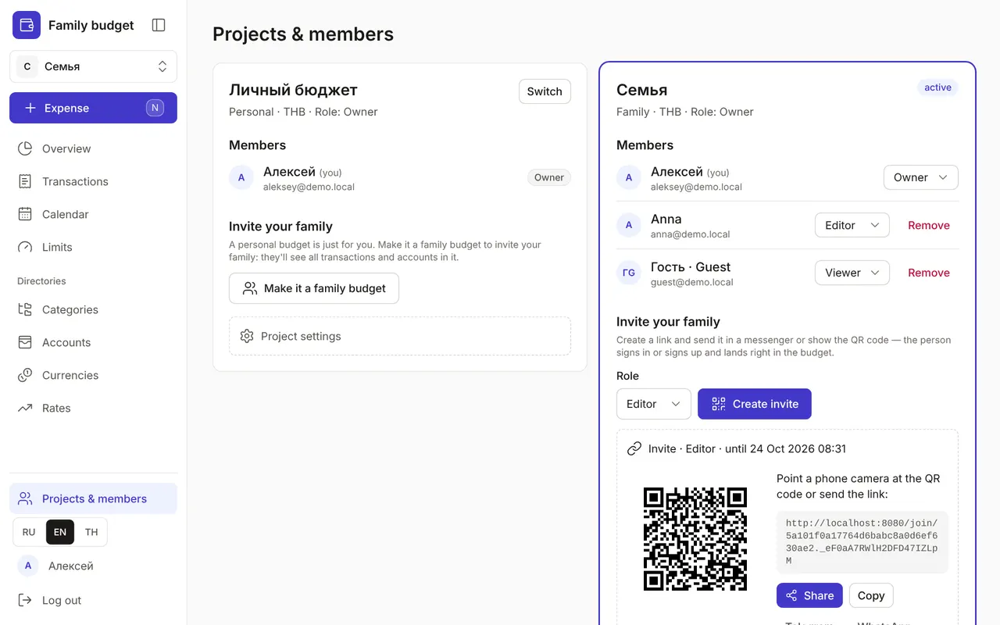

+++
title = "Projects & members: a family budget"
description = "Personal and family budgets, invitations by link or QR code, member roles, switching between projects and settings."
date = 2026-10-17T16:40:00

[taxonomies]
topics = ["family", "security"]

[extra]
level = "beginner"
+++

A project is a separate budget with its own accounts, categories, limits and transactions. After signing up you have a personal project. A family project is kept together: members see the shared accounts and transactions, and everyone logs their own spending from their own phone.

## 1. Create a family budget

Open "Projects & members" at the bottom of the menu. There are two ways. "Make it a family budget" on your personal budget's card turns it into a family one with all its data — but the people you invite will see all its transactions and accounts. If you'd rather keep your personal spending to yourself, create a separate project in the "New project" card: "Name", "Type" — "Family", "Base currency" and "Create". You'll be its owner.

## 2. Invite your family

On the family project's card, in "Invite your family", choose a role and click "Create invite". A link and a QR code appear, along with "Share", "Copy", Telegram and WhatsApp. The person opens the link, signs in or signs up and clicks "Join" — and the budget opens right away.

An invite is valid for 7 days and for one person only. Sent it to the wrong person? Click "Revoke invite". Someone who has already signed in to the app can be added without a link: open "Add by email", enter the address, choose a role and click "Invite".

## 3. Member roles

Every member has a role:
- "Owner" — everything, including members, invites and project settings;
- "Editor" — adds and edits transactions, plans, limits and directories;
- "Viewer" — can only look: a "Read only" bar sits at the top of the pages, and there's no "Expense" button.

The owner changes roles in the "Members" list, and the "Remove" button takes a member out of the project. A member can also leave on their own: "Leave project" → "Yes, leave". After that, only the owner can add them back.

## 4. Switch between projects

The active project is shown at the top of the menu, under the logo. Click its name and pick another one — every section then shows the chosen project's data, and your next expense is logged there. In "Projects & members" the "Switch" button does the same, and the active project has an "active" badge.

## 5. Project settings

The owner has a "Project settings" block: "Rename" the project and turn on "Require 2FA from members" — then a member without a second sign-in factor (an email code or a passkey) sees a request to enable 2FA instead of the data. How to turn on a second factor is in the guide [Profile and security](@/guides/profile/index.en.md).

In the same settings you can delete a family project with the "Delete project forever" button. All the project's transactions, plans, limits and directories are deleted, and this can't be undone: to confirm, you type the project's name.
