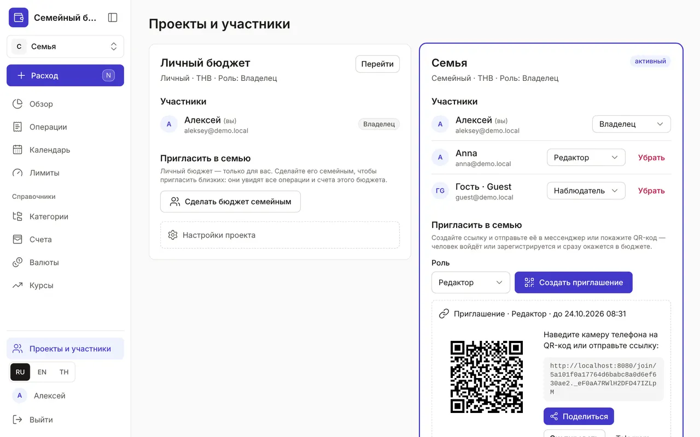

+++
title = "Проекты и участники: семейный бюджет"
description = "Личный и семейный бюджет, приглашение по ссылке или QR-коду, роли участников, переключение между проектами и настройки."
date = 2026-10-17T16:40:00

[taxonomies]
topics = ["family", "security"]

[extra]
level = "beginner"
+++

Проект — это отдельный бюджет со своими счетами, категориями, лимитами и операциями. После регистрации у вас есть личный проект. Семейный проект ведут вместе: участники видят общие счета и операции, и каждый записывает свои траты со своего телефона.

## 1. Создайте семейный бюджет

Откройте «Проекты и участники» внизу меню. Есть два пути. «Сделать бюджет семейным» в карточке личного бюджета превращает его в семейный со всеми данными — но приглашённые увидят все его операции и счета. Если личные траты хотите оставить при себе, создайте отдельный проект в карточке «Новый проект»: «Название», «Тип» — «Семейный», «Базовая валюта» и «Создать». Вы станете его владельцем.

## 2. Пригласите близких

В карточке семейного проекта, в блоке «Пригласить в семью», выберите роль и нажмите «Создать приглашение». Появятся ссылка и QR-код, а рядом — «Поделиться», «Скопировать», Telegram и WhatsApp. Человек откроет ссылку, войдёт или зарегистрируется и нажмёт «Присоединиться» — после этого бюджет сразу откроется.

Приглашение действует 7 дней и только для одного человека. Отправили не тому — нажмите «Отозвать приглашение». Других способов добавить человека нет: участником становится только тот, кто сам открыл ссылку и согласился.

## 3. Роли участников

У каждого участника своя роль:
- «Владелец» — всё, включая участников, приглашения и настройки проекта;
- «Редактор» — добавляет и исправляет операции, планы, лимиты и справочники;
- «Наблюдатель» — только смотрит: вверху страниц у него плашка «Только просмотр», а кнопки «Расход» нет.

Владелец меняет роль в списке «Участники», а кнопка «Убрать» исключает участника из проекта. Участник может уйти и сам: «Выйти из проекта» → «Да, выйти». Вернуть доступ после этого сможет только владелец.

## 4. Переключайтесь между проектами

Активный проект показан вверху меню, под логотипом. Нажмите на его название и выберите другой — все разделы покажут данные выбранного проекта, а следующий расход запишется в него. В «Проектах и участниках» то же делает кнопка «Перейти», а у активного проекта стоит бейдж «активный».

## 5. Настройки проекта

Владельцу доступен блок «Настройки проекта»: «Переименовать» проект и включить «Требовать 2FA от участников» — тогда участник без второго фактора входа (код из письма или passkey) вместо данных увидит просьбу включить 2FA. Как включить второй фактор — в гайде [«Профиль и безопасность»](@/guides/profile/index.md).

В тех же настройках семейный проект можно удалить кнопкой «Удалить проект навсегда». Удалятся все операции, планы, лимиты и справочники проекта, отменить это нельзя: для подтверждения нужно ввести название проекта.
