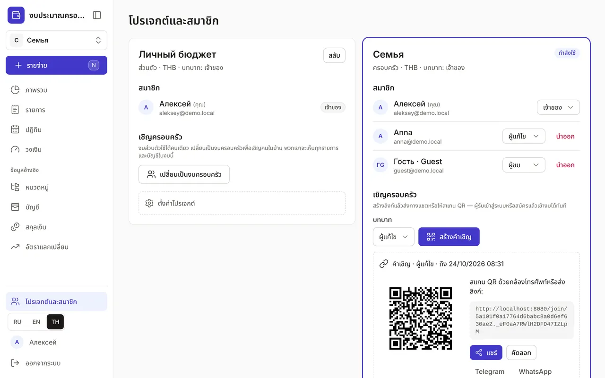

+++
title = "โปรเจกต์และสมาชิก: งบครอบครัว"
description = "งบส่วนตัวและงบครอบครัว การเชิญด้วยลิงก์หรือ QR บทบาทของสมาชิก การสลับโปรเจกต์ และการตั้งค่า"
date = 2026-10-17T16:40:00

[taxonomies]
topics = ["family", "security"]

[extra]
level = "beginner"
+++

โปรเจกต์คืองบแยกหนึ่งชุด มีบัญชี หมวดหมู่ วงเงิน และรายการของตัวเอง หลังสมัครคุณจะมีโปรเจกต์ส่วนตัว ส่วนโปรเจกต์ครอบครัวดูแลร่วมกัน: สมาชิกเห็นบัญชีและรายการร่วมกัน และแต่ละคนบันทึกรายจ่ายของตัวเองจากโทรศัพท์ของตัวเอง

## 1. สร้างงบครอบครัว

เปิด "โปรเจกต์และสมาชิก" ที่ด้านล่างของเมนู ทำได้สองแบบ ปุ่ม "เปลี่ยนเป็นงบครอบครัว" บนการ์ดงบส่วนตัวจะเปลี่ยนงบนั้นเป็นงบครอบครัวพร้อมข้อมูลทั้งหมด — แต่คนที่คุณเชิญจะเห็นทุกรายการและทุกบัญชีในงบนั้น ถ้าอยากเก็บรายจ่ายส่วนตัวไว้เอง ให้สร้างโปรเจกต์แยกในการ์ด "โปรเจกต์ใหม่": "ชื่อ" "ประเภท" — "ครอบครัว" "สกุลเงินหลัก" แล้วกด "สร้าง" คุณจะเป็นเจ้าของโปรเจกต์นั้น

## 2. เชิญคนในบ้าน

บนการ์ดของโปรเจกต์ครอบครัว ในส่วน "เชิญครอบครัว" เลือกบทบาทแล้วกด "สร้างคำเชิญ" จะมีลิงก์และ QR พร้อมปุ่ม "แชร์" "คัดลอก" Telegram และ WhatsApp ผู้รับเปิดลิงก์ เข้าสู่ระบบหรือสมัคร แล้วกด "เข้าร่วม" — งบจะเปิดขึ้นทันที

คำเชิญใช้ได้ 7 วัน และสำหรับหนึ่งคนเท่านั้น ถ้าส่งผิดคน กด "เพิกถอนคำเชิญ" คนที่เคยเข้าสู่ระบบแอปแล้วเพิ่มได้โดยไม่ต้องใช้ลิงก์: เปิด "เพิ่มด้วยอีเมล" ใส่อีเมล เลือกบทบาท แล้วกด "เชิญ"

## 3. บทบาทของสมาชิก

สมาชิกแต่ละคนมีบทบาท:
- "เจ้าของ" — ทำได้ทุกอย่าง รวมถึงจัดการสมาชิก คำเชิญ และการตั้งค่าโปรเจกต์
- "ผู้แก้ไข" — เพิ่มและแก้ไขรายการ แผน วงเงิน และข้อมูลอ้างอิง
- "ผู้ชม" — ดูได้อย่างเดียว: ด้านบนของหน้ามีแถบ "ดูอย่างเดียว" และไม่มีปุ่ม "รายจ่าย"

เจ้าของเปลี่ยนบทบาทได้ในรายการ "สมาชิก" และปุ่ม "นำออก" ใช้นำสมาชิกออกจากโปรเจกต์ สมาชิกออกเองได้ด้วย: "ออกจากโปรเจกต์" → "ใช่ ออก" หลังจากนั้นมีเพียงเจ้าของที่เพิ่มกลับเข้ามาได้

## 4. สลับโปรเจกต์

โปรเจกต์ที่กำลังใช้แสดงอยู่ด้านบนของเมนู ใต้โลโก้ กดชื่อโปรเจกต์แล้วเลือกโปรเจกต์อื่น — ทุกหน้าจะแสดงข้อมูลของโปรเจกต์ที่เลือก และรายจ่ายถัดไปจะบันทึกในโปรเจกต์นั้น ในหน้า "โปรเจกต์และสมาชิก" ปุ่ม "สลับ" ทำได้เหมือนกัน และโปรเจกต์ที่ใช้อยู่มีป้าย "กำลังใช้"

## 5. ตั้งค่าโปรเจกต์

เจ้าของมีส่วน "ตั้งค่าโปรเจกต์": "เปลี่ยนชื่อ" โปรเจกต์ และเปิด "บังคับให้สมาชิกใช้ 2FA" — สมาชิกที่ยังไม่มีปัจจัยที่สองในการเข้าสู่ระบบ (รหัสทางอีเมลหรือ passkey) จะเห็นคำขอให้เปิด 2FA แทนข้อมูล วิธีเปิดปัจจัยที่สองอยู่ในคู่มือ ["โปรไฟล์และความปลอดภัย"](@/guides/profile/index.th.md)

ในการตั้งค่าเดียวกัน ลบโปรเจกต์ครอบครัวได้ด้วยปุ่ม "ลบโปรเจกต์ถาวร" รายการ แผน วงเงิน และข้อมูลอ้างอิงทั้งหมดของโปรเจกต์จะถูกลบและกู้คืนไม่ได้ ต้องพิมพ์ชื่อโปรเจกต์เพื่อยืนยัน
