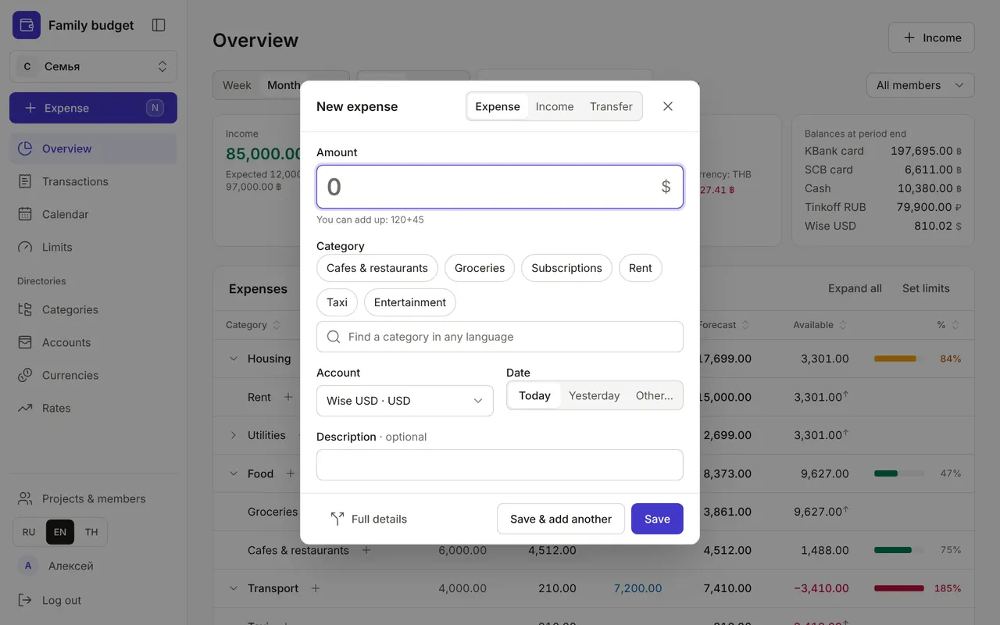
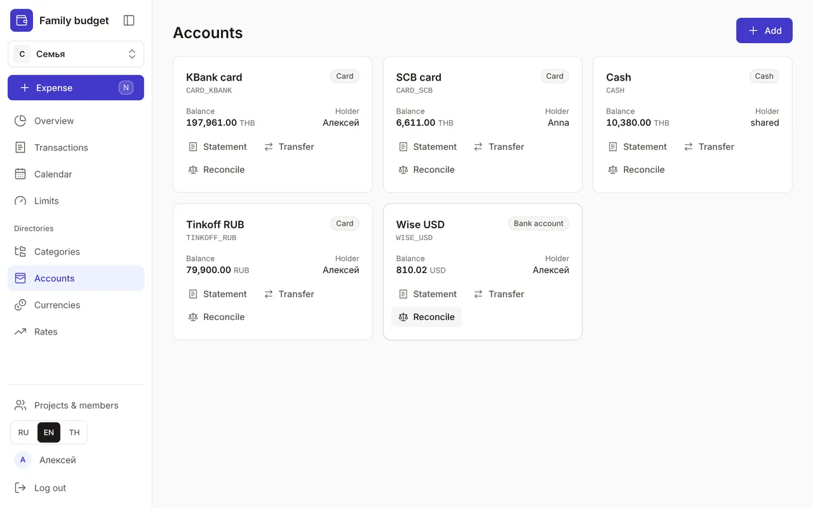
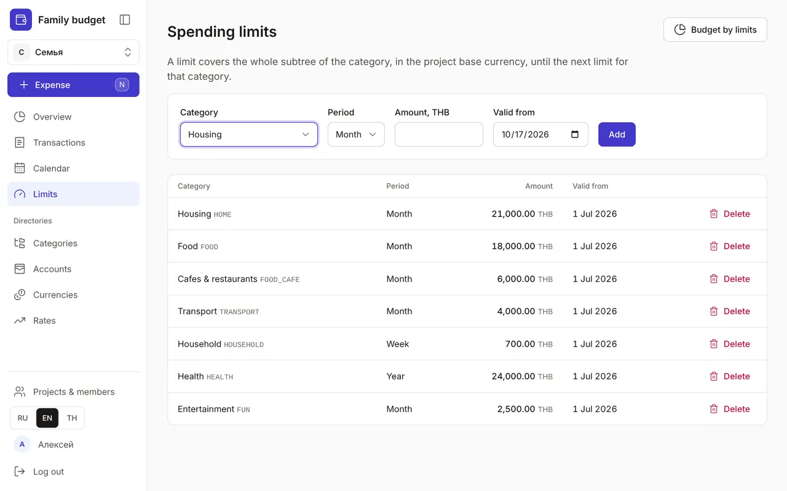
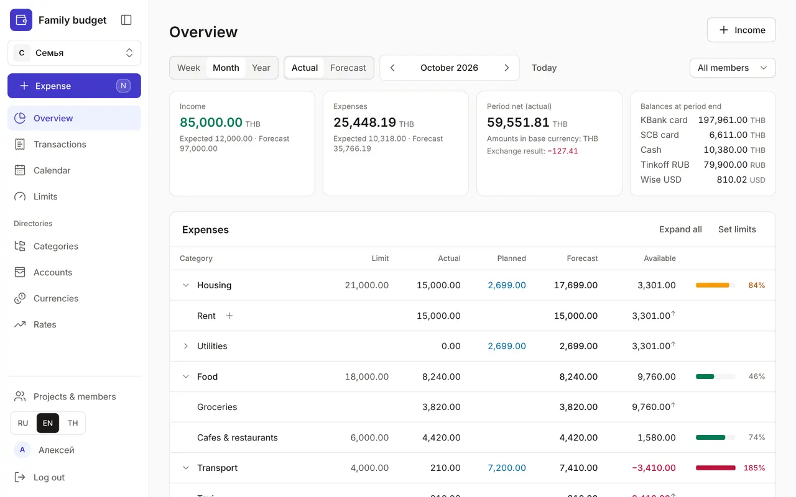
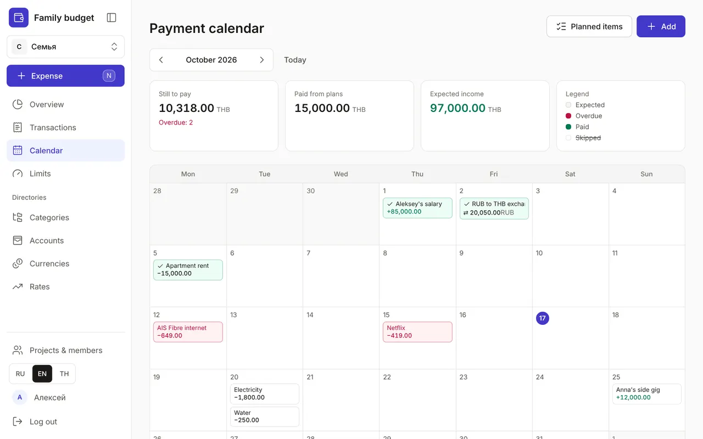
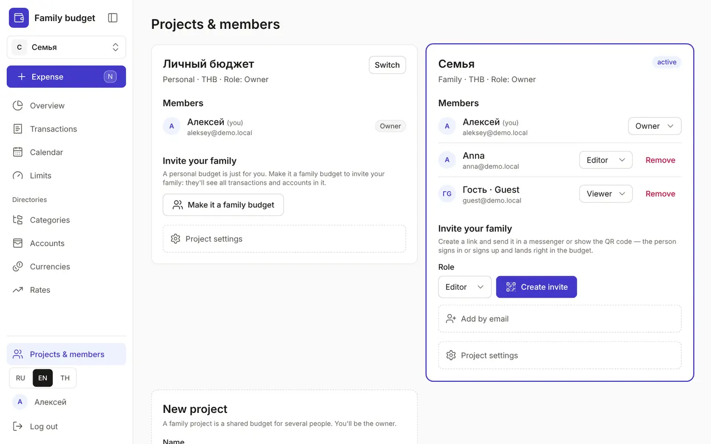

+++
title = "Your first budget in 5 minutes"
description = "Log your first expense, add accounts, set limits and invite your family — step by step, with screenshots."
date = 2026-10-17

[taxonomies]
topics = ["start", "family", "accounts", "limits", "planning"]

[extra]
level = "beginner"
+++

Sign up with the "Create a budget" button on the home page — a personal budget with a "Cash" account appears right away. Everything else takes five minutes to set up. The screenshots show the demo family: you can open it without signing up with the "View the demo" button.

## 1. Log your first expense

Click "Expense" in the left menu (on a computer — the <kbd>N</kbd> key, on a phone — the round "+"). Enter the amount, choose a category and press Enter. You can do the maths right in the field: "120+45".

If one receipt has both groceries and household goods, click "Full details" and each part goes to its own category.

## 2. Add accounts

In "Accounts", add your cards, cash and savings — in any currency. Move money between your own accounts with "Transfer": transfers and currency exchange don't count as spending. "Reconcile" compares the balance with your bank.

## 3. Set limits

In "Limits", choose a category, a period and an amount — for example, "Food" per month. A limit covers the whole category branch: "Groceries" and "Cafes & restaurants" are part of "Food".

## 4. Keep an eye on the budget in the Overview

The Overview shows the limit, actual, plan and what is still available for every category. The bar turns amber at 80% of the limit and red when you go over. The "Actual" / "Forecast" switch adds planned payments that are not paid yet.

## 5. Add regular payments

In the "Calendar", add rent, subscriptions and salary as planned items. On the payment day click "Mark as paid" — the transaction is recorded for you, and you can adjust the amount.

## 6. Invite your family

In "Projects & members", click "Make it a family budget", choose a role and "Create invite". Send the link to a messenger or show the QR code: the person signs in or signs up and lands right in the budget.

Done: now the whole family's spending is in one place. Logging it is even faster by voice with Claude — see the [separate guide](@/guides/connect-claude/index.en.md).
