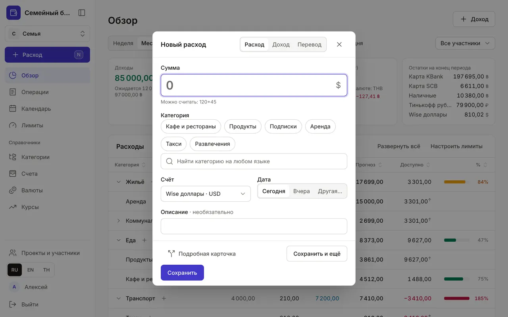
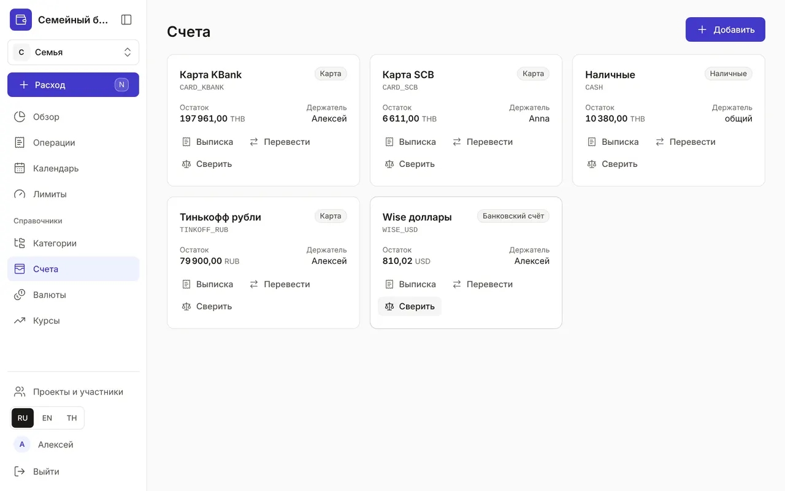
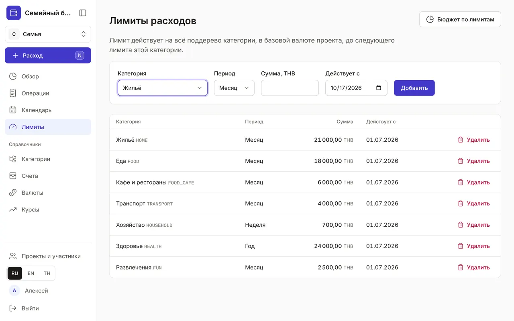
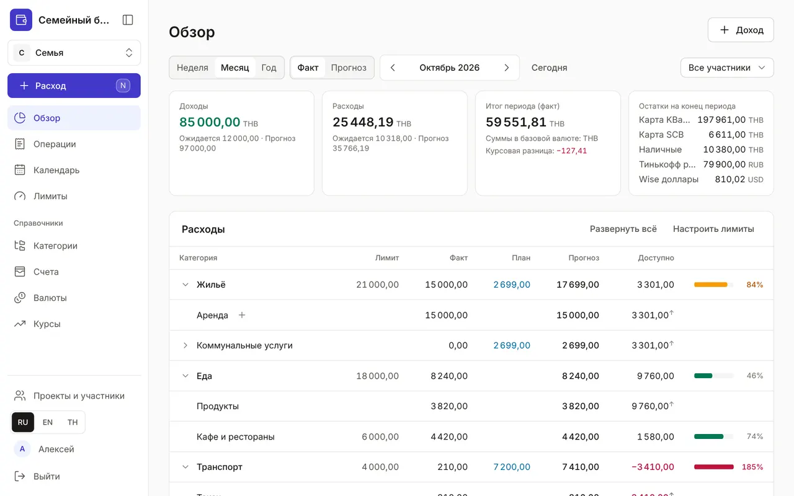
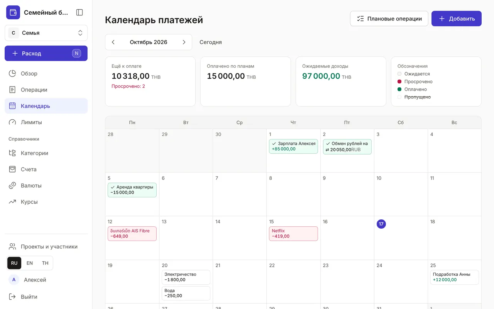
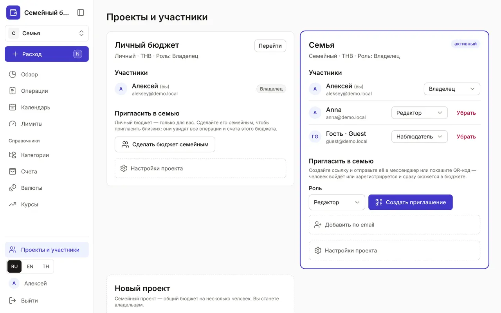

+++
title = "Первый бюджет за 5 минут"
description = "Записать первую трату, добавить счета, задать лимиты и пригласить семью — по шагам и со скриншотами."
date = 2026-10-17

[taxonomies]
topics = ["start", "family", "accounts", "limits", "planning"]

[extra]
level = "beginner"
+++

Зарегистрируйтесь по кнопке «Создать бюджет» на главной — личный бюджет со счётом «Наличные» появится сразу. Дальше всё можно настроить за пять минут. На скриншотах — демо-семья: её можно открыть без регистрации кнопкой «Посмотреть демо».

## 1. Запишите первую трату

Нажмите «Расход» в меню слева (на компьютере — клавиша <kbd>N</kbd>, на телефоне — круглая «+»). Введите сумму, выберите категорию и нажмите Enter. Сумму можно посчитать прямо в поле: «120+45».

Если в одном чеке продукты и бытовая химия — нажмите «Разбить на позиции», и каждая часть уйдёт в свою категорию.

## 2. Добавьте счета

В разделе «Счета» заведите карты, наличные и сбережения — в любой валюте. Деньги между своими счетами переводите кнопкой «Перевести»: перевод и обмен валют не считаются расходом. «Сверить» сравнит остаток с банком.

## 3. Задайте лимиты

В «Лимитах» выберите категорию, период и сумму — например, «Еда» на месяц. Лимит действует на всю ветку категории: «Продукты» и «Кафе и рестораны» входят в «Еду».

## 4. Следите за бюджетом в «Обзоре»

«Обзор» показывает по каждой категории лимит, факт, план и сколько ещё доступно. Полоса желтеет при 80 % лимита и краснеет при превышении. Переключатель «Факт» и «Прогноз» добавляет к потраченному ещё не оплаченные плановые платежи.

## 5. Внесите регулярные платежи

В «Календаре» добавьте аренду, подписки и зарплату как плановые операции. В день платежа нажмите «Оплатил» — операция запишется сама, сумму можно поправить.

## 6. Пригласите семью

В «Проектах и участниках» нажмите «Сделать бюджет семейным», выберите роль и «Создать приглашение». Отправьте ссылку в мессенджер или покажите QR-код: человек войдёт или зарегистрируется и сразу окажется в бюджете.

Готово: теперь траты всей семьи — в одном месте. Записывать их ещё быстрее можно голосом через Claude — об этом [отдельный гайд](@/guides/connect-claude/index.md).
