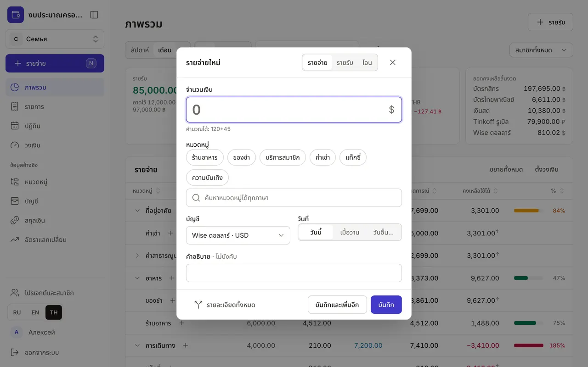
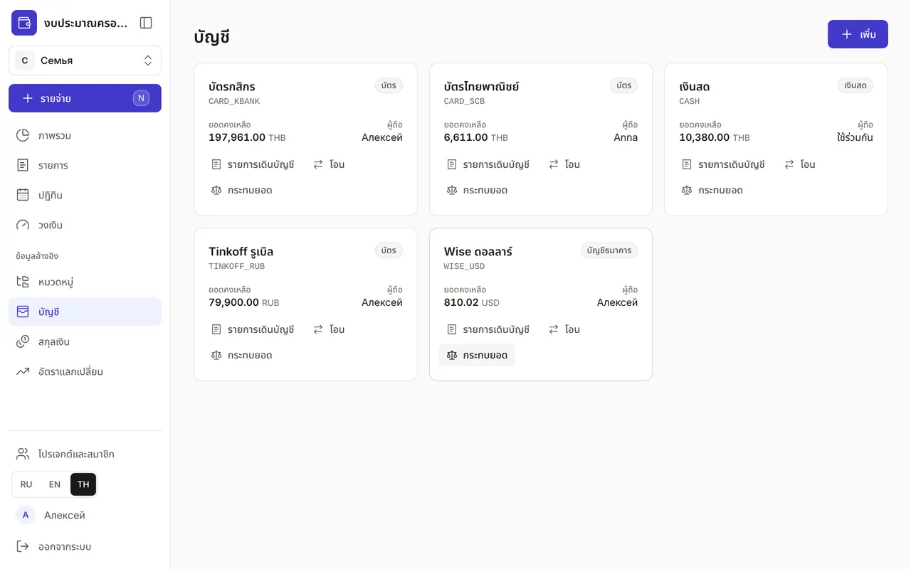
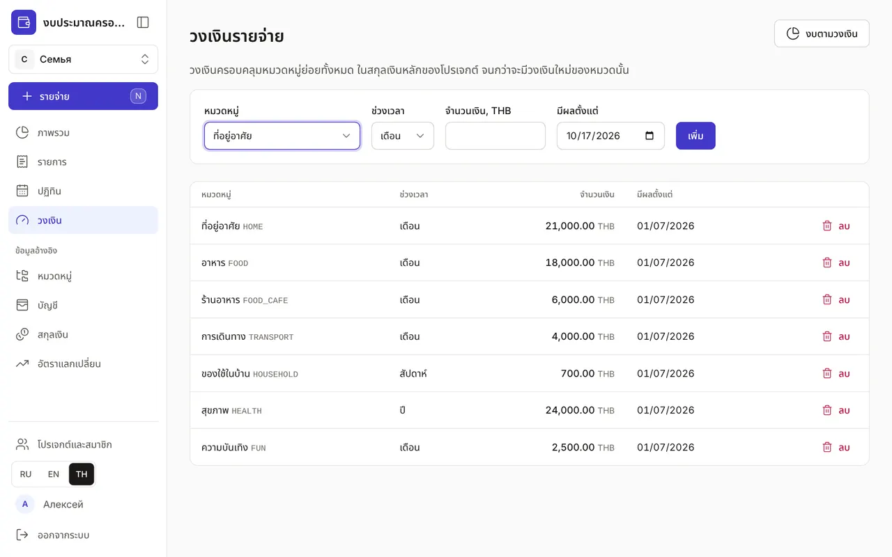
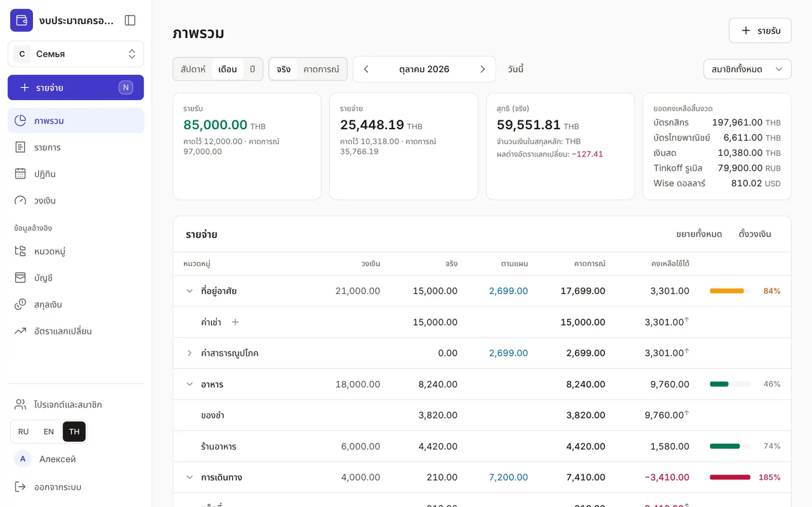
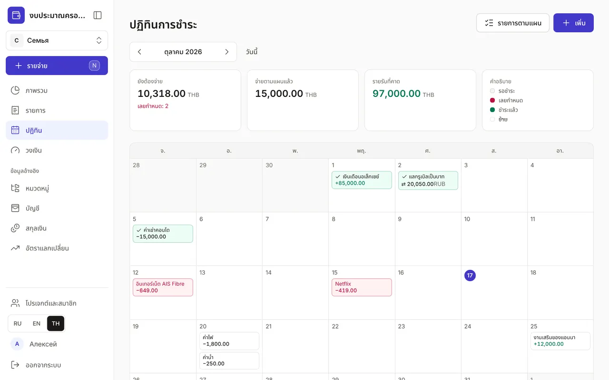
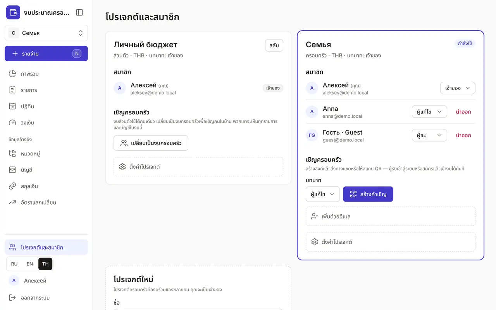

+++
title = "งบประมาณแรกใน 5 นาที"
description = "บันทึกรายจ่ายแรก เพิ่มบัญชี ตั้งวงเงิน และเชิญครอบครัว — ทีละขั้นตอน พร้อมภาพหน้าจอ"
date = 2026-10-17

[taxonomies]
topics = ["start", "family", "accounts", "limits", "planning"]

[extra]
level = "beginner"
+++

สมัครด้วยปุ่ม "สร้างงบประมาณ" ที่หน้าแรก — งบส่วนตัวพร้อมบัญชี "เงินสด" จะถูกสร้างทันที ส่วนที่เหลือตั้งค่าได้ในห้านาที ภาพหน้าจอเป็นครอบครัวเดโม ซึ่งเปิดดูได้โดยไม่ต้องสมัครด้วยปุ่ม "ดูเดโม"

## 1. บันทึกรายจ่ายแรก

กด "รายจ่าย" ในเมนูด้านซ้าย (บนคอมพิวเตอร์กดปุ่ม <kbd>N</kbd> บนโทรศัพท์กดปุ่มกลม "+") ใส่จำนวนเงิน เลือกหมวดหมู่ แล้วกด Enter คำนวณในช่องได้เลย เช่น "120+45"

ถ้าใบเสร็จเดียวมีทั้งของชำและของใช้ในบ้าน กด "รายละเอียดทั้งหมด" แล้วแต่ละส่วนจะไปอยู่ในหมวดของตัวเอง

## 2. เพิ่มบัญชี

ในหน้า "บัญชี" เพิ่มบัตร เงินสด และเงินออม — ในสกุลเงินใดก็ได้ ย้ายเงินระหว่างบัญชีของคุณด้วยปุ่ม "โอน": การโอนและแลกเงินไม่นับเป็นรายจ่าย ส่วน "กระทบยอด" จะเทียบยอดคงเหลือกับธนาคาร

## 3. ตั้งวงเงิน

ในหน้า "วงเงิน" เลือกหมวดหมู่ ช่วงเวลา และจำนวนเงิน เช่น "อาหาร" ต่อเดือน วงเงินครอบคลุมทั้งกิ่งของหมวด: "ของชำ" และ "ร้านอาหาร" อยู่ใน "อาหาร"

## 4. ติดตามงบในหน้าภาพรวม

หน้า "ภาพรวม" แสดงวงเงิน ยอดจริง แผน และยอดที่ยังใช้ได้ของแต่ละหมวด แถบจะเป็นสีเหลืองเมื่อใช้ไป 80% และเป็นสีแดงเมื่อเกินวงเงิน ปุ่มสลับ "จริง" และ "คาดการณ์" จะรวมการชำระตามแผนที่ยังไม่ได้จ่ายเข้าไปด้วย

## 5. เพิ่มการชำระประจำ

ใน "ปฏิทิน" เพิ่มค่าเช่า ค่าสมาชิก และเงินเดือนเป็นรายการตามแผน ถึงวันชำระให้กด "ชำระแล้ว" — ระบบจะบันทึกรายการให้เอง และแก้จำนวนเงินได้

## 6. เชิญครอบครัว

ในหน้า "โปรเจกต์และสมาชิก" กด "เปลี่ยนเป็นงบครอบครัว" เลือกบทบาท แล้วกด "สร้างคำเชิญ" ส่งลิงก์ในแชทหรือให้สแกนคิวอาร์โค้ด อีกฝ่ายจะเข้าสู่ระบบหรือสมัคร แล้วเข้ามาอยู่ในงบทันที

เสร็จแล้ว: ตอนนี้รายจ่ายของทั้งครอบครัวอยู่ในที่เดียว บันทึกได้เร็วยิ่งขึ้นด้วยเสียงผ่าน Claude — อ่าน[คู่มือแยก](@/guides/connect-claude/index.th.md)
