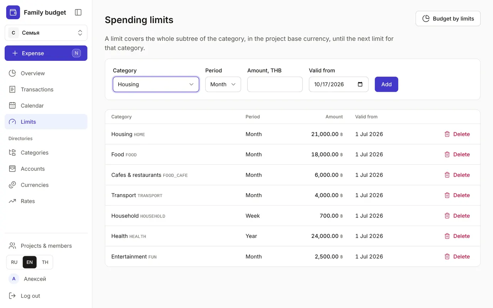

+++
title = "Spending limits"
description = "How much you can spend on food, transport or entertainment per week, month or year — and how the app warns you before you overspend."
date = 2026-10-17T17:20:00

[taxonomies]
topics = ["limits"]

[extra]
level = "beginner"
+++

A limit is the amount you're ready to spend on a category over a period. The app doesn't stop you from spending more, but it shows what's left and warns you early — taking into account planned payments that are still ahead.

## 1. Add a limit

In "Limits", choose a category, a "Period" — "Month", "Week" or "Year" — an amount and a "Valid from" date, then click "Add". The amount is in the project's base currency: spending from a card in another currency is converted at the exchange rate.

## 2. A limit covers the whole branch

A limit applies to the whole branch: a limit on "Food" includes both "Groceries" and "Cafes & restaurants". You can set a limit on a subcategory too — then the Overview shows the smaller of two: what's available under its own limit and what's left for its parent.

Start with three to five big branches: housing, food, transport, entertainment. A subcategory only needs a limit if that's exactly where spending gets out of hand — cafes, for example.

## 3. When a limit changes

Decided to spend more on food from next month? Add a new limit for the same category with a "Valid from" date. A limit applies to the whole period containing that date: a monthly limit set on October 20 covers all of October. The old one stays in the list marked "superseded" and keeps applying to past periods, so your history isn't distorted, and the yearly budget adds the limits up month by month.

Don't want to limit a category any more? Choose it and a date, then click "Remove limit from date": from that period on there is no limit, past periods keep theirs, and the list marks the rule "limit removed". A limit of 0 is different: you can't spend on the category at all, and any expense is over the limit — a way to ban yourself from, say, food delivery. Delete a limit added by mistake with "Delete"; changed your mind — click "Undo" in the pop-up message.

## 4. How the warnings work

In the Overview, every category with a limit has a progress bar: amber from 80% of the limit, red when it's exceeded. It's based on the forecast — what's already spent plus the period's unpaid planned items — so the warning comes before the money runs out. In the quick expense window, under the category, you can see what's available and what will remain after this expense. The "Budget by limits" button takes you from "Limits" to the [Overview](@/guides/overview/index.en.md).
