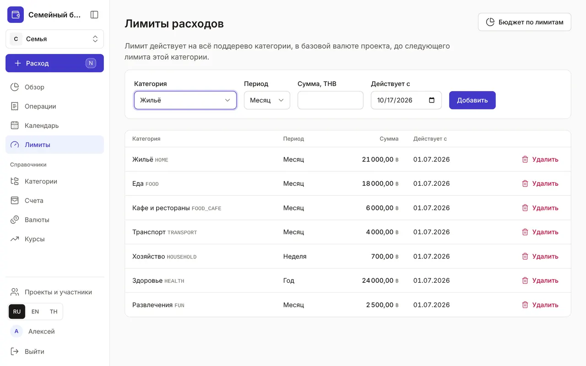

+++
title = "Лимиты расходов"
description = "Сколько можно тратить на еду, транспорт или развлечения за неделю, месяц или год — и как приложение предупреждает о перерасходе."
date = 2026-10-17T17:20:00

[taxonomies]
topics = ["limits"]

[extra]
level = "beginner"
+++

Лимит — сумма, которую вы готовы тратить на категорию за период. Приложение не запрещает тратить больше, но показывает, сколько осталось, и предупреждает заранее — с учётом плановых платежей, которые ещё впереди.

## 1. Добавьте лимит

В разделе «Лимиты» выберите категорию, «Период» — «Месяц», «Неделя» или «Год», сумму и дату «Действует с» и нажмите «Добавить». Сумма — в базовой валюте проекта: траты с карты в другой валюте пересчитаются по курсу.

## 2. Лимит на ветку категорий

Лимит действует на всю ветку: лимит на «Еду» учитывает и «Продукты», и «Кафе и рестораны». Можно задать лимит и подкатегории — тогда «Обзор» покажет меньшее из двух: что доступно по её собственному лимиту и что осталось у родителя.

Начните с трёх–пяти крупных веток: жильё, еда, транспорт, развлечения. Подкатегориям лимит нужен, только если именно они выходят из-под контроля — например, кафе.

## 3. Лимит изменился

Решили с нового месяца тратить на еду больше — добавьте новый лимит той же категории с датой «Действует с». Лимит действует на весь период, в который попала дата: месячный лимит, заведённый 20 октября, — на весь октябрь. Старый останется в списке с пометкой «заменён» и продолжит действовать для прошлых периодов, так что история не исказится, а годовой бюджет сложит лимиты по месяцам. Новый лимит заменяет прежний с начала своего периода, даже если период другой: месячный лимит или «Снять лимит с даты» с периодом «Месяц» после недельного действуют с 1-го числа, годовой — с 1 января, и старый лимит в эти периоды уже не считается.

Больше не хотите ограничивать категорию — выберите её, дату и нажмите «Снять лимит с даты»: с этого периода лимита нет, прошлые периоды его сохраняют, в списке такое правило помечено «лимит снят». Лимит 0 — другое: тратить на категорию нельзя совсем, любая трата — перерасход; так можно запретить себе, например, доставку еды. Ошибочно добавленный лимит удаляется кнопкой «Удалить»; передумали — нажмите «Отменить» во всплывающем сообщении.

## 4. Как работают предупреждения

В «Обзоре» у каждой категории с лимитом — полоса заполнения: жёлтая с 80 % лимита, красная при превышении. Считается прогноз — уже потраченное плюс неоплаченные плановые операции периода, поэтому предупреждение приходит до того, как деньги кончатся. В окне быстрого расхода под категорией видно, сколько доступно и сколько останется после этой траты. Кнопка «Бюджет по лимитам» ведёт из «Лимитов» в [«Обзор»](@/guides/overview/index.md).
