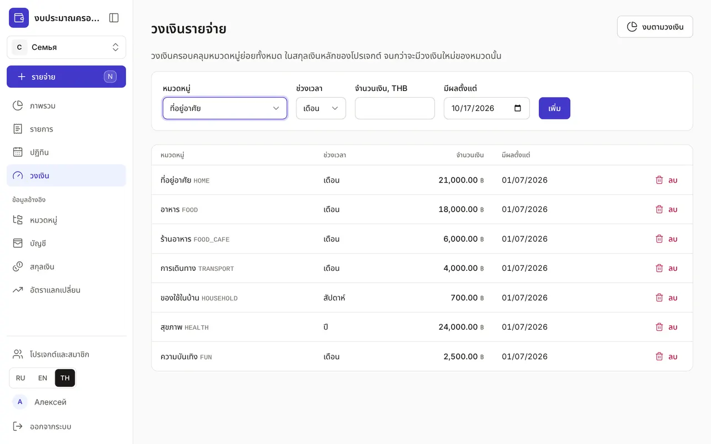

+++
title = "วงเงินรายจ่าย"
description = "ใช้จ่ายค่าอาหาร การเดินทาง หรือความบันเทิงได้เท่าไรต่อสัปดาห์ เดือน หรือปี — และแอปเตือนก่อนใช้เกินอย่างไร"
date = 2026-10-17T17:20:00

[taxonomies]
topics = ["limits"]

[extra]
level = "beginner"
+++

วงเงินคือจำนวนเงินที่คุณพร้อมจะใช้กับหมวดหนึ่งในช่วงเวลาหนึ่ง แอปไม่ห้ามใช้เกิน แต่จะแสดงว่าเหลือเท่าไรและเตือนล่วงหน้า โดยนับรวมรายการตามแผนที่ยังไม่ถึงกำหนดด้วย

## 1. เพิ่มวงเงิน

ในหน้า "วงเงิน" เลือกหมวดหมู่ "ช่วงเวลา" — "เดือน" "สัปดาห์" หรือ "ปี" — จำนวนเงิน และวันที่ "มีผลตั้งแต่" แล้วกด "เพิ่ม" จำนวนเงินเป็นสกุลเงินหลักของโปรเจกต์ รายจ่ายจากบัตรในสกุลเงินอื่นจะแปลงตามอัตราแลกเปลี่ยน

## 2. วงเงินครอบคลุมทั้งกลุ่มหมวด

วงเงินใช้กับหมวดและหมวดย่อยทั้งหมด: วงเงินของ "อาหาร" รวมทั้ง "ของชำ" และ "ร้านอาหาร" ตั้งวงเงินให้หมวดย่อยได้ด้วย แล้ว "ภาพรวม" จะแสดงค่าที่น้อยกว่าระหว่างยอดที่ใช้ได้ตามวงเงินของหมวดย่อยเอง กับยอดที่เหลือของหมวดหลัก

เริ่มจากกลุ่มใหญ่สามถึงห้ากลุ่ม: ที่อยู่อาศัย อาหาร การเดินทาง ความบันเทิง หมวดย่อยต้องมีวงเงินก็ต่อเมื่อเป็นจุดที่ใช้จ่ายเกินจริง ๆ เช่น ร้านอาหาร

## 3. เมื่อวงเงินเปลี่ยน

ตั้งใจจะใช้ค่าอาหารมากขึ้นตั้งแต่เดือนหน้า? เพิ่มวงเงินใหม่ให้หมวดเดิมพร้อมวันที่ "มีผลตั้งแต่" วงเงินเก่าจะยังอยู่ในรายการพร้อมป้าย "ถูกแทนที่" และยังใช้กับช่วงเวลาที่ผ่านมา ประวัติจึงไม่ผิดเพี้ยน วงเงินที่ไม่ต้องการลบได้ด้วยปุ่ม "ลบ" ถ้าเปลี่ยนใจ กด "เลิกทำ" ในข้อความที่ปรากฏขึ้น

## 4. การเตือนทำงานอย่างไร

ใน "ภาพรวม" ทุกหมวดที่มีวงเงินจะมีแถบแสดงการใช้: สีเหลืองตั้งแต่ 80% ของวงเงิน และสีแดงเมื่อเกิน ระบบคิดจากยอดคาดการณ์ — ยอดที่ใช้ไปแล้วบวกรายการตามแผนที่ยังไม่ได้ชำระในช่วงนั้น จึงเตือนก่อนเงินจะหมด ในหน้าต่างบันทึกรายจ่ายด่วน ใต้หมวดหมู่จะเห็นว่าใช้ได้อีกเท่าไรและจะเหลือเท่าไรหลังรายจ่ายนี้ ปุ่ม "งบตามวงเงิน" จะพาจากหน้า "วงเงิน" ไปที่ ["ภาพรวม"](@/guides/overview/index.th.md)
