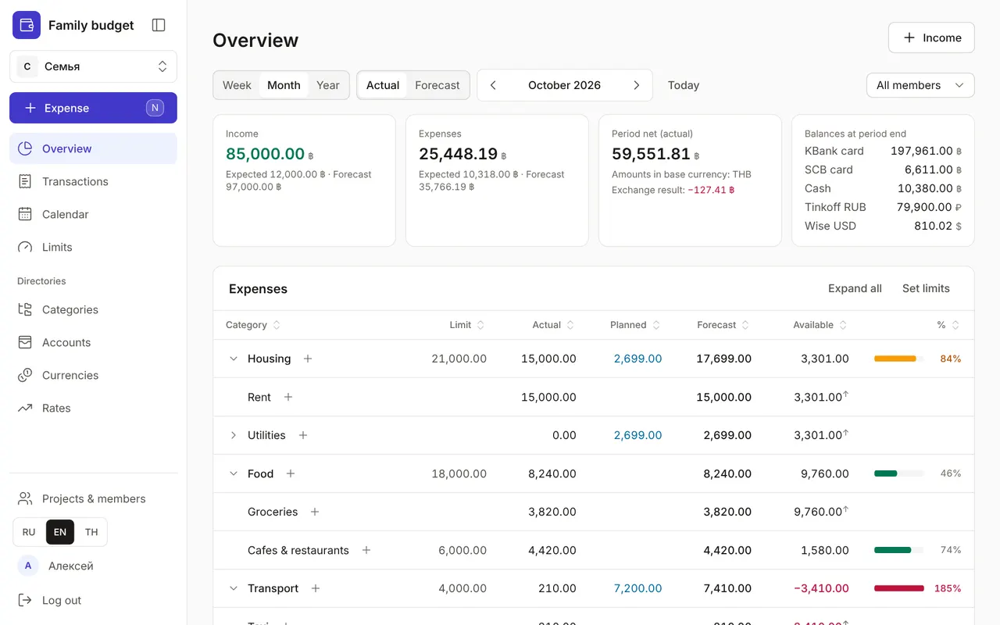
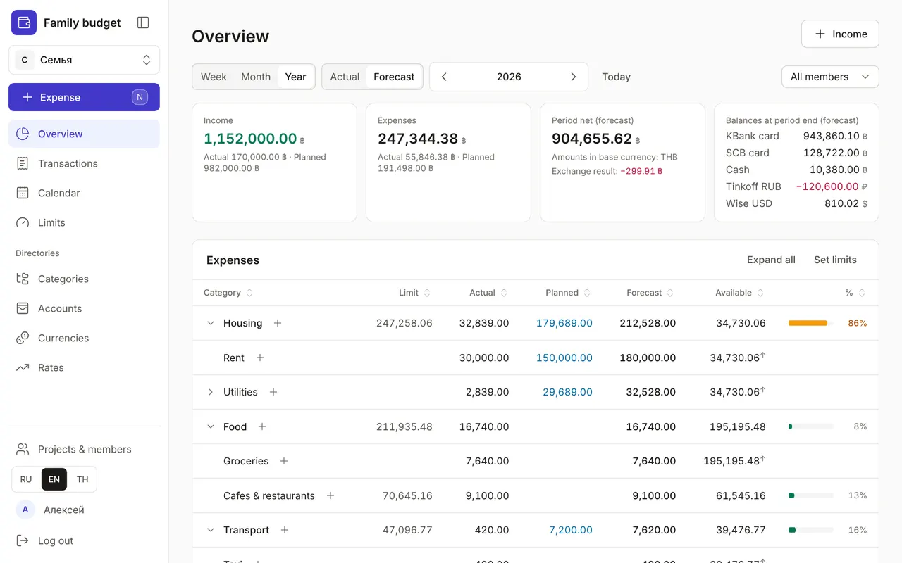

+++
title = "Overview: what's spent and what's left"
description = "How to read the budget's home page: the period, actual and forecast, spending by category with limits, and upcoming payments."
date = 2026-10-17T17:50:00

[taxonomies]
topics = ["limits", "planning"]

[extra]
level = "beginner"
+++

The Overview is the main page of your budget. It answers three questions: how much came in and went out in the period, how much you can still spend in each category, and which payments are coming up. All amounts are converted to the project's base currency, so a card in baht and an account in dollars add up to one figure.

## 1. Choose the period

The "Week", "Month", "Year" switch sets the period, the arrows move it back and forth, and "Today" brings you back to the current one. In a family budget there's an "All members" list on the right: pick a member and the actuals will count only that member's transactions, while limits and plans stay shared.

## 2. Actual or forecast

The four cards at the top are "Income", "Expenses", the period net and "Balances at period end" for every account. In "Actual" mode only recorded transactions count, and under each amount you can see how much is still "Expected" from planned items in the calendar. In "Forecast" mode those planned amounts are added to the actuals, so you can see how the month or year will end and what will be left in your accounts.

If you exchanged currency in the period, the net card shows an "Exchange result": how much you lost ("−") or gained on the exchange compared with the rate in your directory. It isn't counted as an expense.

## 3. Spending by category

The "Expenses" table follows the category tree. Each row shows the "Limit"; "Actual" — already spent; "Planned" — still due from the calendar; "Forecast" — actual plus planned; "Available" — what's left of the limit after all planned spending; and a bar with the percentage of the limit. The bar turns amber when the forecast reaches 80% of the limit and red when it goes over.

The arrow next to a category expands its subcategories, and "Expand all" opens the whole tree. Click a column header to sort the table: for example, by "Available" — the categories where money is running out move to the top. The "+" icon in a row opens the expense window with that category already selected.

An ↑ arrow next to the "Available" amount means the subcategory is capped by its parent's limit. "Cafes & restaurants" may still have 2,000 left, but if the whole of "Food" has only 500 left, then 500 is available. An amber icon next to a category means its subcategories' limits add up to more than the category's own limit.

## 4. Income and upcoming payments

Below the spending is the "Income" table: planned, actual and total by income category. Further down (on a very wide screen — on the right) is the "Still planned" list: the period's unpaid planned items with their dates, overdue ones in red. Click a row to mark it as paid or skip it — more in the guide [Calendar: regular payments and income](@/guides/calendar/index.en.md).

## 5. If the numbers look odd

An amber warning "No rate to the base currency — these amounts are left out of the totals" means one of your accounts' currencies has no exchange rate: such amounts show on categories with a "no rate" tag and count in neither actuals nor totals. Add it via the "Exchange rates" link in the warning — see [Currencies and exchange rates](@/guides/currencies-and-rates/index.en.md). An empty "Limit" column means no limits yet: the "Set limits" button above the table takes you to [Spending limits](@/guides/limits/index.en.md).
