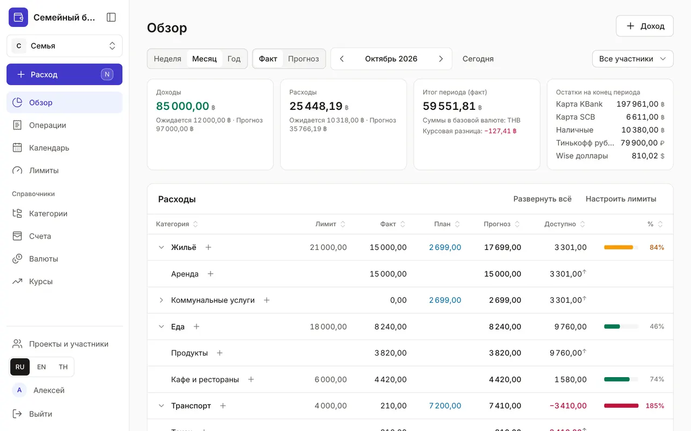
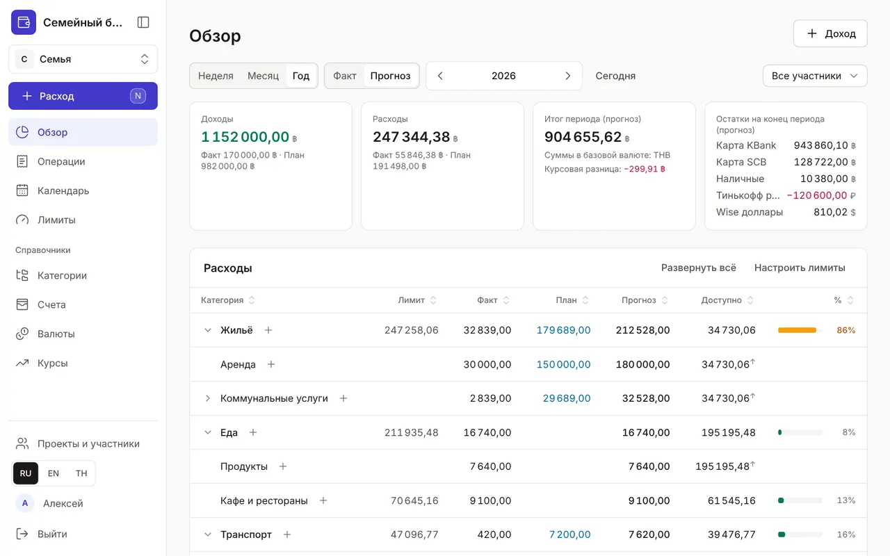

+++
title = "Обзор: сколько потрачено и сколько осталось"
description = "Как читать главную страницу бюджета: период, факт и прогноз, расходы по категориям с лимитами и ближайшие платежи."
date = 2026-10-17T17:50:00

[taxonomies]
topics = ["limits", "planning"]

[extra]
level = "beginner"
+++

«Обзор» открывается первым после входа. Он отвечает на три вопроса: сколько пришло и ушло за период, сколько ещё можно потратить по каждой категории и какие платежи впереди. Все суммы пересчитаны в базовую валюту проекта, поэтому карта в батах и счёт в долларах складываются в одну цифру.

## 1. Выберите период

Переключатель «Неделя», «Месяц», «Год» задаёт период, стрелки листают его назад и вперёд, «Сегодня» возвращает к текущему. В семейном бюджете справа есть список «Все участники»: выберите участника — факт посчитается только по операциям этого участника, а лимиты и планы останутся общими.

## 2. Факт или прогноз

Четыре карточки сверху — «Доходы», «Расходы», итог периода и «Остатки на конец периода» по каждому счёту. В режиме «Факт» считаются только записанные операции, а под суммой видно, сколько ещё «Ожидается» по плановым операциям из календаря. В режиме «Прогноз» эти плановые суммы добавлены к факту — так видно, чем закончится месяц или год и сколько останется на счетах.

Если в периоде вы меняли валюту, в карточке итога появится «Курсовая разница»: сколько потеряно («−») или выиграно на обмене по сравнению с курсом из справочника. В расходы она не входит.

## 3. Расходы по категориям

Таблица «Расходы» повторяет дерево категорий. В каждой строке: «Лимит»; «Факт» — уже потрачено; «План» — ещё предстоит по календарю; «Прогноз» — факт плюс план; «Доступно» — сколько осталось до лимита после всех плановых трат; и полоса с процентом лимита. Полоса желтеет, когда прогноз доходит до 80 % лимита, и краснеет при превышении.

Стрелка у категории раскрывает подкатегории, «Развернуть всё» — всё дерево сразу. Нажмите заголовок колонки, чтобы отсортировать таблицу: например, по «Доступно» — и сверху окажутся категории, где деньги заканчиваются. Значок «+» в строке открывает окно расхода, где эта категория уже выбрана.

Стрелка ↑ у суммы «Доступно» значит, что подкатегорию ограничивает лимит родителя. В «Кафе и ресторанах» может оставаться 2 000, но если на всю «Еду» осталось 500, доступно 500. Жёлтый значок у категории — сумма лимитов её подкатегорий больше лимита самой категории.

## 4. Доходы и ближайшие платежи

Под расходами — таблица «Доходы»: план, факт и итог по категориям доходов. Ниже (на очень широком экране — справа) — список «Ещё предстоит по планам»: неоплаченные плановые операции периода с датами, просроченные — красным. Нажмите строку, чтобы отметить оплату или пропустить платёж, — подробнее в гайде [«Календарь: регулярные платежи и доходы»](@/guides/calendar/index.md).

## 5. Если цифры выглядят странно

Жёлтое предупреждение «Нет курса к базовой валюте — суммы посчитаны 1:1» значит, что для какой-то валюты счёта не задан курс. Добавьте его по ссылке «Курсы валют» в предупреждении — см. [«Валюты и курсы»](@/guides/currencies-and-rates/index.md). Пустая колонка «Лимит» — лимиты ещё не заданы: кнопка «Настроить лимиты» над таблицей ведёт в [«Лимиты расходов»](@/guides/limits/index.md).
