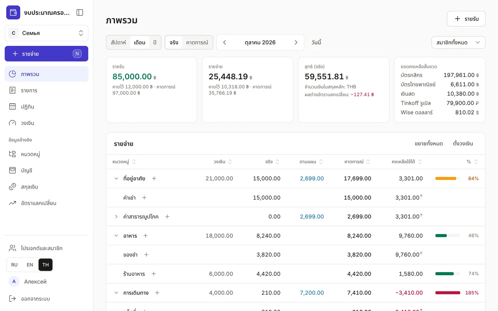
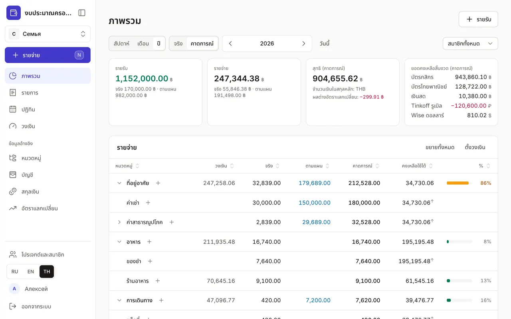

+++
title = "ภาพรวม: ใช้ไปเท่าไรและเหลือเท่าไร"
description = "วิธีอ่านหน้าหลักของงบ: ช่วงเวลา ยอดจริงและคาดการณ์ รายจ่ายตามหมวดพร้อมวงเงิน และรายการที่ใกล้ถึงกำหนด"
date = 2026-10-17T17:50:00

[taxonomies]
topics = ["limits", "planning"]

[extra]
level = "beginner"
+++

"ภาพรวม" เป็นหน้าแรกที่เห็นหลังเข้าสู่ระบบ หน้านี้ตอบสามคำถาม: ในช่วงเวลานี้เงินเข้าและออกเท่าไร แต่ละหมวดยังใช้ได้อีกเท่าไร และมีรายการอะไรที่ต้องชำระต่อไป ทุกจำนวนแปลงเป็นสกุลเงินหลักของโปรเจกต์แล้ว บัตรเงินบาทและบัญชีดอลลาร์จึงรวมเป็นตัวเลขเดียวได้

## 1. เลือกช่วงเวลา

ปุ่ม "สัปดาห์" "เดือน" "ปี" ใช้เลือกช่วงเวลา ลูกศรใช้เลื่อนไปก่อนหน้าหรือถัดไป และ "วันนี้" พากลับมาช่วงปัจจุบัน ในงบครอบครัวจะมีรายการ "สมาชิกทั้งหมด" ทางขวา เลือกสมาชิกคนหนึ่งแล้วยอดจริงจะนับเฉพาะรายการของสมาชิกคนนั้น ส่วนวงเงินและแผนยังเป็นของทุกคน

## 2. ยอดจริงหรือคาดการณ์

การ์ดสี่ใบด้านบนคือ "รายรับ" "รายจ่าย" ยอดสุทธิของช่วง และ "ยอดคงเหลือสิ้นงวด" ของทุกบัญชี ในโหมด "จริง" จะนับเฉพาะรายการที่บันทึกแล้ว และใต้ตัวเลขจะเห็นว่ายัง "คาดไว้" อีกเท่าไรจากรายการตามแผนในปฏิทิน ในโหมด "คาดการณ์" ยอดตามแผนจะถูกบวกเข้ากับยอดจริง ทำให้เห็นว่าเดือนหรือปีจะจบอย่างไร และบัญชีจะเหลือเงินเท่าไร

ถ้าในช่วงนั้นมีการแลกเงิน การ์ดยอดสุทธิจะแสดง "ผลต่างอัตราแลกเปลี่ยน": ขาดทุน ("−") หรือได้กำไรจากการแลกเท่าไรเมื่อเทียบกับอัตราในข้อมูลอ้างอิง ยอดนี้ไม่นับเป็นรายจ่าย

## 3. รายจ่ายตามหมวด

ตาราง "รายจ่าย" เรียงตามโครงสร้างหมวดหมู่ แต่ละแถวมี "วงเงิน" "จริง" คือใช้ไปแล้ว "ตามแผน" คือยังต้องจ่ายตามปฏิทิน "คาดการณ์" คือจริงบวกตามแผน "คงเหลือใช้ได้" คือเหลือจากวงเงินเท่าไรหลังหักรายการตามแผนทั้งหมด และแถบแสดงเปอร์เซ็นต์ของวงเงิน แถบจะเป็นสีเหลืองเมื่อยอดคาดการณ์ถึง 80% ของวงเงิน และเป็นสีแดงเมื่อเกินวงเงิน

ลูกศรข้างหมวดใช้เปิดหมวดย่อย ส่วน "ขยายทั้งหมด" เปิดทั้งโครงสร้าง กดหัวคอลัมน์เพื่อเรียงตาราง เช่น เรียงตาม "คงเหลือใช้ได้" แล้วหมวดที่เงินใกล้หมดจะขึ้นมาอยู่ด้านบน ไอคอน "+" ในแถวจะเปิดหน้าต่างบันทึกรายจ่ายพร้อมเลือกหมวดนั้นไว้แล้ว

ลูกศร ↑ ข้างยอด "คงเหลือใช้ได้" หมายความว่าหมวดย่อยถูกจำกัดด้วยวงเงินของหมวดหลัก "ร้านอาหาร" อาจยังเหลือ 2,000 แต่ถ้าทั้งหมวด "อาหาร" เหลือเพียง 500 ก็ใช้ได้แค่ 500 ไอคอนสีเหลืองข้างหมวดหมายความว่าวงเงินของหมวดย่อยรวมกันเกินวงเงินของหมวดนั้นเอง

## 4. รายรับและรายการที่ใกล้ถึงกำหนด

ใต้ตารางรายจ่ายคือตาราง "รายรับ": ตามแผน จริง และรวม แยกตามหมวดรายรับ ถัดลงไป (บนจอกว้างมากจะอยู่ทางขวา) คือรายการ "ยังรอตามแผน": รายการตามแผนที่ยังไม่ได้ชำระในช่วงนี้พร้อมวันที่ รายการที่เลยกำหนดเป็นสีแดง กดแถวเพื่อบันทึกการชำระหรือข้ามรายการ อ่านเพิ่มในคู่มือ ["ปฏิทิน: การชำระและรายรับประจำ"](@/guides/calendar/index.th.md)

## 5. ถ้าตัวเลขดูแปลก ๆ

คำเตือนสีเหลือง "ไม่มีอัตราแลกเปลี่ยน — คิด 1:1" หมายความว่าสกุลเงินของบัญชีบางสกุลยังไม่มีอัตราแลกเปลี่ยน เพิ่มได้จากลิงก์ "อัตราแลกเปลี่ยน" ในคำเตือน ดู ["สกุลเงินและอัตราแลกเปลี่ยน"](@/guides/currencies-and-rates/index.th.md) ถ้าคอลัมน์ "วงเงิน" ว่าง แปลว่ายังไม่ได้ตั้งวงเงิน ปุ่ม "ตั้งวงเงิน" เหนือตารางจะพาไปที่ ["วงเงินรายจ่าย"](@/guides/limits/index.th.md)
