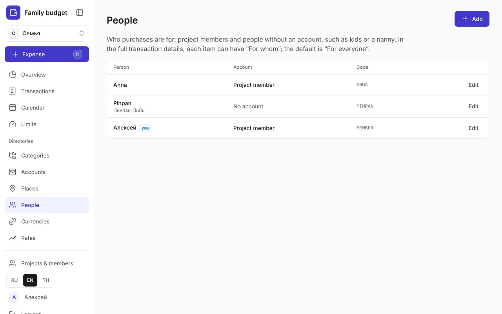
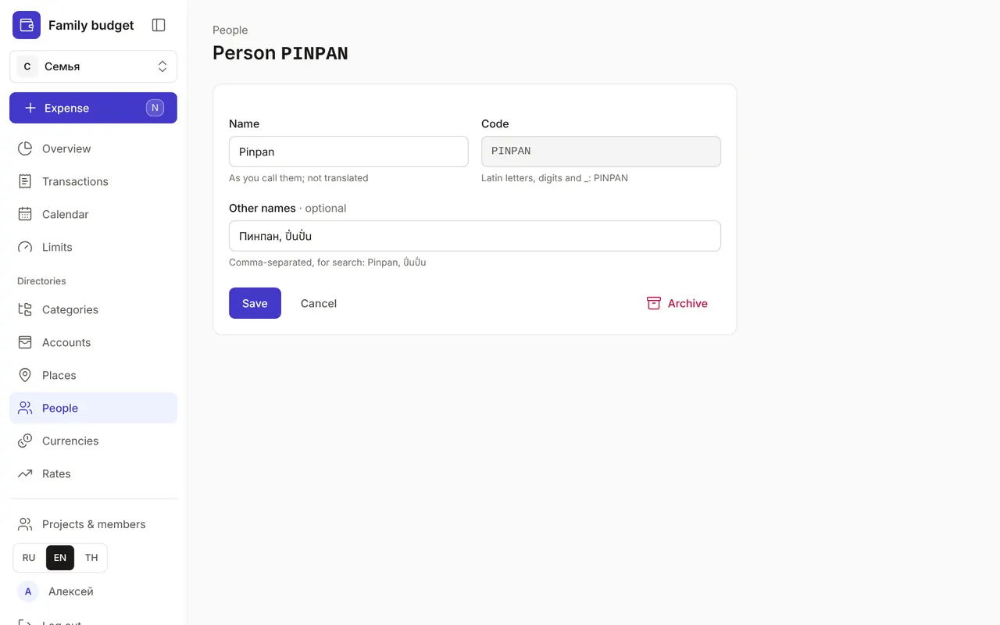
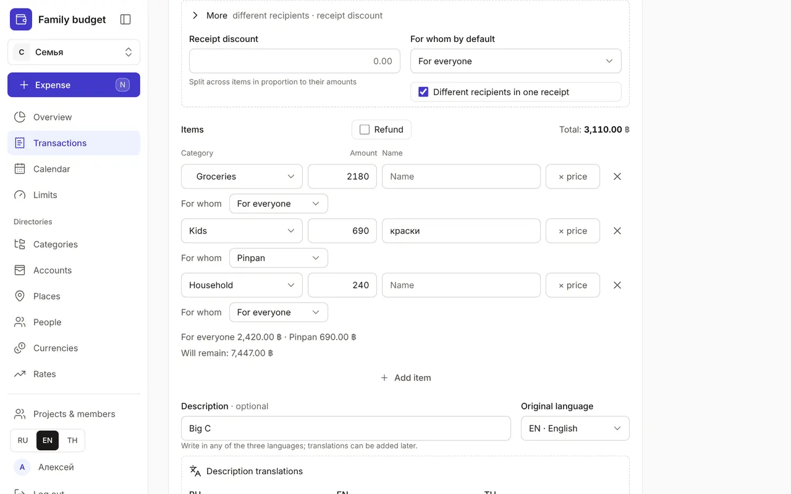
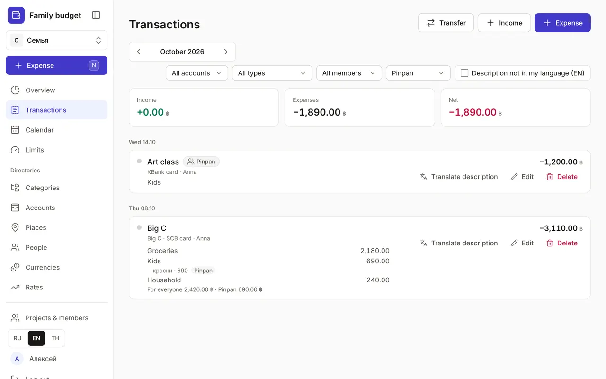

+++
title = "People and “For whom”"
description = "How to mark who a purchase is for — everyone, yourself or a child — split a receipt between people and see how much was spent on each."
date = 2026-10-20T12:00:00

[taxonomies]
topics = ["family", "claude"]

[extra]
level = "beginner"
+++

A normal purchase is “For everyone”: groceries, rent, utilities. But paints for your daughter, an art class or Anna's medicine are handy to mark separately — then you can see how much was spent on each person in a month. That's what the “People” directory and the “For whom” field in the full transaction details are for.

## 1. Who is in “People”

“People” is under “Directories”. Project members appear there by themselves: a record is created when someone creates the project or joins it by invitation, and it is archived when they leave. Your own record is marked “you” — in the choice it is called “For myself”. The “Account” column shows who is a project member and who has no account.

## 2. Add someone without an account

Click “Add”. In the form:
- “Name” — what you call them: Pinpan, nanny Noi. The name is not translated;
- “Code” — Latin letters, digits and _, for example PINPAN; Claude and the API find the person by it, and the code can't be changed after saving;
- “Other names” — comma-separated: Пинпан, ปิ่นปั่น. Search uses them, Thai included.

You can edit a member's name here too — say, “Mum” instead of a full name; their profile stays the same. If a member deletes their account, their name is erased, and past transactions show them as “Former member”.

## 3. “For whom” in the full details

Quick entry doesn't ask anything: the purchase is “For everyone”. To set a recipient, open “Full details” and expand “More”. “For whom by default” applies to the whole receipt. If one receipt has purchases for different people, turn on “Different recipients in one receipt” — each item gets a “For whom” row, and a summary under the items shows how much is for everyone, for yourself and for Pinpan. When a receipt has several items of one category, the “Whole category “…”” link sets the recipient for all of them.

Turn off “Different recipients in one receipt” and the app asks “Reset all to “…”?”: “Reset” gives the whole receipt to the default recipient, “Keep different” changes nothing. Without JavaScript the “For whom” rows work too, and the server sorts out the recipients when you save. The last choice isn't remembered: the next purchase is “For everyone” again.

## 4. In “Transactions”

A transaction whose items are all for one person has a label with their name. If the recipients differ, the labels are on the items and a summary by person is under the transaction. “For everyone” isn't labelled: it's the usual case. The “For whom” filter keeps the transactions that have purchases for the chosen person, and the totals at the top count only their items — so you see how much went on the child this month.

## 5. Through Claude

Tell Claude “art class for Pinpan, 1200” and it records the expense with the recipient. You can also set a recipient for single items of a receipt. Without a word about it, the purchase is “For everyone”. Claude adds a new person only with your consent and with the “People: add and edit” permission (or “All directories”) — see [“How to connect Claude to your budget”](@/guides/connect-claude/index.en.md).

Mark the recipient where it matters to you: spending on a child, gifts, personal purchases. Let the rest stay “For everyone” — entry won't get any slower.
