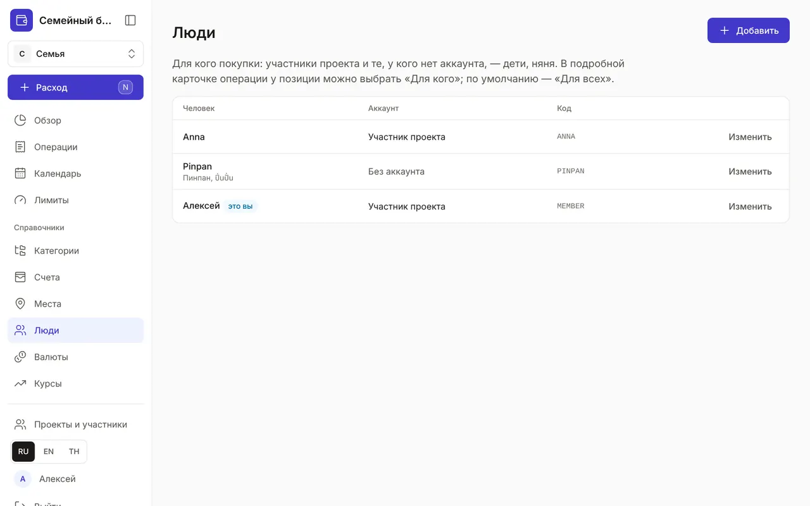
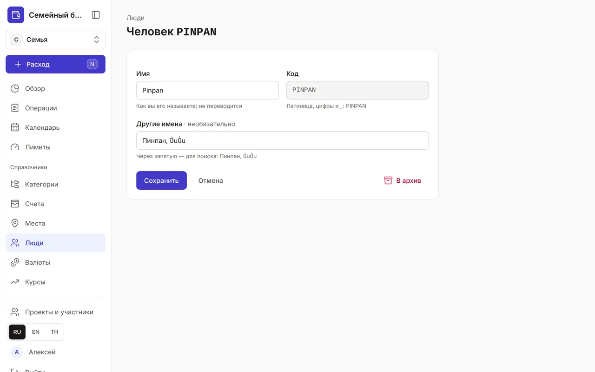
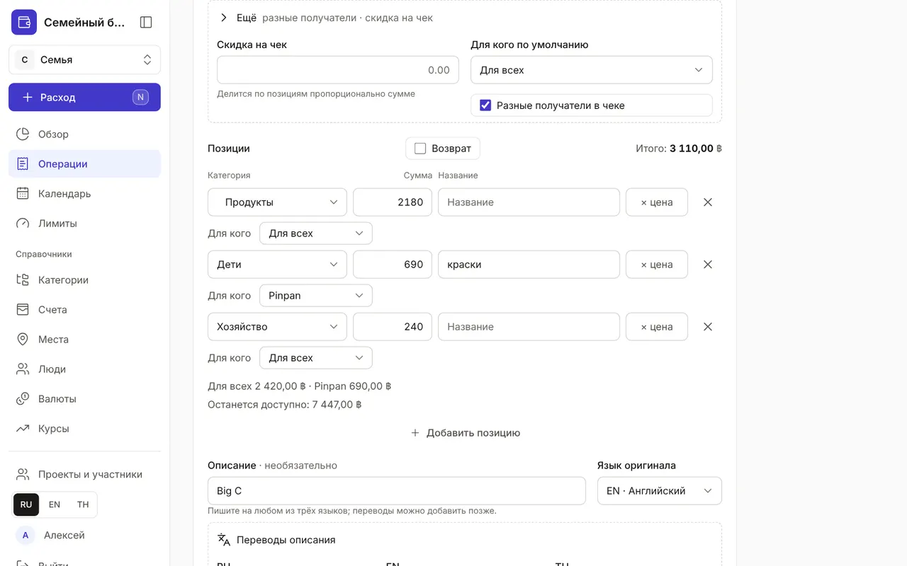
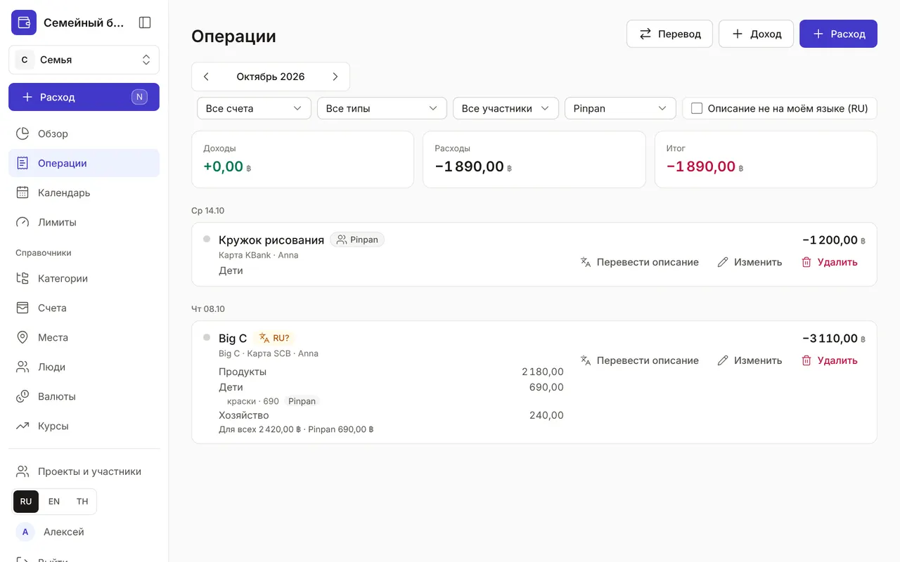

+++
title = "Люди и «Для кого»"
description = "Как отметить, для кого покупка — для всех, для себя или для ребёнка, — разделить чек между людьми и увидеть, сколько потрачено на каждого."
date = 2026-10-20T12:00:00

[taxonomies]
topics = ["family", "claude"]

[extra]
level = "beginner"
+++

Обычная покупка — «Для всех»: продукты, аренда, коммунальные. Но краски для дочери, кружок или лекарства для Анны удобно отметить отдельно — тогда видно, сколько за месяц потрачено на каждого. Для этого есть справочник «Люди» и поле «Для кого» в подробной карточке операции.

## 1. Кто есть в «Людях»

Раздел «Люди» — в «Справочниках». Участники проекта появляются там сами: запись создаётся, когда человек создаёт проект или вступает в него по приглашению, и уходит в архив, когда он выходит. Ваша запись отмечена «это вы» — в выборе она называется «Для себя». В колонке «Аккаунт» видно, кто участник проекта, а у кого аккаунта нет.

## 2. Добавьте того, у кого нет аккаунта

Нажмите «Добавить». В форме:
- «Имя» — как вы его называете: Pinpan, няня Ной. Имя не переводится;
- «Код» — латинские буквы, цифры и _, например PINPAN; по нему человека находят Claude и API, после сохранения код не меняется;
- «Другие имена» — через запятую: Пинпан, ปิ่นปั่น. По ним работает поиск, в том числе на тайском.

Имя участника можно поправить здесь же — например, «Мама» вместо полного имени; в его профиле ничего не изменится. Если участник удалит аккаунт, его имя сотрётся, а в прошлых операциях он останется как «Удалённый участник».

## 3. «Для кого» в подробной карточке

Быстрый ввод ничего не спрашивает: покупка — «Для всех». Чтобы указать получателя, откройте «Подробная карточка» и раскройте «Ещё». «Для кого по умолчанию» относится ко всему чеку. Если в одном чеке покупки для разных людей, включите «Разные получатели в чеке» — у каждой позиции появится строка «Для кого», а под позициями — сводка: сколько для всех, сколько для себя, сколько для Pinpan. Когда в чеке несколько позиций одной категории, ссылка «Всей категории «…»» назначит получателя им всем.

Выключите «Разные получатели в чеке» — приложение спросит «Сбросить всё на «…»?»: «Сбросить» отдаст весь чек получателю по умолчанию, «Оставить разными» ничего не изменит. Без JavaScript строки «Для кого» тоже работают, а получателей разберёт сервер при сохранении. Последний выбор не запоминается: следующая покупка снова «Для всех».

## 4. В «Операциях»

У операции, где все позиции для одного человека, — метка с его именем. Если получатели разные, метки стоят у позиций, а под операцией — сводка по людям. «Для всех» не подписывается: это обычный случай. Фильтр «Для кого» оставит операции, где есть покупки для выбранного человека, а итоги наверху посчитает только по его позициям — так видно, сколько за месяц ушло на ребёнка.

## 5. Через Claude

Скажите Claude «кружок рисования для Pinpan, 1200» — он запишет расход с получателем. Получателя можно указать и у отдельных позиций чека. Без указаний покупка — «Для всех». Нового человека Claude добавит только с вашего согласия и с правом «Люди: добавлять и изменять» (или «Все справочники») — см. [«Как подключить Claude к бюджету»](@/guides/connect-claude/index.md).

Отмечайте получателя там, где это важно вам: расходы на ребёнка, подарки, личные покупки. Остальное пусть остаётся «Для всех» — так ввод не станет дольше.
