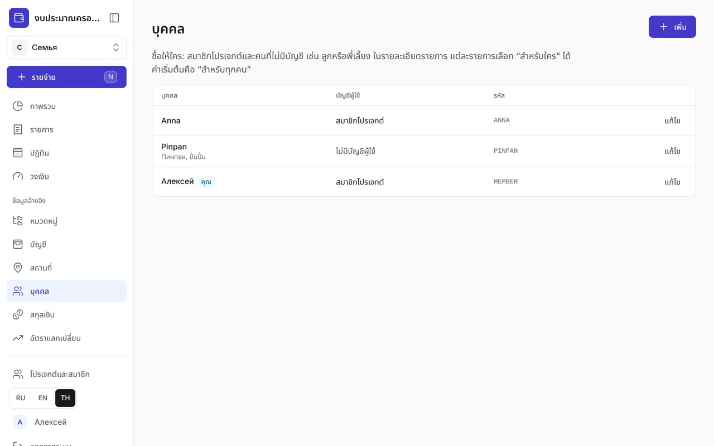
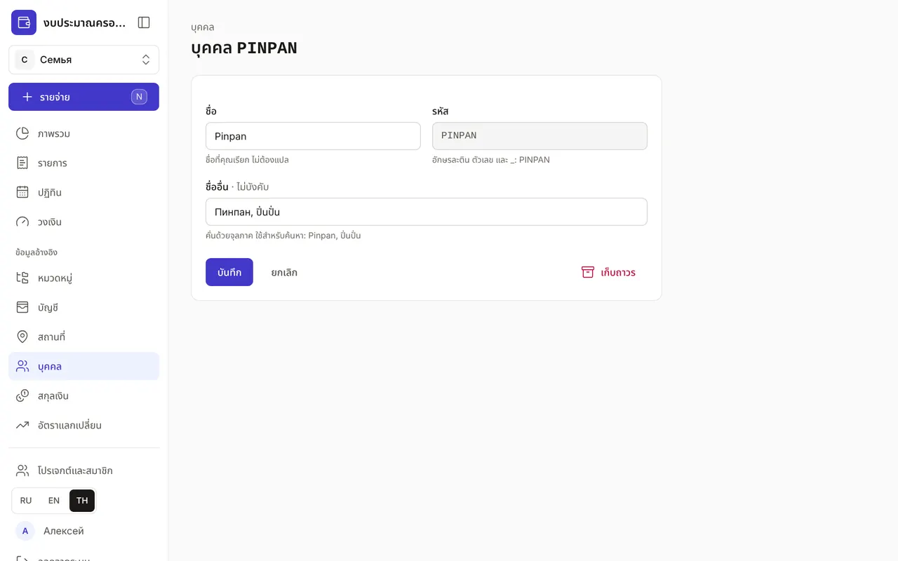
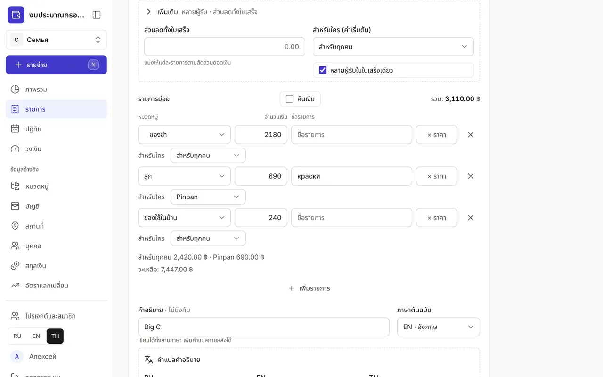
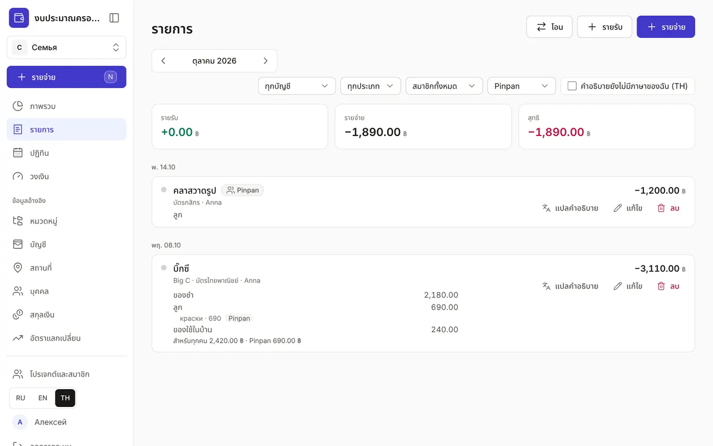

+++
title = "บุคคลและ “สำหรับใคร”"
description = "วิธีระบุว่าซื้อให้ใคร — ทุกคน ตัวเอง หรือลูก — แบ่งใบเสร็จระหว่างคน และดูว่าใช้เงินกับแต่ละคนเท่าไร"
date = 2026-10-20T12:00:00

[taxonomies]
topics = ["family", "claude"]

[extra]
level = "beginner"
+++

การซื้อทั่วไปเป็น “สำหรับทุกคน” เช่น ของชำ ค่าเช่า ค่าน้ำค่าไฟ แต่สีสำหรับลูกสาว คลาสวาดรูป หรือยาของแอนนา ควรระบุแยกไว้ แล้วจะเห็นว่าแต่ละเดือนใช้เงินกับแต่ละคนเท่าไร สำหรับเรื่องนี้มีข้อมูล “บุคคล” และช่อง “สำหรับใคร” ในรายละเอียดทั้งหมดของรายการ

## 1. ใครอยู่ใน “บุคคล”

หน้า “บุคคล” อยู่ใน “ข้อมูลอ้างอิง” สมาชิกโปรเจกต์จะปรากฏเอง: บันทึกถูกสร้างเมื่อสร้างโปรเจกต์หรือเข้าร่วมด้วยคำเชิญ และถูกเก็บถาวรเมื่อออก บันทึกของคุณมีป้าย “คุณ” และในตัวเลือกจะเรียกว่า “สำหรับตัวเอง” คอลัมน์ “บัญชีผู้ใช้” บอกว่าใครเป็นสมาชิกโปรเจกต์ และใครไม่มีบัญชีผู้ใช้

## 2. เพิ่มคนที่ไม่มีบัญชีผู้ใช้

กด “เพิ่ม” ในฟอร์ม:
- “ชื่อ” — ชื่อที่คุณเรียก เช่น Pinpan พี่เลี้ยงน้อย ชื่อไม่ต้องแปล;
- “รหัส” — อักษรละติน ตัวเลข และ _ เช่น PINPAN Claude และ API ใช้รหัสนี้หาบุคคล และเปลี่ยนรหัสหลังบันทึกไม่ได้;
- “ชื่ออื่น” — คั่นด้วยจุลภาค เช่น Пинпан, ปิ่นปั่น การค้นหาใช้ชื่อเหล่านี้ รวมถึงภาษาไทย

แก้ชื่อของสมาชิกที่นี่ได้เช่นกัน เช่น “แม่” แทนชื่อเต็ม โปรไฟล์ของเขาจะไม่เปลี่ยน ถ้าสมาชิกลบบัญชีผู้ใช้ ชื่อจะถูกลบ และในรายการเก่าจะแสดงเป็น “อดีตสมาชิก”

## 3. “สำหรับใคร” ในรายละเอียดทั้งหมด

การบันทึกด่วนไม่ถามอะไร: การซื้อเป็น “สำหรับทุกคน” ถ้าต้องการระบุผู้รับ ให้เปิด “รายละเอียดทั้งหมด” แล้วขยาย “เพิ่มเติม” ช่อง “สำหรับใคร (ค่าเริ่มต้น)” ใช้กับทั้งใบเสร็จ ถ้าใบเสร็จเดียวมีของสำหรับหลายคน ให้เปิด “หลายผู้รับในใบเสร็จเดียว” แต่ละรายการจะมีแถว “สำหรับใคร” และใต้รายการจะมีสรุปว่าสำหรับทุกคนเท่าไร สำหรับตัวเองเท่าไร และสำหรับ Pinpan เท่าไร ถ้าใบเสร็จมีหลายรายการในหมวดเดียวกัน ลิงก์ “ทั้งหมวด “…”” จะตั้งผู้รับให้ทุกรายการในหมวดนั้น

ถ้าปิด “หลายผู้รับในใบเสร็จเดียว” แอปจะถามว่า “ตั้งทั้งหมดเป็น “…”?”: “รีเซ็ต” ให้ทั้งใบเสร็จเป็นของผู้รับค่าเริ่มต้น “คงไว้ต่างกัน” ไม่เปลี่ยนอะไร ถ้าไม่มี JavaScript แถว “สำหรับใคร” ก็ใช้ได้ และเซิร์ฟเวอร์จะจัดผู้รับให้ตอนบันทึก ตัวเลือกล่าสุดจะไม่ถูกจำ: การซื้อครั้งถัดไปเป็น “สำหรับทุกคน” อีกครั้ง

## 4. ในหน้า “รายการ”

รายการที่ทุกรายการย่อยเป็นของคนเดียวจะมีป้ายชื่อของคนนั้น ถ้าผู้รับต่างกัน ป้ายจะอยู่ที่รายการย่อย และใต้รายการจะมีสรุปตามคน “สำหรับทุกคน” ไม่มีป้าย เพราะเป็นกรณีปกติ ตัวกรอง “สำหรับใคร” จะเหลือเฉพาะรายการที่มีของสำหรับคนที่เลือก และยอดสรุปด้านบนจะนับเฉพาะรายการย่อยของเขา จึงเห็นว่าเดือนนี้ใช้เงินกับลูกเท่าไร

## 5. ผ่าน Claude

บอก Claude ว่า “คลาสวาดรูปสำหรับ Pinpan 1200” แล้ว Claude จะบันทึกรายจ่ายพร้อมผู้รับ ระบุผู้รับให้รายการย่อยแต่ละรายการในใบเสร็จก็ได้ ถ้าไม่ได้บอก การซื้อเป็น “สำหรับทุกคน” Claude จะเพิ่มบุคคลใหม่เมื่อคุณยินยอมและมีสิทธิ์ “บุคคล: เพิ่มและแก้ไข” (หรือ “ข้อมูลหลักทั้งหมด”) เท่านั้น — ดู [“วิธีเชื่อม Claude กับงบของคุณ”](@/guides/connect-claude/index.th.md)

ระบุผู้รับเฉพาะเมื่อสำคัญกับคุณ เช่น ค่าใช้จ่ายของลูก ของขวัญ ของใช้ส่วนตัว ที่เหลือปล่อยเป็น “สำหรับทุกคน” การบันทึกจะไม่ช้าลง
