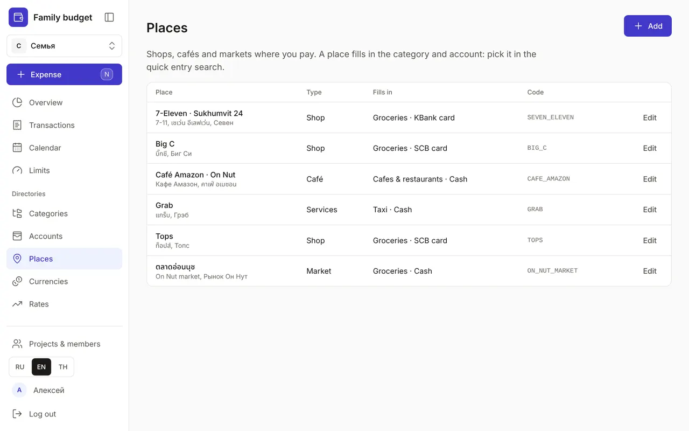
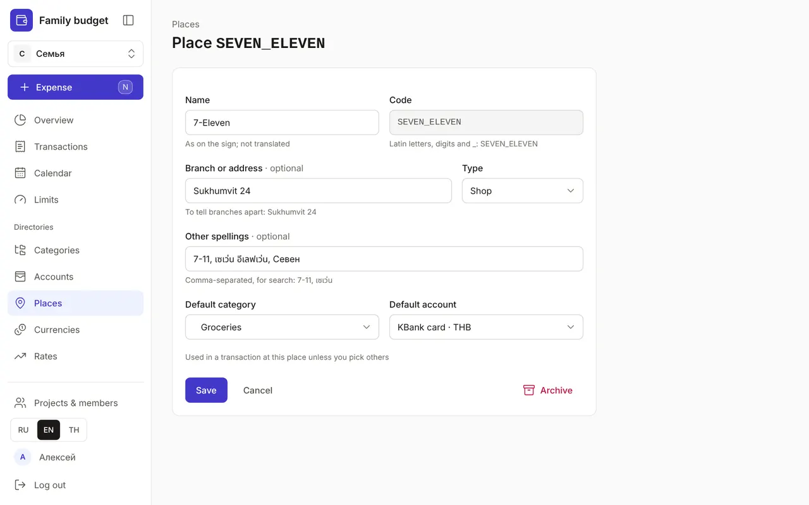
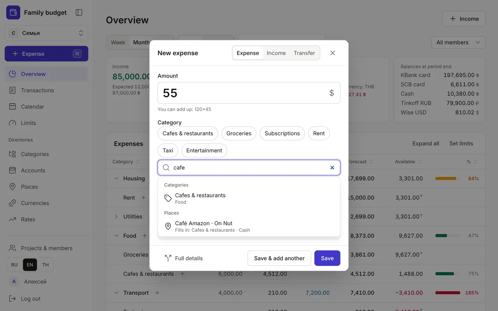
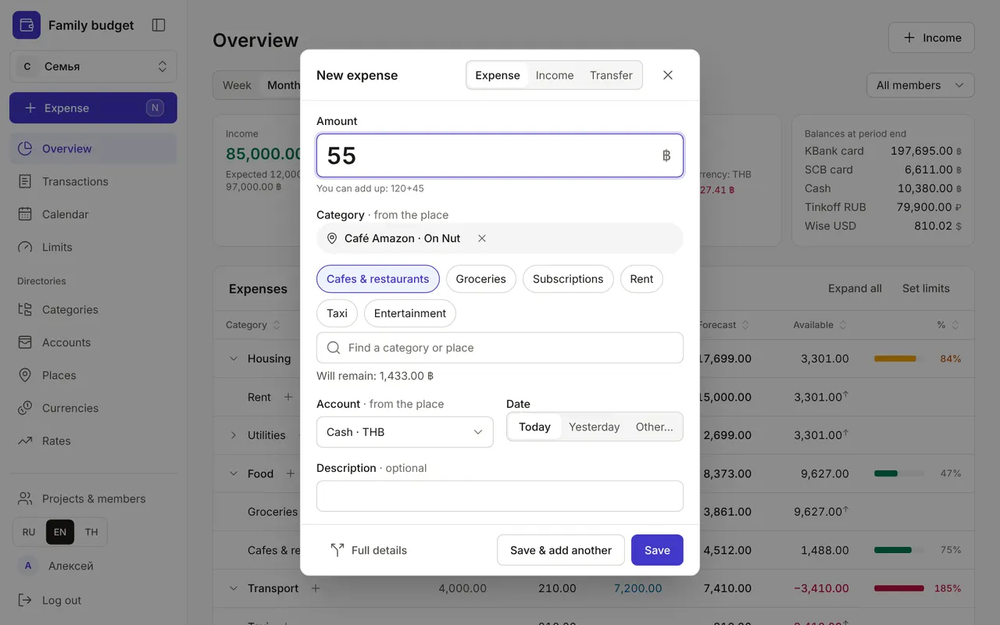

+++
title = "Places: shops, cafés and markets"
description = "How to add places so quick entry fills in the category and account for you, and how to record spending at a place — by hand or through Claude."
date = 2026-10-19T18:00:00

[taxonomies]
topics = ["accounts", "claude"]

[extra]
level = "beginner"
+++

A place is a shop, café or market where you pay. It remembers what you usually buy there and how you pay: pick 7-Eleven in quick entry and the Groceries category and your card are filled in for you. And "Transactions" shows where the money went.

## 1. The list of places

"Places" is under "Directories". Each row shows the name with its branch, other spellings, the type and what the place "Fills in": a category and an account. The code is in grey on the right.

## 2. Add a place

Click "Add". In the form:
- "Name" — as on the sign: 7-Eleven, Café Amazon. The name isn't translated — it's a proper name;
- "Code" — Latin letters, digits and _, such as SEVEN_ELEVEN; Claude and the API find the place by it, and it can't be changed after saving;
- "Branch or address" — if you go to different shops of one chain: Sukhumvit 24, On Nut;
- "Type" — shop, café, market, online, services or other;
- "Other spellings" — comma-separated: 7-11, เซเว่น. Search uses them, Thai included;
- "Default category" and "Default account" — what the place fills in: cash at a market, a card at a supermarket.

## 3. Spending at a place in two taps

In quick entry, start typing in the search box — it finds both categories and places: first the "Categories" group, then "Places". Under each place it says what it fills in. Search ignores case and accents: "cafe" also finds Café Amazon.

Pick a place and a tag with a cross appears above the frequent categories, while "Category" and "Account" get a "· from the place" note. You can still pick another category or account: the note disappears and the place stays. The cross removes the place. "Save & add another" keeps the place for the next expense, like the account and date. While there are no places, the window looks the same as before.

## 4. The place in full details and in the list

The full transaction form has a "Place" field. Pick one and empty item categories are filled in from it (without JavaScript — when you save), and for a new transaction the account too. A place never changes the account of a transaction that's already saved. "Transactions" shows the place on every expense, and when there's no description it takes the title's spot.

## 5. Edit, archive, record through Claude

"Edit" opens the same form. Send a place you no longer need to the "Archive": it disappears from search, and past transactions keep it. Changed your mind — click "Undo" in the pop-up message.

Claude records spending at places too: say "55 baht at Café Amazon" and the category and account are filled in. Claude adds a new place only with your consent and with the "Places: add and edit" permission (or "All directories") — see ["How to connect Claude to your budget"](@/guides/connect-claude/index.en.md).

Start with the places you go to most: the supermarket next door, a coffee shop, a market. Add the rest later — you can always record an expense without a place.
