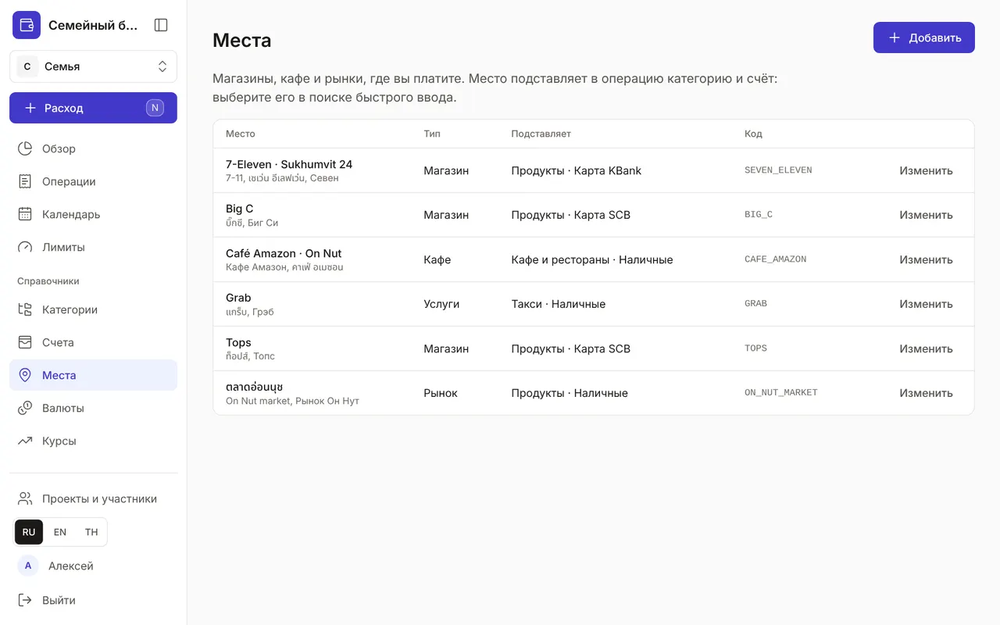
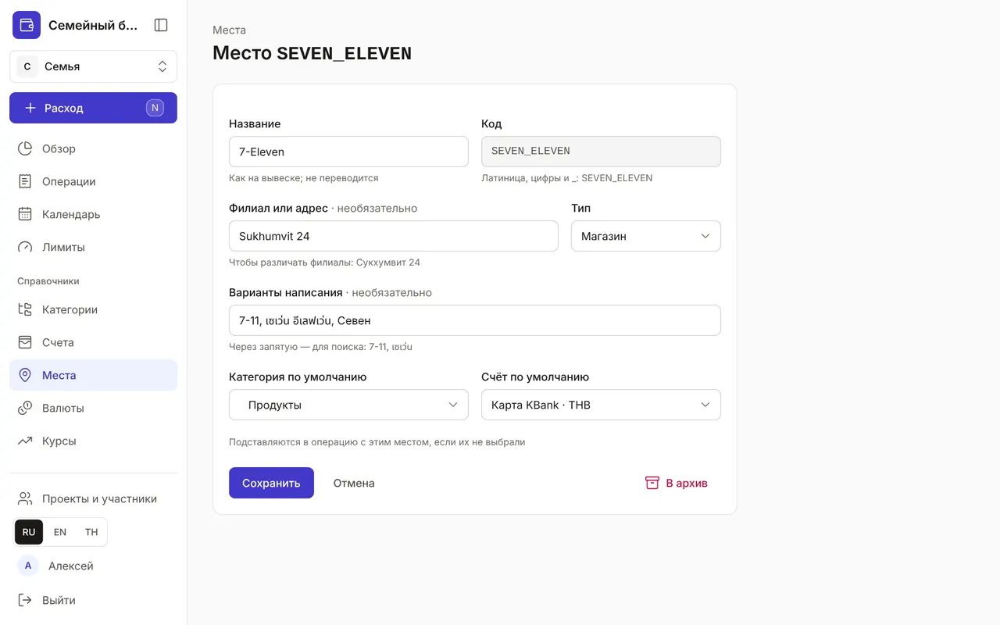
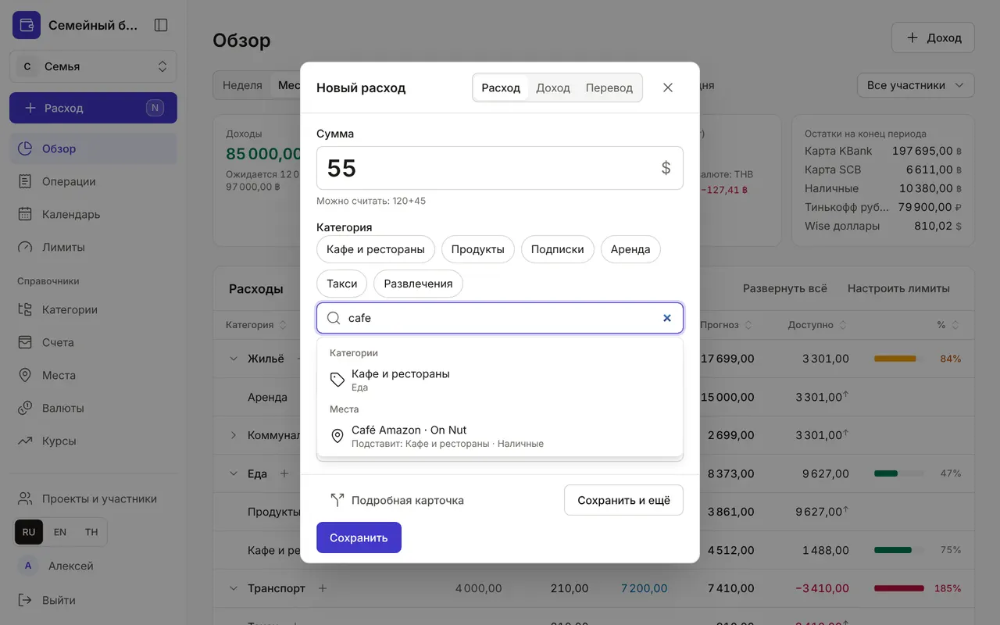
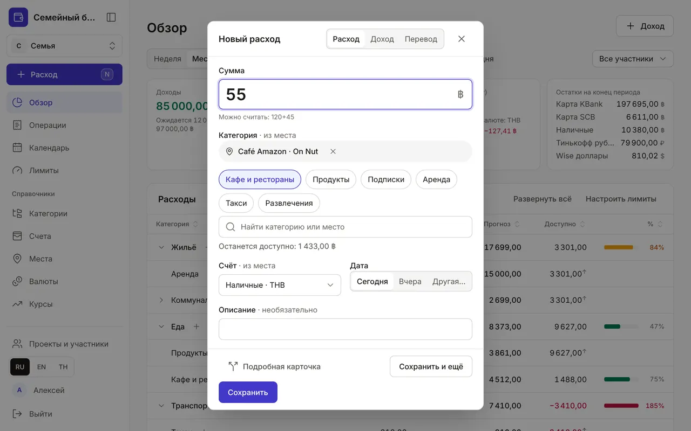

+++
title = "Места: магазины, кафе и рынки"
description = "Как завести места, чтобы быстрый ввод сам подставлял категорию и счёт, и как записывать траты с местом — вручную и через Claude."
date = 2026-10-19T18:00:00

[taxonomies]
topics = ["accounts", "claude"]

[extra]
level = "beginner"
+++

Место — это магазин, кафе или рынок, где вы платите. Оно помнит, что вы там обычно покупаете и чем платите: выберите «7-Eleven» в быстром вводе — категория «Продукты» и карта подставятся сами. А в «Операциях» видно, где была трата.

## 1. Список мест

Раздел «Места» — в «Справочниках». В строке — название с филиалом, варианты написания, тип и что место «Подставляет»: категорию и счёт. Код — серым справа.

## 2. Добавьте место

Нажмите «Добавить». В форме:
- «Название» — как на вывеске: 7-Eleven, Café Amazon. Название не переводится — это имя собственное;
- «Код» — латинские буквы, цифры и _, например SEVEN_ELEVEN; по нему место находят Claude и API, после сохранения код не меняется;
- «Филиал или адрес» — если ходите в разные точки одной сети: Sukhumvit 24, On Nut;
- «Тип» — магазин, кафе, рынок, онлайн, услуги или другое;
- «Варианты написания» — через запятую: 7-11, เซเว่น. По ним работает поиск, в том числе на тайском;
- «Категория по умолчанию» и «Счёт по умолчанию» — что место подставит в операцию: на рынке — наличные, в супермаркете — карта.

## 3. Сеть и её магазины

Если ходите в разные магазины одной сети, заведите сеть один раз, а магазины — внутри неё. У строки сети нажмите «+ магазин»: форма откроется с уже заполненными названием, типом и полем «Входит в» — останется указать «Филиал или адрес» и код, например SEVEN_ELEVEN_ASOK. Категорию и счёт у магазина можно не выбирать: в пустых полях написано «— как у «7-Eleven» —», и магазин берёт их у сети. Выберете свои — они важнее.

В списке магазины стоят сразу под сетью, с отступом, а в «Подставляет» видно «· от сети», если значение унаследовано. Поиск быстрого ввода находит магазины и по вариантам написания сети: «7-11» покажет и сеть, и «7-Eleven · Asok». Вложить можно до трёх уровней — например, сеть → торговый центр → магазин. Сеть с активными магазинами в архив не уходит: сначала архивируйте магазины или перенесите их полем «Входит в».

## 4. Трата с местом за два касания

В быстром вводе начните печатать в поиске — он ищет и категории, и места: сначала группа «Категории», затем «Места». Под местом написано, что оно подставит. Поиск не смотрит на регистр и диакритику: «cafe» найдёт и Café Amazon.

Выберите место — над частыми категориями появится метка с крестиком, а у «Категория» и «Счёт» — пометка «· из места». Можно выбрать другую категорию или счёт: пометка исчезнет, а место останется. Крестик убирает место. «Сохранить и ещё» оставляет место для следующей траты, как счёт и дату. Пока в справочнике нет мест, окно выглядит как раньше.

## 5. Место в подробной карточке и в ленте

В подробной карточке операции есть поле «Место». Выберите его — пустые категории позиций заполнятся из места (без JavaScript — при сохранении), а у новой операции ещё и счёт. Счёт уже записанной операции место не меняет. В «Операциях» место видно у каждой траты, а если описания нет, оно стоит вместо заголовка.

## 6. Изменить, убрать в архив, записать через Claude

«Изменить» открывает ту же форму. Место, которое больше не нужно, отправьте «В архив»: оно пропадёт из поиска, а прошлые операции его сохранят. Передумали — нажмите «Отменить» во всплывающем сообщении.

Claude тоже записывает траты с местом: скажите «55 бат в Café Amazon» — категория и счёт подставятся. Новое место Claude заводит только с вашего согласия и с правом «Места: добавлять и изменять» (или «Все справочники») — см. [«Как подключить Claude к бюджету»](@/guides/connect-claude/index.md).

Начните с мест, куда ходите чаще всего: супермаркет у дома, кофейня, рынок. Остальные можно добавить потом — трату без места записать можно всегда.
