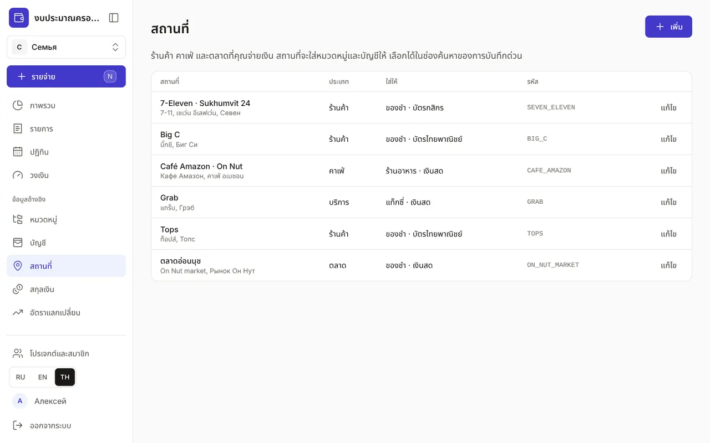
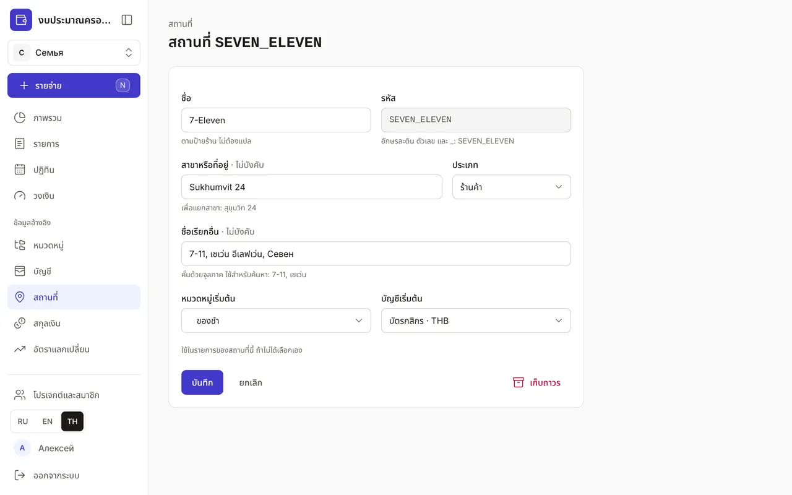
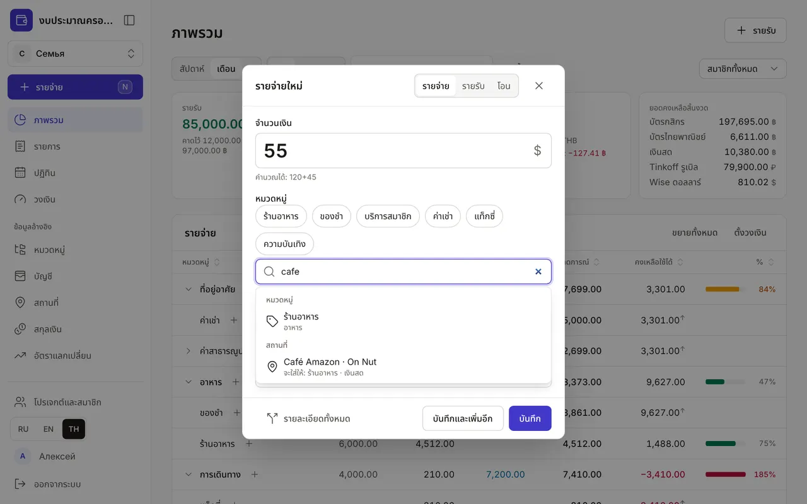
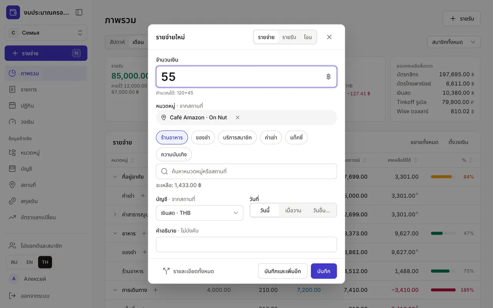

+++
title = "สถานที่: ร้านค้า คาเฟ่ และตลาด"
description = "วิธีเพิ่มสถานที่ให้การบันทึกด่วนใส่หมวดหมู่และบัญชีให้เอง และวิธีบันทึกรายจ่ายพร้อมสถานที่ ทั้งด้วยตัวเองและผ่าน Claude"
date = 2026-10-19T18:00:00

[taxonomies]
topics = ["accounts", "claude"]

[extra]
level = "beginner"
+++

สถานที่คือร้านค้า คาเฟ่ หรือตลาดที่คุณจ่ายเงิน ระบบจะจำว่าปกติคุณซื้ออะไรและจ่ายด้วยอะไร: เลือก 7-Eleven ในการบันทึกด่วน แล้วหมวด ของชำ และบัตรจะถูกใส่ให้เอง และในหน้า "รายการ" จะเห็นว่าใช้เงินที่ไหน

## 1. รายการสถานที่

หน้า "สถานที่" อยู่ใน "ข้อมูลอ้างอิง" แต่ละแถวแสดงชื่อพร้อมสาขา ชื่อเรียกอื่น ประเภท และสิ่งที่สถานที่ "ใส่ให้" คือหมวดหมู่และบัญชี รหัสเป็นสีเทาทางขวา

## 2. เพิ่มสถานที่

กด "เพิ่ม" ในฟอร์ม:
- "ชื่อ" — ตามป้ายร้าน เช่น 7-Eleven, Café Amazon ชื่อไม่ต้องแปลเพราะเป็นชื่อเฉพาะ
- "รหัส" — อักษรละติน ตัวเลข และ _ เช่น SEVEN_ELEVEN Claude และ API ใช้รหัสนี้หาสถานที่ และเปลี่ยนไม่ได้หลังบันทึก
- "สาขาหรือที่อยู่" — ถ้าไปหลายสาขาของร้านเดียวกัน เช่น Sukhumvit 24, On Nut
- "ประเภท" — ร้านค้า คาเฟ่ ตลาด ออนไลน์ บริการ หรืออื่น ๆ
- "ชื่อเรียกอื่น" — คั่นด้วยจุลภาค เช่น 7-11, เซเว่น ใช้สำหรับค้นหา รวมถึงภาษาไทย
- "หมวดหมู่เริ่มต้น" และ "บัญชีเริ่มต้น" — สิ่งที่สถานที่จะใส่ให้ในรายการ เช่น ตลาดจ่ายเงินสด ซูเปอร์มาร์เก็ตจ่ายด้วยบัตร

## 3. เครือร้านและสาขา

ถ้าไปหลายสาขาของร้านเดียวกัน ให้เพิ่มเครือร้านครั้งเดียว แล้วเพิ่มสาขาไว้ข้างใน กด "+ สาขา" ที่แถวของเครือร้าน ฟอร์มจะเปิดพร้อมชื่อ ประเภท และช่อง "อยู่ใน" ที่กรอกไว้แล้ว เหลือแค่ใส่ "สาขาหรือที่อยู่" และรหัส เช่น SEVEN_ELEVEN_ASOK หมวดหมู่และบัญชีของสาขาเว้นว่างได้ ช่องว่างจะแสดง "— เหมือน “7-Eleven” —" และสาขาจะใช้ค่าของเครือร้าน ถ้าเลือกเอง ค่าของสาขาจะมาก่อน

ในรายการ สาขาจะอยู่ใต้เครือร้านแบบย่อหน้า และในช่อง "ใส่ให้" จะมี "· จากเครือ" ถ้าค่านั้นได้มาจากเครือร้าน การค้นหาในการบันทึกด่วนใช้ชื่อเรียกอื่นของเครือร้านหาสาขาได้ด้วย: พิมพ์ "7-11" จะเจอทั้งเครือร้านและ "7-Eleven · Asok" ซ้อนได้สูงสุดสามระดับ เช่น เครือร้าน → ห้าง → ร้าน เครือร้านที่ยังมีสาขาใช้งานอยู่จะเก็บถาวรไม่ได้ ให้เก็บถาวรสาขาก่อน หรือย้ายสาขาด้วยช่อง "อยู่ใน"

## 4. รายจ่ายพร้อมสถานที่ในสองแตะ

ในการบันทึกด่วน เริ่มพิมพ์ในช่องค้นหา ระบบจะหาทั้งหมวดหมู่และสถานที่ โดยแสดงกลุ่ม "หมวดหมู่" ก่อน แล้วจึงเป็น "สถานที่" ใต้สถานที่จะบอกว่าจะใส่อะไรให้ การค้นหาไม่สนตัวพิมพ์เล็กใหญ่และเครื่องหมายกำกับ: พิมพ์ "cafe" ก็เจอ Café Amazon

เมื่อเลือกสถานที่ จะมีป้ายพร้อมกากบาทเหนือหมวดที่ใช้บ่อย และที่ "หมวดหมู่" กับ "บัญชี" จะมีหมายเหตุ "· จากสถานที่" คุณยังเลือกหมวดหมู่หรือบัญชีอื่นได้ หมายเหตุจะหายไปแต่สถานที่ยังอยู่ กดกากบาทเพื่อเอาสถานที่ออก "บันทึกและเพิ่มอีก" จะคงสถานที่ไว้สำหรับรายจ่ายถัดไป เหมือนบัญชีและวันที่ ถ้ายังไม่มีสถานที่ หน้าต่างจะเหมือนเดิม

## 5. สถานที่ในรายละเอียดทั้งหมดและในรายการ

ในฟอร์มรายการแบบเต็มมีช่อง "สถานที่" เมื่อเลือก หมวดหมู่ที่ว่างของรายการย่อยจะถูกใส่จากสถานที่ (ถ้าไม่มี JavaScript จะใส่ตอนบันทึก) และสำหรับรายการใหม่จะใส่บัญชีด้วย สถานที่จะไม่เปลี่ยนบัญชีของรายการที่บันทึกไว้แล้ว หน้า "รายการ" แสดงสถานที่ของทุกรายจ่าย และถ้าไม่มีคำอธิบาย สถานที่จะแสดงแทนหัวข้อ

## 6. แก้ไข เก็บถาวร และบันทึกผ่าน Claude

"แก้ไข" เปิดฟอร์มเดียวกัน สถานที่ที่ไม่ใช้แล้วให้กด "เก็บถาวร" มันจะหายไปจากการค้นหา แต่รายการเก่ายังคงไว้ ถ้าเปลี่ยนใจ กด "เลิกทำ" ในข้อความที่แสดงขึ้น

Claude บันทึกรายจ่ายพร้อมสถานที่ได้เช่นกัน: พูดว่า "55 บาทที่ Café Amazon" แล้วหมวดหมู่และบัญชีจะถูกใส่ให้ Claude จะเพิ่มสถานที่ใหม่เมื่อคุณยินยอมและมีสิทธิ์ "สถานที่: เพิ่มและแก้ไข" (หรือ "ข้อมูลหลักทั้งหมด") เท่านั้น — ดู ["วิธีเชื่อม Claude กับงบของคุณ"](@/guides/connect-claude/index.th.md)

เริ่มจากสถานที่ที่ไปบ่อยที่สุด: ซูเปอร์มาร์เก็ตใกล้บ้าน ร้านกาแฟ ตลาด ที่เหลือเพิ่มทีหลังได้ บันทึกรายจ่ายโดยไม่มีสถานที่ได้เสมอ
