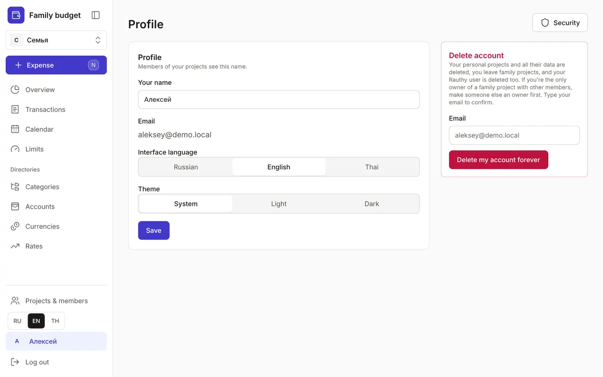
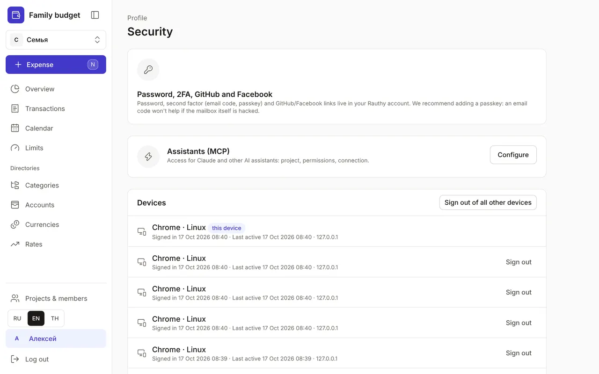

+++
title = "Profile and security"
description = "Name, language and theme, two-factor sign-in, devices, API tokens, the security log and deleting your account."
date = 2026-10-17T16:30:00

[taxonomies]
topics = ["security"]

[extra]
level = "beginner"
+++

Your "Profile" opens when you click your name at the bottom of the menu. It holds the settings that are about you rather than the budget: name, language, theme and account protection.

## 1. Name, language and theme

"Your name" is the name members of your projects see. "Interface language" is "Russian", "English" or "Thai"; you can also switch the language quickly with the RU, EN, TH buttons at the bottom of the menu. "Theme" is "System", "Light" or "Dark". Click "Save".

## 2. Password and second factor

The "Security" button in your profile opens the security page. Your password, second sign-in factor (an email code or a passkey) and GitHub and Facebook sign-in are set up in your account with the Rauthy sign-in service — the "Open Rauthy account" button in the "Password, 2FA, GitHub and Facebook" block. We recommend adding a passkey: an email code won't help if the mailbox itself is hacked.

## 3. Devices

The "Devices" list shows every browser where you're signed in: when you signed in, "Last active", the IP address, and the "this device" and "with second factor" marks. Don't recognise a device? Click "Sign out" next to it. Lost your phone? Click "Sign out of all other devices".

## 4. API tokens and assistants

"API tokens" are for programs without a browser: a Telegram bot, a sync app, Claude Code. Enter a "Name", "Project", "Permissions" — "Add transactions only", "Read all data" or "Change all data" — and "Expires", then click "Create token". Copy the token right away: it won't be shown again. Revoke a token you no longer need with "Revoke". Claude's access to the budget is set up in the "Assistants (MCP)" block with the "Configure" button — step by step in the guide [How to connect Claude to your budget](@/guides/connect-claude/index.en.md).

## 5. Security log

The "Security log" keeps a year of sign-ins and sign-outs, changes to members and roles, invites, tokens, and assistant access and changes. Second-factor events are logged by Rauthy. If you see something you didn't do, sign out the unknown sessions and change your password in your Rauthy account.

## 6. Deleting your account

Your profile has a "Delete account" block. Your personal projects are deleted with all their data, you leave family projects, and your Rauthy user is deleted too. If you're the only owner of a family project with other members, first make someone else an owner in [Projects & members](@/guides/family/index.en.md). To confirm, type your email and click "Delete my account forever".
