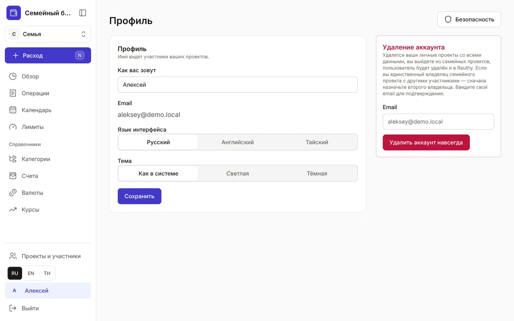
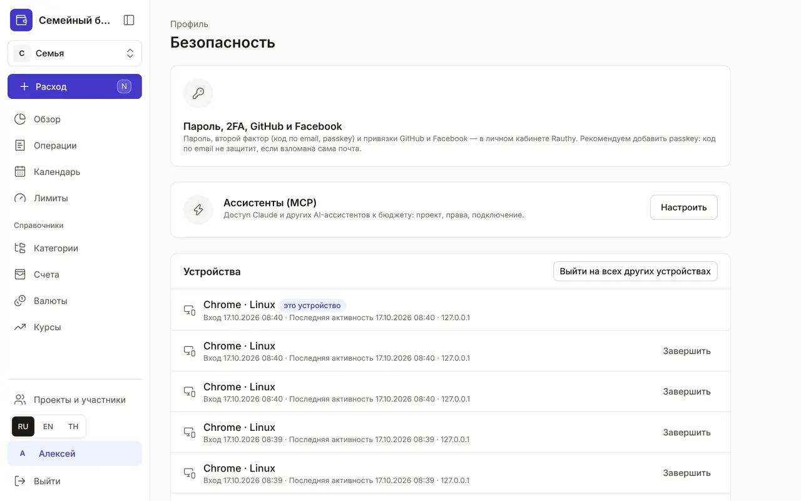

+++
title = "Профиль и безопасность"
description = "Имя, язык и тема оформления, второй фактор входа, устройства, API-токены, журнал безопасности и удаление аккаунта."
date = 2026-10-17T16:30:00

[taxonomies]
topics = ["security"]

[extra]
level = "beginner"
+++

«Профиль» открывается по вашему имени внизу меню. Здесь настройки, которые относятся к вам, а не к бюджету: имя, язык, тема и защита аккаунта.

## 1. Имя, язык и тема

«Как вас зовут» — имя, которое видят участники ваших проектов. «Язык интерфейса» — «Русский», «Английский» или «Тайский»; быстро сменить язык можно и кнопками RU, EN, TH внизу меню. «Тема» — «Как в системе», «Светлая» или «Тёмная». Нажмите «Сохранить».

## 2. Пароль и второй фактор

Кнопка «Безопасность» в профиле открывает страницу безопасности. Пароль, второй фактор входа (код по email или passkey) и вход через GitHub и Facebook настраиваются в кабинете сервиса входа Rauthy — кнопка «Открыть кабинет Rauthy» в блоке «Пароль, 2FA, GitHub и Facebook». Советуем добавить passkey: код по email не защитит, если взломана сама почта.

## 3. Устройства

В списке «Устройства» — все браузеры, где вы вошли: дата входа, «Последняя активность», IP-адрес, отметки «это устройство» и «со вторым фактором». Незнакомое устройство — нажмите «Завершить». Потеряли телефон — «Выйти на всех других устройствах».

## 4. API-токены и ассистенты

«API-токены» нужны программам без браузера: Telegram-боту, синхронизации, Claude Code. Укажите «Название», «Проект», «Права» — «Только добавлять операции», «Чтение всех данных» или «Изменение всех данных» — и «Срок», затем нажмите «Выпустить токен». Скопируйте токен сразу: больше он не покажется. Ненужный токен — «Отозвать». Доступ Claude к бюджету настраивается в блоке «Ассистенты (MCP)» кнопкой «Настроить» — по шагам в гайде [«Как подключить Claude к бюджету»](@/guides/connect-claude/index.md).

## 5. Журнал безопасности

«Журнал безопасности» хранит за последний год входы и выходы, изменения участников и ролей, приглашения, токены, доступ и изменения через ассистента. События второго фактора записывает Rauthy. Видите событие, которого не совершали, — завершите чужие сессии и смените пароль в кабинете Rauthy.

## 6. Удаление аккаунта

В профиле есть блок «Удаление аккаунта». Удалятся ваши личные проекты со всеми данными, вы выйдете из семейных проектов, а пользователь будет удалён и в Rauthy. Если вы единственный владелец семейного проекта с другими участниками, сначала сделайте владельцем кого-то ещё в [«Проектах и участниках»](@/guides/family/index.md). Для подтверждения введите свой email и нажмите «Удалить аккаунт навсегда».
