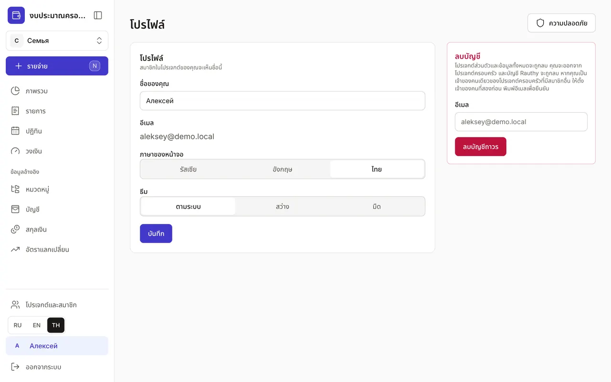
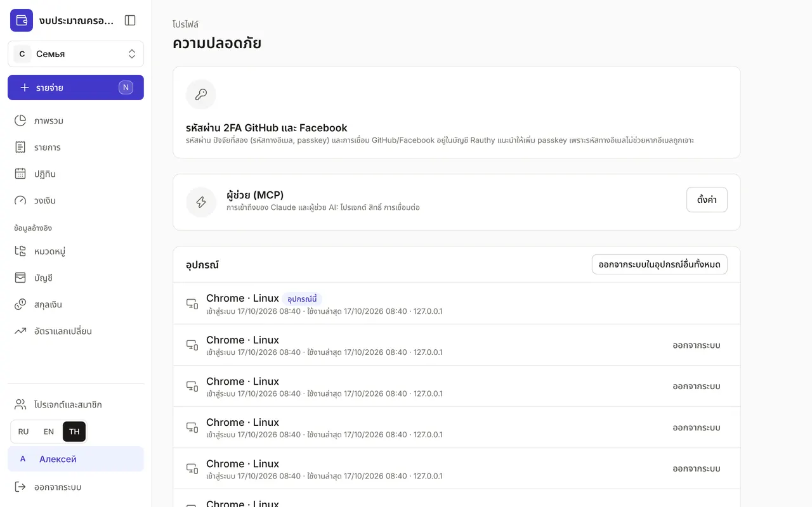

+++
title = "โปรไฟล์และความปลอดภัย"
description = "ชื่อ ภาษา และธีม การยืนยันตัวตนขั้นที่สอง อุปกรณ์ โทเคน API บันทึกความปลอดภัย และการลบบัญชี"
date = 2026-10-17T16:30:00

[taxonomies]
topics = ["security"]

[extra]
level = "beginner"
+++

"โปรไฟล์" เปิดได้โดยกดชื่อของคุณที่ด้านล่างของเมนู ที่นี่คือการตั้งค่าที่เกี่ยวกับตัวคุณ ไม่ใช่งบ: ชื่อ ภาษา ธีม และการป้องกันบัญชี

## 1. ชื่อ ภาษา และธีม

"ชื่อของคุณ" คือชื่อที่สมาชิกในโปรเจกต์ของคุณเห็น "ภาษาของหน้าจอ" เลือกได้ "รัสเซีย" "อังกฤษ" หรือ "ไทย" และเปลี่ยนภาษาได้เร็ว ๆ ด้วยปุ่ม RU, EN, TH ที่ด้านล่างของเมนู "ธีม" เลือกได้ "ตามระบบ" "สว่าง" หรือ "มืด" แล้วกด "บันทึก"

## 2. รหัสผ่านและปัจจัยที่สอง

ปุ่ม "ความปลอดภัย" ในโปรไฟล์จะเปิดหน้าความปลอดภัย รหัสผ่าน ปัจจัยที่สองในการเข้าสู่ระบบ (รหัสทางอีเมลหรือ passkey) และการเข้าสู่ระบบด้วย GitHub และ Facebook ตั้งค่าในบัญชีของบริการเข้าสู่ระบบ Rauthy — ปุ่ม "เปิดบัญชี Rauthy" ในส่วน "รหัสผ่าน 2FA GitHub และ Facebook" แนะนำให้เพิ่ม passkey เพราะรหัสทางอีเมลไม่ช่วยหากอีเมลถูกเจาะ

## 3. อุปกรณ์

รายการ "อุปกรณ์" แสดงทุกเบราว์เซอร์ที่คุณเข้าสู่ระบบอยู่: วันที่เข้าสู่ระบบ "ใช้งานล่าสุด" ที่อยู่ IP และป้าย "อุปกรณ์นี้" กับ "ด้วยปัจจัยที่สอง" ถ้าไม่รู้จักอุปกรณ์ไหน กด "ออกจากระบบ" ข้างอุปกรณ์นั้น ถ้าทำโทรศัพท์หาย กด "ออกจากระบบในอุปกรณ์อื่นทั้งหมด"

## 4. โทเคน API และผู้ช่วย

"โทเคน API" ใช้กับโปรแกรมที่ไม่ใช่เบราว์เซอร์ เช่น บอต Telegram แอปซิงก์ข้อมูล Claude Code ใส่ "ชื่อ" "โปรเจกต์" "สิทธิ์" — "เพิ่มรายการเท่านั้น" "อ่านข้อมูลทั้งหมด" หรือ "แก้ไขข้อมูลทั้งหมด" — และ "หมดอายุ" แล้วกด "สร้างโทเคน" คัดลอกโทเคนทันที เพราะจะไม่แสดงอีก โทเคนที่ไม่ใช้แล้วกด "เพิกถอน" การให้ Claude เข้าถึงงบตั้งค่าในส่วน "ผู้ช่วย (MCP)" ด้วยปุ่ม "ตั้งค่า" — ดูขั้นตอนในคู่มือ ["วิธีเชื่อม Claude กับงบของคุณ"](@/guides/connect-claude/index.th.md)

## 5. บันทึกความปลอดภัย

"บันทึกความปลอดภัย" เก็บข้อมูลย้อนหลังหนึ่งปี: การเข้าและออกจากระบบ การเปลี่ยนสมาชิกและบทบาท คำเชิญ โทเคน รวมถึงการเข้าถึงและการแก้ไขโดยผู้ช่วย เหตุการณ์ของปัจจัยที่สองบันทึกโดย Rauthy ถ้าเห็นเหตุการณ์ที่คุณไม่ได้ทำ ให้ออกจากระบบเซสชันที่ไม่รู้จักและเปลี่ยนรหัสผ่านในบัญชี Rauthy

## 6. การลบบัญชี

ในโปรไฟล์มีส่วน "ลบบัญชี" โปรเจกต์ส่วนตัวและข้อมูลทั้งหมดจะถูกลบ คุณจะออกจากโปรเจกต์ครอบครัว และผู้ใช้ใน Rauthy จะถูกลบด้วย ถ้าคุณเป็นเจ้าของคนเดียวของโปรเจกต์ครอบครัวที่มีสมาชิกอื่น ให้ตั้งคนอื่นเป็นเจ้าของก่อนใน ["โปรเจกต์และสมาชิก"](@/guides/family/index.th.md) เพื่อยืนยัน พิมพ์อีเมลของคุณแล้วกด "ลบบัญชีถาวร"
