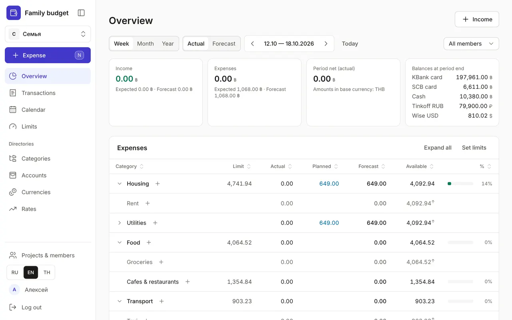

+++
title = "A tour of the app's sections"
description = "What's where in the menu and what each section is for — briefly, with links to detailed guides."
date = 2026-10-17T18:00:00

[taxonomies]
topics = ["start"]

[extra]
level = "beginner"
+++

The app menu is on the left; on a phone it's the bar at the bottom of the screen plus the "More" button. At the top are the sections you open every day, below them the "Directories" you set up once, and at the bottom your projects, language and profile. Here is a paragraph about each section and a link to a detailed guide. If you're just starting, go through [Your first budget in 5 minutes](@/guides/first-budget/index.en.md) first.

## The "Expense" button

The main button sits above the menu. It opens the quick entry window on any page: amount, category, Enter. On a computer the <kbd>N</kbd> key does the same; on a phone, the round "+" in the bottom bar. Income and transfers are logged in the same window. Details are in the guide [Transactions: expenses, income and transfers](@/guides/transactions/index.en.md).

## Overview

The budget's home page: how much came in and went out over a week, month or year, how much you can still spend in each category and which payments are coming up. How to read the table and how "Actual" differs from "Forecast" is in the guide [Overview: what's spent and what's left](@/guides/overview/index.en.md).

## Transactions

All expenses, income and transfers by month and day, filtered by account, type and member. This is where you fix and delete transactions and translate their descriptions into other languages. Guide: [Transactions: expenses, income and transfers](@/guides/transactions/index.en.md).

## Calendar

Regular payments and income: rent, subscriptions, salary, transfers to savings. You add them once and then mark them as paid in one click. Guide: [Calendar: regular payments and income](@/guides/calendar/index.en.md).

## Limits

How much you're ready to spend on a category per week, month or year. The Overview and the expense window warn you when the money is running out. Guide: [Spending limits](@/guides/limits/index.en.md).

## Directories

You set up the directories once and then only add to them:
- "Categories" — the tree of spending and income categories: [Categories: a tree of spending and income](@/guides/categories/index.en.md);
- "Accounts" — cards, cash and savings, statements and balance reconciliation: [Accounts, statements and reconciling balances](@/guides/accounts/index.en.md);
- "Currencies" and "Rates" — your accounts' currencies and their rates to the base currency: [Currencies and exchange rates](@/guides/currencies-and-rates/index.en.md).

## Projects & members

Personal and family budgets, inviting your family by link or QR code, member roles and switching between projects. Guide: [Projects & members: a family budget](@/guides/family/index.en.md).

## Profile

Your name, interface language and theme, and on the "Security" page — two-factor sign-in, devices, API tokens and the log. Guide: [Profile and security](@/guides/profile/index.en.md). It's also where, under "Assistants (MCP)", you give Claude access to the budget: [How to connect Claude to your budget](@/guides/connect-claude/index.en.md).

You can switch the interface language at any time with the RU, EN and TH buttons at the bottom of the menu. Names of categories, accounts and plans are shown in the chosen language too, if they have a translation.
