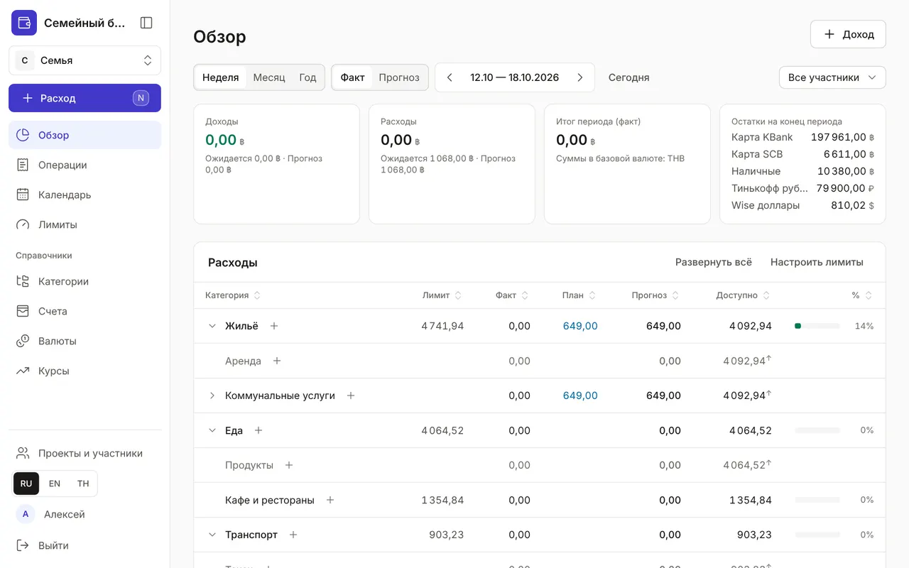

+++
title = "Путеводитель по разделам приложения"
description = "Что где лежит в меню и зачем нужен каждый раздел — коротко, со ссылками на подробные гайды."
date = 2026-10-17T18:00:00

[taxonomies]
topics = ["start"]

[extra]
level = "beginner"
+++

Меню приложения — слева, на телефоне — панель внизу экрана и кнопка «Ещё». Сверху — разделы, которые открываете каждый день, ниже — «Справочники», которые настраиваются один раз, внизу — проекты, язык и профиль. Здесь — по абзацу о каждом разделе и ссылка на подробный гайд. Если вы только начали, сначала пройдите [«Первый бюджет за 5 минут»](@/guides/first-budget/index.md).

## Кнопка «Расход»

Главная кнопка — над меню. Она открывает окно быстрой записи на любой странице: сумма, категория, Enter. На компьютере то же делает клавиша <kbd>N</kbd>, на телефоне — круглая «+» в нижней панели. Доходы и переводы записываются в том же окне. Подробно — в гайде [«Операции: расходы, доходы и переводы»](@/guides/transactions/index.md).

## Обзор

Главная страница бюджета: сколько пришло и ушло за неделю, месяц или год, сколько ещё можно потратить по каждой категории и какие платежи впереди. Как читать таблицу и чем отличаются режимы «Факт» и «Прогноз» — в гайде [«Обзор: сколько потрачено и сколько осталось»](@/guides/overview/index.md).

## Операции

Все расходы, доходы и переводы по месяцам и дням — с поиском по счёту, типу и участнику. Здесь операции исправляют, удаляют и переводят их описания на другие языки. Гайд — [«Операции: расходы, доходы и переводы»](@/guides/transactions/index.md).

## Календарь

Регулярные платежи и доходы: аренда, подписки, зарплата, переводы в копилку. Их заводят один раз, а потом отмечают оплату в один клик. Гайд — [«Календарь: регулярные платежи и доходы»](@/guides/calendar/index.md).

## Лимиты

Сколько вы готовы тратить на категорию за неделю, месяц или год. «Обзор» и окно расхода предупредят, когда деньги заканчиваются. Гайд — [«Лимиты расходов»](@/guides/limits/index.md).

## Справочники

Справочники настраивают один раз и потом лишь дополняют:
- «Категории» — дерево статей расходов и доходов: [«Категории: дерево расходов и доходов»](@/guides/categories/index.md);
- «Счета» — карты, наличные и накопления, выписка и сверка остатка: [«Счета, выписка и сверка остатка»](@/guides/accounts/index.md);
- «Валюты» и «Курсы» — валюты счетов и курсы к базовой валюте: [«Валюты и курсы»](@/guides/currencies-and-rates/index.md).

## Проекты и участники

Личный и семейный бюджет, приглашение близких по ссылке или QR-коду, роли участников и переключение между проектами. Гайд — [«Проекты и участники: семейный бюджет»](@/guides/family/index.md).

## Профиль

Ваше имя, язык интерфейса и тема оформления, а на странице «Безопасность» — второй фактор входа, устройства, API-токены и журнал. Гайд — [«Профиль и безопасность»](@/guides/profile/index.md). Там же, в «Ассистентах (MCP)», Claude получает доступ к бюджету: [«Как подключить Claude к бюджету»](@/guides/connect-claude/index.md).

Язык интерфейса переключается в любой момент кнопками RU, EN и TH внизу меню. Названия категорий, счетов и планов тоже показываются на выбранном языке, если у них есть перевод.
