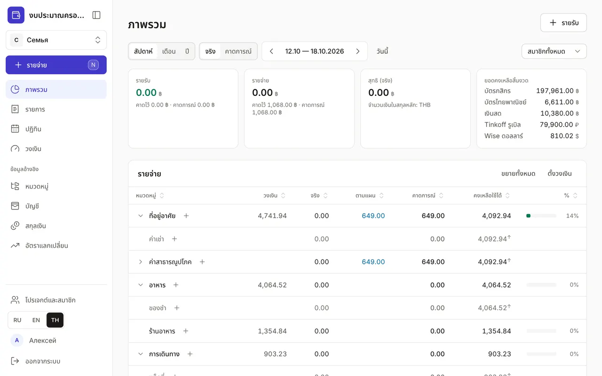

+++
title = "แนะนำส่วนต่าง ๆ ของแอป"
description = "เมนูมีอะไรอยู่ตรงไหน และแต่ละส่วนใช้ทำอะไร — สรุปสั้น ๆ พร้อมลิงก์ไปยังคู่มือฉบับเต็ม"
date = 2026-10-17T18:00:00

[taxonomies]
topics = ["start"]

[extra]
level = "beginner"
+++

เมนูของแอปอยู่ด้านซ้าย บนโทรศัพท์จะเป็นแถบด้านล่างของจอและปุ่ม "เพิ่มเติม" ด้านบนคือส่วนที่เปิดใช้ทุกวัน ถัดลงมาคือ "ข้อมูลอ้างอิง" ที่ตั้งค่าครั้งเดียว และด้านล่างสุดคือโปรเจกต์ ภาษา และโปรไฟล์ ในหน้านี้มีคำอธิบายสั้น ๆ ของแต่ละส่วนพร้อมลิงก์ไปยังคู่มือฉบับเต็ม หากเพิ่งเริ่มใช้ แนะนำให้อ่าน ["งบประมาณแรกใน 5 นาที"](@/guides/first-budget/index.th.md) ก่อน

## ปุ่ม "รายจ่าย"

ปุ่มหลักอยู่เหนือเมนู ใช้เปิดหน้าต่างบันทึกด่วนได้จากทุกหน้า: ใส่จำนวนเงิน เลือกหมวดหมู่ แล้วกด Enter บนคอมพิวเตอร์กดปุ่ม <kbd>N</kbd> ก็ได้ บนโทรศัพท์ใช้ปุ่มกลม "+" ที่แถบด้านล่าง รายรับและการโอนก็บันทึกในหน้าต่างเดียวกัน อ่านรายละเอียดในคู่มือ ["รายการ: รายจ่าย รายรับ และการโอน"](@/guides/transactions/index.th.md)

## ภาพรวม

หน้าหลักของงบ: เงินเข้าและออกเท่าไรในสัปดาห์ เดือน หรือปี แต่ละหมวดยังใช้ได้อีกเท่าไร และมีรายการที่ต้องชำระอะไรบ้าง วิธีอ่านตารางและความต่างระหว่าง "จริง" กับ "คาดการณ์" อยู่ในคู่มือ ["ภาพรวม: ใช้ไปเท่าไรและเหลือเท่าไร"](@/guides/overview/index.th.md)

## รายการ

รายจ่าย รายรับ และการโอนทั้งหมด แยกตามเดือนและวัน กรองตามบัญชี ประเภท และสมาชิกได้ ที่นี่ใช้แก้ไข ลบ และแปลคำอธิบายของรายการเป็นภาษาอื่น คู่มือ: ["รายการ: รายจ่าย รายรับ และการโอน"](@/guides/transactions/index.th.md)

## ปฏิทิน

การชำระและรายรับประจำ เช่น ค่าเช่า ค่าสมาชิก เงินเดือน การโอนเข้าบัญชีออม เพิ่มไว้ครั้งเดียว แล้วกดบันทึกการชำระได้ในคลิกเดียว คู่มือ: ["ปฏิทิน: การชำระและรายรับประจำ"](@/guides/calendar/index.th.md)

## วงเงิน

จำนวนเงินที่พร้อมจะใช้กับหมวดหนึ่งต่อสัปดาห์ เดือน หรือปี "ภาพรวม" และหน้าต่างบันทึกรายจ่ายจะเตือนเมื่อเงินใกล้หมด คู่มือ: ["วงเงินรายจ่าย"](@/guides/limits/index.th.md)

## ข้อมูลอ้างอิง

ข้อมูลอ้างอิงตั้งค่าครั้งเดียว จากนั้นแค่เพิ่มเติม:
- "หมวดหมู่" — โครงสร้างหมวดรายจ่ายและรายรับ: ["หมวดหมู่: โครงสร้างรายจ่ายและรายรับ"](@/guides/categories/index.th.md)
- "บัญชี" — บัตร เงินสด และเงินออม รายการเดินบัญชี และการกระทบยอด: ["บัญชี รายการเดินบัญชี และการกระทบยอด"](@/guides/accounts/index.th.md)
- "สกุลเงิน" และ "อัตราแลกเปลี่ยน" — สกุลเงินของบัญชีและอัตราเทียบกับสกุลหลัก: ["สกุลเงินและอัตราแลกเปลี่ยน"](@/guides/currencies-and-rates/index.th.md)

## โปรเจกต์และสมาชิก

งบส่วนตัวและงบครอบครัว การเชิญคนในบ้านด้วยลิงก์หรือ QR บทบาทของสมาชิก และการสลับโปรเจกต์ คู่มือ: ["โปรเจกต์และสมาชิก: งบครอบครัว"](@/guides/family/index.th.md)

## โปรไฟล์

ชื่อ ภาษาของหน้าจอ และธีม ส่วนหน้า "ความปลอดภัย" มีการยืนยันตัวตนขั้นที่สอง อุปกรณ์ โทเคน API และบันทึกความปลอดภัย คู่มือ: ["โปรไฟล์และความปลอดภัย"](@/guides/profile/index.th.md) ที่เดียวกันนี้ ในส่วน "ผู้ช่วย (MCP)" คุณให้ Claude เข้าถึงงบได้: ["วิธีเชื่อม Claude กับงบของคุณ"](@/guides/connect-claude/index.th.md)

เปลี่ยนภาษาของหน้าจอได้ทุกเมื่อด้วยปุ่ม RU, EN และ TH ที่ด้านล่างของเมนู ชื่อหมวดหมู่ บัญชี และแผนก็จะแสดงเป็นภาษาที่เลือก หากมีคำแปล
