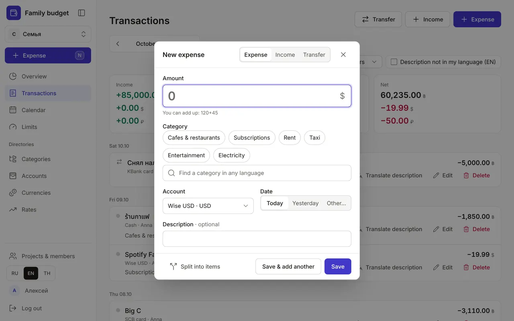
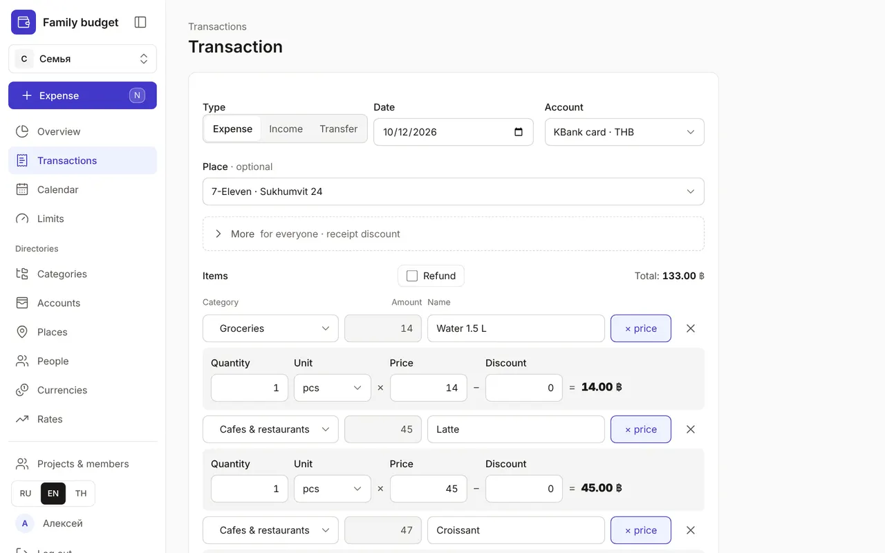
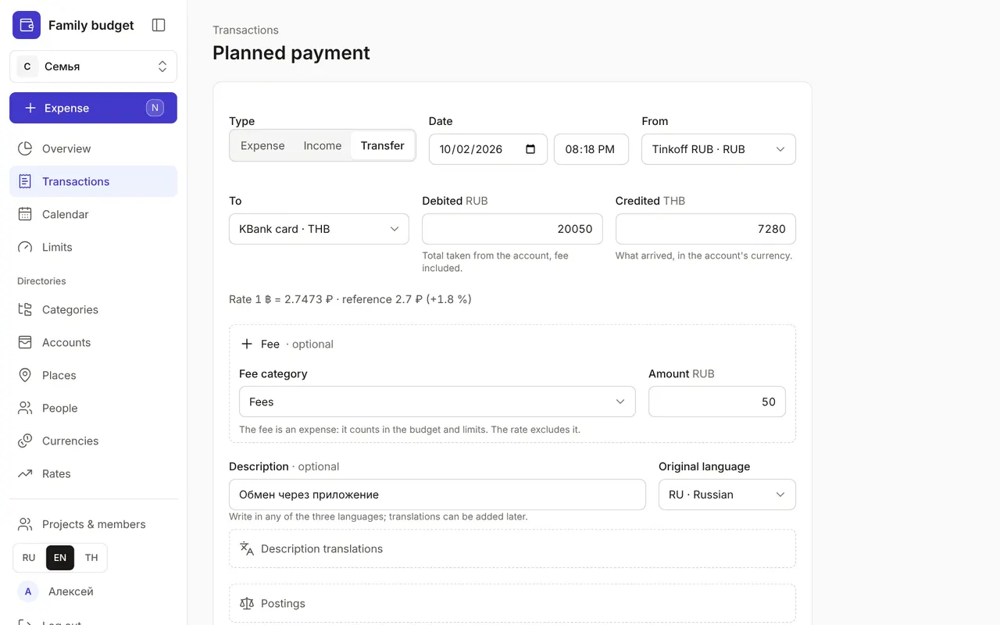
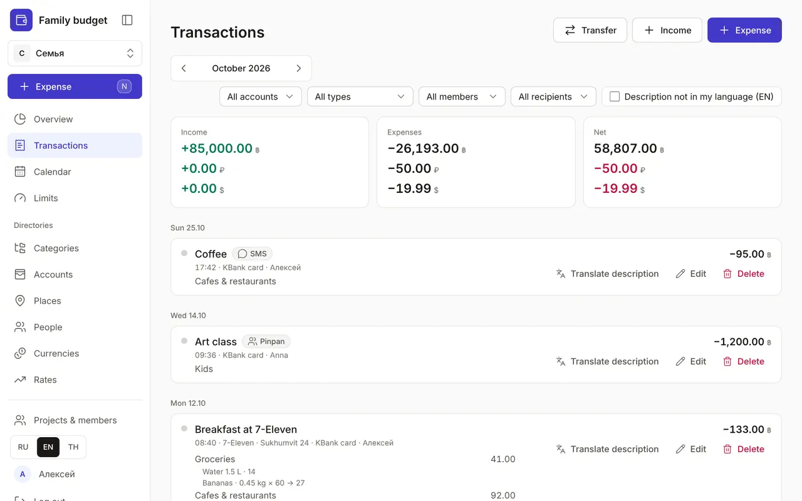

+++
title = "Transactions: expenses, income and transfers"
description = "Quick entry in five seconds, a receipt with several items, transfers and currency exchange between accounts, finding and fixing transactions."
date = 2026-10-17T17:40:00

[taxonomies]
topics = ["start", "accounts"]

[extra]
level = "beginner"
+++

Money moves through the app in three kinds of transactions: an expense, income, and a transfer between your own accounts. You can log a transaction from any page, and in the "Transactions" section you can find, fix or delete it.

## 1. Quick expense

Click "Expense" in the menu, press <kbd>N</kbd>, or tap the round "+" on a phone. Enter the amount — you can do the maths right away: "120+45". Pick a category from the frequent ones or find it with search, which understands names in any of the three languages. The account defaults to the one you paid from last time and the date to "Today"; you can change both. Enter saves and closes the window; "Save & add another" (<kbd>Ctrl</kbd> + <kbd>Enter</kbd>) keeps it open for the next expense.

When a category has a limit, the window shows what's available and what will remain after this expense, and warns you at 80% and when you go over. You can still save — it's just a warning. Made a mistake? Click "Undo" in the pop-up message.

The same window has an "Expense", "Income", "Transfer" switch; the <kbd>I</kbd> key opens income straight away, and <kbd>T</kbd> a transfer. The <kbd>?</kbd> key shows all keyboard shortcuts.

## 2. A receipt with several items

Groceries, cleaning products and a coffee on one receipt? Click "Split into items" in the window — the full form opens, and the amount you entered becomes the first item. Each item has its own category, amount and "Note"; "+ item" adds a row and the "Total" adds itself up. Tick "Refund" when a shop gives money back: the amounts reduce the categories' actuals.

The "Description" is optional; write it in any of the three languages and set the "Original language". Translations into the other languages go in "Description translations", so everyone in the family reads the transaction in their own language. A saved transaction also has a "Postings" block showing how it's recorded in double entry; you don't need to touch it.

## 3. Transfers and currency exchange

A transfer between your own accounts isn't an expense: it doesn't change the budget or limits. Choose "Transfer", the "From" and "To" accounts and the "Debited" amount. If the accounts are in different currencies, a "Credited" field appears — what arrived in the second account's currency — and the "Rate" line shows the resulting rate next to the rate from your directory.

Did the bank charge a fee? Open "Fee", choose a category and an amount. The fee is an expense: it counts in the budget and limits, and the rate is calculated without it. The quick window has an "Add a fee" link for this.

## 4. The transaction list

The "Transactions" section shows all of the month's transactions by day; the arrows switch months. At the top are the totals: income, expenses and net in each currency. Filters: account, type ("Expenses", "Income", "Transfers", "Opening balances"), member in a family budget, and the "Description not in my language" checkbox, which finds transactions that need a translation.

Transactions paid from a calendar plan carry a "planned" badge. A badge with a language code and a question mark, such as "EN?", means the description has no translation into your language.

## 5. Fix, translate, delete

Every transaction has "Translate description", "Edit" and "Delete" buttons. After deleting, you have a few seconds to click "Undo". A statement for a single account, with the balance after each transaction, opens from the "Accounts" section — see [Accounts, statements and reconciling balances](@/guides/accounts/index.en.md).
