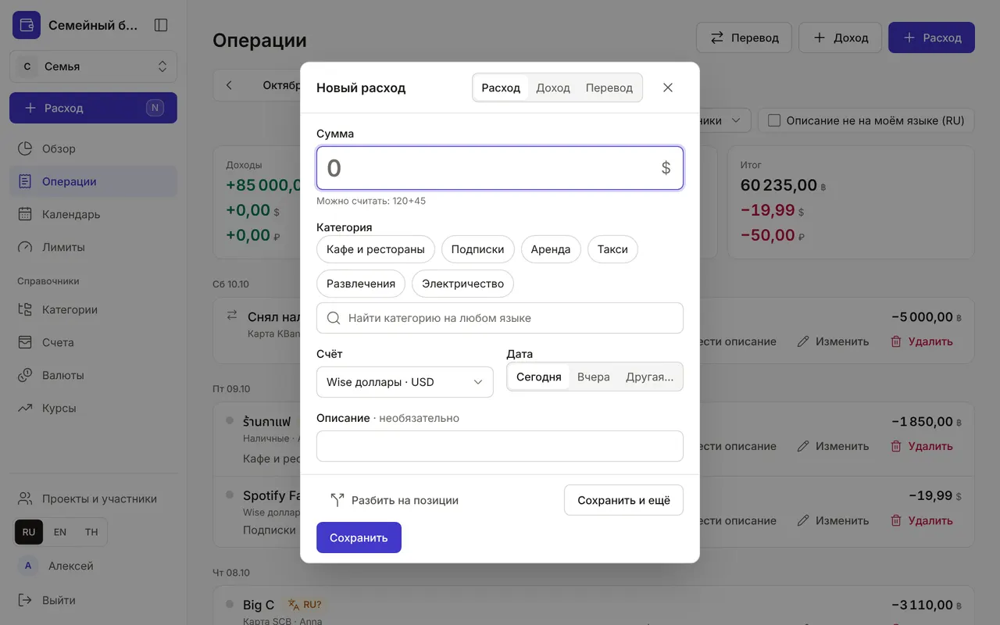
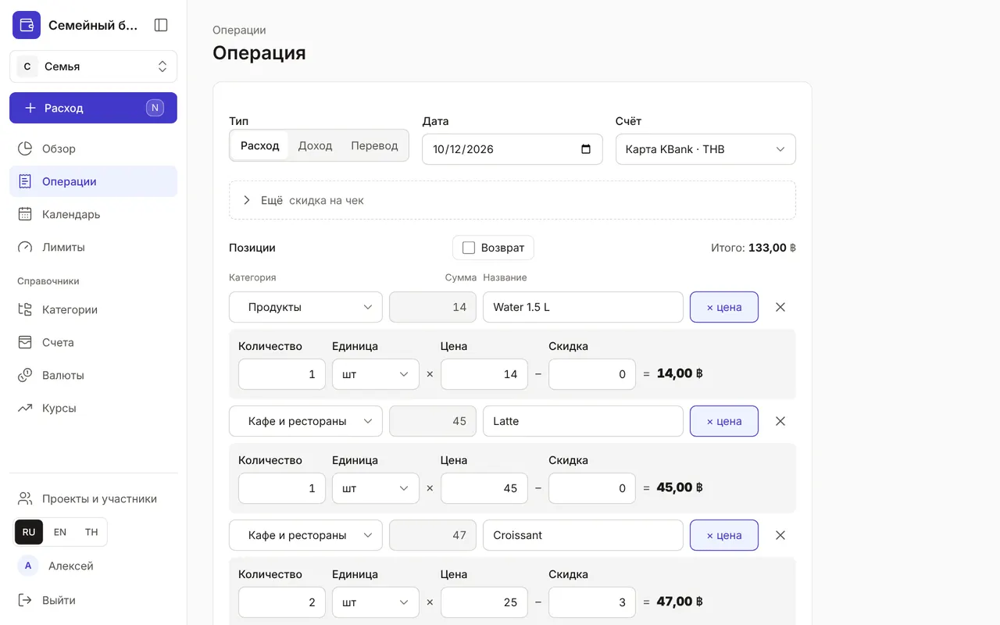
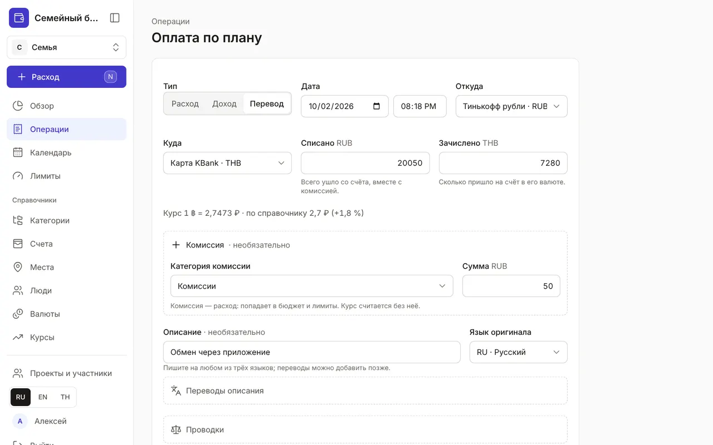
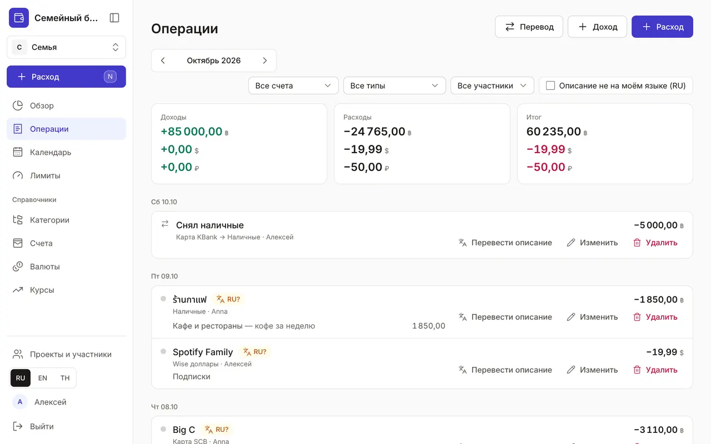

+++
title = "Операции: расходы, доходы и переводы"
description = "Быстрая запись за пять секунд, чек из нескольких позиций, перевод и обмен валют между счетами, поиск и правка операций."
date = 2026-10-17T17:40:00

[taxonomies]
topics = ["start", "accounts"]

[extra]
level = "beginner"
+++

Деньги в приложении двигаются операциями трёх типов: расход, доход и перевод между своими счетами. Записать операцию можно с любой страницы, а в разделе «Операции» — найти её, исправить или удалить.

## 1. Быстрый расход

Нажмите «Расход» в меню, клавишу <kbd>N</kbd> или круглую «+» на телефоне. Введите сумму — её можно сразу посчитать: «120+45». Выберите категорию среди частых или найдите поиском: он понимает названия на любом из трёх языков. Если в «Справочниках» есть места, поиск находит и их: выберите 7-Eleven — категория и счёт подставятся сами (подробнее — в гайде [«Места: магазины, кафе и рынки»](@/guides/places/index.md)). Счёт подставится тот, с которого вы платили в прошлый раз, дата — «Сегодня»; их можно поменять. Enter сохраняет и закрывает окно, «Сохранить и ещё» (<kbd>Ctrl</kbd> + <kbd>Enter</kbd>) оставляет его открытым для следующей траты.

Когда у категории есть лимит, окно подскажет, сколько доступно и сколько останется после этой траты, и предупредит при 80 % и при превышении. Сохранить можно всё равно — это только предупреждение. Ошиблись — нажмите «Отменить» во всплывающем сообщении.

В том же окне переключатель «Расход», «Доход», «Перевод»; доход сразу открывает клавиша <kbd>I</kbd>, перевод — <kbd>T</kbd>. Клавиша <kbd>?</kbd> покажет все горячие клавиши.

## 2. Чек из нескольких позиций

В одном чеке продукты, кофе и выпечка? Нажмите в окне «Подробная карточка» — откроется полная форма, а введённая сумма станет первой позицией. У каждой позиции своя категория, сумма и «Название» — как на чеке; «Добавить позицию» добавляет строку, «Итого» считается само. Галочка «Возврат» нужна, когда деньги вернулись в магазине: суммы уменьшат факт категорий.

Кнопка «× цена» раскрывает под позицией «Количество», «Единица» (шт, кг, л, г), «Цена» и «Скидка»: сумму позиции приложение посчитает само — два круассана по 25 со скидкой 3 дадут 47, 0,45 кг бананов по 60 — 27. Чтобы ввести сумму вручную, сотрите цену. Скидка на весь чек — в блоке «Ещё», поле «Скидка на чек»: она делится по позициям пропорционально их суммам. Там же — «Для кого по умолчанию» и «Разные получатели в чеке», если покупка не для всех: см. [«Люди и «Для кого»»](@/guides/people/index.md).

«Описание» необязательно, его можно написать на любом из трёх языков и указать «Язык оригинала». Переводы на другие языки — в блоке «Переводы описания»: так каждый в семье прочитает операцию на своём языке. У сохранённой операции есть ещё блок «Проводки» — как она записана по двойной записи; трогать его не нужно.

## 3. Переводы и обмен валют

Перевод между своими счетами — не расход: бюджет и лимиты он не меняет. Выберите «Перевод», счета «Откуда» и «Куда» и сумму «Списано». Если валюты счетов разные, появится поле «Зачислено» — сколько пришло в валюте второго счёта, а строка «Курс» покажет получившийся курс рядом с курсом из справочника.

Банк взял комиссию — раскройте «Комиссия», выберите категорию и сумму. Комиссия — это расход: она попадёт в бюджет и лимиты, а курс считается без неё. В быстром окне для этого есть ссылка «С комиссией».

## 4. Список операций

В разделе «Операции» — все операции месяца по дням, стрелки листают месяцы. Сверху итоги: доходы, расходы и итог в каждой валюте. Фильтры: счёт, тип («Расходы», «Доходы», «Переводы», «Начальные остатки»), участник в семейном бюджете, «Для кого» и галочка «Описание не на моём языке» — она найдёт операции, которым нужен перевод.

Внутри дня операции идут по времени — оно первое в строке под описанием: «08:40 · 7-Eleven · Sukhumvit 24 · Карта KBank · Алексей». Время меняется в карточке рядом с «Дата». Если его не указать, операция за сегодня получит текущее время, а за другой день останется без времени и встанет по моменту, когда её внесли. У операций из SMS банка время — из SMS, поэтому порядок совпадает с сообщениями банка.

Чек из нескольких позиций показан по категориям: сумма категории, а под ней товары в порядке чека — «Croissant · 2 шт × 25 − 3 → 47», без цены — «Latte · 45». Операция из одной позиции без названия выглядит как обычно. Метка с именем — «Pinpan», «Для себя» — показывает, для кого покупка; «Для всех» не подписывается.

Операции, оплаченные по плану из календаря, отмечены бейджем «по плану». Бейдж с кодом языка и знаком вопроса, например «RU?», значит, что у описания нет перевода на ваш язык.

## 5. Исправить, перевести, удалить

У каждой операции есть кнопки «Перевести описание», «Изменить» и «Удалить». После удаления несколько секунд можно нажать «Отменить». Выписка по одному счёту с остатком после каждой операции открывается в разделе «Счета» — см. [«Счета, выписка и сверка остатка»](@/guides/accounts/index.md).
