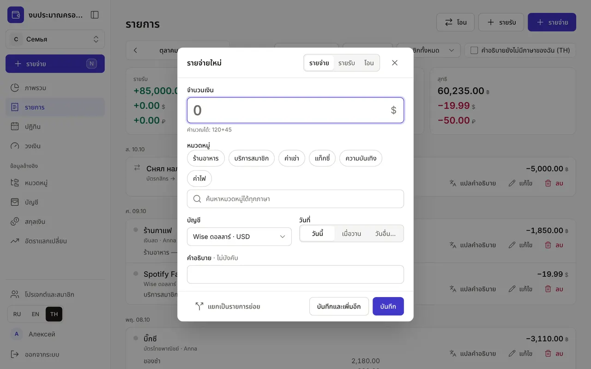
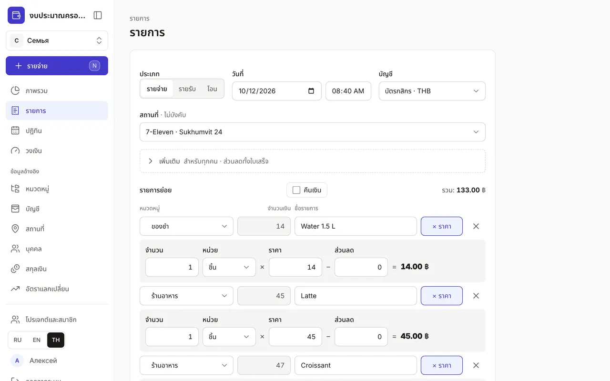
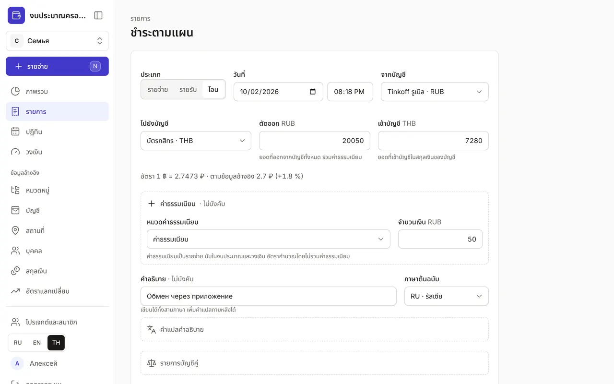
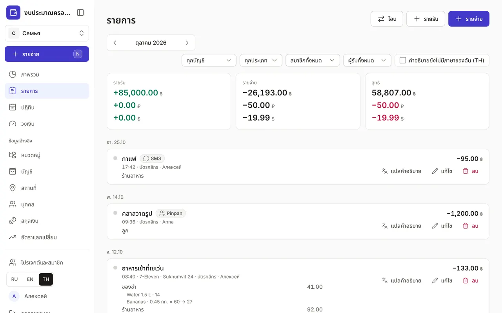

+++
title = "รายการ: รายจ่าย รายรับ และการโอน"
description = "บันทึกด่วนในห้าวินาที ใบเสร็จหลายรายการ การโอนและแลกเงินระหว่างบัญชี การค้นหาและแก้ไขรายการ"
date = 2026-10-17T17:40:00

[taxonomies]
topics = ["start", "accounts"]

[extra]
level = "beginner"
+++

เงินในแอปเคลื่อนไหวผ่านรายการสามประเภท: รายจ่าย รายรับ และการโอนระหว่างบัญชีของคุณเอง บันทึกรายการได้จากทุกหน้า ส่วนในหน้า "รายการ" ใช้ค้นหา แก้ไข หรือลบรายการ

## 1. บันทึกรายจ่ายด่วน

กด "รายจ่าย" ในเมนู กดปุ่ม <kbd>N</kbd> หรือแตะปุ่มกลม "+" บนโทรศัพท์ ใส่จำนวนเงิน — คำนวณได้ทันที เช่น "120+45" เลือกหมวดจากหมวดที่ใช้บ่อย หรือค้นหา ระบบค้นหาเข้าใจชื่อได้ทั้งสามภาษา บัญชีจะเป็นบัญชีที่คุณใช้จ่ายครั้งล่าสุด และวันที่เป็น "วันนี้" เปลี่ยนได้ทั้งสองอย่าง กด Enter เพื่อบันทึกและปิดหน้าต่าง ส่วน "บันทึกและเพิ่มอีก" (<kbd>Ctrl</kbd> + <kbd>Enter</kbd>) จะเปิดหน้าต่างค้างไว้สำหรับรายจ่ายถัดไป

ถ้าหมวดมีวงเงิน หน้าต่างจะบอกว่าใช้ได้อีกเท่าไรและจะเหลือเท่าไรหลังรายจ่ายนี้ และเตือนเมื่อถึง 80% หรือเกินวงเงิน ยังบันทึกได้ตามปกติ — เป็นเพียงคำเตือน ถ้าบันทึกผิด กด "เลิกทำ" ในข้อความที่ปรากฏขึ้น

หน้าต่างเดียวกันมีปุ่มสลับ "รายจ่าย" "รายรับ" "โอน" กดปุ่ม <kbd>I</kbd> เพื่อเปิดรายรับทันที และ <kbd>T</kbd> สำหรับการโอน ปุ่ม <kbd>?</kbd> แสดงแป้นพิมพ์ลัดทั้งหมด

## 2. ใบเสร็จที่มีหลายรายการ

ใบเสร็จเดียวมีทั้งของชำ น้ำยาซักผ้า และกาแฟ? กด "แยกเป็นรายการย่อย" ในหน้าต่าง แบบฟอร์มเต็มจะเปิดขึ้น และจำนวนเงินที่ใส่ไว้จะเป็นรายการย่อยแรก แต่ละรายการย่อยมีหมวด จำนวนเงิน และ "หมายเหตุ" ของตัวเอง "+ รายการย่อย" เพิ่มแถว และ "รวม" คำนวณให้เอง ติ๊ก "คืนเงิน" เมื่อร้านคืนเงินให้ ยอดจะลดยอดจริงของหมวด

"คำอธิบาย" ไม่บังคับ เขียนได้ทั้งสามภาษาและเลือก "ภาษาต้นฉบับ" คำแปลเป็นภาษาอื่นใส่ในส่วน "คำแปลคำอธิบาย" ทุกคนในครอบครัวจึงอ่านรายการเป็นภาษาของตัวเองได้ รายการที่บันทึกแล้วยังมีส่วน "รายการบัญชีคู่" ที่แสดงการบันทึกแบบบัญชีคู่ ไม่ต้องแก้ไขส่วนนี้

## 3. การโอนและแลกเงิน

การโอนระหว่างบัญชีของคุณเองไม่ใช่รายจ่าย จึงไม่เปลี่ยนงบและวงเงิน เลือก "โอน" บัญชี "จากบัญชี" และ "ไปยังบัญชี" และจำนวน "ตัดออก" ถ้าบัญชีใช้สกุลเงินต่างกัน จะมีช่อง "เข้าบัญชี" สำหรับจำนวนที่เข้าบัญชีปลายทางในสกุลเงินของบัญชีนั้น และบรรทัด "อัตรา" จะแสดงอัตราที่ได้จริงเทียบกับอัตราในข้อมูลอ้างอิง

ธนาคารเก็บค่าธรรมเนียม? เปิด "ค่าธรรมเนียม" เลือกหมวดและจำนวนเงิน ค่าธรรมเนียมเป็นรายจ่าย จึงนับในงบและวงเงิน ส่วนอัตราคำนวณโดยไม่รวมค่าธรรมเนียม ในหน้าต่างด่วนมีลิงก์ "เพิ่มค่าธรรมเนียม" สำหรับกรณีนี้

## 4. รายการทั้งหมด

หน้า "รายการ" แสดงรายการทั้งเดือนแยกตามวัน ลูกศรใช้เปลี่ยนเดือน ด้านบนคือยอดสรุป: รายรับ รายจ่าย และสุทธิในแต่ละสกุลเงิน ตัวกรองมี บัญชี ประเภท ("รายจ่าย" "รายรับ" "การโอน" "ยอดยกมา") สมาชิกในงบครอบครัว และช่องติ๊ก "คำอธิบายยังไม่มีภาษาของฉัน" สำหรับหารายการที่ต้องแปล

รายการที่ชำระตามแผนในปฏิทินจะมีป้าย "ตามแผน" ป้ายที่มีรหัสภาษาและเครื่องหมายคำถาม เช่น "TH?" หมายความว่าคำอธิบายยังไม่มีคำแปลเป็นภาษาของคุณ

## 5. แก้ไข แปล และลบ

ทุกรายการมีปุ่ม "แปลคำอธิบาย" "แก้ไข" และ "ลบ" หลังลบแล้วยังกด "เลิกทำ" ได้ภายในไม่กี่วินาที รายการเดินบัญชีของบัญชีเดียวพร้อมยอดคงเหลือหลังแต่ละรายการเปิดได้จากหน้า "บัญชี" ดู ["บัญชี รายการเดินบัญชี และการกระทบยอด"](@/guides/accounts/index.th.md)
